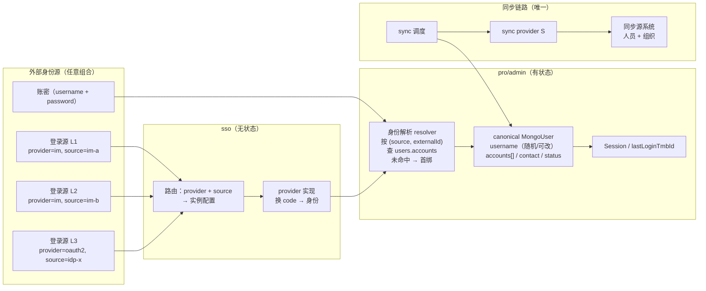

# 单同步源 + 多 SSO 登录收敛 — 通用设计（V2.1）

## 0. 版本记录与评审结论

| 版本 | 日期 | 状态 | 说明 |
| --- | --- | --- | --- |
| V1 | 2026-11-12 | 初版，已提交评审（存档：《单同步源多SSO通用设计.md》） | 身份收敛采用**独立身份表** `user_identity`；账号 `username = externalId` 不可改 |
| V2 | 2026-11-17 | 评审后修订 | 不新增集合，身份绑定内嵌为 `users.accounts`；SSO/注册用户随机 username + 开放修改 |
| **V2.1（本文）** | 2026-11-17 | 当前有效版本 | **username 生成策略延后**：本期沿用现有代码逻辑（同步账号 = 同步下来的 externalId），不做随机生成；把"username 生成"抽象为**可替换策略位**，为后续切换随机生成预留空间。username 修改功能与 `accounts` 模型不变 |

> 注：V1 全文存档于内部评审文档《单同步源多SSO通用设计.md》，未随代码仓库提交；本文中 "V1 §x" 引用仅作评审对照。

### 0.1 评审意见与本文响应

| # | 评审意见 | V2 响应 | 对应章节 |
| --- | --- | --- | --- |
| 1 | 不新增表，身份绑定放进现有 `users` | 删除 `user_identity` 集合，改为 `users.accounts` 内嵌数组 | 5.3 |
| 2 | 先实现一个 `User.accounts` 的属性 | 实施路线把"实现 `User.accounts` 属性与读写 helper"列为第一步，业务代码统一经 helper 读写，不直接操作裸数组 | 5.3.1 / 10 |
| 3 | SSO / 注册用户进来直接分配一个随机的 username | **本期不实施随机生成（V2.1 决策）**：username 沿用现有代码的生成逻辑；把生成抽象为策略位 `USERNAME_GENERATION_POLICY`，随机生成作为预注册的策略之一，后续切换只改配置/一个函数（6.3） | 6.3 |
| 4 | 开放 username 的修改功能 | 新增 username 修改功能：用户自助改 + 管理端改，全局唯一校验、频率限制、审计留痕；改名不影响同步与身份解析（身份锚点在 `accounts` 行） | 6.4 |

### 0.2 V1 → V2 变更总览

| 变更点 | V1 | V2 |
| --- | --- | --- |
| 身份数据承载 | 独立集合 `user_identity`，三个索引（含 `(source, externalId)` 唯一索引） | `users.accounts` 内嵌数组；复合**多键**索引（非唯一）；唯一性改为应用层保证（原子写 + 锁 + 去重审计） |
| `username` 语义 | = `externalId`，稳定不变，是登录键 | 账密登录名 + 展示名，**可修改**；生成逻辑沿用现有代码（同步账号 = externalId），随机生成留作后续策略（V2.1） |
| 同步建号的 username | 必须 = externalId | 默认 = externalId（本期即现有逻辑），但只是命名约定，不再承担身份匹配职责 |
| 首绑 matchKeys | `mobile` / `email` / `username` | 收窄为 `mobile` / `email`（`username` 键删除：生成策略可替换，username 不再是可依赖的长期匹配键；存量场景由 resolver 的 username 回退分支兼容，见 6.1） |
| 存量合并写身份 | 合并脚本写 `user_identity` 行 | 合并脚本把旧身份 `$push` 进 canonical 账号 `accounts` |
| DB 前置条件 | 无特殊要求 | MongoDB ≥ 4.4（复合多键索引允许两个字段均为多键） |
| 明确接受的代价 | DB 级唯一索引兜底并发 | 放弃 DB 级唯一约束，换取零新增集合；用"条件原子写 + Redis 锁 + 定期去重审计"兜底，详见 5.4 |

与 V1 相同、本章不再重复展开的内容：适用场景判定（V1 §1）、设计原则 P1–P6（V1 §1.3）、四个动作的边界（V1 §1.4）、多 provider/source 路由（V1 §6.3）、参数与校验（V1 §6.5）、通用登录源模型三元组（V1 §6.6）、合并方法论主体（V1 §7）。

---

## 1. 核心概念（在 V1 基础上的修订）

**canonical 账号**：同一个自然人在 FastGPT 里的唯一权威账号，即 `users` 集合中的一条 `MongoUser` 文档。定义与判定口径同 V1 文首，唯一修订是**承载物**：

> **V2 承载物**：多身份绑定不再是另一张表，而是 canonical 账号文档上的**一个数组字段 `accounts`**——`User.accounts` 是一个 array，每个元素表示这个用户账号的一个外部身份绑定（`source + externalId`）。

一句话修订：**canonical 是"正本"，旧账号是"副本/别名"；"别名 → 正本"的目录不再独立建表，而是挂在正本文档自己的 `accounts` 数组里。**

目标形态：

```text
同步源 S（单实例）
  └─► canonical MongoUser（唯一账号；资源唯一载体 tmbId）
        └─ accounts: [
             { source: "weaver",    externalId: "77000001" },
             { source: "wecom-hq",  externalId: "zhangsan" },
             { source: "wecom-sub1", externalId: "zs01" }
           ]

登录源 L1 … Ln
  └─► (source, externalId)
      └─► 在 users 中按 accounts 数组命中 → 同一个 userId → 同一份资源
```

---

## 2. 术语（相对 V1 的修订）

| 术语 | 含义 | 与 V1 的差异 |
| --- | --- | --- |
| 同步源 / 登录源 / `provider` / `source` / `externalId` / 首绑 / `matchKey` / `auto_link` / `admin_bind` | 同 V1 §2 | 无变化 |
| canonical user | 同 V1：`users` 集合中的一条 `MongoUser` 文档 | 无变化 |
| **`accounts`（`User.accounts`）** | canonical 账号文档上的内嵌数组，每行（元素）= 一个外部身份绑定：`(source, externalId, status, ...)` | 🆕 替代 V1 的 `UserIdentity` 表 |
| `accounts` 行 | 数组的一个元素，字段集与 V1 `UserIdentity` 行一一对应 | 🆕 |
| `username` | 账号的**账密登录名 + 展示名**，全局唯一、可修改 | 语义降级：不再是身份解析键、不再是同步匹配键 |

---

## 3. 设计目标与约束（修订点）

功能目标与硬约束同 V1 §3，仅以下两条修订：

| 条目 | V1 | V2 |
| --- | --- | --- |
| C3 | `username` 全局唯一；同步源需保证其 externalId 唯一稳定 | `username` 全局唯一（唯一索引不变）**且可修改**；生成逻辑是**可替换策略**（本期 = 现有代码逻辑），任何逻辑不得假设生成方式恒定；externalId 的唯一稳定是来源侧契约（S1），与 username 解耦 |
| C2 补充 | 必须有身份绑定层（独立表） | 必须有身份绑定层（`accounts` 数组）；**不新增集合**是本期硬约束 |

新增约束：

| # | 约束 | 说明 |
| --- | --- | --- |
| C8 | `(source, externalId)` 的全局唯一性由**应用层**保证 | 内嵌数组无法建跨文档唯一索引；写入必须走统一的原子绑定流程（5.4.2），禁止业务代码直接 `$push` |
| C9 | `username` 一旦允许修改，任何逻辑不得依赖"username 恒定" | 同步匹配、身份解析、Session、审计引用均不得以 username 为长期键（存量自动认领的一次性判定除外，见 6.8 S10） |

---

## 4. 通用架构（修订）



职责边界同 V1 §4，唯一变化：pro/admin 的"身份表读写"改为"`accounts` 数组读写（统一 helper）"。

**关键不变量**：登录源可以任意多，但落库账号只有一个；同步源只有一个；**集合也只有一个**（无新增）。

---

## 5. 数据库设计：账号与身份数据模型

### 5.0 变动一览（通用口径）

| 对象 | 标记 | 说明 |
| --- | --- | --- |
| `users.accounts` 数组字段 | 🆕 **新增字段** | 本期唯一的结构性变更；`User.accounts` 是一个 array，每个元素表示该用户的一个外部身份绑定（见 5.3） |
| `users` 复合多键索引 `(accounts.source, accounts.externalId)` | 🆕 新增索引 | 登录解析点查的性能保障（非唯一，见 5.3.3） |
| `users.username` | 🔧 语义变更 | 字段与唯一索引不变；语义改为"账密登录名 + 展示名"：SSO/注册路径**随机分配**，**开放修改**（6.3 / 6.4） |
| `users.contact` 及其普通索引 | ＝ 同 V1 | 首绑匹配值，语义与约束同 V1 5.2 |
| `users` 上的"同步来源"单值字段（`syncSource`，如存在） | ＝ 同 V1 | 语义不变：标记账号由哪个同步源维护；同步按它 + `accounts` 圈定自己的账号 |
| `user_identity` 集合 | ❌ **取消（V1 方案不落地）** | 评审否决新增表；能力并入 `accounts` 数组 |
| `team_members` / `orgs` / 业务资源集合 | ＝ 同 V1 | 无 schema 变更 |

### 5.1 canonical 账号模型（修订）

| 字段 | 语义 | 要求 |
| --- | --- | --- |
| `username` | **账密登录名 + 展示名**；全局唯一、**可修改** | 生成走策略位（6.3），**本期策略 = 现有代码逻辑**：同步账号 = `externalId`，注册/SSO 建号沿用现有规则；随机生成是预注册的后续策略。任何逻辑不得把它当长期键（C9） |
| `accounts` | 外部身份绑定数组，1 账号 : N 行 | 由统一 helper 读写（C8）；结构见 5.3 |
| `contact` | 首绑匹配值（默认手机号） | 同 V1 5.2 |
| `status` | 账号状态（active/forbidden） | 同 V1：以同步源为准，所有入口一致生效 |
| `syncSource`（如存在） | 账号由哪个同步源维护 | 同 V1 5.1：只有同步任务写；无值 = 非同步账号 |

`syncSource` 写入规则、示例数据同 V1 5.1。

**示例数据（`users` / canonical 账号）**：

| `_id` | `username` | `accounts` | `syncSource` | `contact` | `status` | 说明 |
| --- | --- | --- | --- | --- | --- | --- |
| `U_001` | `77000001` | `[{weaver,77000001},{wecom-hq,zhangsan},{wecom-sub1,zs01}]` | `weaver` | `13800000000` | `active` | 同步新建：张三；后两条来自首绑 |
| `U_002` | `77000002` | `[{weaver,77000002},{wecom-hq,lisi}]` | `weaver` | `13900000000` | `active` | 同步新建：李四 |
| `U_003` | 按现有注册规则生成 | `[]` | — | — | `active` | 自助注册：沿用现有生成逻辑（本期不做随机）；如后续 SSO 首绑命中，绑到它 |
| `U_004` | 按现有 SSO 建号逻辑生成 | `[{oauth2-x,e10086}]` | — | — | `active` | SSO 自动建号（允许 create 的部署）：沿用现有建号逻辑 + 建号即写绑定 |

### 5.2 匹配字段约束（修订）

同 V1 5.2，两处修订：

- **matchKeys 收窄为 `mobile` / `email`**：V1 的 `username` 匹配键删除。原因：username 的生成方式已抽象为可替换策略（6.3，本期沿用现有逻辑，未来可能切随机生成），且允许修改，"登录源返回的账号标识与 username 一致"不再是可依赖的机制；存量单 SSO 部署（账号 username = externalId）迁移后改由 `accounts` 行承担该职责（回填见 5.5），回填前的过渡期由 resolver 的 username 回退分支兼容（6.1）。
- 同步建号账号 `username = externalId` 从"必须"降为"默认/建议"：同步识别自己名下账号的依据改为 `syncSource` + `accounts` 行（6.8 S8），username 不再参与匹配。

### 5.3 `accounts` 数组（🆕 新增字段）

#### 5.3.1 `User.accounts` 属性与读写 helper（评审要求先行实现）

在 `MongoUser` schema 上新增：

```ts
type UserAccountBinding = {
  source: string;        // 登录源实例 id，全局唯一（如 im-a / oauth2-x）
  externalId: string;    // 该实例内的稳定用户标识
  status: 'active' | 'disabled';
  matchKey?: 'mobile' | 'email';   // 首绑实际使用的匹配规则（写一次；同步/合并/管理员写入的行可为空）
  matchValue?: string;             // 首绑实际使用的值（写一次；PII，展示脱敏）
  createdAt: Date;
  lastLoginAt?: Date;
};

// MongoUser 上新增字段
accounts: UserAccountBinding[];    // 默认 []；存量账号回填前视为空
```

实现要求：

- `User.accounts` 作为 schema 字段 + 类型化属性先行实现（Phase 1 第一步）；
- 封装统一的读写方法（至少：`findAccount(source, externalId)`、`bindAccount(row)`、`unbindAccount(source, externalId)`、`setAccountStatus(...)`、`touchLastLogin(source, externalId)`）；
- **业务代码禁止直接操作 `accounts` 裸数组**（禁止读-改-写整段数组回写），一切写入走 helper 的原子操作符路径（5.4.2），这是 C8 的落点；
- 行数预期 = 该用户可用的登录入口数（个位数），数组不设软上限但超预期（如 > 20）记告警。

#### 5.3.2 行内字段的存在理由

字段集与 V1 `UserIdentity` 行一一对应（`_id` 不再需要——行由 `userId + source` 定位，无独立主键），逐字段论证同 V1 5.3.2 表格，要点复述：

- `source + externalId`：身份键，登录解析的唯一查找条件；`externalId` 只在 `source` 内唯一；
- `status`：按单个身份关闭入口，不影响账号与其他入口；
- `matchKey / matchValue`：首绑证据，只写一次、不参与认证、PII 脱敏、空值表示该行非首绑产生；
- `createdAt / lastLoginAt`：绑定时间轴与入口活跃度。

#### 5.3.3 索引与查询形态

```ts
// 🆕 复合多键索引（非唯一）——MongoDB ≥ 4.4
index({ 'accounts.source': 1, 'accounts.externalId': 1 })
```

登录解析查询（`status` 不进查询条件，先判歧义再判行状态）：

```ts
const users = await MongoUser.find(
  { accounts: { $elemMatch: { source, externalId } } },
  { projection: { username: 1, contact: 1, status: 1, accounts: 1 } }
).limit(2);
```

- **返回 2 个文档（跨账号重复绑定/串号）→ 不猜，拒绝并告警**（P6），进去重审计处理（5.4.3）；
- 唯一命中且行 `status=active` → 得到 userId；
- 唯一命中但行 `status=disabled` → 拒绝（该身份已禁用）——disabled 不能靠查询过滤，
  否则禁用身份会被误判成「未绑定」而重新走回退/首绑；
- 未命中 → 过渡期回退（6.1）→ 首绑（6.2）。

#### 5.3.4 为什么内嵌数组在 V2 可行（逐条回应 V1 5.3.3）

V1 曾以四条理由否决内嵌数组；V2 在"不新增集合"的评审约束下重新权衡，逐条给出缓解措施，并明确**接受残余风险**：

| V1 的反对理由 | V2 缓解措施 | 残余风险 |
| --- | --- | --- |
| 无法对 `(source, externalId)` 建跨文档唯一索引，首绑并发下可能重复绑定 | ① 绑定写入用**带条件的原子 `$push`**（`accounts: { $not: { $elemMatch: { source, externalId } } }`），文档内幂等；② 跨账号并发首绑加 **Redis SETNX 锁** `lock:bind:{source}:{externalId}`；③ 写前先全库查重（同一身份绑到别人 → 拒绝）；④ **定期去重审计脚本**兜底（用多键索引扫描重复键）（5.4.2 / 5.4.3） | 极端并发下（锁失效/Redis 不可用且未配置降级暂停首绑）仍可能写入重复行；靠去重审计发现并人工合并，登录侧多命中即拒绝，不会静默串号 |
| 登录解析按 `(source, externalId)` 直查需要全表扫描大文档 | 复合多键索引支撑点查；查询带 projection 只取必要字段；users 量级（万级）下索引点查代价与独立表相当 | 无实质残余；前提 MongoDB ≥ 4.4 |
| 绑定/解绑/审计都写整个账号大文档，并发冲突风险高 | 所有写入用原子操作符（`$push` / `$set` positional / `$pull`），禁止读-改-写；并发更新由 Mongo 文档级原子性串行化，`$push` 与同步的 `$set: {contact, status}` 互不覆盖对方字段 | 高频并发写同一账号时操作排队（代价可忽略）；读-改-写式代码是唯一禁忌（C8） |
| per-source 状态、`lastLoginAt` 挤在账号文档里，职责不清 | `accounts` 行字段集与 V1 身份行等价，职责边界不变；账号文档其余字段（contact/status/组织）仍由同步维护 | 职责在同一文档内分层，靠 helper 与写入纪律维持 |

**明确的取舍结论**：V2 用"DB 级唯一约束"换"零新增集合"；残余风险全部收敛到**绑定写入路径**一处（统一 helper + 锁 + 审计），登录读取路径无风险（多命中拒绝，不静默）。若未来部署出现高频跨账号绑定冲突或需要严格唯一性（如超大并发、多活写入），模型可平移回 V1 独立表：行字段一一对应，迁移脚本按 `userId 展开 accounts → 插入 user_identity` 即可，登录/首绑/合并逻辑不变。

### 5.4 绑定写入纪律

#### 5.4.1 数据来源（时机）

同 V1 5.3.4 的四个时机，落点改为 `accounts`：

| # | 时机 | 写入的行 | 触发方 |
| --- | --- | --- | --- |
| 1 | 同步时 / 上线回填 | `(同步源, sync externalId)` `$push` 进该账号 `accounts` | 同步链路；存量账号跑一次幂等回填脚本（5.5） |
| 2 | 存量账号合并时 | 旧登录身份写入 canonical 账号 `accounts`（`status` 默认 `disabled`；客户要求旧入口继续可用则 `active`） | 合并脚本 |
| 3 | 首次登录（惰性首绑） | `(source, externalId)` 按 matchKeys 唯一命中后 `$push` | resolver |
| 4 | 管理员手工绑定 | 任意 `(source, externalId)` | 管理端 |

不变量（同 V1）：幂等 upsert 语义、时机 #1 先于 #2/#3、匹配不到不写行进人工清单、回填产出统计。

#### 5.4.2 绑定写入的统一流程（helper 内部实现，C8 落点）

```text
bindAccount(userId, row):
  0. 参数校验：source 必须是已配置实例 id；externalId 非空
  1. 跨账号并发锁（首绑路径必加；过渡期 username 回退路径不加——目标已被 username 唯一锁定，条件 $push 幂等）
       Redis 租约 bind:{source}:{externalId}，EX 10 秒（短 TTL 自动过期兜底进程崩溃）
       未抢到 → 有限重试（3 次 × 200ms），超限判定失败；Redis 不可用 → 报错，不降级跳锁直写
  2. 全库查重（防"身份已被别人占用"）
       findOne({ accounts: { $elemMatch: { source, externalId } } })
       命中且 userId 相同 → 幂等成功（更新可更新字段后返回）
       命中且 userId 不同 → 拒绝 + 告警（身份已被占用，进人工处理）
  3. 原子写入（文档内幂等）
       updateOne(
         { _id: userId,
           accounts: { $not: { $elemMatch: { source, externalId } } } },
         { $push: { accounts: row } }
       )
       matchedCount = 0 → 重读该文档仲裁（并发竞态），按结果返回成功/重复/冲突
  4. 释放锁；写入结果（含重试次数）记日志
```

#### 5.4.3 去重审计（兜底）

- 定期（每周/每同步周期）用聚合按 `(accounts.source, accounts.externalId)` 分组计数，输出重复清单；
- 重复行的处置：人工确认归属 → 保留一行（active）、其余改 `disabled` 或移除；期间登录对该身份多命中即拒绝，不会静默串号；
- 审计同时输出 `accounts` 行数异常（> 20）的账号清单。

#### 5.4.4 绑定后的语义

同 V1 5.3.5：长期登录键是 `(source, externalId)`，手机号变更不影响登录；同一 `externalId` 在不同 `source` 下可共存；per-identity 禁用只关入口；账号状态以同步源为准。

#### 5.4.5 `externalId` 的稳定性契约

同 V1 5.3.6 全文（四级稳定性打标、变更/复用两种失效模式、不复用承诺 + 定期对账），不因数据落点改变而弱化——**内嵌数组让"停用一行"更容易，但"发现复用"仍只能靠来源侧契约与对账**。

### 5.5 存量回填脚本（🆕 新增行为）

身份绑定从"无"到"进 accounts"的一次性幂等脚本：

1. 圈定范围：`syncSource=S` 的账号（同步账号），以及客户指定要接入的旧 SSO 前缀账号（如 `wecom-<userid>`）；
2. externalId 来源：同步账号取同步输入的 externalId；带前缀的旧账号按 provider 配置剥离前缀还原 `userid`；
3. 写入：走 `bindAccount`（幂等，已存在跳过），产出"写入/跳过/冲突"统计供上线核对；
4. 顺序：回填必须在开放对应登录入口之前完成（同 V1 R4 的顺序纪律）。

### 5.6 关联集合与数据变动总表（通用）

| 集合 | 变动类型 | 最终形态 / 操作 | 触发方 |
| --- | --- | --- | --- |
| `users` | 🆕 `accounts` 字段 + 多键索引；🔧 `username` 语义 | 全部身份绑定内嵌于账号文档；`username` 随机分配、可修改 | 同步 / 回填 / 首绑 / 管理端 / 用户自助 |
| `team_members` | ＝ 原有 | 名称、状态随同步 | 同步 |
| `orgs` | ＝ 原有 | 全量重建，跟随同步源组织结构 | 同步 |
| app / dataset / 协作权限 / 成员关系 | ＝ 原有，仅数据迁移 | 存量合并时 `tmbId` 换绑 | 合并脚本 |
| 聊天记录 / 审计日志 | ＝ 原有，不动 | 按 userId/tmbId 归属保留 | — |
| Session（Redis） | ＝ 原有，清理 | 旧账号 `delUserAllSession` 下线；新增首绑锁 key（短 TTL，自动过期） | 合并脚本 / 首绑 |

---

## 6. 核心逻辑设计

### 6.1 登录身份解析（pro 侧 resolver，修订）

```text
1. sso 返回 source + externalId + profile
2. 查 MongoUser.find({ accounts: { $elemMatch: { source, externalId } } }, projection).limit(2)
   （status **不进查询条件**：disabled 必须显式拒绝，若进过滤会把禁用身份误判成
    「未绑定」而重新走回退/首绑；limit(2) 用于发现跨账号重复绑定）
   - 2 个文档命中     → 拒绝 + 告警（去重审计处理，P6），先判歧义再判状态
   - 唯一命中 active  → 得到 userId
   - 唯一命中 disabled → 拒绝（该身份已禁用）
   - 未命中           → 回退判定（过渡期兼容）→ 首绑策略（6.2）
2.5 回退判定（过渡期兼容，回填完成前生效）
   - **范围**：仅限 sso 显式声明了存量 username（legacyUsername）的来源——即旧单实例
     部署中 username = externalId（或旧前缀形态）的那批存量账号。候选只有
     legacyUsername 本身，**不做 externalId 形态的泛化推导**：同类型多实例的
     externalId 会重名（A、B 两家公司都有 userid 001），username 全局唯一不构成
     「同人」证据；未声明 legacyUsername 的新来源一律遵守首绑／人工绑定
   - 命中 → 走既有 usernameLoginCore 语义，并补写 (source, externalId) 的 accounts 行
        补写不加跨账号锁（useLock=false）：目标账号已被 username 唯一确定，
        条件原子 $push 自身幂等；并发重复登录时后到者走 matchedCount=0 重读仲裁
   - 未命中 → 首绑策略
   ※ 该分支刻意放在首绑策略之前（仅对进入本分支的旧来源）：存量账号必须收敛到
     username 锚点，否则会被 matchKeys 误匹配成别的账号或被 admin_bind 拒绝
   ※ **退出条件**：回填（5.5）完成后 accounts 点查先命中，本分支自然失效；
     username 生成策略切换（6.3 随机化）时整体移除
3. 首绑策略
   - auto_link：按该来源的 matchKeys（mobile/email）依次查 MongoUser
        唯一命中 → bindAccount 写行（记录 matchKey/matchValue）
        0 / 多命中 → 尝试下一个键；全部失败 → 拒绝，进入管理员绑定清单
   - admin_bind：直接拒绝，等待管理员绑定
   - create：创建新账号（默认关闭；开启的部署见 6.3，建号按生成策略分配 username 并写绑定行）
4. 得到 userId → 命中行 touchLastLogin → 账号/团队/Session 的既有登录逻辑
```

对同步源无感知同 V1：resolver 只认 `(source, externalId)`。username 回退分支是**过渡期兼容**，不是长期机制：回填（5.5）完成后该分支自然失效（accounts 先命中），后续切换 username 生成策略（如随机化）不需要改动 resolver。

### 6.2 首绑匹配策略（可配置，修订）

配置形态同 V1 6.2（`SSO_FIRST_BIND_MATCH_KEYS` + 按来源覆盖），两处修订：

- matchKeys 取值收窄为 `mobile` / `email`（`username` 键删除，见 5.2）；
- 首绑命中后写 `accounts` 行必须走 `bindAccount`（含锁与查重），不得直接 `$push`。

matchKey 映射表（修订后）：

| matchKey | 身份 profile 取值 | 匹配的账号字段 | 前提（同步侧保证） |
| --- | --- | --- | --- |
| `mobile`（默认） | profile.mobile | `contact` | `contact` 必须存手机号 |
| `email` | profile.email | `contact` | 同步把 contact 统一写成邮箱 |

"绑定后换手机号不影响登录"等规则同 V1。

#### 6.2.1 手工账号的首绑（修订）

同 V1 6.2.1 的框架，修订：`username` 匹配键已删除——手工账号若要"首登即绑"，必须具备可匹配的 `contact`（手机号/邮箱）；只有 username 而无 contact 的手工账号，走管理员预绑定或回填。是否需改造当前代码的结论同 V1（现有 SSO 登录只按 `username` 命中 `usernameLoginCore`，需新增基于 `accounts`/`contact` 的解析与首绑）。

#### 6.2.2 手工账号先建、后开同步（修订）

认领规则与 V1 6.2.2 一致（目标团队内同名、`syncSource` 为空 → 自动认领），两处修订：

- **认领成功后**，同步在更新分支同时写入 `syncSource=S` 和 `(S, externalId)` 的 `accounts` 行——认领账号的身份锚点从 username 切换为 `accounts` 行，此后该账号即使改名也始终被同步识别；
- **认领前**的"同名"判定仍按 `username == 同步输入 externalId`（一次性判定，不受 C9 影响：随机 username 不会撞上，用户把 username 改成他人 externalId 属数据问题，按 V1 冲突规则处理）。

### 6.3 username 生成策略（🆕 策略位；本期沿用现有逻辑，随机生成为预留策略）

#### 6.3.1 职责重定义

`username` 在 V2 只承担两件事：**账密登录名**（有密码时）与**展示/人工定位名**。它不再是身份解析键（解析走 `accounts`）、不再是同步匹配键（匹配走 `syncSource` + `accounts`，存量认领的一次性判定除外）。

#### 6.3.2 生成抽象为可替换策略位

username 的生成不看死在某一种规则上，统一收敛为一个策略函数：

```ts
// 策略位：所有"系统侧给账号起 username"的路径（注册、SSO 建号、管理端快速建号、同步建号）
// 一律调用该策略，不允许散落各处的硬编码命名逻辑
generateUsername(ctx: { path: 'register' | 'sso-create' | 'admin-create' | 'sync';
                        externalId?: string; profile?: Record<string, string> }): string
```

- 调用方只拿结果，不感知策略内容；写入仍受 `username` 唯一索引约束（冲突由策略内部处理或重试）；
- 策略实现可配置（env / 配置项 `USERNAME_GENERATION_POLICY`，默认 `legacy`）；
- **本期（V2.1）策略 = `legacy`：完全沿用现有代码逻辑**——
  - 同步账号：username = 同步下来的 externalId（现状即如此，零改动）；
  - 自助注册、SSO 建号、管理端建号：沿用各路径现有生成规则，零改动；
- **预留策略 `random`**（评审意见 #3 的完整形态，本期不启用）：`'u_' + 12 位 [A-Za-z0-9]`，约 62¹² ≈ 3×10²¹，唯一索引冲突重试上限 5 次；禁止用 externalId、手机号、邮箱等可推测信息生成；
- 切换策略 = 改一处配置/函数，**不需要动** resolver、同步、合并逻辑——这是把生成收敛成策略位的全部目的（评审要求的"预留空间"）。

各建号路径在本期策略下的表现：

| 建号路径 | 本期（`legacy`） | 后续切 `random` 后 |
| --- | --- | --- |
| 同步源新建 | username = externalId（现有逻辑，零改动） | 可按路径差异化：同步账号建议保持 = externalId（对账友好），其余路径随机 |
| 邮箱/手机号自助注册 | 沿用现有注册生成规则 | 随机分配 |
| SSO 自动建号（`create` 开启的部署） | 沿用现有 SSO 建号逻辑，建号同事务写 `(source, externalId)` 绑定行 | 随机分配 + 写绑定行 |
| 管理端手工新增 | 沿用现有逻辑 | 默认随机，管理端可指定 |

#### 6.3.3 策略切换的前置自检（为后续 `random` 预留的检查单）

切换生成策略前只需确认三件事，均与本文其他章节无耦合：

1. C9 已满足：没有任何逻辑依赖"username 恒定"（同步匹配走 `accounts`、解析走 `accounts`、Session 绑 userId）；
2. 账密场景：若随机名影响账密可用性，先确认对应账号的 username 修改功能可用（6.4）；
3. 存量自动认领：认领的一次性判定按"账号当前 username == 同步输入 externalId"，与新生成策略无关（新账号不参与认领）。

### 6.4 username 修改功能（🆕 新增）

#### 6.4.1 入口与开关

- 用户自助修改：个人设置入口，开关 `ENABLE_USERNAME_MODIFY`（默认开）；
- 管理端修改：管理员可改任意账号 username（不受自助开关影响）。

#### 6.4.2 修改规则

| # | 规则 |
| --- | --- |
| 1 | 全局唯一：沿用 `username` 唯一索引，占用即拒绝 |
| 2 | 格式：`[A-Za-z0-9_-]`，长度 3–32 |
| 3 | 保留前缀：`merged-` 开头禁止占用（存量合并保留名） |
| 4 | 频率限制：自助修改默认 7 天一次（可配），管理端不受限 |
| 5 | 审计：记录操作者、旧值、新值、时间；旧值立即释放，不保留 alias/跳转 |
| 6 | Session 不失效：Session 绑 userId/token，改 username 不要求重新登录（实现需确认现有 Session 未缓存 username，如有则该处改为 userId） |
| 7 | 旧登录名立即失效：账密登录用新 username；外部引用（报表、脚本、API 按 username 查询）由部署方自行通知，文档明示此风险 |

#### 6.4.3 与同步/身份解析的关系

- 改名**不影响**身份解析（走 `accounts`）与同步匹配（走 `syncSource` + `accounts`；自动认领只在"无来源存量账号"上一次性发生，已认领账号改名后仍被 `accounts` 行锚定识别）；
- 同步更新分支**不覆盖**用户改过的 username（认领账号只刷新组织/contact/成员名）；
- 改名后与他人的同步输入撞名 → 走既有冲突规则（S10），不隐式接管。

### 6.5 账密登录共存（修订）

同 V1 6.4，修订点：

- 账密用 canonical `username` + 密码认证；username 生成策略决定账密名的可读性——本期 `legacy` 策略下沿用现状，无需额外动作；后续切 `random` 策略时，启用账密前由用户/管理员把 username 改成可读名（6.4 已开放修改）；
- 账密不读写 `accounts`（同 V1：账密无外部 source，账号本身即身份；不写"密码身份行"）；
- 同步新建账号无密码、认领账号不动密码等规则同 V1；
- `disablePasswordForSsoUsers` 按 username 前缀识别 SSO 用户的问题在 `legacy` 策略下**依然存在**（现状不变）；切 `random` 策略后无前缀可判，该开关会彻底失效——无论本期还是后续，判定依据都应改为 `syncSource`/`accounts`（同 V1 6.4 尾注的独立改造项）。

### 6.6 路由、参数、登录源模型

同 V1：多 provider/source 路由（§6.3）、参数与优先级（§6.5）、通用登录源模型三元组与配置形态（§6.6）全部不变。`UserIdentity.source` 的引用统一替换为"`accounts` 行的 `source`"。

### 6.7 同步源侧配合要求（修订）

V1 S1–S10 逐条复核，修订如下：

| # | 要求 | V2 修订 |
| --- | --- | --- |
| S1 | `externalId` 唯一、稳定、不复用 | 不变（内嵌数组不弱化该契约） |
| S2 | 账号 username 与 externalId 一致 | **降级为建议**：同步新建账号默认 username = externalId（便于对账），但 username 可被用户修改，同步不得依赖、不得覆盖 |
| S3 | `contact` 与 matchKey 严格一致 | 不变 |
| S4 | 账号状态以同步源为权威 | 不变 |
| S5 | 同步时写入身份行，幂等 upsert | 落点改为 `$push` 进 `accounts`（走 `bindAccount` 幂等语义）；整个批次包 `sync:{source}` 租约（短 TTL + 自动续租），重复点击/并发同步幂等跳过不报错；**批内查重**：两个账号去前缀后撞到同一 externalId 属脏数据，并入冲突让整批失败 |
| S6 | 同步源/登录源互不产生账号 | 不变；SSO 自动建号（随机 username）只在显式允许 create 的部署存在 |
| S7 | 过滤后为空视为异常 | 不变 |
| S8 | 按 `syncSource` 圈定账号，不按前缀 | **强化**：圈定 + 匹配依据 = `syncSource` + `accounts` 中 `(S, externalId)` 行；username 彻底退出匹配（存量无来源同步保留前缀兼容，同 V1 6.8.1） |
| S9 | 清单 username 非空且唯一、同人多记录合并 | 措辞改为"清单 externalId 非空且唯一" |
| S10 | 同名账号按来源与团队判定；团队内同名无来源 → 复用认领；其他来源/团队外 → 整次失败 | 认领判定保留 username 一次性比对；**认领成功即写 `accounts` 行**，锚点切换（6.2.2）；`syncConflictPolicy`（fail/skip）同 V1 |

`syncConflictPolicy`、前缀兼容边界（6.8.1）、切换前置检查均同 V1，仅把"身份行"表述替换为"`accounts` 行"。

---

## 7. 存量平行账号合并（修订点）

方法论主体（识别、映射、迁移内容、冲突规则、执行纪律、完成判据）同 V1 第 7 章，落点修订：

| V1 动作 | V2 动作 |
| --- | --- |
| 合并脚本写 `user_identity` 行 `(旧source, 旧externalId) → canonical userId` | 把旧登录身份 `$push` 进 canonical 账号 `accounts`：`status` 默认 `disabled`（旧入口关闭）；客户要求旧入口继续可用则 `active` |
| 旧账号改名 `merged-<旧标识>` 并禁用 | 不变（`merged-` 为保留前缀，进入 username 修改的禁用名单，6.4.2 #3） |
| 7.7 完成判据 #4"新登录源登录命中 canonical" | 判据不变，实现改为 `accounts` 命中 |

---

## 8. 异常与边界（修订）

同 V1 §8，新增/修订：

| 场景 | 处理 |
| --- | --- |
| 同一 `(source, externalId)` 出现在多个账号的 `accounts`（重复行） | 登录多命中 → 拒绝 + 告警；绑定新行前查重 → 拒绝；由去重审计（5.4.3）人工归属 |
| 首绑并发（同账号） | 条件 `$push` 幂等；matchedCount=0 重读仲裁 |
| 首绑并发（跨账号，锁失效兜底） | 写前查重拒绝；残余重复行靠去重审计，不会静默串号 |
| 用户把 username 改成他人 externalId | 仅影响"存量自动认领"的一次性同名判定 → 按冲突规则处理；不影响身份解析与已认领账号 |
| username 生成撞唯一索引 | `legacy` 策略沿用现有行为；`random` 策略重试上限 5 次，超限报错（概率 3×10⁻²¹ 级，重试仅为兜底） |
| 用户改 username 后账密登录失败 | 属预期（旧名已释放）；提示用新 username；管理员可代改 |
| Redis 不可用导致首绑锁失败 | 可配置降级：暂停首绑（推荐）或跳锁直写（需接受残余重复风险并触发审计），不静默 |

---

## 9. 测试与验收（修订）

同 V1 §9 框架，修订/新增用例：

1. resolver：`accounts` 命中 active → 返回 userId；命中 disabled → 拒绝；**多文档命中 → 拒绝 + 告警**；
2. `bindAccount` 幂等：同账号重复绑定不产生重复行；条件 `$push` 并发竞态重读仲裁正确；
3. 跨账号绑定冲突：身份已被他人占用 → 拒绝 + 告警，不写入；
4. 去重审计：构造重复行，脚本产出正确清单；
5. username 生成策略位：`legacy` 策略输出与现有各路径逻辑完全一致（回归确认零变化）；`random` 预注册策略单测验证格式与冲突重试（本期不启用）；
6. username 修改：唯一性/格式/保留前缀/频率限制/审计各规则生效；改名后身份解析与同步匹配不受影响；Session 不失效；
7. 同步认领：认领成功后 `accounts` 行写入，账号改名后下一次同步仍正确识别（锚点切换）；
8. 回填脚本幂等、统计正确；多键索引点查走执行计划（非全表扫描）；
9. MongoDB 版本前置检查：< 4.4 时启动告警/拒绝创建多键索引。

---

## 10. 实施路线（修订）

| 期 | 内容 |
| --- | --- |
| Phase 1 第一步 | **实现 `User.accounts` 属性与读写 helper**（评审明确要求先行）；schema + 类型 + 索引 + 绑定流程（5.4.2） |
| Phase 1 其余 | resolver（查 `accounts` → 过渡期 username 回退 → 首绑 → 写行）+ 回填脚本 + 合并脚本改造；多 provider 路由；username 生成策略位（本期 `legacy`，零改动）+ username 修改功能（6.3 / 6.4） |
| Phase 2 | 管理端身份工具（查看/解绑/手工绑定，操作 `accounts`）、per-source 禁用 UI、去重审计报表；各 provider 多实例配置推广 |
| Phase 3 | 新增同步源接入（复用同一 `accounts` 模型）；新增 provider 类型接入 |
| 后续（非本期） | 同 V1：不同名自动合并、跨团队迁移、其他来源接管；另加：若部署需要严格 DB 级唯一性，按 5.3.4 平移回独立表（预留迁移脚本） |

---

## 11. 风险清单（修订）

V1 R1–R13 全部继承，修订/新增：

| # | 风险 | 触发条件 | 影响 | 等级 | 应对 |
| --- | --- | --- | --- | --- | --- |
| R14 | 内嵌数组无跨文档唯一索引，绑定重复/串号 | 并发首绑且锁失效、Redis 降级直写 | 同一身份两行 / 多命中拒绝导致登录不可用 | 中 | 统一 `bindAccount`（查重 + 条件 `$push` + 锁）+ 去重审计兜底；多命中即拒绝不静默（P6） |
| R15 | 业务代码绕过 helper 直接改 `accounts` | 读-改-写回写整段数组 | 丢失并发更新、破坏幂等 | 中 | C8 写入纪律 + code review 检查；helper 是唯一写入口 |
| R16 | username 修改破坏外部引用 | 报表/脚本/API 按 username 查询 | 外部集成失效 | 中 | 文档明示 + 审计留痕 + 频率限制；关键集成改按 userId |
| R17 | 切 `random` 策略后 username 可读性差 | 账密用户面对 `u_x8K3...` 无法记忆 | 体验问题（**本期 `legacy` 下不触发**） | 低 | 开放修改功能（6.4）即为解法；切换策略前确认 6.3.3 自检项 |
| R18 | 旧实现按 username 前缀识别 SSO 用户 | `disablePasswordForSsoUsers` 依赖前缀；`legacy` 策略下现状延续，切 `random` 后无前缀可判 | 策略失效（可能误放行/误拦截） | 中 | 判定依据改 `syncSource`/`accounts`（6.5，独立改造项） |
| R19 | 多键索引要求 MongoDB ≥ 4.4 | 低版本部署 | 索引创建失败 / 查询退化为全表扫描 | 中 | 启动时版本检查并告警（9#9） |
| R20 | 同一大文档并发写放大 | 登录写 `lastLoginAt` 与同步刷数同时高频发生 | 操作排队延迟（无正确性问题） | 低 | positional 更新代价小；同步低频、登录点更，可忽略 |

---

## 附录 A：与 V1 的模型对照（一句话）

**V1：账号 + 独立身份表（`user_identity`：`(source, externalId) → userId`，唯一索引兜底），username = externalId 不可改。**
**V2.1：账号自己携带身份（`User.accounts` 数组，每行一个 `(source, externalId)` 绑定，应用层保证唯一），username 生成收敛为可替换策略位（本期 = 现有逻辑，随机生成为预留策略）、可修改，只做账密登录名与展示名。**

## 附录 B：一句话结论

**一个同步源产生唯一的 canonical 账号；每个登录身份作为一行 `(source, externalId)` 挂在该账号的 `accounts` 数组里；本期 username 照旧用同步下来的信息，生成方式随时可换，且想改随时能改；手机号等属性只在首次认领时帮一次忙。**
