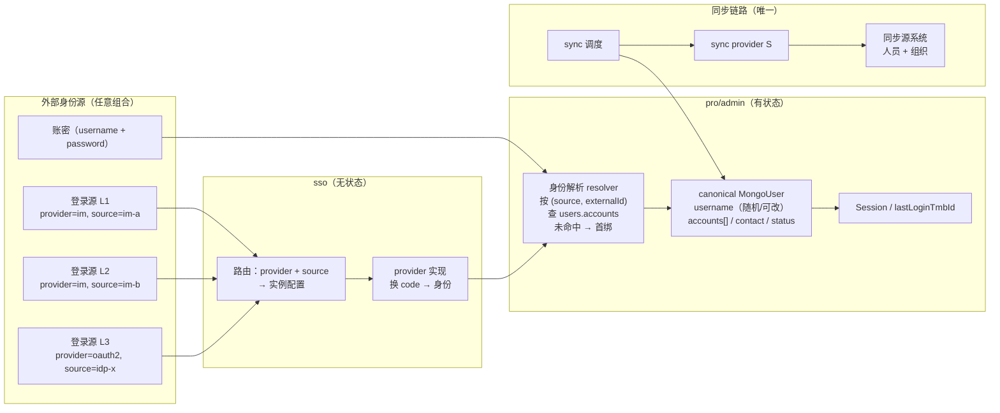

# 单同步源 + 多 SSO 登录收敛 — 通用设计（V2.1）

## 0. 版本记录与评审结论

| 版本 | 日期 | 状态 | 说明 |
| --- | --- | --- | --- |
| V1 | 2026-11-12 | 初版，已提交评审（存档：《单同步源多SSO通用设计.md》） | 身份收敛采用**独立身份表** `user_identity`；账号 `username = externalId` 不可改 |
| V2 | 2026-11-17 | 评审后修订 | 不新增集合，身份绑定内嵌为 `users.accounts`；SSO/注册用户随机 username + 开放修改 |
| **V2.1（本文）** | 2026-11-17 | 当前有效版本 | **username 生成策略延后**：本期沿用现有代码逻辑（同步账号 = 同步下来的 externalId），不做随机生成；把"username 生成"抽象为**可替换策略位**，为后续切换随机生成预留空间。username 修改功能与 `accounts` 模型不变 |

> 注：V1 中仍属实施与验收依据的公共契约已全部并入本版**附录 C**；V1 全文存档于内部评审文档《单同步源多SSO通用设计.md》，仅作历史对照，正文不再有依赖 V1 才能执行的规则。

### 0.1 评审意见与本文响应

| # | 评审意见 | V2 响应 | 对应章节 |
| --- | --- | --- | --- |
| 1 | 不新增表，身份绑定放进现有 `users` | 删除 `user_identity` 集合，改为 `users.accounts` 内嵌数组 | 5.3 |
| 2 | 先实现一个 `User.accounts` 的属性 | 实施路线把"实现 `User.accounts` 属性与读写 helper"列为第一步，业务代码统一经 helper 读写，不直接操作裸数组 | 5.3.1 / 10 |
| 3 | SSO / 注册用户进来直接分配一个随机的 username | **本期不实施随机生成（V2.1 决策）**：username 沿用现有代码的生成逻辑；把生成抽象为策略位 `USERNAME_GENERATION_POLICY`，随机生成作为预注册的策略之一，后续切换只改配置/一个函数（6.3） | 6.3 |
| 4 | 开放 username 的修改功能 | 新增 username 修改功能：用户自助改 + 管理端改，全局唯一校验、频率限制、审计留痕；改名不影响同步与身份解析（身份锚点在 `accounts` 行） | 6.4 |

### 0.2 V1 → V2 变更总览

| 变更点 | V1 | V2 |
| --- | --- | --- |
| 身份数据承载 | 独立集合 `user_identity`，三个索引（含 `(source, externalId)` 唯一索引） | `users.accounts` 内嵌数组；复合**多键**索引（非唯一）；唯一性改为应用层保证（原子写 + 锁 + 去重审计） |
| `username` 语义 | = `externalId`，稳定不变，是登录键 | 账密登录名 + 展示名，**可修改**；生成逻辑沿用现有代码（同步账号 = externalId），随机生成留作后续策略（V2.1） |
| 同步建号的 username | 必须 = externalId | 默认 = externalId（本期即现有逻辑），但只是命名约定，不再承担身份匹配职责 |
| 首绑 matchKeys | `mobile` / `email` / `username` | 收窄为 `mobile` / `email`（`username` 键删除：生成策略可替换，username 不再是可依赖的长期匹配键；存量场景由 resolver 的 username 回退分支兼容，见 6.1） |
| 存量合并写身份 | 合并脚本写 `user_identity` 行 | 合并脚本把旧身份 `$push` 进 canonical 账号 `accounts` |
| DB 前置条件 | 无特殊要求 | MongoDB ≥ 4.4（复合多键索引允许两个字段均为多键） |
| 明确接受的代价 | DB 级唯一索引兜底并发 | 放弃 DB 级唯一约束，换取零新增集合；用"条件原子写 + Redis 锁 + 定期去重审计"兜底，详见 5.4 |

与 V1 相同、本章不再重复展开的内容已并入**附录 C**（有效公共契约）：适用场景判定（C.1）、设计原则 P1–P6（C.2）、四个动作的边界（C.3）、多 provider/source 路由（C.4）、参数与校验（C.5）、通用登录源模型三元组（C.6）、合并方法论主体（C.10）。

---

## 1. 核心概念（在 V1 基础上的修订）

**canonical 账号**：同一个自然人在 FastGPT 里的唯一权威账号，即 `users` 集合中的一条 `MongoUser` 文档。定义与判定口径见 C.1 / C.6，唯一修订是**承载物**：

> **V2 承载物**：多身份绑定不再是另一张表，而是 canonical 账号文档上的**一个数组字段 `accounts`**——`User.accounts` 是一个 array，每个元素表示这个用户账号的一个外部身份绑定（`source + externalId`）。

一句话修订：**canonical 是"正本"，旧账号是"副本/别名"；"别名 → 正本"的目录不再独立建表，而是挂在正本文档自己的 `accounts` 数组里。**

目标形态：

```text
同步源 S（单实例）
  └─► canonical MongoUser（唯一账号；资源唯一载体 tmbId）
        └─ accounts: [
             { source: "weaver",    externalId: "77000001" },
             { source: "wecom-hq",  externalId: "zhangsan" },
             { source: "wecom-sub1", externalId: "zs01" }
           ]

登录源 L1 … Ln
  └─► (source, externalId)
      └─► 在 users 中按 accounts 数组命中 → 同一个 userId → 同一份资源
```

---

## 2. 术语（相对 V1 的修订）

| 术语 | 含义 | 与 V1 的差异 |
| --- | --- | --- |
| 同步源 / 登录源 / `provider` / `source` / `externalId` / 首绑 / `matchKey` / `auto_link` / `admin_bind` | 见 C.13 | 无变化 |
| canonical user | `users` 集合中的一条 `MongoUser` 文档（见 C.1） | 无变化 |
| **`accounts`（`User.accounts`）** | canonical 账号文档上的内嵌数组，每行（元素）= 一个外部身份绑定：`(source, externalId, status, ...)` | 🆕 替代 V1 的 `UserIdentity` 表 |
| `accounts` 行 | 数组的一个元素，字段集与 V1 `UserIdentity` 行一一对应 | 🆕 |
| `username` | 账号的**账密登录名 + 展示名**，全局唯一、可修改 | 语义降级：不再是身份解析键、不再是同步匹配键 |

---

## 3. 设计目标与约束（修订点）

功能目标与硬约束见 C.14，仅以下两条修订：

| 条目 | V1 | V2 |
| --- | --- | --- |
| C3 | `username` 全局唯一；同步源需保证其 externalId 唯一稳定 | `username` 全局唯一（唯一索引不变）**且可修改**；生成逻辑是**可替换策略**（本期 = 现有代码逻辑），任何逻辑不得假设生成方式恒定；externalId 的唯一稳定是来源侧契约（S1），与 username 解耦 |
| C2 补充 | 必须有身份绑定层（独立表） | 必须有身份绑定层（`accounts` 数组）；**不新增集合**是本期硬约束 |

新增约束：

| # | 约束 | 说明 |
| --- | --- | --- |
| C8 | `(source, externalId)` 的全局唯一性由**应用层**保证 | 内嵌数组形态下 DB 级唯一约束不完整——同一数组两字段的复合唯一多键索引虽可创建（见 5.3.4），但同文档内重复元素与字段缺失场景仍需 partial index / schema validation 配套，且仍需应用层条件写入兜底；权衡后按非唯一索引交付，唯一性收敛到应用层：写入必须走统一的原子绑定流程（5.4.2），禁止业务代码直接 `$push` |
| C9 | `username` 一旦允许修改，任何逻辑不得依赖"username 恒定" | 同步匹配、身份解析、Session、审计引用均不得以 username 为长期键（存量自动认领的一次性判定除外，见 6.8 S10） |

---

## 4. 通用架构（修订）



职责边界见 C.15，唯一变化：pro/admin 的"身份表读写"改为"`accounts` 数组读写（统一 helper）"。

**关键不变量**：登录源可以任意多，但落库账号只有一个；同步源只有一个；**集合也只有一个**（无新增）。

---

## 5. 数据库设计：账号与身份数据模型

### 5.0 变动一览（通用口径）

| 对象 | 标记 | 说明 |
| --- | --- | --- |
| `users.accounts` 数组字段 | 🆕 **新增字段** | 本期唯一的结构性变更；`User.accounts` 是一个 array，每个元素表示该用户的一个外部身份绑定（见 5.3） |
| `users` 复合多键索引 `(accounts.source, accounts.externalId)` | 🆕 新增索引 | 登录解析点查的性能保障（非唯一，见 5.3.3） |
| `users.username` | 🔧 语义变更 | 字段与唯一索引不变；语义改为"账密登录名 + 展示名"：生成收敛为策略位（6.3），**本期 `legacy` 沿用现有逻辑**（`random` 随机生成是预留策略，本期不启用），**开放修改**（6.4） |
| `users.contact` 及其普通索引 | 无变化 | 首绑匹配值，语义与约束见 C.5 |
| `users` 上的"同步来源"单值字段（`syncSource`，如存在） | 无变化 | 语义不变：标记账号由哪个同步源维护；同步按它 + `accounts` 圈定自己的账号 |
| `user_identity` 集合 | ❌ **取消（V1 方案不落地）** | 评审否决新增表；能力并入 `accounts` 数组 |

### 5.1 canonical 账号模型（修订）

| 字段 | 语义 | 要求 |
| --- | --- | --- |
| `username` | **账密登录名 + 展示名**；全局唯一、**可修改** | 生成走策略位（6.3），**本期策略 = 现有代码逻辑**：同步账号 = `externalId`，注册/SSO 建号沿用现有规则；随机生成是预注册的后续策略。任何逻辑不得把它当长期键（C9） |
| `accounts` | 外部身份绑定数组，1 账号 : N 行 | 由统一 helper 读写（C8）；结构见 5.3 |
| `contact` | 首绑匹配值（默认手机号） | 见 6.2 |
| `status` | 账号状态（active/forbidden） | 以同步源为准，所有入口一致生效 |
| `syncSource`（如存在） | 账号由哪个同步源维护 | 只有同步任务写；无值 = 非同步账号 |
| `team_members` / `orgs` / 业务资源集合 | ＝ 无 schema 变更 | 组织与成员关系仍由同步维护 |

`syncSource` 写入规则见 C.3 / 6.2.2（同步建号与自动认领时由同步写入）。

**示例数据（`users` / canonical 账号）**：

| `_id` | `username` | `accounts` | `syncSource` | `contact` | `status` | 说明 |
| --- | --- | --- | --- | --- | --- | --- |
| `U_001` | `77000001` | `[{weaver,77000001},{wecom-hq,zhangsan},{wecom-sub1,zs01}]` | `weaver` | `13800000000` | `active` | 同步新建：张三；后两条来自首绑 |
| `U_002` | `77000002` | `[{weaver,77000002},{wecom-hq,lisi}]` | `weaver` | `13900000000` | `active` | 同步新建：李四 |
| `U_003` | 按现有注册规则生成 | —（未落字段，读侧视为空） | — | — | `active` | 自助注册：沿用现有生成逻辑（本期不做随机）；如后续 SSO 首绑命中，绑到它 |
| `U_004` | 按现有 SSO 建号逻辑生成 | `[{oauth2-x,e10086}]` | — | — | `active` | SSO 自动建号（允许 create 的部署）：沿用现有建号逻辑 + 建号即写绑定 |

### 5.2 匹配字段约束（修订）

匹配字段约束如下，相对 V1 有两处修订：

- **matchKeys 收窄为 `mobile` / `email`**：V1 的 `username` 匹配键删除。原因：username 的生成方式已抽象为可替换策略（6.3，本期沿用现有逻辑，未来可能切随机生成），且允许修改，"登录源返回的账号标识与 username 一致"不再是可依赖的机制；存量单 SSO 部署（账号 username = externalId）迁移后改由 `accounts` 行承担该职责（回填见 5.5），回填前的过渡期由 resolver 的 username 回退分支兼容（6.1）。
- 同步建号账号 `username = externalId` 从"必须"降为"默认/建议"：同步识别自己名下账号的依据改为 `syncSource` + `accounts` 行（6.8 S8），username 不再参与匹配。

### 5.3 `accounts` 数组（🆕 新增字段）

#### 5.3.1 `User.accounts` 属性与读写 helper（评审要求先行实现）

在 `MongoUser` schema 上新增：

```ts
type UserAccountBinding = {
  source: string;        // 登录源实例 id，全局唯一（如 im-a / oauth2-x）
  externalId: string;    // 该实例内的稳定用户标识
  status: 'active' | 'disabled';
  matchKey?: 'mobile' | 'email';   // 首绑实际使用的匹配规则（写一次；同步/合并/管理员写入的行可为空）
  matchValue?: string;             // 首绑实际使用的值（写一次；PII，展示脱敏）
  createdAt: Date;
  lastLoginAt?: Date;
};

// MongoUser 上新增字段
accounts?: UserAccountBinding[];   // schema 默认 undefined（不落字段）；存量账号回填前视为空，读侧按空数组语义处理
```

实现要求：

- `User.accounts` 作为 schema 字段 + 类型化属性先行实现（Phase 1 第一步）；
- 封装统一的读写方法（至少：`findAccount(source, externalId)`、`bindAccount(row)`、`unbindAccount(source, externalId)`、`setAccountStatus(...)`、`touchLastLogin(source, externalId)`）；
- **业务代码禁止直接操作 `accounts` 裸数组**（禁止读-改-写整段数组回写），一切写入走 helper 的原子操作符路径（5.4.2），这是 C8 的落点；
- 行数预期 = 该用户可用的登录入口数（个位数），数组不设软上限但超预期（如 > 20）记告警。

#### 5.3.2 行内字段的存在理由

字段集与 V1 `UserIdentity` 行一一对应（`_id` 不再需要——行由 `userId + source` 定位，无独立主键），字段论证要点：

- `source + externalId`：身份键，登录解析的唯一查找条件；`externalId` 只在 `source` 内唯一；
- `status`：按单个身份关闭入口，不影响账号与其他入口；
- `matchKey / matchValue`：首绑证据，只写一次、不参与认证、PII 脱敏、空值表示该行非首绑产生；
- `createdAt / lastLoginAt`：绑定时间轴与入口活跃度。

#### 5.3.3 索引与查询形态

```ts
// 🆕 复合多键索引（非唯一）——MongoDB ≥ 4.4
index({ 'accounts.source': 1, 'accounts.externalId': 1 })
```

登录解析查询（Mongoose `find` 的第二参数即字段投影；`status` 不进查询条件，先判歧义再判行状态）：

```ts
const users = await MongoUser.find(
  { accounts: { $elemMatch: { source, externalId } } },
  'username contact status accounts'
).limit(2);
```

- **返回 2 个文档（跨账号重复绑定/串号）→ 不猜，拒绝并告警**（P6），进去重审计处理（5.4.3）；
- 唯一命中且行 `status=active` → 得到 userId；
- 唯一命中但行 `status=disabled` → 拒绝（该身份已禁用）——disabled 不能靠查询过滤，
  否则禁用身份会被误判成「未绑定」而重新走回退/首绑；
- 未命中 → 过渡期回退（6.1）→ 首绑（6.2）。

#### 5.3.4 为什么内嵌数组在 V2 可行（逐条回应 V1 5.3.3）

V1 曾以四条理由否决内嵌数组；V2 在"不新增集合"的评审约束下重新权衡，逐条给出缓解措施，并明确**接受残余风险**：

| V1 的反对理由 | V2 缓解措施 | 残余风险 |
| --- | --- | --- |
| DB 级唯一约束在内嵌数组形态下不完整，首绑并发下可能重复绑定：同一数组两字段的复合唯一多键索引虽可创建，但字段缺失场景需 partial index、同文档重复元素仍需应用层拦截 | ① 绑定写入用**带条件的原子 `$push`**（`accounts: { $not: { $elemMatch: { source, externalId } } }`），文档内幂等；② 跨账号并发首绑加 **Redis SETNX 锁** `lock:bind:{source}:{externalId}`；③ 写前先全库查重（同一身份绑到别人 → 拒绝）；④ **定期去重审计脚本**兜底（用多键索引扫描重复键）（5.4.2 / 5.4.3） | 极端并发下（锁失效/Redis 不可用且未配置降级暂停首绑）仍可能写入重复行；靠去重审计发现并人工合并，登录侧多命中即拒绝，不会静默串号 |
| 登录解析按 `(source, externalId)` 直查需要全表扫描大文档 | 复合多键索引支撑点查；查询带 projection 只取必要字段；users 量级（万级）下索引点查代价与独立表相当 | 无实质残余；前提 MongoDB ≥ 4.4 |
| 绑定/解绑/审计都写整个账号大文档，并发冲突风险高 | 所有写入用原子操作符（`$push` / `$set` positional / `$pull`），禁止读-改-写；并发更新由 Mongo 文档级原子性串行化，`$push` 与同步的 `$set: {contact, status}` 互不覆盖对方字段 | 高频并发写同一账号时操作排队（代价可忽略）；读-改-写式代码是唯一禁忌（C8） |
| per-source 状态、`lastLoginAt` 挤在账号文档里，职责不清 | `accounts` 行字段集与 V1 身份行等价，职责边界不变；账号文档其余字段（contact/status/组织）仍由同步维护 | 职责在同一文档内分层，靠 helper 与写入纪律维持 |

**明确的取舍结论**：V2 用"DB 级唯一约束"换"零新增集合"；残余风险全部收敛到**绑定写入路径**一处（统一 helper + 锁 + 审计），登录读取路径无风险（多命中拒绝，不静默）。若未来部署出现高频跨账号绑定冲突或需要严格唯一性（如超大并发、多活写入），模型可平移回 V1 独立表：行字段一一对应，迁移脚本按 `userId 展开 accounts → 插入 user_identity` 即可，登录/首绑/合并逻辑不变。

### 5.4 绑定写入纪律

#### 5.4.1 数据来源（时机）

绑定写入的四个时机如下，落点为 `accounts`：

| # | 时机 | 写入的行 | 触发方 |
| --- | --- | --- | --- |
| 1 | 同步时 / 上线回填 | `(同步源, sync externalId)` `$push` 进该账号 `accounts` | 同步链路；存量账号跑一次幂等回填脚本（5.5） |
| 2 | 存量账号合并时 | 旧登录身份写入 canonical 账号 `accounts`（`status` 默认 `disabled`；客户要求旧入口继续可用则 `active`） | 合并脚本 |
| 3 | 首次登录（惰性首绑） | `(source, externalId)` 按 matchKeys 唯一命中后 `$push` | resolver |
| 4 | 管理员手工绑定 | 任意 `(source, externalId)` | 管理端 |

不变量：幂等 upsert 语义、时机 #1 先于 #2/#3、匹配不到不写行进人工清单、回填产出统计。

#### 5.4.2 绑定写入的统一流程（helper 内部实现，C8 落点）

```text
bindAccount(userId, row):
  0. 参数校验：source 必须是已配置实例 id；externalId 非空
  1. 跨账号并发锁（首绑路径必加；过渡期 username 回退路径不加——目标已被 username 唯一锁定，条件 $push 幂等）
       Redis 租约 bind:{source}:{externalId}，EX 10 秒（短 TTL 自动过期兜底进程崩溃）
       未抢到 → 有限重试（3 次 × 200ms），超限判定失败；Redis 不可用 → 报错，不降级跳锁直写
  2. 全库查重（防"身份已被别人占用"）
       findOne({ accounts: { $elemMatch: { source, externalId } } })
       命中且 userId 相同 → 幂等成功（更新可更新字段后返回）
       命中且 userId 不同 → 拒绝 + 告警（身份已被占用，进人工处理）
  3. 原子写入（文档内幂等）
       updateOne(
         { _id: userId,
           accounts: { $not: { $elemMatch: { source, externalId } } } },
         { $push: { accounts: row } }
       )
       matchedCount = 0 → 重读该文档仲裁（并发竞态），按结果返回成功/重复/冲突
  4. 释放锁；写入结果（含重试次数）记日志
```

#### 5.4.3 去重审计（兜底）

- 定期（每周/每同步周期）用聚合按 `(accounts.source, accounts.externalId)` 分组计数，输出重复清单；
- 重复行的处置：人工确认归属 → 保留一行（active）、其余改 `disabled` 或移除；期间登录对该身份多命中即拒绝，不会静默串号；
- 审计同时输出 `accounts` 行数异常（> 20）的账号清单。

#### 5.4.4 绑定后的语义

长期登录键是 `(source, externalId)`，手机号变更不影响登录；同一 `externalId` 在不同 `source` 下可共存；per-identity 禁用只关入口；账号状态以同步源为准。

#### 5.4.5 `externalId` 的稳定性契约

见附录 C.12（四级稳定性打标、变更/复用两种失效模式、不复用承诺 + 定期对账），不因数据落点改变而弱化——**内嵌数组让"停用一行"更容易，但"发现复用"仍只能靠来源侧契约与对账**。

### 5.5 存量回填脚本（🆕 新增行为）

身份绑定从"无"到"进 accounts"的一次性幂等脚本：

1. 圈定范围：`syncSource=S` 的账号（同步账号），以及客户指定要接入的旧 SSO 前缀账号（如 `wecom-<userid>`）；
2. externalId 来源：同步账号取同步输入的 externalId；带前缀的旧账号按 provider 配置剥离前缀还原 `userid`；
3. 写入：走 `bindAccount`（幂等，已存在跳过），产出"写入/跳过/冲突"统计供上线核对；
4. 顺序：回填必须在开放对应登录入口之前完成（C.11 R4 的顺序纪律）。

### 5.6 关联集合与数据变动总表（通用）

| 集合 | 变动类型 | 最终形态 / 操作 | 触发方 |
| --- | --- | --- | --- |
| `users` | 🆕 `accounts` 字段 + 多键索引；🔧 `username` 语义 | 全部身份绑定内嵌于账号文档；`username` 可修改，生成策略本期沿用现有逻辑（`random` 为预留策略） | 同步 / 回填 / 首绑 / 管理端 / 用户自助 |
| `team_members` | ＝ 原有 | 名称、状态随同步 | 同步 |
| `orgs` | ＝ 原有 | 全量重建，跟随同步源组织结构 | 同步 |
| app / dataset / 协作权限 / 成员关系 | ＝ 原有，仅数据迁移 | 存量合并时 `tmbId` 换绑 | 合并脚本 |
| 聊天记录 / 审计日志 | ＝ 原有，不动 | 按 userId/tmbId 归属保留 | — |
| Session（Redis） | ＝ 原有，清理 | 旧账号 `delUserAllSession` 下线；新增首绑锁 key（短 TTL，自动过期） | 合并脚本 / 首绑 |

---

## 6. 核心逻辑设计

### 6.1 登录身份解析（pro 侧 resolver，修订）

```text
1. sso 返回 source + externalId + profile
2. 查 MongoUser.find({ accounts: { $elemMatch: { source, externalId } } }, projection).limit(2)
   （status **不进查询条件**：disabled 必须显式拒绝，若进过滤会把禁用身份误判成
    「未绑定」而重新走回退/首绑；limit(2) 用于发现跨账号重复绑定）
   - 2 个文档命中     → 拒绝 + 告警（去重审计处理，P6），先判歧义再判状态
   - 唯一命中 active  → 得到 userId
   - 唯一命中 disabled → 拒绝（该身份已禁用）
   - 未命中           → 回退判定（过渡期兼容）→ 首绑策略（6.2）
2.5 回退判定（过渡期兼容，回填完成前生效）
   - **范围**：仅限 sso 显式声明了存量 username（legacyUsername）的来源——即旧单实例
     部署中 username = externalId（或旧前缀形态）的那批存量账号。候选只有
     legacyUsername 本身，**不做 externalId 形态的泛化推导**：同类型多实例的
     externalId 会重名（A、B 两家公司都有 userid 001），username 全局唯一不构成
     「同人」证据；未声明 legacyUsername 的新来源一律遵守首绑／人工绑定
   - 命中 → 走既有 usernameLoginCore 语义，并补写 (source, externalId) 的 accounts 行
        补写不加跨账号锁（useLock=false）：目标账号已被 username 唯一确定，
        条件原子 $push 自身幂等；并发重复登录时后到者走 matchedCount=0 重读仲裁
   - 未命中 → 首绑策略
   ※ 该分支刻意放在首绑策略之前（仅对进入本分支的旧来源）：存量账号必须收敛到
     username 锚点，否则会被 matchKeys 误匹配成别的账号或被 admin_bind 拒绝
   ※ **退出条件**：回填（5.5）完成后 accounts 点查先命中，本分支自然失效；
     username 生成策略切换（6.3 随机化）时整体移除
3. 首绑策略
   - auto_link：按该来源的 matchKeys（mobile/email）依次查 MongoUser
        唯一命中 → bindAccount 写行（记录 matchKey/matchValue）
        0 / 多命中 → 尝试下一个键；全部失败 → 拒绝，进入管理员绑定清单
   - admin_bind：直接拒绝，等待管理员绑定
   - create：创建新账号（默认关闭；开启的部署见 6.3，建号按生成策略分配 username 并写绑定行）
4. 得到 userId → 命中行 touchLastLogin → 账号/团队/Session 的既有登录逻辑
```

对同步源无感知：resolver 只认 `(source, externalId)`。username 回退分支是**过渡期兼容**，不是长期机制：回填（5.5）完成后该分支自然失效（accounts 先命中），后续切换 username 生成策略（如随机化）不需要改动 resolver。

### 6.2 首绑匹配策略（可配置，修订）

配置形态见 C.5（`SSO_FIRST_BIND_MATCH_KEYS` + 按来源覆盖），两处修订：

- matchKeys 取值收窄为 `mobile` / `email`（`username` 键删除，见 5.2）；
- 首绑命中后写 `accounts` 行必须走 `bindAccount`（含锁与查重），不得直接 `$push`。

matchKey 映射表（修订后）：

| matchKey | 身份 profile 取值 | 匹配的账号字段 | 前提（同步侧保证） |
| --- | --- | --- | --- |
| `mobile`（默认） | profile.mobile | `contact` | `contact` 必须存手机号 |
| `email` | profile.email | `contact` | 同步把 contact 统一写成邮箱 |

"绑定后换手机号不影响登录"等规则见 C.2 P3 与 C.12（长期登录键是 `(source, externalId)`）。

#### 6.2.1 手工账号的首绑（修订）

手工账号首绑框架不变，修订：`username` 匹配键已删除——手工账号若要"首登即绑"，必须具备可匹配的 `contact`（手机号/邮箱）；只有 username 而无 contact 的手工账号，走管理员预绑定或回填。是否需改造当前代码的结论同 V1 评审结论（现有 SSO 登录只按 `username` 命中 `usernameLoginCore`，需新增基于 `accounts`/`contact` 的解析与首绑）。

#### 6.2.2 手工账号先建、后开同步（修订）

认领规则与 V1 一致（目标团队内同名、`syncSource` 为空 → 自动认领；机制见 C.3），两处修订：

- **认领成功后**，同步在更新分支同时写入 `syncSource=S` 和 `(S, externalId)` 的 `accounts` 行——认领账号的身份锚点从 username 切换为 `accounts` 行，此后该账号即使改名也始终被同步识别；
- **认领前**的"同名"判定仍按 `username == 同步输入 externalId`（一次性判定，不受 C9 影响：随机 username 不会撞上，用户把 username 改成他人 externalId 属数据问题，按 V1 冲突规则处理）。

### 6.3 username 生成策略（🆕 策略位；本期沿用现有逻辑，随机生成为预留策略）

#### 6.3.1 职责重定义

`username` 在 V2 只承担两件事：**账密登录名**（有密码时）与**展示/人工定位名**。它不再是身份解析键（解析走 `accounts`）、不再是同步匹配键（匹配走 `syncSource` + `accounts`，存量认领的一次性判定除外）。

#### 6.3.2 生成抽象为可替换策略位

username 的生成不看死在某一种规则上，统一收敛为一个策略函数：

```ts
// 策略位：所有"系统侧给账号起 username"的路径（注册、SSO 建号、管理端快速建号、同步建号）
// 一律调用该策略，不允许散落各处的硬编码命名逻辑
generateUsername(ctx: { path: 'register' | 'sso-create' | 'admin-create' | 'sync';
                        externalId?: string; profile?: Record<string, string> }): string
```

- 调用方只拿结果，不感知策略内容；写入仍受 `username` 唯一索引约束（冲突由策略内部处理或重试）；
- 策略实现可配置（env / 配置项 `USERNAME_GENERATION_POLICY`，默认 `legacy`）；
- **本期（V2.1）策略 = `legacy`：完全沿用现有代码逻辑**——
  - 同步账号：username = 同步下来的 externalId（现状即如此，零改动）；
  - 自助注册、SSO 建号、管理端建号：沿用各路径现有生成规则，零改动；
- **预留策略 `random`**（评审意见 #3 的完整形态，本期不启用）：`'u_' + 12 位 [A-Za-z0-9]`，约 62¹² ≈ 3×10²¹，唯一索引冲突重试上限 5 次；禁止用 externalId、手机号、邮箱等可推测信息生成；
- 切换策略 = 改一处配置/函数，**不需要动** resolver、同步、合并逻辑——这是把生成收敛成策略位的全部目的（评审要求的"预留空间"）。

各建号路径在本期策略下的表现：

| 建号路径 | 本期（`legacy`） | 后续切 `random` 后 |
| --- | --- | --- |
| 同步源新建 | username = externalId（现有逻辑，零改动） | 可按路径差异化：同步账号建议保持 = externalId（对账友好），其余路径随机 |
| 邮箱/手机号自助注册 | 沿用现有注册生成规则 | 随机分配 |
| SSO 自动建号（`create` 开启的部署） | 沿用现有 SSO 建号逻辑，建号同事务写 `(source, externalId)` 绑定行 | 随机分配 + 写绑定行 |
| 管理端手工新增 | 沿用现有逻辑 | 默认随机，管理端可指定 |

#### 6.3.3 策略切换的前置自检（为后续 `random` 预留的检查单）

切换生成策略前只需确认三件事，均与本文其他章节无耦合：

1. C9 已满足：没有任何逻辑依赖"username 恒定"（同步匹配走 `accounts`、解析走 `accounts`、Session 绑 userId）；
2. 账密场景：若随机名影响账密可用性，先确认对应账号的 username 修改功能可用（6.4）；
3. 存量自动认领：认领的一次性判定按"账号当前 username == 同步输入 externalId"，与新生成策略无关（新账号不参与认领）。

### 6.4 username 修改功能（🆕 新增）

#### 6.4.1 入口与开关

- 用户自助修改：个人设置入口，开关 `ENABLE_USERNAME_MODIFY`（默认开）；
- 管理端修改：管理员可改任意账号 username（不受自助开关影响）。

#### 6.4.2 修改规则

| # | 规则 |
| --- | --- |
| 1 | 全局唯一：沿用 `username` 唯一索引，占用即拒绝 |
| 2 | 格式：`[A-Za-z0-9_-]`，长度 3–32 |
| 3 | 保留前缀：`merged-` 开头禁止占用（存量合并保留名） |
| 4 | 频率限制：自助修改默认 7 天一次（可配），管理端不受限 |
| 5 | 审计：记录操作者、旧值、新值、时间；旧值立即释放，不保留 alias/跳转 |
| 6 | Session 不失效：Session 绑 userId/token，改 username 不要求重新登录（实现需确认现有 Session 未缓存 username，如有则该处改为 userId） |
| 7 | 旧登录名立即失效：账密登录用新 username；外部引用（报表、脚本、API 按 username 查询）由部署方自行通知，文档明示此风险 |

#### 6.4.3 与同步/身份解析的关系

- 改名**不影响**身份解析（走 `accounts`）与同步匹配（走 `syncSource` + `accounts`；自动认领只在"无来源存量账号"上一次性发生，已认领账号改名后仍被 `accounts` 行锚定识别）；
- 同步更新分支**不覆盖**用户改过的 username（认领账号只刷新组织/contact/成员名）；
- 改名后与他人的同步输入撞名 → 走既有冲突规则（S10），不隐式接管。

### 6.5 账密登录共存（修订）

账密共存基线规则见 C.7，修订点：

- 账密用 canonical `username` + 密码认证；username 生成策略决定账密名的可读性——本期 `legacy` 策略下沿用现状，无需额外动作；后续切 `random` 策略时，启用账密前由用户/管理员把 username 改成可读名（6.4 已开放修改）；
- 账密不读写 `accounts`（见 C.7：账密无外部 source，账号本身即身份；不写"密码身份行"）；
- 同步新建账号无密码、认领账号不动密码等规则见 C.7；
- `disablePasswordForSsoUsers` 按 username 前缀识别 SSO 用户的问题在 `legacy` 策略下**依然存在**（现状不变）；切 `random` 策略后无前缀可判，该开关会彻底失效——无论本期还是后续，判定依据都应改为 `syncSource`/`accounts`（C.7 尾注的独立改造项）。

### 6.6 路由、参数、登录源模型

多 provider/source 路由见 C.4、参数与优先级见 C.5、通用登录源模型三元组与配置形态见 C.6（均已并入本版附录）。`UserIdentity.source` 的引用统一替换为"`accounts` 行的 `source`"。

### 6.7 同步源侧配合要求（修订）

V1 S1–S10 逐条复核，修订如下：

| # | 要求 | V2 修订 |
| --- | --- | --- |
| S1 | `externalId` 唯一、稳定、不复用 | 不变（内嵌数组不弱化该契约） |
| S2 | 账号 username 与 externalId 一致 | **降级为建议**：同步新建账号默认 username = externalId（便于对账），但 username 可被用户修改，同步不得依赖、不得覆盖 |
| S3 | `contact` 与 matchKey 严格一致 | 不变 |
| S4 | 账号状态以同步源为权威 | 不变 |
| S5 | 同步时写入身份行，幂等 upsert | 落点改为 `$push` 进 `accounts`（走 `bindAccount` 幂等语义）；整个批次包 `sync:{source}` 租约（短 TTL + 自动续租），重复点击/并发同步幂等跳过不报错；**批内查重**：两个账号去前缀后撞到同一 externalId 属脏数据，并入冲突让整批失败 |
| S6 | 同步源/登录源互不产生账号 | 不变；SSO 自动建号（随机 username）只在显式允许 create 的部署存在 |
| S7 | 过滤后为空视为异常 | 不变 |
| S8 | 按 `syncSource` 圈定账号，不按前缀 | **强化**：圈定 + 匹配依据 = `syncSource` + `accounts` 中 `(S, externalId)` 行；username 彻底退出匹配（存量无来源同步保留前缀兼容，见 C.9） |
| S9 | 清单 username 非空且唯一、同人多记录合并 | 措辞改为"清单 externalId 非空且唯一" |
| S10 | 同名账号按来源与团队判定；团队内同名无来源 → 复用认领；其他来源/团队外 → 整次失败 | 认领判定保留 username 一次性比对；**认领成功即写 `accounts` 行**，锚点切换（6.2.2）；`syncConflictPolicy`（fail/skip）见 C.8 |

`syncConflictPolicy`、前缀兼容边界（见 C.9）、切换前置检查均见 C.8 / C.9，仅把"身份行"表述替换为"`accounts` 行"。

---

## 7. 存量平行账号合并（修订点）

方法论主体（识别、映射、迁移内容、冲突规则、执行纪律、完成判据）见 C.10（已并入本版附录），落点修订：

| V1 动作 | V2 动作 |
| --- | --- |
| 合并脚本写 `user_identity` 行 `(旧source, 旧externalId) → canonical userId` | 把旧登录身份 `$push` 进 canonical 账号 `accounts`：`status` 默认 `disabled`（旧入口关闭）；客户要求旧入口继续可用则 `active` |
| 旧账号改名 `merged-<旧标识>` 并禁用 | 不变（`merged-` 为保留前缀，进入 username 修改的禁用名单，6.4.2 #3） |
| 7.7 完成判据 #4"新登录源登录命中 canonical" | 判据不变，实现改为 `accounts` 命中 |

---

## 8. 异常与边界（修订）

异常与边界基表见 C.16，新增/修订：

| 场景 | 处理 |
| --- | --- |
| 同一 `(source, externalId)` 出现在多个账号的 `accounts`（重复行） | 登录多命中 → 拒绝 + 告警；绑定新行前查重 → 拒绝；由去重审计（5.4.3）人工归属 |
| 首绑并发（同账号） | 条件 `$push` 幂等；matchedCount=0 重读仲裁 |
| 首绑并发（跨账号，锁失效兜底） | 写前查重拒绝；残余重复行靠去重审计，不会静默串号 |
| 用户把 username 改成他人 externalId | 仅影响"存量自动认领"的一次性同名判定 → 按冲突规则处理；不影响身份解析与已认领账号 |
| username 生成撞唯一索引 | `legacy` 策略沿用现有行为；`random` 策略重试上限 5 次，超限报错（概率 3×10⁻²¹ 级，重试仅为兜底） |
| 用户改 username 后账密登录失败 | 属预期（旧名已释放）；提示用新 username；管理员可代改 |
| Redis 不可用导致首绑锁失败 | 可配置降级：暂停首绑（推荐）或跳锁直写（需接受残余重复风险并触发审计），不静默 |

---

## 9. 测试与验收（修订）

单元/集成与手工验收基矩阵见 C.17，修订/新增用例：

1. resolver：`accounts` 命中 active → 返回 userId；命中 disabled → 拒绝；**多文档命中 → 拒绝 + 告警**；
2. `bindAccount` 幂等：同账号重复绑定不产生重复行；条件 `$push` 并发竞态重读仲裁正确；
3. 跨账号绑定冲突：身份已被他人占用 → 拒绝 + 告警，不写入；
4. 去重审计：构造重复行，脚本产出正确清单；
5. username 生成策略位：`legacy` 策略输出与现有各路径逻辑完全一致（回归确认零变化）；`random` 预注册策略单测验证格式与冲突重试（本期不启用）；
6. username 修改：唯一性/格式/保留前缀/频率限制/审计各规则生效；改名后身份解析与同步匹配不受影响；Session 不失效；
7. 同步认领：认领成功后 `accounts` 行写入，账号改名后下一次同步仍正确识别（锚点切换）；
8. 回填脚本幂等、统计正确；多键索引点查走执行计划（非全表扫描）；
9. MongoDB 版本前置检查：< 4.4 时启动告警/拒绝创建多键索引。

---

## 10. 实施路线（修订）

| 期 | 内容 |
| --- | --- |
| Phase 1 第一步 | **实现 `User.accounts` 属性与读写 helper**（评审明确要求先行）；schema + 类型 + 索引 + 绑定流程（5.4.2） |
| Phase 1 其余 | resolver（查 `accounts` → 过渡期 username 回退 → 首绑 → 写行）+ 回填脚本 + 合并脚本改造；多 provider 路由；username 生成策略位（本期 `legacy`，零改动）+ username 修改功能（6.3 / 6.4） |
| Phase 2 | 管理端身份工具（查看/解绑/手工绑定，操作 `accounts`）、per-source 禁用 UI、去重审计报表；各 provider 多实例配置推广 |
| Phase 3 | 新增同步源接入（复用同一 `accounts` 模型）；新增 provider 类型接入 |
| 后续（非本期） | 不同名自动合并、跨团队迁移、其他来源接管（V1 遗留增强项，历史对照）；另加：若部署需要严格 DB 级唯一性，按 5.3.4 平移回独立表（预留迁移脚本） |

---

## 11. 风险清单（修订）

V1 的 R1–R13 已并入附录 C.11，V2 修订/新增：

| # | 风险 | 触发条件 | 影响 | 等级 | 应对 |
| --- | --- | --- | --- | --- | --- |
| R14 | 内嵌数组无跨文档唯一索引，绑定重复/串号 | 并发首绑且锁失效、Redis 降级直写 | 同一身份两行 / 多命中拒绝导致登录不可用 | 中 | 统一 `bindAccount`（查重 + 条件 `$push` + 锁）+ 去重审计兜底；多命中即拒绝不静默（P6） |
| R15 | 业务代码绕过 helper 直接改 `accounts` | 读-改-写回写整段数组 | 丢失并发更新、破坏幂等 | 中 | C8 写入纪律 + code review 检查；helper 是唯一写入口 |
| R16 | username 修改破坏外部引用 | 报表/脚本/API 按 username 查询 | 外部集成失效 | 中 | 文档明示 + 审计留痕 + 频率限制；关键集成改按 userId |
| R17 | 切 `random` 策略后 username 可读性差 | 账密用户面对 `u_x8K3...` 无法记忆 | 体验问题（**本期 `legacy` 下不触发**） | 低 | 开放修改功能（6.4）即为解法；切换策略前确认 6.3.3 自检项 |
| R18 | 旧实现按 username 前缀识别 SSO 用户 | `disablePasswordForSsoUsers` 依赖前缀；`legacy` 策略下现状延续，切 `random` 后无前缀可判 | 策略失效（可能误放行/误拦截） | 中 | 判定依据改 `syncSource`/`accounts`（6.5，独立改造项） |
| R19 | 多键索引要求 MongoDB ≥ 4.4 | 低版本部署 | 索引创建失败 / 查询退化为全表扫描 | 中 | 启动时版本检查并告警（9#9） |
| R20 | 同一大文档并发写放大 | 登录写 `lastLoginAt` 与同步刷数同时高频发生 | 操作排队延迟（无正确性问题） | 低 | positional 更新代价小；同步低频、登录点更，可忽略 |

---

## 附录 A：与 V1 的模型对照（一句话）

**V1：账号 + 独立身份表（`user_identity`：`(source, externalId) → userId`，唯一索引兜底），username = externalId 不可改。**
**V2.1：账号自己携带身份（`User.accounts` 数组，每行一个 `(source, externalId)` 绑定，应用层保证唯一），username 生成收敛为可替换策略位（本期 = 现有逻辑，随机生成为预留策略）、可修改，只做账密登录名与展示名。**

## 附录 B：一句话结论

**一个同步源产生唯一的 canonical 账号；每个登录身份作为一行 `(source, externalId)` 挂在该账号的 `accounts` 数组里；本期 username 照旧用同步下来的信息，生成方式随时可换，且想改随时能改；手机号等属性只在首次认领时帮一次忙。**

---

## 附录 C：自 V1 并入的有效公共契约

> 评审后本仓库只保留本文一份设计。原 V1 中**仍属实施与验收依据**的公共契约已全部并入本附录（内容以 V1 评审通过版为准，仅按 V2 模型改写落点表述）：C.1 场景判定、C.2 设计原则、C.3 四个动作、C.4 路由、C.5 参数与校验、C.6 登录源模型、C.7 账密共存、C.8 同步源适配约束、C.9 前缀边界、C.10 合并方法论、C.11 风险清单、C.12 externalId 稳定性契约、C.13 术语、C.14 设计目标与硬约束、C.15 通用架构与职责边界、C.16 异常与边界基表、C.17 测试与验收基矩阵；C.18 部署刷数操作说明（升级 Runbook）为本版新增，不属于 V1 契约。V1 全文存档于内部评审文档《单同步源多SSO通用设计.md》，仅作历史对照，正文不再有依赖 V1 才能执行的规则。

### C.1 适用场景判定（V1 §1.1）

同时满足以下特征时适用本设计：

1. 人员与组织由某一系统统一维护（HR / OA / IM / 自建用户中心），作为**唯一同步源**写入 FastGPT；
2. 用户从**多个**身份提供方登录：企业 IM、OA、第三方 OIDC/OAuth2、账密等，任意组合；
3. **同一类型可以有多个实例**（多子公司、多租户、多环境各一套），且实例之间 `userid` 可能重名；
4. 业务要求：所有入口进入**同一个** FastGPT 账号、看到**同一份**资源；同一人在系统里只有一个身份。

"多套 IM"是**一个** FastGPT 部署同时接入多套 IM 凭证（每套 `corpid + agentid + appSecret`），不是每个子公司各部署一套 FastGPT。

### C.2 设计原则 P1–P6（V1 §1.3）

| # | 原则 | 含义 |
| --- | --- | --- |
| P1 | 同步源与登录源解耦 | 换/加同步源或登录源，只做 provider 适配与配置，身份模型零改动 |
| P2 | 登录源不建号 | 账号由同步源产生；登录源只映射到既有账号，或进入人工绑定清单 |
| P3 | 长期登录键是 `(source, externalId)` | 手机号、邮箱等易变属性只用于首次绑定 |
| P4 | 身份数据在 pro 侧 | sso 保持无状态、可横向扩容；身份绑定与解析逻辑均在 pro/admin |
| P5 | 资源隔离不变 | 资源仍绑定 `tmbId`，不允许跨 tmb 聚合/并集视图 |
| P6 | 失败不静默 | 未绑定、多命中、来源禁用都明确拒绝并给可诊断原因 |

### C.3 四个动作的边界与存量升级顺序（V1 §1.4）

| 动作 | 解决什么 | 何时发生 | 机制 | 新环境 / 新账号 |
| --- | --- | --- | --- | --- |
| **⓪ 同步建号与维护** | canonical 账号集合从哪来 | 首次上线 + 周期同步 | 唯一同步源按 `syncSource` 圈定自己的账号（6.7 S8–S10） | 必须生效，是 ①③ 的前提 |
| **① 运行时身份收敛** | 一个人有多个登录身份 | 每次登录 | `accounts` 行 + 首绑（6.1 / 6.2） | 必须生效，**全自动** |
| **② 刷数（回填/纠错）** | 历史数据不符合新规则（缺绑定行、旧用户名格式） | 上线窗口一次 | 幂等数据脚本（操作步骤见 C.18 Runbook） | **不需要**（新数据天然合规） |
| **③ 存量账号合并** | 旧平行账号持有资源，需要转移到 canonical 账号 | 上线窗口一次 | 合并脚本（C.10；操作步骤见 C.18 Runbook） | **不需要**（没有旧账号） |

- **⓪ 决定账号集合**：账号由同步源建立，登录源只映射；① 的登录命中、③ 的合并目标都建立在它之上；
- **① 是产品能力**，每次登录都在跑，不依赖任何脚本；
- **② 只修数据、不动资源归属**；**③ 迁移资源归属并禁用旧账号**，不可回退到"没合并"，必须预演 + 备份；
- 新部署、新入职、新增登录源都只走 ①；只有**已经存在旧账号且持有资源**时才有 ②/③。

**存量升级固定顺序（只适用于已有账号的部署）：认领 → 同步 → 合并**。

| 步骤 | 通用动作 | 前置 / 判断 |
| --- | --- | --- |
| **认领** | 把**非同步产生的存量账号**标记为目标同步源（补 `syncSource=S`）；`username` 必须与同步输入一致（默认等于该源的 `externalId`；保留前缀时同步输入也须带同样前缀）；账号须在同步目标团队。**目标团队内同名、且在来源名单内的账号，同步首跑会自动复用并写入 `syncSource`（自动认领）**；改名、团队外、其他来源仍需人工 | 只处理"同一自然人已存在、但不是 S 建的"账号；自动认领依赖 `username`（`externalId`）不跨人复用；不在人员名单内的账号**不要标记**，否则下一次同步会判其离职 |
| **同步** | 由 S 建立/维护 canonical 账号：新建账号 `username=externalId`；被认领的存量账号原地刷新组织、`contact`、成员名 | 账号必须在目标团队且 username 与 incoming 一致；其他来源或团队外的同名账号 → "范围外同名"→ 整次同步失败 |
| **合并** | 旧体系账号按 matchKey（如 mobile）或 externalId 把资源换绑到 canonical 账号；旧登录身份写入 `accounts`（默认 `disabled`）；旧账号改名禁用 | 必须在同步之后；目标账号必须已由 S 建立/认领 |

术语边界：**非同步账号** = 不是由目标同步源创建的账号（手工创建、旧同步源遗留、旧 SSO 自动建号），不是"所有存量账号"；**认领** = 只补来源标记，不搬资源，账号的 `userId`/`tmbId`/名下资源不变，可由同步自动完成也可人工执行；**合并** = 搬资源 + 写旧身份行 + 禁用旧账号。认领与合并是两件事，不能合并成一步。改名/移入目标团队等人工动作必须在同步前完成。

### C.4 多 provider / source 路由（V1 §6.3）

```text
GET /login/oauth/getAuthURL?provider=<type>&source=<instance>&redirect_uri=...
GET /login/oauth/getUserInfo?provider=<type>&source=<instance>&code=...
```

- 未传 `provider` → 回落到 `SSO_PROVIDER`（兼容旧部署）；`provider` 必须是注册表内的值；
- `source` 必须是该 provider 已配置的实例 id；provider 无实例概念时可省略 `source`（账密不走 SSO 路由）；
- 同步 provider 由独立的 `SSO_SYNC_PROVIDER` 决定，登录路由改动不影响同步；
- sso 只返回 `(source, externalId, profile)`，不做任何落库；
- **多实例不猜**：同类型配置了多个实例而请求未指定 `source` → 不默认第一个，返回来源选择或 400；
- **入口链接从第一天就带 `source`**（即使当前只有一个实例）：单实例省略 source 的链接在扩容当天会命中"多实例未指定"分支，行为从"一点就进"悄悄变成选择页/拒绝；带 source 的链接在单/多实例下行为一致。

### C.5 参数、优先级与校验（V1 §6.5）

| 参数 | 层级 | 作用 | 默认 / 约束 |
| --- | --- | --- | --- |
| `SSO_PROVIDER` | sso env | 缺省登录 provider | 请求未指定时使用 |
| `SSO_SYNC_PROVIDER` | sso env | 唯一同步源 | 必填 |
| `SSO_DEFAULT_SOURCE` | sso env | 全局自动登录时的默认来源 id | 空 |
| `<PROVIDER>_LOGIN_SOURCES` | sso env | 该类型全部实例配置（含 secret） | 多实例必填 |
| `SSO_FIRST_BIND_MATCH_KEYS` | sso env | 全局默认首绑键 | `mobile` |
| `SSO_ALLOWED_SOURCES` | sso env | provider/source 白名单 | 空=全部 |
| `provider` | URL / API query | 本次登录类型 | 回落 `SSO_PROVIDER` |
| `source` | URL / API query | 本次登录实例 | 单实例可省略；多实例必填 |
| `autoSso` | 前端 URL | 自动跳转，值等于 provider | 空=不自动 |
| `sso.autoLogin` | 管理端配置 | 全局自动跳默认来源 | `false`，不推荐开启 |

选择优先级：`1. URL 显式 autoSso + source` → `2. URL 显式 autoSso（provider 唯一）` → `3. sso.autoLogin=true → SSO_DEFAULT_SOURCE，未配置则 SSO_PROVIDER` → `4. 终端内置浏览器 + 只有一套同类实例 → 自动该类` → `5. 其他 → 多来源选择页`。

校验规则：`provider`/`source` 不在允许范围 → **严格 400**，不做宽容降级；同类型多实例未传 `source` → 不猜，返回选择；`source` 对无实例化的 provider 无意义，传了按 400 处理；URL 中不允许出现任何 secret。不要用全局 `sso.autoLogin` 劫持所有 `/login`（账密入口会不可达），多入口场景一律用 `?autoSso=<provider>&source=<id>`。

### C.6 通用登录源模型与配置形态（V1 §6.6）

每个登录源 = `(provider, sourceId, instanceConfig)`：`provider` 是登录类型（对应 sso provider 注册名）；`sourceId` 是实例唯一 id（全局唯一，即 `accounts` 行的 `source`）；`instanceConfig` 是该类型专属的一套连接凭证（如 IM 的 `corpid + agentid + appSecret`）。同类型可重复注册 N 个实例，靠 `sourceId` 区分；身份层只认 `(source, externalId)` 字符串，对 provider 类型零感知。

两条关键事实：**`externalId` 只在实例内唯一**（两家公司都可以有 `zhangsan`，登录键必须是二元组）；**服务端无法从协议层判断"该用哪套实例"**（浏览器 UA 只能说明在某个 IM 内置浏览器里，请求必须带 `source`）。

通用配置形态：各 provider 统一采用 `<PROVIDER>_LOGIN_SOURCES` 列表（未来可收敛为 `SSO_LOGIN_SOURCES` 单一数组，provider 作为条目字段）：

```jsonc
{
  "id": "oauth2-idp-x",              // 实例 id = accounts 行的 source
  "provider": "oauth2",              // 登录类型
  "name": "某 IdP",                   // 前端展示名（脱敏后进前端元数据）
  "status": "active",                // per-source 开关
  "firstBind": { "matchKeys": ["email", "mobile"] },  // 可选，见 6.2
  // provider 专属配置（im: corpid/agentid/appSecret；oauth2: authorizeUrl/tokenUrl/userInfoUrl/clientId/clientSecret/usernameMap/contactMap；oidc: issuer/clientId/clientSecret/scopes）
}
```

要求：`id` 全局唯一；敏感值放 K8s Secret / 环境变量，不落代码、文档、镜像；前端只拿到 `{ id, provider, name }` 等安全元数据。通用化的剩余工作集中在 provider 配置读取层；身份模型、解析逻辑、首绑策略、前端元数据、路由参数与校验规则无需再动。

### C.7 账密登录共存（V1 §6.4）

- 账密直接使用 canonical `username`；密码策略统一走 `disablePasswordForSsoUsers` 等既有开关，不做前缀硬编码判断；
- 账密登录**不读写 `accounts`**：没有外部 `source`，按 `users.username` + 密码直接认证；不写 `(password, username)` 形式的绑定行（改名后会漂移）；
- 同步新建账号：`status=active`、**无 `password`**，账密登录在管理员设密前不可用；被同步**认领**的存量账号：更新分支只写 `username`/`syncSource`/`contact`，**不碰 `password`**，原密码继续有效；
- 存量 `wecom-` 前缀账号：`assertPasswordLoginUser` 仍硬编码拒绝 `wecom-`，与"不做前缀硬编码"冲突，属于待清理项；
- `disablePasswordForSsoUsers` 目前按 username 前缀识别 SSO 用户；若产品要求"同步来的账号也算 SSO 用户"，判定依据需改按 `syncSource`/`accounts`（独立改造项，见 §11 R18）。

### C.8 同步源适配约束 S1–S10 与冲突策略（V1 §6.8）

身份模型能否成立，取决于同步源遵守以下最低要求（**适配约束**，不是可由登录侧补救的问题）：

| # | 要求 | 不满足的后果 |
| --- | --- | --- |
| S1 | `externalId` 唯一、稳定且**不复用**：不随改名/调岗变化；离职/删除人员的标识不得再分配给他人 | 变更 → 孤儿行、同人两行（C.12）；复用 → 新人登进旧账号，属越权 |
| S2 | 账号 username 与 externalId 一致（V2 降级为建议：username 可修改，同步不得依赖、不得覆盖） | 定位分裂；同步识别依据是 `syncSource` + `accounts` 行，不是 username |
| S3 | `contact` 的取值与首绑 matchKey 严格一致 | 首绑永远匹配不上 |
| S4 | 账号状态（在职/离职/禁用）以同步源为权威 | 各登录源状态判断不一致 |
| S5 | 同步时同步写入 `(source, externalId)` 绑定行，幂等 upsert | 首绑数据基线不完整 |
| S6 | 同步源不因登录源产生账号；登录源不写人员/组织数据 | 出现平行账号，破坏唯一性 |
| S7 | 拉取成功但过滤后为空 → 视为异常，不得据此删号/删组织 | 一次接口异常可能清空账号与组织树 |
| S8 | 新接入/已声明 `syncSource` 的同步源，按来源标识圈定账号，**不按 username 前缀**；无来源标识的存量同步可保留前缀兼容（C.9） | username 格式一变同步即失配：重复建号、误判离职 |
| S9 | 同步入口收到的清单 username 必须**非空且唯一**；provider 负责把同一人的多条组织记录合并成一条 | 清单重名被 Map 静默去重 → 少同步一个人且不报错 |
| S10 | 同名账号按来源与团队判定：**目标团队内、无 `syncSource`** 的同名账号 → 复用并原地认领；**已归属其他来源 / 不在目标团队**的同名账号 → **整次同步失败并列出冲突，不隐式接管** | 前者保证"先手工建号、后开同步"能原地收拢且资源不变；后者防止改写其他来源账号、认错人 |

**全量失败 vs 跳过冲突（`syncConflictPolicy`）**：S10 的"整次失败"是**安全默认**。部署方可配置：

| 取值 | 行为 | 适用 |
| --- | --- | --- |
| `fail`（默认） | 列出冲突账号，整次不写库；管理员处理后重跑 | 安全优先；冲突少、可人工及时处理 |
| `skip` | 冲突账号不参与本次任何写操作（不改、不禁用、不新建），其余账号正常同步，返回冲突清单 | 可用性优先；冲突可能持续一段时间，但不能阻塞新员工 |

两种模式都必须在**写库前**完成冲突判定；`skip` 也**不得自动接管**冲突账号。"整次失败"不是"重名就失败"，而是"同名账号的归属无法判定"——**团队内同名无来源账号属于可判定的复用+认领，不算冲突**；正常的重名（显示名相同、工号不同）也不会触发。

### C.9 前缀命名与来源匹配的兼容边界（V1 §6.8.1）

两个决策拆开：`username` 是否带前缀（`wecom-<userid>` 等）**不强制统一**——前缀只是账号命名，完整 `username` 仍是账号标识、登录键与唯一性约束；同步如何圈定自己的账号——**新接入/已声明来源的同步源必须按 `syncSource`**，无来源标识的存量同步可保留前缀兼容。

- 前缀**可以保留**，前提是**同步输入（incoming username）与账号 username 使用同一种形式**；
- 一旦配置了 `syncSource`，**同步匹配**必须按 `syncSource` 圈定；`username` 仍承担账号标识、登录与唯一性约束，只是不再作为"圈定范围"的依据；
- **新接入的同步源必须声明 `syncSource`**：它是同步范围、per-source 禁用、冲突判断、合并目标枚举的共同前提；
- 纯 `externalId`（无前缀）是**新部署推荐形态**，不是对存量的强制要求；
- 内置 provider（企微/飞书/钉钉）的前缀硬编码在返回的 username 里，同步输入与账号 username 同形式，不需要改名迁移；配置 `syncSource` 只改匹配键，不改 username 字符串；
- 一次性旧前缀开关（如 `EXTERNAL_USER_SYSTEM_LEGACY_USERNAME_PREFIX=weaver-`）：同步时额外把 `前缀+incoming` 作为候选，命中后原地改名并写入来源，迁移完成后撤掉。它**只是迁移工具**，必须可选、可撤、幂等，不绕过来源匹配，不能成为长期匹配依赖。

**切换来源匹配的前置检查（避免把存量打挂）**：

1. 该来源的存量账号是否都在同步目标团队？目标团队内同名、无 `syncSource` 的会被自动认领；团队外或已归属其他来源的会进冲突；
2. username 是否与 incoming 的 externalId 一致？不一致的先改名，或保留前缀并保证同步输入也带同样前缀；
3. 是否有**其他同步源 / 目标团队外**的账号与目标 username 同名？有则先处理（改名/合并/人工绑定）；
4. 回滚路径：改名是否可逆、旧前缀是否保留、账密用户如何通知。

### C.10 存量平行账号合并方法论（V1 §7）

适用：**已经存在**旧的平行账号且名下持有资源，一次性转移到 canonical 账号；本质是把"旧账号持有的资源与权限"转移到同一自然人的 canonical 账号，旧账号仅改名禁用、保留用于历史外键与审计。运行时身份收敛与刷数不含资源迁移；③ 的目标账号必须由同步建号/认领后才能合并。

**前置条件（顺序不可颠倒）**：① 新同步源已稳定运行、canonical 账号齐全；② 绑定行已完成全量回填；③ 新登录入口尚未对用户开放；④ 旧同步源已停止写入（或暂停）、旧 SSO 登录入口已关闭；⑤ 已确认团队模式（sync/multi）；⑥ 全量备份 + 合并清单预览已通过人工核对；⑦ 已确认资源不会被新同步提前转移。

**遗留账号识别**：按"来源标记字段 → 用户名前缀 → 显式清单"三方式组合，执行前必须输出**全量待处理清单**及账号数；不允许"扫到哪个算哪个"，清单之外的新账号不得被合并逻辑碰到。

**映射值来源（按优先级）**：旧账号自身已有匹配值 → 按旧登录源接口反查（如通讯录 `user/get`）→ 离线映射表兜底；映射复用登录首绑的同一份 `matchKeys` 配置。

**映射结果矩阵**：唯一命中 → 自动合并；多个旧账号命中同一 canonical → 允许，逐个合并到同一目标；匹配值命中多个 canonical / 同一人有多个 canonical / 一个旧标识命中多个登录源实例 → **阻断，人工指定，脚本不得自行选择**；匹配值缺失 → 人工清单或补齐后重跑；共享匹配值（多人共用手机号）→ 人工抽查；全部失败 → 人工清单，不自动迁移。

**迁移内容（字段分类）**：权限归属字段（资源归属 `tmbId`、协作权限、成员关系、团队 owner、最近登录团队）**迁移**；创建者/历史归属字段默认保留原值；审计/计费/日志**不迁移**；旧账号本身保留不物理删除。

**团队语义**：`sync` 单团队只换绑 `tmbId` 与 ACL；`multi`/历史多团队需把新账号加入旧账号所在全部团队（必要时创建成员行），旧账号是 owner 时转移 owner；团队级配置（钱包/套餐/渠道）留在原团队。

**冲突合并规则（确定性，不能随机覆盖）**：协作权限 ACL 按位 OR 合并；成员组角色取高（owner > admin > member）；组织成员去重；同名标签/分类重指到目标同名对象后删除旧对象；同名模型/工作流等强引用资源**阻断**人工确认；最近使用记录保留较晚一条；合并前核对目标团队配额，超限**阻断**而非静默失败。

**会话**：旧账号全部下线（优先删除 Session）；合并后重启应用进程使团队/成员缓存失效。

**旧账号处置**：`username: <旧标识> → merged-<旧标识>`（`merged-` 为保留前缀，进入 username 修改的禁用名单）、`status: forbidden`、成员状态 leave、密码清空或禁用、审计字段保留来源/合并时间/目标 userId；合并失败不得改名/禁用；合并完成后旧账号不再作为任何登录源的身份。

**执行纪律**：`DRY_RUN` 预演输出逐人映射、资源清单、阻断项，人工核对后才执行；按"人"为单位开事务，单人失败整体回滚；重复执行幂等（已合并记录跳过）；支持分批执行与按批次回滚，保留迁移前快照；执行期间暂停同步写入、登录入口与定时任务；执行前对全部将变更/删除的文档做全量备份，可逐文档恢复；先在测试库完整执行 `plan → execute → verify → restore`；输出成功/跳过/失败/阻断/人工清单五类统计。

**完成判据**：① 全部遗留账号处于"已合并"或"人工清单"两种终态之一；② 已合并账号的资源在新账号下可见、权限等价；③ 旧账号 Session 已全部失效；④ 新登录源对已合并用户的登录全部命中 canonical 账号（实现为 `accounts` 行命中）；⑤ **全库残留扫描通过**——迁移范围内不再存在旧 `tmbId`/旧 `userId`/旧 `ownerId` 引用，白名单（审计/计费/历史）之外的残留一律视为失败；⑥ 人工清单已由业务方逐条确认处理方式。

### C.11 风险清单 R1–R13（V1 §11）

> 等级：高＝会导致登录不可用、账号串号或资源丢失；中＝功能可用但有明显缺陷或排障成本；低＝体验/可维护性问题。R14–R20 为 V2 新增，见 §11。

| # | 风险 | 触发条件 | 影响 | 等级 | 应对 / 兜底 |
| --- | --- | --- | --- | --- | --- |
| R1 | 匹配属性不可靠 | 手机号缺失、换号、共用 | 首绑失败或误绑到他人 | 高 | 绑定后不依赖属性；缺失进人工清单；共用属性上线前人工抽查，绑定结果支持解绑复核 |
| R2 | `externalId` 变更 | 来源侧改工号/改账号 | 旧身份成孤儿、同人两行；手机号同时变则登录中断 | 中 | 要求稳定（C.8 S1）；首绑自愈写新行 + 告警；手机号也变的走管理员绑定；旧行不自动删，对账清理 |
| R2b | `externalId` 被复用 | 离职者标识被分配给新员工 | **新人登进旧人账号**，越权访问 | 高 | 接入前取得"不复用"书面承诺；按人员清单上线对账 + 定期对账；发现复用立即停用该行并复核审计 |
| R3 | 登录源与同步源并存写账号 | 旧同步未停、登录源开启 create | 平行账号复活，收敛失败 | 高 | 同步源单值；`create` 默认关闭；部署纪律 + 监控新建账号来源 |
| R4 | 回填未完成就放开登录 | 顺序颠倒 | 首绑失败、多命中 | 中 | 严格顺序（回填先于开放登录，5.5）；回填统计核对 |
| R5 | 并发首绑 | 多副本同时首登 | 重复绑定/写失败 | 中 | 条件原子 `$push` + Redis 租约兜底，冲突后重读仲裁；不视为失败 |
| R6 | matchKey 与账号字段规则不一致 | 同步改 contact 规则但登录未改（或反之） | 永远匹配不上 | 高 | 两侧配置成对变更；联调用例覆盖 |
| R7 | 多实例配置漂移 | 多副本 env 不一致、漏配 source | 跳错实例、400 | 中 | 配置集中管理；启动时校验 source 列表 |
| R8 | 合并冲突处理不确定 | ACL/同名资源/模型冲突 | 权限丢失、引用断裂 | 高 | 确定性冲突规则（C.10）；dry-run、备份、verify 全库扫描 |
| R9 | 合并期间旧同步恢复 | 旧同步未真正停用 | 旧账号复活、资源回流 | 高 | 停用旧同步并监控；合并后校验旧账号状态 |
| R10 | 审计粒度不足 | 埋点只记 `'sso'` | 排障与合规困难 | 中 | 记录 `source`/`externalId`；必要时扩展枚举 |
| R11 | 来源禁用误伤 | 把 source 当账号状态用 | 该来源全部用户无法登录 | 中 | 明确 per-source 状态只控入口；账号状态由同步源决定 |
| R12 | sso 无状态导致身份不可见 | 只看 sso 无法判断绑定关系 | 排障链路长 | 低 | 绑定数据提供查询接口；日志带 source |
| R13 | 手工账号先建、后开同步 | username 在目标团队外、已归属其他来源，或不是外部标识 | 团队内同名无来源可被同步复用认领（资源不变）；团队外/其他来源同名整次失败；username 不同产生同人两账号 | 中 | 上线前枚举：纯外部标识且在目标团队的可交给同步自动认领；团队外先移入或走合并；其他来源用 `merge --pair`；username 不同先改名（6.2.2） |

### C.12 `externalId` 稳定性契约（V1 §5.3.6）

**结论：`externalId` 的稳定性不保证，也不能由数据库保证。** `accounts` 只保证"登录时按 `(source, externalId)` 查得到一行"，稳定性是**来源侧契约**（C.8 S1）。每个登录源接入前必须逐源确认：**会不会变**、**会不会被复用**。

稳定性四级打标（接入评审时逐 source 标注）：

| 级别 | 含义 | 对设计的影响 |
| --- | --- | --- |
| A 不可变且不复用 | 人一生一个值，离职后不再分配给他人 | 理想契约；`(source, externalId)` 可视为永久身份 |
| B 极少变、不复用 | 可能因调岗或数据更正而变，但不会分配给他人 | 可接受；变更后靠首绑自愈 + 对账清理 |
| C 可改，且历史上出现过复用 | 管理员可改，离职账号的标识可能被重新分配 | **高危**；必须对账，且客户需书面承诺不再复用 |
| D 不稳定 | 用可编辑的登录名、邮箱、手机号当 `externalId` | **不可接入**；换稳定字段，或降级为 matchKey |

两种失效模式：**变更**（同一人换标识）→ 登录查不到旧行走首绑，写新行、**不自动删旧行**；同一 `userId` 在同一 `source` 下已有其他 active 行时记"疑似标识变更"告警进对账清单；手机号也同时变了 → 拒绝，走管理员绑定。**复用**（同值换人）→ 查得到旧行直接放行，**新人登进旧人账号**属越权；只能靠来源侧承诺 + 定期对账发现，发现复用立即停用该行、要求重新首绑，并复核审计日志。

每个接入必须同时具备：**不复用承诺**（来源侧书面保证删除/离职人员的标识不再分配）与**可对账**（来源能提供当前人员清单）。对账规则：行在、清单无 → 标记孤儿（疑似变更或离职），不自动删；行在、清单有但手机号/姓名明显不符 → 疑似复用，人工复核后停用；清单有、行无 → 新入职，等待首绑或管理员预绑。对账频率：上线时一次 + 每季度（或与人员同步同频）。既拿不到清单、也不承诺不复用的来源，只能按低价值登录源接入，并把串号风险写进风险登记。

### C.13 术语（V1 §2）

| 术语 | 含义 |
| --- | --- |
| 同步源（sync source） | 提供人员/组织主数据的系统，全系统只允许一个；决定账号集合与组织树 |
| 登录源（login source） | 提供登录身份的 IdP 实例，可多个、可同类多实例 |
| `provider` | 登录**类型**（如 IM、OA-OAuth2、OIDC），对应 sso 侧 provider 注册名 |
| `source` / `sourceId` | 类型下的**实例**唯一 id，全局唯一，即 `accounts` 行的 `source`（例：`im-hq`、`oauth2-idp-x`） |
| `externalId` | 该实例内用户的稳定标识（userid / 工号 / subject / username），**只在同一 source 内唯一**（例：`zhangsan`） |
| canonical user | 同步源维护的**权威账号**：`users` 集合里的一条 `MongoUser` 文档（不是独立集合），资源归属主体；同一自然人的所有登录身份都解析到它，旧平行账号合并后退出 |
| `accounts` 行 | 身份绑定行：`(source, externalId) → userId`，内嵌在 canonical 账号文档上，多行指向同一 userId |
| 首绑（first bind） | 某 `(source, externalId)` 第一次登录时，与既有账号建立绑定的过程 |
| `matchKey` | 首绑使用的匹配规则（`mobile` / `email`，可配置；V2 已删除 `username` 键，见 6.2.1） |
| `auto_link` | 首绑策略：按 matchKey 唯一命中既有账号则自动绑定 |
| `admin_bind` | 首绑策略：不自动绑定，等待管理员人工绑定 |

### C.14 设计目标与硬约束（V1 §3）

功能目标：

1. 任意一个受支持的同步源作为唯一人员/组织来源；
2. 任意多个登录源（任意类型组合、同类型多实例）都能登录；
3. 同一自然人从任意入口登录后：同一个账号、同一个 tmb、同一份资源、同一份权限；
4. 账密登录与 SSO 并存，同一账号保留账密能力；
5. 登录身份可单独禁用（某来源下线不影响其他来源）；
6. 首绑规则可配置，不把某个字段写死在代码里；
7. 存量账号（旧登录方式产生的平行账号）可迁移合并，不丢资源、不断审计。

硬约束：

| # | 约束 | 影响 |
| --- | --- | --- |
| C1 | 资源绑定在 `tmbId` 上，登录入口不能改变资源归属 | "视图一致"只能靠"解析到同一个 userId → 同一个 tmb" |
| C2 | 多源登录必须收敛到同一个账号，不允许每个来源建平行账号 | 必须有身份绑定层（V2 落地为 `accounts` 数组） |
| C3 | `username` 全局唯一 | 同步源需保证其 externalId 唯一稳定 |
| C4 | 登录源的主数据（组织、状态）不由登录侧维护 | 人员状态以同步源为准；登录源状态只控制"该入口是否可用" |
| C5 | 存量平行账号不能直接删除 | 需资源转移 + 旧账号禁用保留 |
| C6 | 不能假设所有登录源都返回手机号/邮箱 | 长期登录键不能依赖单一易变属性 |
| C7 | 多团队切换能力不变 | `lastLoginTmbId` 回写、Session 重签行为与登录来源无关 |

非目标：

- 不做跨 tmb 的资源聚合或并集视图；
- 不做多同步源同时维护同一批账号（多同步源互斥，切换即迁移）；
- 不在 sso 侧持久化身份数据；
- 不在本期做 IdP 侧的组织同步（登录源只提供身份）。

### C.15 通用架构与职责边界（V1 §4）

```text
外部身份源（任意组合）
  登录源 L1 (provider=im, source=im-a)
  登录源 L2 (provider=im, source=im-b)
  登录源 L3 (provider=oauth2, source=idp-x)
  账密
        │
sso（无状态）：路由 provider + source → 实例配置；provider 实现 code 换身份
        │  返回 (source, externalId, profile)
pro/admin（有状态）：身份解析 resolver（查 accounts → 未命中走首绑/回退）
  canonical MongoUser（username / contact / status / syncSource / accounts）
  Session / lastLoginTmbId
同步链路（唯一）：sync 调度 → sync provider → 同步源系统（人员 + 组织）→ 写 users
```

职责边界：

| 组件 | 职责 | 不负责 |
| --- | --- | --- |
| sso | 按 `provider` + `source` 选择实例、拼授权地址、code 换身份、返回 `(source, externalId, profile)` | 身份持久化、账号匹配、账号创建 |
| pro/admin | 身份解析、首绑、`accounts` 读写、账号状态与团队校验、Session | IdP 协议细节 |
| UI | 来源列表展示、`autoSso` 自动跳转、失败回退 | 任何 secret |

**关键不变量**：登录源可以任意多，但落库账号只有一个；同步源只有一个。

### C.16 异常与边界基表（V1 §8）

| 场景 | 处理 |
| --- | --- |
| 登录源未返回任何 matchKey 对应值 | 已绑定 → 正常登录；未绑定 → 拒绝，进管理员绑定清单 |
| 首绑匹配值多命中 | 仅首绑阶段拒绝，列出候选，管理员处理后重试 |
| 某来源身份被禁用 | 该入口拒绝；其他入口与账号状态不受影响 |
| canonical 账号被禁用 / 已离职 | 所有入口一致拒绝（状态以同步源为准） |
| 登录源有、同步源无此人 | 默认不允许登录（单同步源语义）；客户可决定是否保留独立账号 |
| 同步源修改 externalId（如改工号） | 旧账号禁用、新账号新建；须要求同步侧保证标识稳定（C.12） |
| 多团队 | 以 `lastLoginTmbId` / 可用团队为准，不跨团队并集 |
| 账密共存 | 统一 canonical username；`disablePasswordForSsoUsers` 按需配置 |
| 多副本 / 多实例部署 | 身份解析与首绑在 pro 侧查库，不依赖进程内缓存 |
| sso 无状态扩容 | 实例配置随 env 分发；不做进程内身份状态 |

正文 §8 在此基表上新增 V2 特有场景（多文档重复行拒绝、批内/跨账号同步冲突等）。

### C.17 测试与验收基矩阵（V1 §9）

单元 / 集成（V1 基线，V2 落点为 `accounts`）：

1. resolver：绑定行命中 active → 直接返回 userId；命中 disabled → 拒绝；
2. 首绑：matchKeys 唯一命中 → 写行并记录 matchKey/matchValue；
3. 首绑：0 命中 / 多命中 → 拒绝，不写行；
4. 首绑幂等：并发首绑（租约串行 + 条件 `$push`）不产生重复行；
5. matchKeys 可配置：调整顺序后按新顺序匹配；
6. 绑定后换手机号 → 登录仍命中（登录键是 `(source, externalId)`，见 C.2 P3）；
7. 多实例路由：`source` 不在配置内 → 400；同类多实例未传 `source` → 不猜；
8. 回填脚本幂等，产出统计正确；
9. 合并脚本 DRY_RUN / 失败回滚 / 幂等；
10. 资源换绑后新账号可见原资源，旧账号不再可登录。

正文 §9 在此基线上修订/新增 V2 用例（多文档命中拒绝、泛化回退禁止、同步租约幂等等）。

手工验收：

| # | 场景 | 预期 |
| --- | --- | --- |
| 1 | 同步 | 账号以同步源标识为准，字段完整 |
| 2 | 主同步源登录 | 直接命中 canonical 账号 |
| 3 | 其他登录源首次登录 | 按首绑进入同一账号；第二次直查 `accounts` |
| 4 | 账密登录 | 进入同一账号 |
| 5 | 多入口资源对比 | 应用/知识库/团队/权限完全一致 |
| 6 | 存量合并 | 旧账号禁用，资源在新账号可见 |
| 7 | 人员离职 | 所有入口统一拒绝 |
| 8 | 某来源下线 | 该入口拒绝，其他入口正常 |

### C.18 部署刷数操作说明（升级 Runbook，本版新增）

定位：把 C.3 表中动作 ②（刷数回填）与 ③（存量合并）落成可执行的运维步骤。契约形态为 pro 管理端两个接口（均在升级窗口由 root 执行，幂等可重跑）：

> **交付状态（待实现契约）**：截至本设计定稿，下述两个管理端接口与"同步按 `syncSource`/`accounts` 圈定"**均尚未进入主仓或任何已发布的 Pro 版本**——主仓 `admin/user` 路由下无对应入口，已发布 Pro 的同步仍按 username 前缀圈定成员。本节按**待实现契约**编写：命令、鉴权与响应是后续交付的实现规格与验收依据；**在部署包含 ① `User.accounts` 模型（本 PR）② 两个管理端接口 ③ 同步链路按来源圈定（C.8 S8）的版本之前，不得按本节对生产环境执行**。文中冒烟验证在配套实现分支完成，随该分支一同交付。

| 接口 | 作用 | 对应动作 |
| --- | --- | --- |
| `POST /api/admin/user/identity/backfill` | 刷数：为存量同步账号补 `accounts` 绑定行；dryRun 同时产出异常清单与疑似平行账号清单 | ② |
| `POST /api/admin/user/identity/merge` | 合并：管理员提供 `fromUserId → toUserId` 映射，转移资源、搬迁绑定行、禁用旧账号 | ③ |

**前置条件**（缺一不执行）：

1. 新版本（`accounts` 模型 + 同步链路）已部署，同步源配置就绪（`EXTERNAL_USER_SYSTEM_SOURCE`、`EXTERNAL_USER_SYSTEM_LEGACY_USERNAME_PREFIX` 等）；
2. 旧登录入口已关闭、旧同步源已停止写入（C.10 前置 ④）；
3. MongoDB 全量备份已完成（合并动作不可逆，回滚只能靠备份恢复）；
4. root 账号登录态可用（两接口均为 `authRoot` 校验）。

**总流程与判定开关**（回填先于合并，与 C.10 前置 ②、5.4.1 时机顺序一致）：

```text
0. 前缀候选来源确认（认领，见步骤 0）——无 syncSource 的前缀账号核对后补标记，不自动归属
① backfill {dryRun:true} 预检，**携带首轮 parallelMatchKeys**，看四样输出：
   sources      → 待补行数计划
   unconfirmed  → 前缀命中但尚未认领的账号清单（回步骤 0，认领后重跑）
   anomalies    → 非空 = 有脏数据，先人工处理再继续
   parallelAccountCandidates → 非空 = 有平行账号，走步骤 3 合并
② backfill {dryRun:false} 实刷（对来源已确认的账号补行；分来源失败按异常表处理后重跑）
③ merge {dryRun:true} 预演 → 管理员核对映射 → merge {dryRun:false} 实际合并（仅 candidates 非空时）
④ 复跑 backfill {dryRun:true}（**同一 parallelMatchKeys**）→ 完成判据校验
```

顺序纪律：**回填先于合并**（C.10 前置 ②"绑定行已完成全量回填"、5.4.1 时机 #1 先于 #2）——合并要搬迁的绑定行必须已在旧账号上；**回填必须在开放对应登录入口之前完成**（C.11 R4）；合并必须在同步建号/认领之后（C.3）。旧账号缺绑定行时由 merge 按 5.4.1 时机 #2 补写旧登录身份行（对应 pair `movedIdentities` 为 0，属正常）。

---

#### 步骤 0：存量账号来源确认（前缀候选认领）

- `syncSource` 非空的账号来源可信，直接进入刷数范围；
- 无 `syncSource`、username 命中 `EXTERNAL_USER_SYSTEM_LEGACY_USERNAME_PREFIX` 的账号：**前缀只用于候选发现**，dryRun 列入 `unconfirmed`，**实刷不写入**；
- 管理员按 C.3 认领条件逐项核对（目标团队一致 + 来源人员名单命中，或已确认的旧账号映射）后完成认领——同步首跑自动认领或人工补 `syncSource=S`；认领后重跑预检，账号转入正常刷数范围；
- 无法确认或与名单/团队冲突的账号留在待处理清单，其身份由登录首绑或人工绑定补齐，**不得凭前缀自动归属写行**。

#### 步骤 1：预检（backfill dryRun）

```bash
curl -s -X POST https://<admin域名>/api/admin/user/identity/backfill \
  -H "Authorization: Bearer <root登录token>" -H "Content-Type: application/json" \
  -d '{"dryRun": true}'
```

示例响应（部署前缀 `wecom-`，1286 个同步账号，其中 83 个缺绑定行）：

```json
{
  "dryRun": true,
  "totalUsers": 1286,
  "sources": [
    { "source": "wecom", "total": 1286, "created": 0, "skipped": 1203, "missing": 83 }
  ],
  "anomalies": [],
  "unconfirmed": [],
  "parallelAccountCandidates": []
}
```

- `missing` = 本轮待补行数，作为**本轮**实刷 `created` 的对账基准（分轮对账，见步骤 4 判据 2）；
- `anomalies` 非空时**不得继续实刷**，按下文异常处置表处理；
- `parallelAccountCandidates` 非空时进入步骤 3（平行账号合并）；
- `unconfirmed` 非空时回步骤 0 完成认领后重跑预检，实刷不处理这些账号；
- **刷数圈定范围（来源判定）**：只对**来源已确认**的账号写行——`syncSource=S` 的账号（S = `EXTERNAL_USER_SYSTEM_SOURCE`）直接进入范围，externalId 取同步输入。**升级环境里旧版本同步号没有 `syncSource`**（该字段本期才引入，旧版本用 username 前缀识别同步号），此时**前缀（如 `weaver-77000122`）只用于候选发现**：dryRun 将其列入 `unconfirmed` 输出，实刷不写入；按步骤 0 完成认领（C.3：目标团队一致 + 来源人员名单核对，或已确认的旧账号映射）后进入范围。未标记来源的手工账号、其他来源账号可能使用相同前缀，**不得凭前缀自动归属并写行**——写错归属后 5.3.3 的身份解析会优先命中该行，导致登录指向错误账号。两者都不满足的账号（纯手工/其他来源）不刷数，其身份由登录首绑或人工绑定补齐；
- **排除范围以"已确认的合并结果"为准，不以 `status` 单独判断**：合并收尾旧号（`merged-*` 改名 + `forbidden` + 合并审计记录指向接收账号）不进刷数与候选范围——其绑定行已搬迁到接收账号，重写同 `(source, externalId)` 行会形成跨账号重复，且 forbidden 账号会挡住该外部身份的登录匹配（冒烟实测确认的缺口）；**普通禁用账号（管理员暂停、同步离职）不排除**：照常进入刷数与候选范围，防止"临时禁用且无绑定行"的账号被最终预检漏判（`missing=0`，恢复启用后仍缺绑定）。恢复启用前按步骤 4 判据核对其绑定行。

**平行账号评估维度 `parallelMatchKeys`**（请求参数，默认 `['contact']`）：

| 维度 | 规则 | 适用 |
| --- | --- | --- |
| `contact` | 同手机号挂多个账号 | 最可靠的人归属信号（默认） |
| `username` | 按部署前缀规则去前缀后 username 相同 | 捞回 contact 为空的旧 SSO 号对；**依赖 `EXTERNAL_USER_SYSTEM_LEGACY_USERNAME_PREFIX` 配置**，未配置前缀时该维度退化为全同名（username 唯一索引下不可能命中） |

客户环境按需选择：只认手机号传 `["contact"]`（默认，行为不变）；手机号与 username 二者合并传 `["contact","username"]`——同一批账号任一维度命中即并为一组（如 contact 对与 username 对共享某账号时串成一组，响应 `matchKeys` 字段标明命中了哪些维度）。返回的 `usernameKey` 为去前缀后的归约键。

**候选分组的匹配依据（契约要求）**：两个维度可通过共享账号把多对候选串成一组（A-B 共 contact、B-C 共 username，A 与 C 无直接匹配），组级 `matchKeys` 只是汇总。响应必须按**每对账号（或每个原始匹配子组）**给出依据 `pairs: [{ fromUserId, toUserId, rule, value }]`；管理员的映射核对、merge 输入与审计以 `pairs` 为准，不得把整组成员默认当成同一人。组内任一账号被多对引用（串组/歧义）时标记 `ambiguous: true`，必须人工确认后才可提供 merge 映射（C.10 映射矩阵的阻断规则同样适用）。

**有平行账号时的 candidates 示例**（同 contact 挂了旧手工号 + 同步号，属同一自然人；请求体 `{"dryRun": true, "parallelMatchKeys": ["contact", "username"]}`）：

```json
"parallelAccountCandidates": [
  {
    "usernameKey": "zhang",
    "matchKeys": ["contact", "username"],
    "pairs": [
      { "fromUserId": "665f1a2b...", "toUserId": "665f2c3d...", "rule": "contact", "value": "138****0001" }
    ],
    "ambiguous": false,
    "accounts": [
      { "userId": "665f1a2b...", "username": "legacy-zhang" },
      { "userId": "665f2c3d...", "username": "wecom-zhang", "syncSource": "wecom" }
    ]
  }
]
```

#### 步骤 3（仅 candidates 非空）：平行账号合并

映射关系（`fromUserId → toUserId`）由管理员对照 candidates 清单核对后提供，脚本不做归属猜测。建议每批先 dryRun 预演、确认后实际执行：

```bash
# 3.1 预演
curl -s -X POST https://<admin域名>/api/admin/user/identity/merge \
  -H "Authorization: Bearer <root登录token>" -H "Content-Type: application/json" \
  -d '{
    "dryRun": true,
    "pairs": [{ "fromUserId": "665f1a2b...", "toUserId": "665f2c3d...", "teamId": "665f9e8f..." }]
  }'
# → results[0]: { "status": "wouldMerge", "movedIdentities": 1, ... }  校验全部通过，预计搬迁 1 行

# 3.2 实际执行（同请求体，dryRun:false）
# → results[0]: { "status": "merged", "apps": 3, "datasets": 1, "movedIdentities": 1, ... }
```

实际执行在单事务内完成：资源（app/dataset/群组/组织/Key/权限）换绑到接收账号 tmb；绑定行搬迁并保留 matchKey/createdAt 审计证据；旧账号改名 `merged-<原名>-<时间戳>`、`status=forbidden`、清密码，事务提交后强制下线。逐 pair 独立执行，单对失败不影响其他对（一次最多 50 对）。旧账号尚无绑定行时，merge 按 5.4.1 时机 #2 补写旧登录身份行（该 pair `movedIdentities` 为 0，属正常）。

#### 步骤 2：实刷（backfill dryRun=false）

```bash
curl -s -X POST https://<admin域名>/api/admin/user/identity/backfill \
  -H "Authorization: Bearer <root登录token>" -H "Content-Type: application/json" \
  -d '{"dryRun": false}'
```

示例响应：

```json
{
  "dryRun": false,
  "totalUsers": 1286,
  "sources": [
    { "source": "wecom", "total": 1286, "created": 83, "skipped": 1203 }
  ],
  "anomalies": [],
  "unconfirmed": [],
  "parallelAccountCandidates": []
}
```

逐来源条件 `$push` 只补缺的行，**幂等**：重复执行第二遍全部 `skipped`、`created=0`，可安全重跑。实刷计数按轮对账：本轮 `created` 对照本轮预检的 `missing`（分轮对账规则见步骤 4 判据 2）。

#### 步骤 4：完成判据

1. 复跑 `backfill {dryRun:true}`，**必须携带与首轮相同的 `parallelMatchKeys`**（首轮启用了 `username` 维度的，复核不得省略——否则仅靠 username 命中的候选会从清单消失，被空结果误判为已验收）：`missing` 全部为 0、`anomalies` 为空、`unconfirmed` 为空或剩余项均已列入待处理清单；
2. **分轮对账，按最终数据状态验收**：单次无 `error` 的实刷，`created` 之和等于**同轮** dryRun 的 `missing` 之和；某来源带 `error` 时按异常表处理后重跑，每轮计数只用于本轮对账，**不与初次预检的 `missing` 累计比较**——部分失败重跑会跳过已写入行、合并搬迁会改变计数起点，累计比较会把正确完成的执行误判为失败。最终完成条件 = 复跑预检无缺行、无异常，且所有执行 `error` 均已处理；
3. 首轮 `parallelAccountCandidates` 按**候选账号 ID 逐项**核对处置并记录留档：已合并（旧账号 `merged-*` / `forbidden`）/ 业务方确认保留双账号 / 待处理——不以 contact 值为核销单位，覆盖无 contact、仅靠 `username` 维度命中的候选；
4. 登录验收按绑定状态分别执行（C.17 手工验收 #3/#6）：
   - canonical 账号、资源与权限：用**启用的新登录入口**验证命中 canonical 账号、资源可见；
   - 旧登录身份：默认迁移为 `disabled`（5.4.1 #2）→ 按 5.3.3 契约验证旧入口登录**被拒绝**，且新入口不受影响；客户要求旧入口保留 `active` → 验证旧入口登录命中 canonical 账号。

#### 异常处置表

| 现象 | 含义 | 处置 |
| --- | --- | --- |
| `anomalies`：按前缀规则去前缀后 externalId 为空 | username 全部由前缀构成（或为空），无法定位外部身份 | 人工改名补齐或按实际身份补绑定行，处理后重跑 |
| `anomalies`：同来源内 externalId 重名 | 批内两个不同账号推导出同一外部身份（如 `wecom-zhang` 与 `zhang` 在前缀 `wecom-` 下都推导出 `zhang`），登录匹配会产生二义性 | 判定是否同一自然人：是 → merge 合并；否 → 清理/禁用废弃账号；处理后重跑 |
| merge：`接收账号已存在同来源绑定（source:externalId）` | 接收账号已有同键绑定行，属脏数据，整对失败不覆盖 | 先人工处理重复绑定（删废弃行或改用其他目标账号）后重试该 pair |
| backfill：某来源带 `error` | 该来源整批失败（冲突/批内重名），**该批一行未写**，其他来源不受影响 | 按 error 原文处理对应脏数据后重跑（幂等，已写入的行会跳过） |
| merge：`源账号已是禁用状态` 等 | 重复合并或账号状态不符合前置 | 已合并/已处理，无需操作；确认为其他原因时人工检查 |

#### 回滚边界

- 步骤 2 实刷：只新增绑定行，可回退（删除本次新增的 `accounts` 行）或直接保留（新行与同步链路写入形态一致）；
- 步骤 3 合并：**不可逆**（禁用 + 改名 + 资源换绑），回滚只能依赖前置条件 3 的 Mongo 备份按文档恢复——因此 dryRun 预演 + 备份在先为强制纪律。
