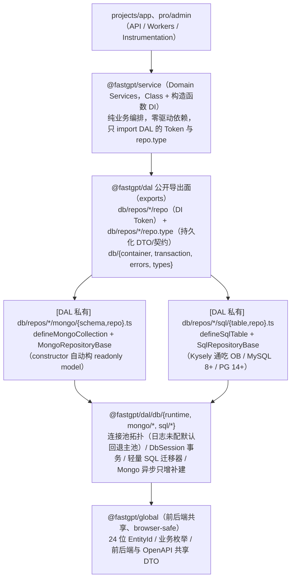

# FastGPT 多数据库适配与领域仓储（Repository）重构设计

> 状态：设计定稿（待按阶段实施）
>
> 关联文档：[FastGPT Data Access Layer 设计](./data-access-layer.md)、[Mongo 索引同步策略](../mongo-index-sync-strategy.md)

## 1. 背景、前提与核心目标

### 1.1 业务前提、引擎优先级与适配边界

1. **运行模式前提**：**单部署实例二选一族运行（`DB_DIALECT = 'mongo' | 'oceanbase' | 'mysql' | 'postgres'`，仓储实现归并收敛为 `'mongo' | 'sql'` 两族），不做异构数据库间的数据迁移，也不做运行期双写同步**。
2. **数据库版本基线、优先级与可移植 SQL 边界**：
   - **MongoDB**：保持现有副本集部署要求与存量功能 100% 兼容；
   - **SQL-Like 关系型族（OceanBase 优先，PostgreSQL 次先）**：
     - **P0 第一优先 —— OceanBase（新版本 4.3+ / SeekDB，MySQL 兼容模式）及 MySQL 8.0+**：通过 `mysql2` 协议访问，原生支持标准 `JSON` 列、`FOR UPDATE SKIP LOCKED` 及 OceanBase 原生中文全文分词器（`space` / `ik`）；
     - **P1 次优先 —— PostgreSQL ≥ 14**：共享同一套可移植 SQL 仓储实现与版本化迁移；
     - **可移植 SQL 编码铁律**：所有常规业务表必须**共用唯一一份 `sql/table.ts` + `sql/repo.ts`**（基于 Kysely），严禁使用 PG 专有 `ARRAY[]` 列、`GIN` 索引、`ILIKE`、`RETURNING *`、部分唯一索引（`CREATE UNIQUE INDEX ... WHERE ...`）及 JSON 路径查询；同时严格遵守 OceanBase/MySQL 硬约束——建表显式声明 `CHARSET=utf8mb4 COLLATE=utf8mb4_bin`（对齐区分大小写等值与唯一约束）、禁止给 `text`/`json` 列设 `DEFAULT` 或建 B-Tree 索引、复合索引总长 `<= 3072` 字节、禁用 `INSERT IGNORE`、可空排序列显式对齐 `NULL` 位置，统一采用标准 B-Tree 索引、物化路径（`ancestor_path`）、确定性哨兵值（规避 `NULL != NULL`）与 `LOWER(...) LIKE ... ESCAPE '|'`。
3. **主库与向量库解耦红线**：即便客户在部署上将业务主库与 `OceanBase` 或 `pgvector` 向量库指向同一个数据库实例，代码架构上仍必须保持 **100% 物理连接池隔离、Schema 命名空间隔离与事务边界隔离**。严禁跨业务 Repository 与 `VectorController` 共享本地数据库事务，确保 Milvus / OceanBase / SeekDB / PG 等异构向量库组合行为完全一致。
4. **明确划出 SQL 适配范围的历史遗留与独立项目**：
   - **`dataset_image`（Mongo GridFS）**：属于纯 MongoDB 历史遗留能力（新图片均走 S3），**SQL 模式下不建表、不提供该功能**（仅 Mongo 模式保留历史兼容读取，SQL 模式通过降级实现返回空/404）；
   - **`projects/marketplace`**：独立应用与数据模型，不在本次主仓多库改造范围内。

### 1.2 现状痛点（为什么必须同步重构 Mongo 访问层）

按 AST 全仓盘点，当前主仓与商业版在范围之内共 **81 个 Mongoose Model**（`packages/service` 71 个含 4 个日志库集合、1 个 GridFS 遗留与 1 个 Phase 0 Pilot `app_registrations`；`pro/admin` 10 个；不含范围外的 `projects/marketplace` 2 个与 `projects/app/src/migration` 2 个内部状态表），剥离 GridFS 后共 **79 张待适配 SQL 的核心业务/日志表**；现存 **253 个现行索引**（其中 245 个即 96.8% 为无前缀默认名）及 **17 条 `deprecated: true` 废弃索引墓碑**，存在严重的数据库驱动穿透问题：

1. **裸调 `MongoXxx` 穿透全栈**：`packages/service` 有 394 个文件、`projects/app/src` 有 158 个文件（含 121 个 `pages/api` 路由）、`pro/admin/src` 有 1,117 处直接引用 Mongoose Model 与算子。
2. **已有 `entity.ts` 仍存在算子泄漏（“假封装”）**：例如 `packages/service/core/app/entity.ts` 仍直接暴露 `FilterQuery<AppSchemaType>` 与空格分隔的 Mongoose `fields` 投影字符串，API 路由仍在手写 `$in`、`$or`、`$regex` 甚至在 `@fastgpt/global` 中遗留 `parseParentIdInMongo` 与数据库物理 `CollectionName` 常量。
3. **业务安全不变量缺乏统一闸口**：软删除过滤（`deleteTime: null`）、多租户隔离（`teamId`）、TTL 有效期判断散落在上百个调用点靠人工记忆传递，极易产生漏过滤越权或幽灵数据。
4. **返回值类型失真与隐式全局魔法**：`packages/service/common/mongo/index.ts` 中的 `convertObjectIds` 中间件只浅层转换顶层 `ObjectId`，嵌套数组（如 `ancestorIds`、`indexes[].dataId`）与部分聚合结果仍残留 BSON `ObjectId`；漏写 `.lean()` 时还会返回重型 Mongoose `Document` 实例，导致业务层被迫到处编写 `String(doc._id)` 防御代码。
5. **模块顶层副作用与索引隐患**：各 `schema.ts` 在模块导入阶段即执行 `getMongoModel()` 绑定全局 `connectionMongo` 并异步 fire-and-forget 同步索引，导致纯逻辑单测被迫启动内存数据库、无法在纯 SQL 环境下按需加载，同时存在未关 `autoIndex`、复合 `text` 索引匹配缺前导列、启动无条件删索引、60s 业务查询超时打断大表建索引等现网隐患。

因此，本设计采取 **“先彻底收口重构持久化层进 `@fastgpt/dal`（物理隔离驱动依赖），再平滑接入 OceanBase/MySQL（P0）与 PostgreSQL（P1）”** 的演进路线：即使在纯 Mongo 环境下，也能直接带来包边界隔离、内存性能、索引安全与可测试性的全面收益。

---

## 2. 总体架构与包分层设计

### 2.1 拒绝的两条死胡同

- **❌ 死胡同 1：自研通用类 Mongo Query DSL 转 SQL 翻译器**
  业务中大量存在“排序后原子扣减（`findOneAndUpdate + sort`）”、“深层数组条件匹配与动态键 CAS 更新”、“异构 `bulkWrite`”。通用 AST 翻译器无法在 OceanBase / MySQL / PG 下使用 `CTE + FOR UPDATE SKIP LOCKED` 或精确批量更新，必然退化为性能低劣且锁粒度失控的半成品 ORM。
- **❌ 死胡同 2：强行将所有文档聚合根拆成纯关系子表（或按 JSON 嵌套层数机械拆表）**
  FastGPT 拥有大量天然聚合根文档（Workflow `nodes/edges/chatConfig`、`ChatItem.value` 多态消息块、`SystemConfigs`）。既然不做跨库迁移且 OceanBase / MySQL / PG 均支持高性能 JSON 存储，**禁止按“第 2 层 JSON 必须拆表”一刀切**（这会在分布式 SQL 下引爆大量跨表 JOIN 与分布式写事务），而应遵循 **“四信号拆表法则”**：只有命中 **① 需进 `WHERE/ORDER BY`/反查主记录、② 独立高频局部更新/并发 CAS 抢占、③ 数组随时间无上限增长、④ 需跨行 `SUM/COUNT` 或原子加减** 这 4 个信号之一时才拆独立关系列或关联表；未命中时哪怕嵌套 5 层仍作为黑盒 `JSON/JSONB` 整存整取。

### 2.2 分层模型与物理包归属（物理硬隔离，与 Redis DAL 对称）

沿用 [FastGPT Data Access Layer 设计](./data-access-layer.md) 的包边界治理经验（开源 Redis Cache 在 `packages/dal/redis/caches/`、Pro 专属在 `pro/admin/src/dal/redis/caches/`、`packages/service/common/redis/` 已彻底移除），将**全部开源持久化基础设施、Mongo Schema、SQL Table、双族 Repository 实现及契约测试统一收口至 `@fastgpt/dal/db/`**，用 Node/TS 包级 `exports` 物理阻断依赖污染：



**物理包归属与边界铁律**：
1. **`@fastgpt/global` vs `@fastgpt/dal` 严格按“前端是否需要”切分**：
   - **`@fastgpt/global`**（browser-safe）：仅放前后端共享的 `EntityId` 工具、业务枚举（`AppTypeEnum`、`PerResourceTypeEnum` 等）及 OpenAPI / API 响应 DTO；**不再向 `@fastgpt/global` 放入数据库物理集合名 / 表名常量**；
   - **`@fastgpt/dal`**（纯服务端持久化，前端严禁引用）：承载物理集合名 / 表名常量、持久化层 `repo.type.ts`（含内部存储字段与 Read/Write Zod Schema）、`mongo/{schema,repo}.ts`、`sql/{table,repo}.ts`、DI Token 以及独立契约测试（`packages/dal/test/db/repos/`）。
2. **`packages/dal/package.json` `exports` 物理防污染**：
   - 对业务层仅暴露 `./db/repos/*/repo`、`./db/repos/*/repo.type` 与 `./db/{container,transaction,errors,types}`；
   - 对应用启动入口（`instrumentation-node.ts`）与 `pro/admin` 暴露 `./db/runtime`、`./db/mongo/*`、`./db/sql/*`；
   - **绝不暴露 `./db/repos/*/mongo/*` 与 `./db/repos/*/sql/*`**，从编译期物理禁止 `@fastgpt/service`、`projects/app`、`pro/admin` 直接导入 Mongoose Model 或 SQL Table。
3. **契约测试与业务单测天然物理隔离**：
   - `packages/dal/test/db/repos/<domain>/repo.contract.test.ts` 运行在独立 `packages/dal/vitest.config.ts` 中，**完全不加载根 `test/setup.ts`**（零 `projects/app` 全局变量、零业务 mock）；
   - `packages/service/test/<domain>/service.test.ts` 保持为 **L0 零数据库纯内存单测**（通过构造函数注入 Fake Repo）。
4. **`pro/admin` 与 `service` 过渡边界**：
   - 商业版 10 张专属表置于 `pro/admin/src/dal/db/repos/<domain>/`（契约测试在 `pro/admin/test/dal/db/repos/`），遵守 `shared DAL 不反向依赖 pro` 铁律；
   - `@fastgpt/service` 已直接依赖 `@fastgpt/dal`，**新迁移领域无需任何转发层**；极少数依赖 `service` 分词的能力（如 `FullTextStore` 的 `jiebaSplit`）由 `service` 层完成分词后传 token 或以 callback 注入 DAL；
   - 存量未迁移的 71 张旧表仍暂留于 `packages/service`，过渡期 `packages/service/common/mongo/index.ts` 直接复用 `@fastgpt/dal/db/mongo/runtime` 的同一份底层 `Mongoose` 连接实例（确保新旧混跑事务共享同一 `ClientSession`），严禁任何新代码引用；待 Phase 1 全部旧表迁入 DAL 后，整目录删除 `packages/service/common/mongo/`（与已删除的 `packages/service/common/redis/` 一致）。

> **Pilot 落地验证**：首个最小试点 `AppRegistration` 已完成全链路迁入 `packages/dal/db/repos/appRegistration/` 与 `packages/dal/test/db/repos/appRegistration/repo.contract.test.ts`，`packages/service/support/appRegistration/service.ts` 只通过 `@fastgpt/dal` 公开 `exports` 消费 Token 与 `repo.type`。

---

## 3. `@fastgpt/dal/db` 底座核心设计

### 3.1 Runtime 配置与双数据源 + 读写分离拓扑

与 `@fastgpt/dal/redis` 一致，`@fastgpt/dal/db` **不隐式读取 `serviceEnv`**，由应用启动入口（`instrumentation.ts`）显式注入配置，并在内部私有上下文管理单例（兼容 Next.js HMR 热重载，淘汰零散的 `global.mongodb`）：

```ts
export type DbDialect = 'mongo' | 'oceanbase' | 'mysql' | 'postgres';
export type DbDialectFamily = 'mongo' | 'sql';
export type DbLogMode = 'separate' | 'shared';

export type DbRuntimeConfig = {
  dialect: DbDialect;
  mainWriteUrl: string;
  mainReadUrl?: string; // SQL 只读副本连接串；未配置时自动回退至 mainWritePool
  /**
   * 独立日志库连接串：
   * - 配置时进入 `separate` 模式，建立独立日志连接池；
   * - 未配置（默认）时进入 `shared` 模式，透明回退复用 `main` 连接池（既不重复建池，又兼容默认单库部署）。
   */
  logWriteUrl?: string;
  /** 独立日志库只读副本连接串；仅在 `separate` 模式下生效，未配置时回退至 logWritePool。 */
  logReadUrl?: string;
  maxConnections?: number;
  logger: DbLogger;
  metrics?: DbMetrics;
};
```

- **SQL 技术栈选型**：采用 **`Kysely` + 原生驱动池（`mysql2` / `pg.Pool`）**（仓库已内置 `mysql2@^3.23` 与 `pg@^8.10`）。Kysely 纯 TypeScript 零二进制引擎包袱，表定义即纯类型，**同一份 `Kysely` 查询代码可通过底层 `MysqlDialect`（OceanBase / MySQL，P0）与 `PostgresDialect`（PG，P1）直接通吃**；`mysql2` 连接池显式配置 `timezone: 'Z'`、`charset: 'utf8mb4'`、`supportBigNumbers: true`、`bigNumberStrings: true` 以对齐 `pg` 精度与时区语义。
- **读写分离路由**：Mongo 通过单连接串 + `readPreference: 'secondaryPreferred'` 路由；SQL 族通过 `mainReadPool` 路由。底座统一暴露语义选项 `{ useReadReplica?: boolean, tx?: DbSession }`——**一旦传入活跃的 `tx` 事务会话，底座强制忽略 `useReadReplica` 并路由至 `WritePool`**，杜绝事务内读不到自身未提交写入的一致性事故。
- **日志数据源双态拓扑（未配独立日志库时默认回退主库，无 `Noop` 降级）**：挂载在 `log` 数据源上的 4 张日志表（`app_chat_logs`、`team_audits`、`llm_request_records`、`system_logs`）与普通仓储一致，统一通过 `defineRepoToken` 注册 `mongo` / `sql` 实现，仅通过 `mongo/schema.ts` 的 `datasource: 'log'` 与 `sql/repo.ts` 的 `protected override readonly datasource = 'log'` 声明逻辑数据源：
  1. `separate`（配置了独立 `logWriteUrl`）：走独立日志连接池；
  2. `shared`（**默认**，未配置 `logWriteUrl`）：**透明回退复用 `main` 物理连接池**（消除旧代码 `connectionLogMongo` 连接同一库却建两套池的资源浪费，同时 100% 保证默认单库部署下对话日志、审计日志、请求追踪功能正常可用；且 `runInTransaction(..., { datasource: 'log' })` 仍保持逻辑数据源隔离校验，防止与 `main` 仓储误混入同一事务）。
- **Mongo 连接下沉、可观测性与启动期 Schema Registry**：
  - `@fastgpt/dal/db/mongo/runtime.ts` 接管进程唯一的 `Mongoose` 主连接与可选独立日志连接（`shared` 模式复用主连接，彻底淘汰 `global.mongodb` / `global.mongodbLog`），统一设置 `autoIndex: false`、独立非连接池 DDL 连接（`socketTimeoutMS: 0`），并在 `Kysely` 与 `Mongoose` 双侧统一接入 `runtime.recordOperation()` 慢查询告警与 `common/profiling` 分段耗时回调；
  - 区分**模块 `import` 零副作用**与**应用启动显式引导（Bootstrap）**：维护统一领域注册表 `packages/dal/db/repos/registry.ts`（以及 `pro/admin` 专属注册表），启动期（`instrumentation-node.ts`）按方言执行**解耦的轻量初始化**——SQL 侧同步执行轻量版本化 DDL 迁移器，Mongo 侧启动后异步只增补建缺失索引（绝不阻塞探针、绝不在启动自动删索引），并共享统一的只读 `inspect` 能力。

### 3.2 显式事务模型 `DbSession` 与 `afterCommit` 机制

**架构决策：坚持显式传递 `tx?: DbSession`，严禁使用 `AsyncLocalStorage` 隐式传播事务。**
> **设计原因**：PostgreSQL 开启事务（`BEGIN`）后，整个事务周期会独占一条物理连接并持有行锁。FastGPT 业务逻辑中普遍夹杂着 LLM 流式请求、S3 文件传输、`Promise.all` 并发以及写 `logDb` 审计日志。若采用 `AsyncLocalStorage` 隐式传播，极易在无意间将长耗时外部 IO 或日志库写入卷入主库事务，瞬间耗尽 PG 连接池并引发死锁。延续仓库现有的 404 处显式 `session` 传递习惯，将数据流向完全透明化。

```ts
/** 对上层完全不透明的事务会话令牌，业务代码无法访问底层 ClientSession 或 PoolClient。 */
export type DbSession = {
  readonly id: string;
  readonly dialect: DbDialect;
  /** 注册事务成功 commit 后才触发的副作用回调（如刷新 Redis 缓存、投递 BullMQ 任务）。 */
  afterCommit: (callback: () => Promise<void> | void) => void;
};

export declare function runInTransaction<T>(
  fn: (tx: DbSession) => Promise<T>,
  options?: {
    datasource?: 'main' | 'log';
    maxConflictRetries?: number; // 默认 3 次，自动重跑 DbTransactionConflictError
    timeoutMs?: number;          // 默认 60_000ms
  }
): Promise<T>;
```

- **重试安全保证**：当捕获到 `DbTransactionConflictError`（Mongo `112 WriteConflict` / `TransientTransactionError`，或 PG `40001 serialization_failure` / `40P01 deadlock_detected`）触发自动重跑时，上一轮回滚尝试中注册的 `afterCommit` 队列会被自动清空丢弃，只有最终 commit 成功的那一轮才会按序执行 `afterCommit`。
- **嵌套复用约定**：所有支持事务的 Service / Repo 写方法统一接收可选 `tx?: DbSession`；若外层已传入 `tx` 则直接复用，未传入但自身需要原子性时内部调用 `runInTransaction`。

### 3.3 Repo 出口 Zod 强校验与脏数据隔离降级（Warn & Skip）

结合仓库已升级 **Zod v4** 的高性能基础，所有 Repository 读出口统一经过 `@fastgpt/dal/db` 提供的行解析器，一举解决**深层 `ObjectId` 转字符串、剥离 `__v`、抹平 PG `NULL` 与 Mongo `undefined` 差异、拦截 SQL 列名拼写错误**四大问题：

1. **单条查询（Fail-Fast）—— `parseRepoRow`**：
   - 用于 `findById`、`findOne`、`create` 返回值等精确单记录场景。
   - 若记录存在但未通过出口 Zod Schema 校验，记录结构化错误日志并抛出 `DbRecordCorruptedError`（按内部服务端异常上报，绝不静默返回残缺对象污染后续计费/鉴权逻辑）。
2. **列表/批量查询（Warn & Skip 隔离降级）—— `parseRepoRows`**：
   - 用于 `list*`、分页查询、游标批处理等多记录场景。
   - 先尝试整批快速校验；若整批失败，自动退化为逐行 `safeParse`：**对校验失败的远古历史脏数据打印高优先级 `logger.error`（携带 `table`、记录主键 `_id` 及精简 `zodIssues` 供线上告警修复），同时跳过该坏行并返回其余正常记录**，防止 1 条历史脏数据导致客户整个工作台列表 500 瘫痪。

```ts
export function parseRepoRows<TSchema extends z.ZodTypeAny>({
  table,
  schema,
  rows,
  logger
}: {
  table: string;
  schema: TSchema;
  rows: unknown[];
  logger: DbLogger;
}): z.output<TSchema>[] {
  const fastResult = z.array(schema).safeParse(rows);
  if (fastResult.success) {
    return fastResult.data;
  }

  // 慢路径：仅当存在历史脏数据时逐行定位并隔离坏行，保证其余有效资产正常展示
  const validRows: z.output<TSchema>[] = [];
  for (const rawRow of rows) {
    const parsed = schema.safeParse(rawRow);
    if (parsed.success) {
      validRows.push(parsed.data);
      continue;
    }
    const recordId =
      rawRow !== null && typeof rawRow === 'object' && '_id' in rawRow
        ? String((rawRow as Record<string, unknown>)._id)
        : 'unknown';
    logger.error('Repository row failed schema validation, skipping corrupted record', {
      table,
      recordId,
      issues: parsed.error.issues
    });
  }
  return validRows;
}
```

### 3.4 模板方法抽象基类与轻量级 DI 容器（Template Method + Strategy + Constructor DI）

为消除闭包工厂与重复样板代码，`@fastgpt/dal/db` 提供两层基础能力：

1. **方言抽象基类（Template Method）**：
   - **`MongoRepositoryBase<TDoc, TReadSchema>`（`@fastgpt/dal/db/mongo/base`）**：彻底废除 `getMongoModel` / `getXxxMongoModel()` / 模块级 `let cachedModel`。每个域的 `mongo/schema.ts` 使用原生 `new Schema(...)`（保留 `.virtual()` / `.pre()` 表达力）并传给纯声明式 `defineMongoCollection({ name, datasource, schema, indexes })`（零导入副作用、定义期自动禁止字段级 `index: true / unique: true`）；`MongoRepositoryBase` 在 **`constructor({ collection, readSchema, runtime })` 中直接通过 `runtime.bindMongoModel(collection)` 幂等构出 `protected readonly model: Model<TDoc>`**（基于 `container.ts` 按 `DbRuntime` 隔离的懒单例生命周期，换连/测试重建自动淘汰旧 Model，且内部先查 `connection.models[name]` 防 `OverwriteModelError`），同时封装 `oid`、`txOpts`、`readOpts`、`parseRow`、`parseList`；
   - **`SqlRepositoryBase`（`@fastgpt/dal/db/sql/base`）**：将 `tableName`、`readSchema`、读写分离/事务路由（`this.db(tx)` / `this.readDb(tx)`，因 Kysely 事务与读副本按次切执行器故按次路由）、`upsertRow`、`insertChunked`、`caseInsensitiveLike`、`orderByNullable`、`toJsonParam`、Keyset 游标分页、哨兵与物化路径编解码，以及 `parseRepoRow` / `parseRepoRows` 收口至 `protected` 方法，子类（Strategy 实现类）只需专注纯粹的数据查询与写入逻辑：

```ts
// 完整源码见 packages/dal/db/mongo/base.ts 与 packages/dal/db/sql/base.ts
export abstract class MongoRepositoryBase<TDoc, TReadSchema extends z.ZodTypeAny> {
  protected readonly model: Model<TDoc>;
  protected readonly tableName: string;
  protected readonly readSchema: TReadSchema;

  constructor(params: {
    collection: MongoCollectionDefinition<TDoc>;
    readSchema: TReadSchema;
    runtime?: DbRuntime;
  }) {
    const runtime = params.runtime ?? getDbRuntime();
    this.tableName = params.collection.name;
    this.readSchema = params.readSchema;
    this.model = runtime.bindMongoModel(params.collection);
  }
}

export abstract class SqlRepositoryBase<
  TDatabase extends Record<string, any>,
  TTableName extends keyof TDatabase & string,
  TReadSchema extends z.ZodTypeAny
> {
  protected abstract readonly tableName: TTableName;
  protected abstract readonly readSchema: TReadSchema;
  protected readonly datasource: 'main' | 'log' = 'main';

  protected db(tx?: DbSession): Kysely<TDatabase> { ... }
  protected readDb(tx?: DbSession): Kysely<TDatabase> { ... }
  protected parseRow(row: unknown): z.output<TReadSchema> { ... }
  protected parseNullable(row: unknown): z.output<TReadSchema> | null { ... }
  protected parseList<TSchema extends z.ZodTypeAny = TReadSchema>(rows: readonly unknown[], customSchema?: TSchema) { ... }
  protected toJsonParam(value: unknown): string | null { ... }
  protected toParentSentinel(parentId?: string | null): string { ... }
  protected fromParentSentinel(value?: string | null): string | null { ... }
  protected encodeMaterializedPath(ids?: readonly string[]): string { ... }
  protected decodeMaterializedPath(path?: string | null): string[] | undefined { ... }
  protected caseInsensitiveLike(columnName: string, keyword: string): RawBuilder<boolean> { ... }
  protected insertChunked(...) { ... }
  protected upsertRow(...) { ... }
}
```

2. **轻量级 Token DI 容器（无装饰器 / 零 `reflect-metadata` 侵入）**：
   - `defineRepoToken<TRepo>(name, { mongo, sql })` 统一注册主库与日志库仓储的双族构造工厂（`postgres` / `oceanbase` / `mysql` 自动映射至 `sql`），并在实例化时向工厂透传当前 `runtime`（`mongo: (runtime) => new MongoXxxRepository(runtime)`）；日志仓储未配置 `logWriteUrl` 时在底座层透明回退复用主池，无需单独的 `Noop` 实现；
   - `injectRepo(token)` 返回一个轻量 **Lazy `Proxy`**（含 `.then` 防 `await` 误展开保护）：因此即使在模块顶层执行 `export const appService = new AppService()`，在模块导入或 Next.js 静态构建阶段**绝对不会触发**任何数据库连接、Mongoose 模型注册或方言解析；仅在仓储方法被实际调用时，才按当前 `DbRuntime` 生命周期解析并缓存单例（并在热重载或测试切换 Runtime 时自动失效重建）。

---

## 4. 领域仓储（Domain Repository）编写铁律

每个业务子域的持久化与编排代码统一演进为以下目录结构（严格遵守 `syntax.md` **禁止 barrel re-export** 规范，且通过 `packages/dal/package.json` `exports` 物理隐藏 `mongo/` 与 `sql/`）：

```text
packages/dal/db/repos/<domain>/         # 开源表（Pro 10 张专属表在 pro/admin/src/dal/db/repos/<domain>/）
├── repo.type.ts                        # 【公开导出】领域仓储契约 type、Write/Read Zod Schema、.pick() 窄 DTO
├── repo.ts                             # 【公开导出】defineRepoToken 导出 XxxRepoToken
├── mongo/                              # 【包内私有，exports 不暴露】
│   ├── schema.ts                       # 原生 new Schema(...) + defineMongoCollection（纯声明、零副作用、含物理集合名常量）
│   └── repo.ts                         # MongoXxxRepository（constructor 自动 bindMongoModel，implements XxxRepository）
└── sql/                                # 【包内私有，exports 不暴露】
    ├── table.ts                        # 中立可移植 SQL 表定义（defineSqlTable，零 PG/OB 方言私货）+ 行类型
    └── repo.ts                         # SqlXxxRepository（extends SqlRepositoryBase，implements XxxRepository）

packages/dal/test/db/repos/<domain>/
└── repo.contract.test.ts               # DAL 独立 Vitest 多方言契约测试（零 service/app 全局依赖）

packages/service/<domain>/
├── service.ts                          # XxxService 类（只 import @fastgpt/dal/db/repos/<domain>/{repo,repo.type}）
└── utils.ts                            # 无副作用纯函数

packages/service/test/<domain>/
└── service.test.ts                     # L0 零数据库纯内存单测（构造注入 Fake Repo）
```

### 四条编码铁律

1. **铁律一：零驱动算子泄漏与物理包隔离**
   `repo.type.ts` 的方法签名只允许表达**业务意图**（如 `listActiveApps`、`claimNextTrainingTask`、`deductEarliestExpiringSubPoints`），严禁出现 `FilterQuery`、`UpdateQuery`、空格分隔的 `fields: string` 或 `AnyBulkWriteOperation`。原 `resourcePermissionRepo` 中遗留的 `bulkWrite`、`findCursor(query)`、`deleteByFilter(filter)` 等逃生口必须在收口阶段改为具名领域方法。物理集合名 / 表名常量与持久化 Repo DTO 归属 `@fastgpt/dal`，禁止塞入面向前端的 `@fastgpt/global`。
2. **铁律二：业务安全不变量焊死在 Repo 内部**
   - 含软删除语义的表，所有常规读/写方法内部强制附加 `deleteTime: null`（回收站专属方法显式命名为 `listTrashApps` / `restoreDeletedApp`）；
   - 多租户业务表的方法入参强制要求 `teamId: string`（系统级后台巡检方法显式以 `Admin` 或 `System` 后缀区分）；
   - 带过期时间的表，所有读方法内部强制附加 `expireTime > now()` 过滤。
3. **铁律三：严进宽出 + `.pick()` 窄 DTO + 超大载荷容器边界**
   - **严进（Write Schema）**：`create` / `update` 入参严校验，拦截非法值入库；
   - **宽出归一化（Read Schema）**：所有可选列统一使用 `optionalNullToUndefined(...)` 抹平 SQL `null` 与 Mongo `undefined`；历史可能缺失的字符串列补 `.default('')`；布尔列使用 `BoolSchema` 抹平 OceanBase/MySQL `0/1`；JSON 列使用 `jsonColumnSchema(...)` 且内嵌时间使用 `z.coerce.date()`；所有 ID 列使用 `EntityIdSchema` 自动将 BSON `ObjectId` 深层转为 `string`。**待全仓收口完成后，彻底移除 `mongo/index.ts` 中的浅层 `convertObjectIds` 全局钩子**；
   - **窄 DTO 派生**：局部字段查询必须基于领域基准读 Schema 调用 `.pick({ _id: true, name: true, ... })` 派生出口 Schema，严禁使用宽泛的全表类型冒充局部返回类型；
   - **大载荷分层校验**：对于 `AppVersion.nodes / edges`、`ChatItem.value` 等动辄数百 KB 的深层多态数组，Repo 出口只校验外层容器与骨架字段，深层节点参数交由工作流/对话引擎在执行期按需校验，避免热路径双重深度遍历。
4. **铁律四：零顶层副作用、构造期自动绑定 Model 与构造函数依赖注入**
   - `mongo/schema.ts` 只导出纯声明式 `defineMongoCollection(...)` 描述符（内部接收原生 Mongoose `Schema` 并校验无内联 `index: true / unique: true`），模块导入阶段零连接、零注册、零建索引副作用；
   - `MongoXxxRepository` 在 `constructor(runtime?: DbRuntime)` 内由父类 `MongoRepositoryBase` 自动构出 `readonly model`，依托容器 `WeakMap<DbRuntime, Map<RepoToken, object>>` 保证 `DB_DIALECT=oceanbase|mysql|postgres` 时永不实例化 Mongo Repo，且每次切换 `DbRuntime` 自动重建；
   - `service.ts` 统一定义为 `XxxService` 类，通过构造函数对象参数 `constructor(deps: XxxServiceDeps = {})` 注入所需仓储及协同服务（默认使用 `injectRepo(Token)`），单测直接 `new AppService({ appRepo: mockRepo })` 即可毫秒级隔离运行，彻底告别 `vi.mock` 模块劫持与参数列表膨胀。

---

## 5. 九大异构数据库深水区与标准解法

| 编号 | 深水区问题 | FastGPT 现状与隐患 | 跨 Mongo / PG / OceanBase 统一重构方案 |
| :--- | :--- | :--- | :--- |
| **1** | **实体 ID 生成与游标字典序** | 全仓大量预生成 `new Types.ObjectId()`（如先拼 S3 Key 再落库）；`ObjectIdSchema` 在 **94 个文件（含 56 个 OpenAPI 契约）** 硬编码校验 24 位 Hex；多处游标分页直接依赖 `_id > cursor` 的时间单调字典序。 | **严禁改用 36 位 UUIDv7 或破坏字典序的 `BIGSERIAL`！**<br>在 `@fastgpt/global/common/string/entityId.ts` 纯 TS 实现零驱动依赖的 **24 位小写 Hex 时间序生成器**（`4B 秒级时间戳 + 5B 进程随机熵 + 3B 单调递增计数器`）。在 Mongo 中可直接转为原生 `ObjectId`，在 PG / OceanBase 中存为 `VARCHAR(24)`，100% 兼容全部现有 OpenAPI 契约、S3 路径规则与时间序游标分页。 |
| **2** | **事务中断、唯一键 `NULL`、Collation 与 `NULL` 排序差异** | PG 事务内报错即进入 `25P02 aborted`；PG/OB `UNIQUE` 均认为 `NULL != NULL`；MySQL/OB 默认 `utf8mb4_0900_ai_ci` 大小写不敏感（与 Mongo/PG 冲突）；PG `DESC` 默认 `NULLS FIRST` 而 OB/MySQL 默认 `NULLS LAST`；`INSERT IGNORE` 会静默吞掉 `NOT NULL`/截断错误。 | 1. **严禁“试探 `insert` + `catch` 唯一冲突后 `update`”**，幂等写入走 `SqlRepositoryBase.upsertRow`（PG `ON CONFLICT` / OB `ON DUPLICATE KEY UPDATE`，无更新时 OB 改用无副作用 `ON DUPLICATE KEY UPDATE _id = _id` 禁用 `INSERT IGNORE`，且限定单唯一键冲突路径）；<br>2. 进唯一索引的可空列与软删除列统一存哨兵值（`''` / `0`）；<br>3. OB/MySQL 建表强制 `CHARSET=utf8mb4 COLLATE=utf8mb4_bin`；<br>4. 可空列排序统一走 `orderByNullable`（显式 `CASE WHEN col IS NULL`）或哨兵值。 |
| **3** | **Mongo Change Streams 实时监听** | `MongoSystemConfigs.watch()`、`MongoDatasetTraining.watch()` 依赖 Mongo oplog 实现多实例配置热更新与训练队列唤醒；PG `LISTEN/NOTIFY` 过不了 PgBouncer 且 OceanBase 不支持。 | **全面迁移至 `@fastgpt/dal/redis`**：<br>1. 系统配置/License 热更新改为 **Redis Pub/Sub 广播 + 本地 Revision 版本号按需轮询兜底**（复用现有模型目录刷新范式）；<br>2. 训练/异步任务唤醒改为 **Redis Pub/Sub 信号触发 + 分钟级兜底巡检 Cron**。 |
| **4** | **排序原子抢占与最早过期扣减** | 套餐扣费（`findOneAndUpdate({ surplusPoints: { $gte: 0 } }).sort({ expiredTime: 1 })`）与训练分片抢占依赖排序原子修改；PG/MySQL `UPDATE` 不支持子查询级 `SKIP LOCKED`。 | 1. 纯瞬态分布式互斥锁统一收归 `@fastgpt/dal/redis` 的 `LeaseCache`；<br>2. 持久化抢占与有序扣减封装为具名 Repo 方法：SQL 侧采用事务内 **`SELECT _id FROM ... WHERE ... ORDER BY ... LIMIT 1 FOR UPDATE SKIP LOCKED`**（OceanBase 4.3+ / MySQL 8.0+ / PG 14+ 原生一致支持）后紧接主键 `UPDATE`。 |
| **5** | **TTL 自动过期索引（34 处）** | Mongo 依赖 `expireAfterSeconds` 后台清理验证码、临时会话、过期日志；OceanBase/MySQL 与 PG 均无统一内置列级 TTL。 | 1. 验证码、短期幂等键等纯瞬态数据迁入 Redis TTL；<br>2. 需落盘的带生命周期表统一维护索引列 `expire_time`：**Repo 读路径强制追加 `expire_time > now()`**，并由内置后台 Cron 分批按主键范围 `DELETE` 物理回收。 |
| **6** | **权限位运算与跨库冲突错误码重试** | `resourcePermissionRepo` 使用 `$bitsAllSet` / `$bitsAnySet` 过滤权限掩码，并依赖捕获 `11000 / 112` 抛出冲突异常触发外层事务重试。 | OceanBase/MySQL 与 PG 均原生支持整型按位与 `(permission & ?) = ?` 与 `(permission & ?) <> 0`；错误码映射层除覆盖 Mongo `112`、MySQL `1213/1205`、PG `40001/40P01` 外，**显式补充 OceanBase 高频瞬态错误码（`4012`、`6002`、`6004`、`6210`、`6223`）** 统一转为可重试冲突异常。 |
| **7** | **知识库全文检索（`FullTextStore`）** | 当向量库为 OceanBase / SeekDB / PG / OpenGauss 时，全文检索目前强耦合在 MongoDB 的 `dataset_data_texts` 集合 + `$text` 索引上；标准 MySQL 默认 `ft_min_token_size=3` 会丢弃 1~2 字中文词。 | FastGPT 已在 Node 层通过 `jiebaSplit` 预先切好空格分词串：<br>1. `FullTextStore` 作为极少数（<2%）按需使用方言子策略的模块：**P0 OceanBase 4.3+ / SeekDB 优先采用原生 `FULLTEXT INDEX ... WITH PARSER space`（或 `ik`）+ `MATCH ... AGAINST`**（进入 `core/dataset` 前用真实 OB 容器完成短词召回 PoC）；P1 PG 采用 `to_tsvector('simple', full_text_token)`；<br>2. 路由改为：Milvus 走向量库原生 BM25，其余跟随主库方言路由。 |
| **8** | **跨库类型、批量上限、大表流式导出与跨表 `$lookup`** | PG 单条 SQL 最多 65,535 参数且数组参数误序列；MySQL/OB `TEXT` 仅 64KB、`LONGTEXT`/`JSON` 禁 `DEFAULT`、复合索引上限 3072B、`BIGINT` 驱动返回类型不一致；全仓存在 9 处 `.cursor()` 大表流式导出与 8 处跨表 `$lookup`。 | 由 `@fastgpt/dal/db/sql` 底座与分层规范一次性封死：<br>1. `insertChunked` 控批参数 `< 60,000`，`toJsonParam` 统一 `JSON.stringify`；<br>2. `ddl.ts` 映射 `LONGTEXT`/`DATETIME(3)` 并静态拦截 `text/json` 默认值与 >3072B 复合索引，`mysql2` 开启 `supportBigNumbers + bigNumberStrings`；<br>3. `.cursor()` 统一改为基于 24 位有序 `_id` 的 **Keyset 分批迭代器**（不占长连接）；<br>4. 跨表 `$lookup` 简单字段补全改 Service 批量 `IN` 组装（天然兼容 `main`/`log` 跨库），必须 DB 侧过滤分页的（如 `resourceLookup`）独立建只读 **Query Repo** + 关联表。 |
| **9** | **索引命名、`deprecated: true` 清理、DDL 迁移引擎与四信号拆表** | 原 `mongo-index-sync-strategy` 在 `schema.ts` 积累了 17 条 `deprecated: true` 墓碑、无法改 TTL/unique 且存在未设 `autoIndex: false`/复合 `text` 匹配 Bug/60s 超时/无条件删索引 4 个现网隐患；原版 Kysely `0.29.9` `Migrator` 在 PG 下把所有迁移包进事务（导致 `CREATE INDEX CONCURRENTLY` 报 `25001`）、硬编码 `GET_LOCK`/`pg_advisory_lock`（OBProxy/PgBouncer 脆弱）且回滚遇到未来版本 ID 会 CrashLoop；但把无 Schema 的 Mongo 硬塞进重型跨引擎状态机又会带来 `0000_mongo_cutover` 与 Pod 心跳等过度复杂度。 | **原则统一，执行解耦（各用最简方案）**：<br>1. **四条统一契约**：`schema.ts`/`table.ts` 只声明当前有效索引（**彻底移除 `deprecated: true`**）；全部 SQL 索引与所有新增 Mongo 索引统一命名 `fg_<table_short>_<purpose>[_vN]`（≤63 ASCII 字节、SQL 全库唯一），存量 245 个无前缀 Mongo 索引原位冻结零重建，严禁碰客户自建索引；删除旧索引遵守 **Expand-Contract 两版制**（版本 N 移出声明并停用、版本 N+1 显式删除，天然杜绝旧 Pod 复活）；大表建索引不卡启动探针、不用 60s 业务查询超时，并提供只读 `inspect`。<br>2. **SQL 侧（`@fastgpt/dal/db/sql/migrations/`，~250 行轻量自研执行器）**：外层 Redis `LeaseCache` + 每物理库独立 `_fg_sql_migrations(scope: 'core'\|'pro', id)` 主键幂等账本；向前兼容回滚（忽略未知未来版本 ID）；支持单迁移 `transactional: false` 与专用 DDL 连接；提供 `ensureSqlIndex`（PG `CONCURRENTLY` + `indisvalid=false` 自愈、MySQL `LOCK=NONE` + `lock_wait_timeout`、OB `1061` 幂等）与 `dropSqlIndexIfExists`（硬守卫仅删 `fg_*`）；先于 `projects/app/src/migration` 执行；CI 重放 `0001 -> latest` 与 `defineSqlTable` 防漂移。<br>3. **Mongo 侧（异步只增补建 + 低频删/改走一次性任务）**：新增索引直接在 `mongo/schema.ts` 声明 `fg_*`，启动后后台异步只增补建（Redis 锁、`autoIndex: false`、独立 `socketTimeoutMS: 0` 连接、key 等价检查防 Error 85、`285` 轮询，支持动态条件索引函数）；删除废弃索引与改 TTL/`unique` 绝不在启动自动执行，改为一次性迁移任务（复用 `projects/app/src/migration` 或运维脚本显式 `dropMongoIndex`/`collMod`）。<br>4. **四信号拆表与 OB 分区预留**：仅命中四信号之一才拆表；超大表（`chat_items`、`dataset_datas`、`app_chat_logs`、`llm_request_records`）索引坚持 `team_id` 前导列。 |

---

## 6. 标准代码样板（以 `App` 领域仓储为例）

以下样板展示如何将现有耦合 Mongoose 的 `packages/service/core/app/entity.ts` 与 API 裸查询彻底重构为双库同构的领域仓储。

### 6.1 领域契约与读写 Schema（`packages/dal/db/repos/app/repo.type.ts`）

```ts
import z from 'zod';
import { AppListSortEnum, AppTypeEnum } from '@fastgpt/global/core/app/constants';
import { LOGO_ICON } from '@fastgpt/global/common/system/constants';
import { EntityIdSchema, EntityIdStringSchema } from '@fastgpt/global/common/string/entityId';
import { BoolSchema, optionalNullToUndefined } from '@fastgpt/global/common/zod';
import type { ParentIdType } from '@fastgpt/global/common/parentFolder/type';
import type { DbSession } from '@fastgpt/dal/db/types';

/**
 * App 读路径归一化基准 Schema（宽出兼容存量历史数据，抹平 Mongo undefined 与 PG null 差异）。
 */
export const AppDomainReadSchema = z.object({
  _id: EntityIdSchema,
  parentId: z.preprocess((val) => (val === '' || val === undefined ? null : val), EntityIdSchema.nullable()),
  ancestorIds: optionalNullToUndefined(z.array(EntityIdSchema)),
  teamId: EntityIdSchema,
  tmbId: EntityIdSchema,
  name: z.string(),
  type: z.enum(AppTypeEnum),
  avatar: z.preprocess((val) => val ?? undefined, z.string().default(LOGO_ICON)),
  intro: z.preprocess((val) => val ?? '', z.string()),
  createTime: z.coerce.date(),
  updateTime: z.coerce.date(),
  publishedVersionId: optionalNullToUndefined(EntityIdSchema),
  inheritPermission: optionalNullToUndefined(BoolSchema),
  isPinned: optionalNullToUndefined(BoolSchema),
  pinnedAt: optionalNullToUndefined(z.coerce.date()),
  pluginData: optionalNullToUndefined(z.record(z.string(), z.unknown())),
  deleteTime: optionalNullToUndefined(z.coerce.date())
});
export type AppDomainDTO = z.infer<typeof AppDomainReadSchema>;

/** 列表查询通过 .pick() 派生精确窄 DTO，杜绝局部查询返回宽泛类型。 */
export const AppListItemDTOSchema = AppDomainReadSchema.pick({
  _id: true,
  parentId: true,
  avatar: true,
  type: true,
  name: true,
  intro: true,
  tmbId: true,
  createTime: true,
  updateTime: true,
  pluginData: true,
  inheritPermission: true,
  publishedVersionId: true,
  isPinned: true
});
export type AppListItemDTO = z.infer<typeof AppListItemDTOSchema>;

export type ListActiveAppsParams = {
  teamId: string;
  /** 非团队 Owner 时传入当前成员有权限的 App ID 集合；为空数组时直接短路返回空。 */
  allowedAppIds?: string[];
  /** undefined 表示跨层级检索；null/'' 表示根目录；24位 hex 表示指定父文件夹。 */
  parentId?: ParentIdType;
  types?: AppTypeEnum[];
  excludeHidden?: boolean;
  searchKey?: string;
  creatorTmbIds?: string[];
  sort?: AppListSortEnum;
  pinnedFirst?: boolean;
  offset?: number;
  limit?: number;
};

export const CreateAppWriteSchema = z.object({
  _id: EntityIdStringSchema.optional(),
  parentId: EntityIdStringSchema.nullable().default(null),
  ancestorIds: z.array(EntityIdStringSchema).optional(),
  teamId: EntityIdStringSchema,
  tmbId: EntityIdStringSchema,
  name: z.string().min(1),
  type: z.enum(AppTypeEnum),
  avatar: z.string().default(LOGO_ICON),
  intro: z.string().default(''),
  inheritPermission: z.boolean().default(true)
});
export type CreateAppWriteInput = z.input<typeof CreateAppWriteSchema>;

export type AppRepository = {
  findActiveById: (params: { appId: string; teamId?: string; tx?: DbSession }) => Promise<AppDomainDTO | null>;
  listActiveApps: (params: ListActiveAppsParams) => Promise<AppListItemDTO[]>;
  createApp: (params: { data: CreateAppWriteInput; tx?: DbSession }) => Promise<AppDomainDTO>;
  softDeleteSubtree: (params: { teamId: string; rootAppId: string; deletedAt: Date; tx?: DbSession }) => Promise<number>;
};
```

### 6.2 Mongo 方言实现（`packages/dal/db/repos/app/mongo/schema.ts` & `repo.ts`）

```ts
// packages/dal/db/repos/app/mongo/schema.ts（包内私有，exports 不暴露）
import { Schema } from 'mongoose';
import { defineMongoCollection } from '../../../mongo/collection';

export const AppCollectionName = 'apps';

export type AppMongoDoc = Record<string, unknown>;

const AppMongoSchema = new Schema(
  {
    teamId: { type: Schema.Types.ObjectId, required: true },
    tmbId: { type: Schema.Types.ObjectId, required: true },
    parentId: { type: Schema.Types.ObjectId, default: null },
    name: { type: String, required: true },
    deleteTime: { type: Date, default: null }
  },
  { versionKey: false }
);

export const appMongoCollection = defineMongoCollection<AppMongoDoc>({
  name: AppCollectionName,
  datasource: 'main',
  schema: AppMongoSchema,
  indexes: [
    // 存量索引原位保留名称；新增索引统一采用 fg_<table_short>_<purpose>[_vN]
    { key: { teamId: 1, deleteTime: 1, updateTime: -1 } }
  ]
});
```

```ts
// packages/dal/db/repos/app/mongo/repo.ts（包内私有，exports 不暴露）
import { replaceRegChars } from '@fastgpt/global/common/string/tools';
import { createEntityId } from '@fastgpt/global/common/string/entityId';
import { AppListSortEnum, AppTypeEnum } from '@fastgpt/global/core/app/constants';
import { MongoRepositoryBase } from '../../../mongo/base';
import type { DbRuntime } from '../../../runtime';
import type { DbSession } from '../../../types';
import { appMongoCollection, type AppMongoDoc } from './schema';
import {
  AppDomainReadSchema,
  AppListItemDTOSchema,
  CreateAppWriteSchema,
  type AppRepository,
  type ListActiveAppsParams
} from '../repo.type';

/**
 * App 仓储的 MongoDB 策略实现。
 *
 * 在 constructor 中由 MongoRepositoryBase 自动绑定当前 DbRuntime 对应的 readonly model，
 * 并将软删除过滤（deleteTime: null）、正则转义、.lean() 与 Zod 出口归一化完全封闭在内部。
 */
export class MongoAppRepository
  extends MongoRepositoryBase<AppMongoDoc, typeof AppDomainReadSchema>
  implements AppRepository
{
  constructor(runtime?: DbRuntime) {
    super({
      collection: appMongoCollection,
      readSchema: AppDomainReadSchema,
      runtime
    });
  }

  async findActiveById({
    appId,
    teamId,
    tx
  }: {
    appId: string;
    teamId?: string;
    tx?: DbSession;
  }) {
    const doc = await this.model
      .findOne(
        {
          _id: this.oid(appId),
          ...(teamId !== undefined ? { teamId: this.oid(teamId) } : {}),
          deleteTime: null
        },
        undefined,
        this.txOpts(tx)
      )
      .lean();

    return this.parseNullable(doc);
  }

  async listActiveApps(params: ListActiveAppsParams) {
    const {
      teamId,
      allowedAppIds,
      parentId,
      types,
      excludeHidden = true,
      searchKey,
      creatorTmbIds,
      sort = AppListSortEnum.updateTimeDesc,
      pinnedFirst = false,
      offset = 0,
      limit
    } = params;

    if (
      (allowedAppIds !== undefined && allowedAppIds.length === 0) ||
      (creatorTmbIds !== undefined && creatorTmbIds.length === 0)
    ) {
      return [];
    }

    const matchFilter: Record<string, unknown> = {
      teamId: this.oid(teamId),
      deleteTime: null,
      ...(allowedAppIds !== undefined ? { _id: { $in: this.oids(allowedAppIds) } } : {}),
      ...(creatorTmbIds !== undefined ? { tmbId: { $in: this.oids(creatorTmbIds) } } : {})
    };

    if (types !== undefined && types.length > 0) {
      matchFilter.type = { $in: types };
    } else if (excludeHidden) {
      matchFilter.type = { $ne: AppTypeEnum.hidden };
    }

    // 搜索词开启跨目录匹配；未传搜索词时按 parentId 层级过滤
    if (searchKey !== undefined && searchKey.length > 0) {
      const escaped = new RegExp(replaceRegChars(searchKey), 'i');
      matchFilter.$or = [{ name: { $regex: escaped } }, { intro: { $regex: escaped } }];
    } else if (parentId !== undefined) {
      matchFilter.parentId =
        parentId === null || parentId === '' ? null : this.oid(parentId);
    }

    const projection = {
      _id: 1,
      parentId: 1,
      avatar: 1,
      type: 1,
      name: 1,
      intro: 1,
      tmbId: 1,
      createTime: 1,
      updateTime: 1,
      pluginData: 1,
      inheritPermission: 1,
      publishedVersionId: 1,
      ...(pinnedFirst ? { isPinned: 1 } : {})
    };

    const rows = await (async () => {
      if (!pinnedFirst) {
        return this.model
          .find(matchFilter, projection, {
            skip: offset,
            ...(limit !== undefined ? { limit } : {}),
            sort: { updateTime: sort === AppListSortEnum.updateTimeAsc ? 1 : -1, _id: -1 }
          })
          .lean();
      }
      return this.model.aggregate([
        { $match: matchFilter },
        { $addFields: { _pinRank: { $cond: [{ $eq: ['$isPinned', true] }, 1, 0] } } },
        { $sort: { _pinRank: -1, pinnedAt: -1, updateTime: -1, _id: -1 } },
        ...(offset > 0 ? [{ $skip: offset }] : []),
        ...(limit !== undefined ? [{ $limit: limit }] : []),
        { $project: projection }
      ]);
    })();

    return this.parseList(rows, AppListItemDTOSchema);
  }

  async createApp({
    data,
    tx
  }: {
    data: Parameters<AppRepository['createApp']>[0]['data'];
    tx?: DbSession;
  }) {
    const parsed = CreateAppWriteSchema.parse(data);
    const now = new Date();
    const [created] = await this.model.create(
      [
        {
          ...parsed,
          _id: this.oid(parsed._id ?? createEntityId()),
          parentId: parsed.parentId !== null ? this.oid(parsed.parentId) : null,
          ancestorIds: parsed.ancestorIds !== undefined ? this.oids(parsed.ancestorIds) : undefined,
          teamId: this.oid(parsed.teamId),
          tmbId: this.oid(parsed.tmbId),
          createTime: now,
          updateTime: now
        }
      ],
      this.txOpts(tx)
    );

    return this.parseRow(created.toObject());
  }

  async softDeleteSubtree({
    teamId,
    rootAppId,
    deletedAt,
    tx
  }: {
    teamId: string;
    rootAppId: string;
    deletedAt: Date;
    tx?: DbSession;
  }) {
    const rootOid = this.oid(rootAppId);
    const result = await this.model.updateMany(
      {
        teamId: this.oid(teamId),
        $or: [{ _id: rootOid }, { ancestorIds: rootOid }],
        deleteTime: null
      },
      { $set: { deleteTime: deletedAt } },
      this.txOpts(tx)
    );
    return result.modifiedCount;
  }
}
```

### 6.3 通用 SQL 方言实现（`packages/dal/db/repos/app/sql/repo.ts`，通吃 PG / OceanBase / MySQL）

```ts
import { sql } from 'kysely';
import { createEntityId } from '@fastgpt/global/common/string/entityId';
import { AppListSortEnum, AppTypeEnum } from '@fastgpt/global/core/app/constants';
import { SQL_ACTIVE_DELETE_TIME_MS, SqlRepositoryBase } from '../../../sql/base';
import type { DbSession } from '../../../types';
import type { AppsDatabase } from './table';
import {
  AppDomainReadSchema,
  AppListItemDTOSchema,
  CreateAppWriteSchema,
  type AppRepository,
  type CreateAppWriteInput,
  type ListActiveAppsParams
} from '../repo.type';

/** App 仓储的可移植 SQL（Kysely）策略实现，一套代码同时运行于 PostgreSQL 与 OceanBase/MySQL。 */
export class SqlAppRepository
  extends SqlRepositoryBase<AppsDatabase, 'apps', typeof AppDomainReadSchema>
  implements AppRepository
{
  protected readonly tableName = 'apps';
  protected readonly readSchema = AppDomainReadSchema;

  async findActiveById({
    appId,
    teamId,
    tx
  }: {
    appId: string;
    teamId?: string;
    tx?: DbSession;
  }) {
    let query = this.db(tx)
      .selectFrom('apps')
      .selectAll()
      .where('_id', '=', appId)
      .where('delete_time_ms', '=', SQL_ACTIVE_DELETE_TIME_MS);

    if (teamId !== undefined) {
      query = query.where('team_id', '=', teamId);
    }

    const row = await query.executeTakeFirst();
    if (row === undefined) {
      return null;
    }

    return this.parseRow({
      ...row,
      parentId: this.fromParentSentinel(row.parent_id),
      ancestorIds: this.decodeMaterializedPath(row.ancestor_path)
    });
  }

  async listActiveApps(params: ListActiveAppsParams) {
    const {
      teamId,
      allowedAppIds,
      parentId,
      types,
      excludeHidden = true,
      searchKey,
      creatorTmbIds,
      sort = AppListSortEnum.updateTimeDesc,
      pinnedFirst = false,
      offset = 0,
      limit
    } = params;

    if (
      (allowedAppIds !== undefined && allowedAppIds.length === 0) ||
      (creatorTmbIds !== undefined && creatorTmbIds.length === 0)
    ) {
      return [];
    }

    let query = this.readDb()
      .selectFrom('apps')
      .select([
        '_id',
        'parent_id',
        'avatar',
        'type',
        'name',
        'intro',
        'tmb_id',
        'create_time',
        'update_time',
        'plugin_data',
        'inherit_permission',
        'published_version_id',
        'is_pinned'
      ])
      .where('team_id', '=', teamId)
      .where('delete_time_ms', '=', SQL_ACTIVE_DELETE_TIME_MS);

    if (allowedAppIds !== undefined) {
      query = query.where('_id', 'in', allowedAppIds);
    }
    if (creatorTmbIds !== undefined) {
      query = query.where('tmb_id', 'in', creatorTmbIds);
    }
    if (types !== undefined && types.length > 0) {
      query = query.where('type', 'in', types);
    } else if (excludeHidden) {
      query = query.where('type', '!=', AppTypeEnum.hidden);
    }

    if (searchKey !== undefined && searchKey.length > 0) {
      query = query.where((eb) =>
        eb.or([this.caseInsensitiveLike('name', searchKey), this.caseInsensitiveLike('intro', searchKey)])
      );
    } else if (parentId !== undefined) {
      query = query.where('parent_id', '=', this.toParentSentinel(parentId));
    }

    if (pinnedFirst) {
      query = query
        .orderBy(sql`CASE WHEN is_pinned = ${this.sqlDialect === 'postgres' ? sql`TRUE` : 1} THEN 1 ELSE 0 END desc`)
        // 显式将 NULL 置后，抹平 PG DESC 默认 NULLS FIRST 与 OceanBase/MySQL 默认 NULLS LAST 的差异
        .orderBy(sql`CASE WHEN pinned_at IS NULL THEN 1 ELSE 0 END asc`)
        .orderBy('pinned_at', 'desc');
    }

    query = query
      .orderBy('update_time', sort === AppListSortEnum.updateTimeAsc ? 'asc' : 'desc')
      .orderBy('_id', 'desc')
      .offset(offset);

    if (limit !== undefined) {
      query = query.limit(limit);
    }

    const rows = await query.execute();
    return this.parseList(
      rows.map((r) => ({ ...r, parentId: this.fromParentSentinel(r.parent_id) })),
      AppListItemDTOSchema
    );
  }

  async createApp({ data, tx }: { data: CreateAppWriteInput; tx?: DbSession }) {
    const parsed = CreateAppWriteSchema.parse(data);
    const id = parsed._id ?? createEntityId();
    const now = new Date();

    // 应用层已预生成主键与时间，不依赖 PG 专属 RETURNING *，一次 INSERT 通吃 PG 与 OceanBase
    await this.db(tx)
      .insertInto('apps')
      .values({
        _id: id,
        parent_id: this.toParentSentinel(parsed.parentId),
        ancestor_path: this.encodeMaterializedPath(parsed.ancestorIds),
        team_id: parsed.teamId,
        tmb_id: parsed.tmbId,
        name: parsed.name,
        type: parsed.type,
        avatar: parsed.avatar,
        intro: parsed.intro,
        inherit_permission: parsed.inheritPermission,
        create_time: now,
        update_time: now,
        delete_time_ms: SQL_ACTIVE_DELETE_TIME_MS,
        delete_time: null
      })
      .execute();

    return this.parseRow({
      ...parsed,
      _id: id,
      createTime: now,
      updateTime: now
    });
  }

  async softDeleteSubtree({
    teamId,
    rootAppId,
    deletedAt,
    tx
  }: {
    teamId: string;
    rootAppId: string;
    deletedAt: Date;
    tx?: DbSession;
  }) {
    const deletedMs = deletedAt.getTime();
    const res = await this.db(tx)
      .updateTable('apps')
      .set({
        delete_time: deletedAt,
        delete_time_ms: deletedMs
      })
      .where('team_id', '=', teamId)
      .where('delete_time_ms', '=', SQL_ACTIVE_DELETE_TIME_MS)
      .where((eb) =>
        eb.or([
          eb('_id', '=', rootAppId),
          eb('ancestor_path', 'like', `${rootAppId}/%`),
          eb('ancestor_path', 'like', `%/${rootAppId}/%`)
        ])
      )
      .executeTakeFirst();

    return Number(res.numUpdatedRows ?? 0n);
  }
}
```

### 6.4 DI Token 注册与 Service 构造函数注入装配（`repo.ts` & `service.ts` & 日志库双态路由示例）

#### 1. Token 定义（`packages/dal/db/repos/app/repo.ts`，公开导出）

```ts
import { defineRepoToken } from '../../container';
import type { AppRepository } from './repo.type';
import { MongoAppRepository } from './mongo/repo';
import { SqlAppRepository } from './sql/repo';

/**
 * App 仓储 DI Token。
 *
 * 仅注册方言构造工厂；配合 injectRepo 的惰性代理，在模块加载期不会触发任何连接或模型初始化，
 * 首次调用时由容器透传当前 DbRuntime 并在 constructor 内绑定 Model。
 */
export const AppRepoToken = defineRepoToken<AppRepository>('AppRepository', {
  mongo: (runtime) => new MongoAppRepository(runtime),
  sql: () => new SqlAppRepository()
});
```

#### 2. Service 构造函数注入与无 Mock 单测（`packages/service/core/app/service.ts`）

```ts
import { injectRepo } from '@fastgpt/dal/db/container';
import { runInTransaction } from '@fastgpt/dal/db/transaction';
import type { DbSession } from '@fastgpt/dal/db/types';
import { AppRepoToken } from '@fastgpt/dal/db/repos/app/repo';
import type { AppRepository, CreateAppWriteInput } from '@fastgpt/dal/db/repos/app/repo.type';
import { AppVersionRepoToken } from '@fastgpt/dal/db/repos/appVersion/repo';
import type { AppVersionRepository } from '@fastgpt/dal/db/repos/appVersion/repo.type';

export type AppServiceDeps = {
  appRepo?: AppRepository;
  versionRepo?: AppVersionRepository;
};

/** App 核心领域编排服务，通过构造函数依赖注入实现与底层方言及测试桩的完全解耦。 */
export class AppService {
  private readonly appRepo: AppRepository;
  private readonly versionRepo: AppVersionRepository;

  constructor(deps: AppServiceDeps = {}) {
    this.appRepo = deps.appRepo ?? injectRepo(AppRepoToken);
    this.versionRepo = deps.versionRepo ?? injectRepo(AppVersionRepoToken);
  }

  async createAppWithInitialVersion({
    data,
    tx
  }: {
    data: CreateAppWriteInput;
    tx?: DbSession;
  }) {
    const execute = async (activeTx: DbSession) => {
      const app = await this.appRepo.createApp({ data, tx: activeTx });
      await this.versionRepo.createInitialVersion({ appId: app._id, tx: activeTx });
      return app;
    };

    if (tx !== undefined) {
      return execute(tx);
    }
    return runInTransaction(execute);
  }
}

export const appService = new AppService();

// 单元测试零 vi.mock 示例：
// const service = new AppService({ appRepo: mockAppRepo, versionRepo: mockVersionRepo });
```

#### 3. 日志库双态自动回退示例（`packages/dal/db/repos/appChatLog/`）

```ts
// packages/dal/db/repos/appChatLog/repo.ts
import { defineRepoToken } from '../../container';
import type { AppChatLogRepository } from './repo.type';
import { MongoAppChatLogRepository } from './mongo/repo';
import { SqlAppChatLogRepository } from './sql/repo';

/**
 * 日志数据源双态自动路由（与普通仓储统一使用 defineRepoToken）：
 * - `separate`（配置 logWriteUrl）：走独立日志连接池；
 * - `shared`（默认，未配置 logWriteUrl）：透明回退复用主库连接池，不重复建池、不丢日志。
 * Mongo 侧在 `defineMongoCollection({ datasource: 'log', ... })` 声明；
 * SQL 侧在 `SqlAppChatLogRepository` 声明 `protected override readonly datasource = 'log'`。
 */
export const AppChatLogRepoToken = defineRepoToken<AppChatLogRepository>('AppChatLogRepository', {
  mongo: (runtime) => new MongoAppChatLogRepository(runtime),
  sql: () => new SqlAppChatLogRepository()
});
```

---

## 7. 四层测试架构与多数据库验证体系

为避免“只用 PGlite（PG）验证 OceanBase 优先代码”的方言盲区，同时最大化复用 FastGPT 现有的 **1,479 个业务/API 存量测试资产**（`service` 595 + `app` 642 + `pro/admin` 242），多库测试采用 **L0 → L3 四层金字塔**：

| 层级 | 测试对象 | 运行后端 | 触发时机与耗时 | 核心职责 |
| :--- | :--- | :--- | :--- | :--- |
| **L0：纯内存单测** | `packages/service/test/<domain>/service.test.ts`、纯函数、Zod Schema、DDL 编译与防呆校验、`@fastgpt/dal` 底座 | **零数据库**（构造函数注入 Stub/Mock Repo，独立轻量 Vitest 配置，不加载 `test/setup.ts`） | 本地保存 & 每次 PR（< 3s） | 兑现 Constructor DI 速度红利，彻底摆脱 `MongoMemoryReplSet` 启动开销。 |
| **L1：快速多库契约（Contract Unit）** | `packages/dal/test/db/repos/<domain>/repo.contract.test.ts`（Pro 在 `pro/admin/test/dal/db/repos/`） | **`MongoMemoryReplSet` + `PGlite`**（进程内零容器，在 `packages/dal/vitest.config.ts` 中隔离运行，不沾 `service/app` 全局状态） | 本地开发 & 每次 PR（秒级） | 快速校验空值/类型归一化、24 位 Hex ID 大小写与非法 ID、哨兵唯一键、租户/软删除/TTL 隔离、`parseRepoRows` Warn & Skip、真实副本集回滚与 `afterCommit`。 |
| **L2：真实 SQL 协议与并发契约（SQL Integration）** | **复用同一份 `repo.contract.test.ts`** + 专项并发 / SQL Migration / 全文用例 | **PR 必跑 `MySQL 8`**（轻量快启，若 SeekDB 容器同样轻量可前移）；**合并前门禁 / Nightly 跑 `OceanBase 4.3+ / SeekDB`（P0）+ `PostgreSQL 14+`（P1）** | PR 必跑 MySQL 8；门禁/定时跑 OB + PG | 捕获单连接 PGlite 测不出的真实差异：`mysql2` 类型与 `utf8mb4_bin`、OB 瞬态错误码重试、多连接 `SKIP LOCKED` 抢占、SQL 轻量版本化迁移演进与 PG `indisvalid` 自愈、OB 中文全文召回。 |
| **L3：存量业务/API 全链路回归** | 全仓 1,479 个既有 `service` / `app` / `pro` 测试 | `test/setup.ts` 支持 `FASTGPT_TEST_DB_DIALECT=mongo \| oceanbase \| mysql \| postgres` | 随表迁移完成分域解锁；Phase 2~3 全量回归 | 零重写成本将存量业务测试转化为 OceanBase / PG 全链路回归防护网。 |

### 7.1 测试基础设施四项核心设计

1. **一份契约测试，动态挂载多后端（`createContractBackends`）**：
   - `@fastgpt/dal/db/testing` 统一封装动态后端工厂与 `insertRawRow` 脏数据插入 helper：默认本地挂载 `[mongo, pglite]`（DAL 包内补齐 `mongodb-memory-server` 惰性 Harness，优先连 `FASTGPT_TEST_MONGODB_URI` 否则按需拉起临时副本集）；当 CI 注入 `FASTGPT_TEST_MYSQL_URL`、`FASTGPT_TEST_OB_URL` 或 `FASTGPT_TEST_PG_URL` 时，**同一份 `repo.contract.test.ts` 零代码修改自动追加对应真实引擎重放**。
2. **真实 SQL 容器的多 Worker 隔离与无锁清理**：
   - 禁止多并发 Vitest Worker 共用同一 SQL 库并执行 `TRUNCATE TABLE`（会触发 Metadata Lock 死锁与跨文件互清）；
   - `globalSetup` 按 `VITEST_POOL_ID` 为每个 Worker 预建独立库/Schema（`fastgpt_test_w1..wN`）并仅执行一次完整 SQL 版本化 Migration；用例间统一使用 **`DELETE FROM`（仅清本用例涉及表）** 替代 `TRUNCATE`，在 OceanBase / MySQL 中更快且不持表级 DDL 锁；
   - 修复 `test/setup.ts` 中默认的 `transactionRunner: ({ execute }) => execute(undefined)` 事务空壳，默认启用 `MongoMemoryReplSet` 真实事务语义（无 DB 纯逻辑单测直接走 L0 轻量配置）。
3. **三大按特征必补的专项测试套件**：
   - **真实多连接并发与锁竞争套件**（自动跳过单连接 PGlite，在真实 OB / MySQL / PG / Mongo 跑）：覆盖 10 并发 `FOR UPDATE SKIP LOCKED` 抢训练分片零重复、最早过期套餐并发扣费不超扣、人为构造冲突/死锁重试后 `afterCommit` 仅执行最终成功一轮；
   - **SQL 轻量版本化 Migration & 索引守卫套件**：覆盖空库 `0001 → latest` 升级、重复执行幂等、双协程并发启动 Redis 锁防惊群、回滚遇未来版本 ID 向前兼容跳过、PG `indisvalid = false` 僵尸索引自愈，以及**防漂移断言**（跑完所有 SQL Migration 后对比 `information_schema` / `pg_index` 与全部 `sql/table.ts` 定义一致，杜绝改表定义却漏写增量 Migration）；
   - **日志双态专项套件**：对每张 `datasource: 'log'` 表验证 `shared`（未配置独立日志库时默认回退复用主池可读写）与 `separate`（配置独立日志库时写独立日志库、主库无数据）。
4. **存量测试夹具同步脱 Mongo 化 & CI 补全**：
   - 每张表物理删除旧 `schema.ts` 时，同步将该表关联的 `test/datas/` 公共夹具与测试文件内的裸 `MongoXxx` 造数/断言改走 Repo / Service（`verify-domain.mjs` 自动拦截非 `migration/` 测试文件中的旧 Model 残留），确保全部 79 张待适配表迁完后存量测试天然零 Mongoose 依赖；
   - Phase 0.5 补全 `.github/workflows/test-fastgpt.yaml`（经确认后变更），纳入 `packages/dal/**` 变更探测与 `test-dal` / `MySQL 8` 契约作业。

---

## 8. 渐进式演进路线（垂直端到端切片 + WIP=1 合龙锁）

拒绝长期大分支与“先改几百个文件只做 Mongo 再回头重改 SQL”的二次返工，在 `main` 主干按以下路线推进：

- **Phase 0：底座就位、可移植 SQL 基建、最小 Pilot 与自动化 Skill（已完成）**
  完成 `@fastgpt/dal/db`（`mongo` + `Kysely sql` + `PGlite` 契约底座）、24 位 `EntityId` 工具、`.agents/code/syntax.md` 升级、`.agents/skills/system/multi-db-repo-refactor` 自动化工具链、Mongo Change Streams 全面切 Redis Pub/Sub，以及首个端到端最小样板 `AppRegistration`。
- **Step 0（现网 Mongo 索引 4 个 Bug 定点修复，可独立小 PR 优先合入）**
  设置 `autoIndex: false` 消除双重竞态、修复 `indexManager.ts` 复合 `text` 索引匹配器（纳入 `teamId: 1` 前导列）、修复无条件删索引问题补齐删除开关门控、为 DDL 建索引分离无 60s 超时的专用连接。
- **Phase 0.5：DAL 物理隔离收口、底座硬对齐与解耦迁移基建（Phase 1 大规模迁移前置）**
  将 `MongoRuntime`、`defineMongoCollection`（原生 `Schema` + 禁字段内联索引）与 `MongoRepositoryBase` `constructor` 自动构 `readonly model` 下沉至 `@fastgpt/dal/db/mongo/`，把 `AppRegistration` 试点迁入 `packages/dal/db/repos/appRegistration/` 与 `packages/dal/test/db/repos/appRegistration/`；落地日志双态（未配置独立日志库时默认 `shared` 透明回退复用主池，移除 `Noop` 路由）；补齐 OceanBase / MySQL 底座护栏（`utf8mb4_bin`、`fg_` 命名与 63B/3072B/asc-desc 静态校验、`mysql2` 参数、`orderByNullable`、去 `INSERT IGNORE`、Keyset 游标、OB 瞬态错误码、Kysely 观测插件）；落地**原则统一、执行解耦**的轻量索引与迁移基建（SQL 侧 ~250 行轻量版本化 DDL 迁移器，Mongo 侧异步只增补建 + 一次性迁移清零现有 17 条 `deprecated: true` + 只读 `inspect`），并补齐多后端测试底座与 CI 漂移门禁。
- **Phase 1：垂直端到端切片重构（开源表落 `packages/dal/db/repos/`、Pro 表落 `pro/admin/src/dal/db/repos/`，同表含 `pro` 一刀切 + WIP=1 合龙锁）**
  - **Wave 1 轻量原型验证**：优先迁移 4~8 张低耦合叶子表，验证日志库双态回退 + TTL（`llm_request_records`、`system_logs`）、原子 Upsert/CAS/`$inc`（`timer_locks`、`count_limits`），并在 Mongo + PGlite + MySQL/OceanBase 三端打通闭环；
  - **≤ 20 个调用文件的中小型表（占 ~80%）**：单个原子切片同时完成 `packages/dal/db/repos/<domain>/` + `packages/dal/test/db/repos/<domain>/repo.contract.test.ts` + `packages/service/<domain>/service.ts` + L0 单测，一次性迁移主仓与 `pro` 全部调用点、物理删除旧 `schema.ts` 并通过 `verify-domain.mjs` 验收；
  - **> 20 个调用文件的核心超级大表**：进入前先完成该域 ER 拆表评审；Slice 1 审 `repo.type.ts` + `mongo/` + `sql/` + 契约单测；Slice 2~N 每批 10~15 个调用文件直到删除旧 `schema.ts`（跨表事务严格遵循“自底向上先叶子桥接、整链迁完再翻外层 `runInTransaction`”）。通过 `WIP=1` 锁强制前一张大表彻底合龙后再开下一张；
  - **收口清零**：开源 71 表全部迁完后整目录删除 `packages/service/common/mongo/` 与全局 `convertObjectIds` 浅层中间件；`dataset_image`（GridFS）仅保留 Mongo 兼容读，SQL 模式下返回空/404；`projects/marketplace` 在范围外。
- **Phase 2：SQL 生产运行时、启动迁移装配与 TTL 后台清理**
  完成 `projects/app` 与 `pro/admin` 的 `instrumentation-node.ts` 按 `DB_DIALECT` 接入 `oceanbase` / `mysql`（P0）与 `postgres`（P1）或 `mongo` 运行时、SQL 启动期版本化 DDL 升级（`scope: 'core' | 'pro'`，先于 `projects/app/src/migration` 且 SQL 模式下跳过历史 Mongo 修复任务），以及通用带过期时间表的分批物理清理任务与 `inspect` 运维入口。
- **Phase 3：异构引擎全链路集成回归与压测验收**
  优先在 `DB_DIALECT=oceanbase`（搭配 `OceanBase` / `SeekDB` / `Milvus`）与 `DB_DIALECT=mysql`、次先在 `DB_DIALECT=postgres`（搭配 `pgvector` / `Milvus`）及 `DB_DIALECT=mongo` 环境下通过 1,479 存量测试全链路回归与并发压测验收。

---

## 9. 实施 TODO 清单

### Phase 0：基础设施底座、架构门禁、Change Streams 替换与最小 Pilot
- [x] **0.1 统一实体 ID 工具**：在 `packages/global/common/string/entityId.ts` 实现零驱动依赖的 24 位小写 Hex 时间序 `createEntityId()`、`isValidEntityId()` 与 `EntityIdSchema`（兼容保留 `ObjectIdSchema` 别名）。
- [x] **0.2 `@fastgpt/dal/db` 核心底座（`mongo` + 通用 `sql` Kysely 底座 + `PGlite` 契约沙盒）**：
  - [x] 实现 `configureDbRuntime`、`getDbDialect`、`getDbFamily`、连接生命周期与健康检查；
  - [x] 实现不透明 `DbSession`、`runInTransaction`、`tx.afterCommit` 及冲突重试器；
  - [x] 实现 `MongoRepositoryBase` / `SqlRepositoryBase`（含 `upsertRow`、`insertChunked`、`caseInsensitiveLike`、`toJsonParam`、物化路径与哨兵值 helper）、中立 `compileSqlTableDDL`（PG + OceanBase/MySQL）、`postgres.ts` & `mysql.ts` 方言连接器，以及 `defineRepoToken` / `injectRepo` DI 容器；
  - [x] 实现 `parseRepoRow`（Fail-Fast）、`parseRepoRows`（Warn & Skip）、`jsonColumnSchema` 与 `createPGliteSqlTestHarness` / `registerDualDialectContractSuite` 双库契约测试基建；
  - [x] 定义跨库标准错误类型与慢查询监控日志接口。
- [x] **0.3 消除 Mongo Change Streams 依赖**：
  - [x] 将系统配置 / License 变更监听改造为 `@fastgpt/dal/redis` Pub/Sub + Revision 兜底；
  - [x] 将知识库训练等队列唤醒监听改造为 Redis Pub/Sub 信号 + 分钟级 Cron 兜底，下线 `packages/service/common/mongo/watch.ts` 与 `volumnMongoWatch.ts`。
- [x] **0.4 代码规范、自动化 Skill 与最小 Pilot（`AppRegistration`）**：
  - [x] 更新 `.agents/code/syntax.md` 并创建 `.agents/skills/system/multi-db-repo-refactor/`（`audit-domain.mjs`、`scaffold-repo.mjs`、`verify-domain.mjs`）；
  - [x] 完成 `support/appRegistration` 全链路端到端迁移与双库契约单测，物理删除旧 `schema.ts`。

### Step 0：现网 Mongo 索引 4 个高危 Bug 定点修复（可独立优先合入）
- [x] **S0.1 禁用 Mongoose `autoIndex`**：在 `connectionMongo`、`connectionLogMongo` 与 `marketplace` 连接初始化时显式设置 `db.set('autoIndex', false)`，消除与索引管理器的双重并发建索引竞态。
- [x] **S0.2 修复复合 `text` 索引匹配器**：修复 `packages/service/common/mongo/indexManager.ts` 忽略非 text 前导字段的 Bug（覆盖 `dataset_data_texts` 与 `agent_skills` 的 `{ teamId: 1, ...: 'text' }`）。
- [x] **S0.3 补齐删除开关门控**：修复 `indexManager.ts` 硬编码 `apply: true` 忽略 `MONGO_DEPRECATE_INDEX` 的问题，杜绝启动无条件删除生产索引。
- [x] **S0.4 分离 DDL 建索引超时**：为索引操作提供独立无 60s `socketTimeoutMS` 限制的连接配置（`withMongoDdlConnection`），防止大表建索引中途客户端超时。

### Phase 0.5：DAL 物理隔离收口、底座硬对齐与解耦迁移基建（Wave 1 前置）
- [x] **0.5.1 日志数据源双态回退改造**：升级 `DbRuntime` / `container` / Mongo & SQL 运行时支持 `logMode: 'separate' | 'shared'`，移除 `disabled`/`Noop` 路由与 `defineLogRepoToken`，未配置独立日志库时默认 `shared` 透明回退复用 `main` 连接池（兼容默认单库部署且不重复建池）。
- [x] **0.5.2 Mongo 连接下沉、构造期 Model 绑定与 `AppRegistration` 迁入 `@fastgpt/dal`**：
  - [x] 在 `packages/dal/db/mongo/` 实现 `runtime.ts`（接管唯一主/日志 `Mongoose` 连接池、`autoIndex: false`、独立 DDL 连接、`bindMongoModel` 幂等缓存与统一慢查询/Profiling 回调）与 `collection.ts`（纯声明式 `defineMongoCollection`，接收原生 `Schema` 并拦截内联 `index: true / unique: true`）；
  - [x] 升级 `MongoRepositoryBase` 在 `constructor({ collection, readSchema, runtime })` 自动构出 `readonly model`，`defineRepoToken` 透传 `runtime`；
  - [x] `packages/service/common/mongo/index.ts` 改为直接复用 DAL 的同一 `Mongoose` 实例（仅服务未迁旧表，不做新代码转发层）；
  - [x] 将 `AppRegistration` 的 `repo.type.ts`、`repo.ts`、`mongo/`、`sql/`（索引命名改为 `fg_app_reg_team`）与 `repo.contract.test.ts` 迁入 `packages/dal/db/repos/appRegistration/` 与 `packages/dal/test/db/repos/appRegistration/`，并同步更新 `packages/dal/package.json` `exports`（严禁导出 `mongo/` 与 `sql/`）及 `multi-db-repo-refactor` Skill 脚本路径校验。
- [x] **0.5.3 OceanBase / MySQL 底座硬对齐**：
  - [x] `ddl.ts`：OB/MySQL 建表显式声明 `CHARSET=utf8mb4 COLLATE=utf8mb4_bin`；`SqlIndexDef` 补齐列排序方向（`asc`/`desc`）；`defineSqlTable` 增加静态校验（强制 `fg_` 前缀与 `<= 63B`、跨表索引名唯一、禁 `text`/`json` 默认值与普通索引、复合索引 `<= 3072` 字节）；
  - [x] `mysql.ts` & `sql/base.ts`：`mysql2` 补齐 `charset: 'utf8mb4'` / `supportBigNumbers` / `bigNumberStrings`；`upsertRow` 禁用 `INSERT IGNORE`；新增 `orderByNullable` 与基于 `_id` 的 Keyset 游标分批迭代 helper；
  - [x] `errors.ts`：补充 OceanBase 瞬态冲突错误码（`4012`、`6002`、`6004`、`6210`、`6223`）；
  - [x] Kysely 观测插件：接通 `runtime.recordOperation()` 慢查询告警与 `common/profiling` 分段耗时统计。
- [ ] **0.5.4 轻量 SQL DDL 迁移器、Mongo 异步只增补建与 `deprecated: true` 清零**：
  - [ ] 在 `packages/dal/db/sql/migrations/` 实现轻量自研 SQL DDL 迁移器（~250 行）：Redis `LeaseCache` 锁 + 每物理库独立 `_fg_sql_migrations(scope: 'core' | 'pro', id)` 账本 + 回滚向前兼容跳过未来版本 + 单迁移 `transactional: false` + 专用 DDL 连接 + `ensureSqlIndex`（PG `CONCURRENTLY` + `indisvalid` 自愈、MySQL `LOCK=NONE` / `lock_wait_timeout`、OB `1061` 幂等）+ `dropSqlIndexIfExists`（硬守卫仅删 `fg_*`）；
  - [ ] 在 `packages/dal/db/repos/registry.ts` 建立开源 Collection / Table 注册表，Mongo 启动后后台异步执行只增补建（Redis 锁、key 等价检查防 Error 85、`285` 轮询、支持动态条件索引函数，绝不启动自动删索引），并补齐 Mongo & SQL 统一只读 `inspect`；
  - [ ] 将当前 11 个文件中的 17 条 `deprecated: true` 废弃索引一次性迁出为显式一次性清理任务并从 `schema.ts` 彻底删除，后续严禁新增 `deprecated: true` 墓碑及无 `fg_` 前缀新索引，同步更新 `.agents/design/common/mongo-index-sync-strategy.md` 与 `AGENTS.md`。
- [ ] **0.5.5 四层测试底座与 CI 漂移门禁**：
  - [ ] `@fastgpt/dal` 补齐 `mongodb-memory-server` devDep 与惰性 Mongo Harness；升级 `@fastgpt/dal/db/testing` 提供 `createContractBackends`（按环境变量动态挂载 `Mongo / PGlite / MySQL 8 / OceanBase / PG`）、`insertRawRow` 及按 `VITEST_POOL_ID` 独立库 + `DELETE` 无锁清理；
  - [ ] 拆分无 DB 的 L0 轻量 Vitest 配置（脱离 `test/setup.ts`），修复 `test/setup.ts` 默认事务空壳；
  - [ ] 落地 CI 防漂移校验（SQL 重放 `0001 -> latest` 比对 `defineSqlTable` + 校验无超期未删索引；Mongo 校验新索引 `fg_` 规范与零 `deprecated: true`）并补齐 `.github/workflows/test-fastgpt.yaml`（经确认后变更）纳入 `packages/dal` 触发与 PR 级 MySQL 8 容器契约作业。

### Phase 1：81 张业务表垂直端到端迁入 DAL（开源 71 表落 `packages/dal/db/repos/`，Pro 10 表落 `pro/admin/src/dal/db/repos/`，同表含 `pro` 一刀切，WIP=1 锁）
- [ ] **1.0 Wave 1 轻量原型验证**：优先迁移 `llm_request_records`、`system_logs`（验证日志双态回退 + TTL/动态 `collMod`）、`timer_locks`、`count_limits`（验证原子 Upsert/CAS/`$inc`）及零耦合叶子表，在 Mongo + PGlite + MySQL/OceanBase 三端打通闭环。
- [ ] **1.1 应用域（`core/app`，含 `version`、`folder`、`tool`、`logs/app_chat_logs` 与 `resourceLookup` 只读 Query Repo）**：先过 ER 拆表评审，消除 `pages/api/core/app/**` 中的裸查询与 `@fastgpt/global` 中的 `parseParentIdInMongo` 及物理集合名常量耦合。
- [ ] **1.2 认证、用户与团队域（`support/user`、`account`、`team`、`inform`、`operationLog`、`audit`）**：收口仓储（`mongo/` + `sql/` + 契约测试），为 `team_audits` 接入日志双态路由（默认回退复用主池），验证码/瞬态会话迁 Redis，逐步回收 `@fastgpt/global` 中遗留的 `TeamCollectionName` / `OrgCollectionName` 等物理表名常量至 `@fastgpt/dal`。
- [ ] **1.3 权限与组织架构域（`support/permission`、`memberGroup`、`org`、`sync`）**：收回 `resourcePermissionRepo` 中残留的 `bulkWrite` / `findCursor` / `deleteByFilter` 逃生口，全部转为具名语义方法，补齐 `sql/` 按位与过滤与契约测试。
- [ ] **1.4 对话与分享域（`core/chat`、`outLink`、`publishChannel`）**：收口高频对话读写、历史记录游标分页与多态消息容器级校验（`chat_items` 索引坚持 `team_id` 前导列）。
- [ ] **1.5 知识库与全文检索域（`core/dataset`、`collection`、`data`、`training`、`tag`）**：
  - [ ] 先完成 ER 拆表评审（`dataset_data_indexes`、`dataset_collection_tags` 等核心热路径子表）及 OceanBase 4.3+ / SeekDB `FULLTEXT ... WITH PARSER space/ik` 短词召回 PoC；
  - [ ] 收口分片训练原子抢占（`claim*` 语义化 + `FOR UPDATE SKIP LOCKED`）；
  - [ ] 重构 `FullTextStore` 路由契约，分词保留在 `service` 层或以 callback 注入 DAL，拆分 `sql/oceanbase.ts`（P0）与 `sql/postgres.ts`（P1）子策略，解除非 Milvus 场景对 Mongo 的硬编码绑定；
  - [ ] `dataset_image`（GridFS）标记为 Mongo 历史只读兼容，SQL 模式走空降级实现。
- [ ] **1.6 计费、钱包与用量域（`support/wallet`、`usage`、`sub`、`discountCoupon`）**：收口最早过期套餐原子扣减与账单聚合，杜绝业务层试探 `insert + catch` 模式。
- [ ] **1.7 AI 模型、插件、评测与系统基础设施（`core/ai`、`plugin`、`evaluation`、`common/s3`、`system`）**：收口剩余开源表，彻底删除 `packages/service/common/mongo/` 整目录与全局 `convertObjectIds` 浅层中间件。
- [ ] **1.8 商业版专属域（`pro/admin` 10 张专属表；不含范围外的 `projects/marketplace`）**：完成商业版仓储双族收口至 `pro/admin/src/dal/db/repos/` 并彻底删除全部旧版 `schema.ts`。

### Phase 2：SQL 生产运行时、启动迁移装配与 TTL 后台清理
- [ ] **2.1 应用启动方言装配**：在 `projects/app` 与 `pro/admin` 的 `instrumentation-node.ts` 根据 `DB_DIALECT` 优先接入 `oceanbase` / `mysql`（P0）与 `postgres`（P1）或 `mongo` 运行时，遵循日志双态路由策略（配置独立日志库走 `separate`，未配置默认 `shared` 回退复用主池）。
- [ ] **2.2 SQL 启动迁移装配与运维入口**：在 `projects/app`（`scope: 'core'`）与 `pro/admin`（`scope: 'core'` + `scope: 'pro'`）启动 Step 2 接入轻量 SQL DDL 迁移器（先于 `projects/app/src/migration` 且 SQL 模式下自动跳过历史 Mongo 数据修复任务），并提供只读 `inspect` 与手动迁移 CLI。
- [ ] **2.3 通用 TTL 物理清理 Cron**：为带 `expire_time` 的 SQL 表实现按主键范围低峰期分批物理回收任务。

### Phase 3：异构引擎全链路集成测试与压测验收
- [ ] **3.1 CI 容器集成矩阵**：优先挂载真实 OceanBase 4.3+ / SeekDB 与 MySQL 8+、次先挂载 PostgreSQL ≥ 14 与 MongoDB 副本集，跑通仓储集成契约、并发锁竞争（`SKIP LOCKED` / 死锁重试）、中文全文检索与多副本版本迁移。
- [ ] **3.2 全链路集成测试与压测验收**：在 `DB_DIALECT=oceanbase`（P0）、`DB_DIALECT=mysql`（P0）、`DB_DIALECT=postgres`（P1）及 `DB_DIALECT=mongo` 环境下通过 1,479 存量业务回归与并发压测验收。
