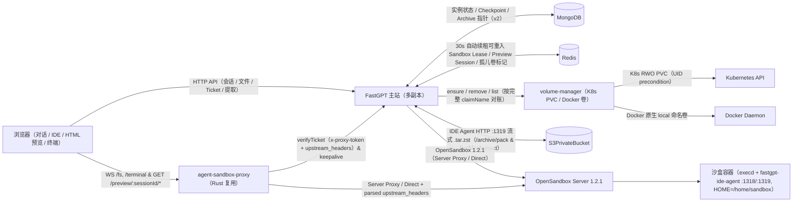

# Agent Sandbox 当前设计

状态：当前实现

最后核对：2026-11-20

> 本文档定义 AI Agent / WorkflowBuilder / Skill 编辑所使用的持久化 **Agent Sandbox** 完整架构、不变量、状态机与安全/运维契约；工作流「代码运行」节点使用的无状态 Code Sandbox（`projects/code-sandbox`）不在本文档范围内。
> 集成测试环境与 5 个测试套件说明见 [Agent Sandbox 集成测试](./integration-testing.md)。

---

## 1. 整体架构与技术定调

Agent Sandbox 统一基于 **OpenSandbox（`@alibaba-group/opensandbox@^1.2.1`）+ 原生持久卷（`volume-manager`）+ S3 `.tar.zst` 流式归档** 运行，`provider` 固定为 `'opensandbox'`，不存在多 Provider 运行时分发或独立 `sandbox-adapter` 包；Sandbox 不负责 Agent 模型循环、Workflow 调度或 Skill 版本创建，只向调用方提供准备就绪的 `SandboxClient` 与工作区运行时。

### 1.1 为何采用原生 PVC + `.tar.zst` 流式归档

- **拒绝主工作区对象存储 FUSE（如 JuiceFS）**：高小文件密度的典型包管理/构建（`bun install`、`pip install`、`rm -rf node_modules .venv`）在 FUSE 上相较原生块存储存在数十至数百倍延迟，且额外引入 MountPod 与数据库运维面；K8s 下采用标准 RWO PVC（Docker 下使用原生 `local` 命名卷）直接挂载 `$HOME`，保证运行期零额外存储延迟、Pod 重建热唤醒与 CSI 内核级磁盘配额控制。
- **全流式、零容器 `/tmp` 落盘的冷热分层**：低频冷数据按归档策略整包流式压缩为 `.tar.zst` 存入 `S3PrivateBucket` 并回收 PVC；容器内 `fastgpt-ide-agent` 与主站之间全链路流式传输，彻底消除早期 `/tmp` 暂存导致的恢复期双倍磁盘峰值与 `storageMB / 2` 容量折半；并发归档受独立低并发 Worker 与非阻塞租约反压控制，避免归档风暴。

### 1.2 总体拓扑



### 1.3 模块分层与依赖约束

服务端实现位于 [`packages/service/core/ai/sandbox/`](../../../../../packages/service/core/ai/sandbox)，保持严格单向依赖，**不使用 barrel re-export**：

```text
interface（面向 Workflow / API / Skill Edit / sourceCleanup，接收 sourceType/sourceId/userId/chatId）
    │
    ▼
application（runtime / lifecycle / lease / archive / ideAgent / preview / file / quota / ownership / sourceGuard / skillEdit / toolCall / cron）
    │
    ▼
infrastructure（instance repository / opensandbox SDK & runtimeProfile / volume service）
```

- **外部调用边界**：生产业务仅引用 `interface/*` 或显式公开模块，禁止直接跨层读写 `infrastructure/instance/schema.ts` 或直接发 Provider 请求；Mongo 读写集中于 `infrastructure/instance/repository.ts`。
- **运行客户端 vs 资源管理**：`SandboxClient` 仅服务运行态（可能触发新建或唤醒）；历史资源 `stop` / `archive` / `delete` / `keepalive` / `checkExist` 必须走 `resource` 或 `session` 服务，严禁隐式拉起 `archived` 实例。
- **4.18.0 过渡兼容层（[`legacy/index.ts`](../../../../../packages/service/core/ai/sandbox/legacy/index.ts)）**：严格隔离旧 Devbox 识别、旧工作区路径转换、未迁移门禁与遗留归档/卷标记；移除窗口为 `>= 4.19.0`。系统升级迁移脚本位于 `projects/app/src/migration/tasks/4180/`，直接使用目标 Schema，不向运行期新增迁移转导接口。

---

## 2. 配置边界与基础设施参数

### 2.1 主站运行态实例配置（`system_instance_configs`）

主站运行时统一读取 `getSystemInstanceConfig().subservice.agentSandbox`（Schema 位于 [`packages/global/common/system/config/schemas/subservice.ts`](../../../../../packages/global/common/system/config/schemas/subservice.ts)），不再于运行期读取 `AGENT_SANDBOX_*` 或已下线的 `AGENT_SANDBOX_PROVIDER` 环境变量（旧 ENV 仅在 4.18.0 系统配置迁移任务一次性导入，详见 [实例配置与环境变量边界](../../../common/admin-instance-config-env-boundary.md)）：

| 配置组 | 字段与默认值 | 职责说明 |
| --- | --- | --- |
| 开关与代理 | `enabled`、`proxy: { wsUrl, previewUrl, secret }` | 全局启停；WS / 预览网关地址与 HS256 代理共享密钥（≥ 32 字节） |
| `common` | `cpuCount=1`、`memoryMiB=2048`、`storageSizeGi=1`、`suspendMinutes=60`、`archiveInactiveDays=7`、`maxEditDebug=100`、`maxPerTeam=null`、`npmRegistry`、`pypiIndexUrl`、`aptMirror` | 计算与存储配额、无操作暂停阈值、冷归档阈值、全局/单团队并发配额、包管理器默认镜像源 |
| `opensandbox` | `baseUrl`、`apiKey`、`runtime='docker'\|'kubernetes'`、`cpuOvercommitFactor=1`、`memoryOvercommitFactor=1`、`image`、`useServerProxy=true`、`volumeManagerUrl`、`volumeManagerToken`、`volumeNamePrefix='fastgpt-session'` | 控制面地址与凭据、底层运行时、K8s 超售系数、默认容器镜像（需含完整 tag）、Server Proxy 端点转发开关、`volume-manager` 地址/Token 与 PVC 前缀 |

资源限制与超售规则：

- **存储配额换算（[`config.ts`](../../../../../packages/service/core/ai/sandbox/config.ts)）**：`getAgentSandboxDiskBytes()` 为 `Math.round(storageSizeGi * 1024 * MB_BYTES)`。因归档全程在容器内流式输出（`/tmp` 零落盘），不再做 `storageMB / 2` 折半或额外容量预留扣减。
- **Kubernetes 资源规格（[`runtimeProfile.ts`](../../../../../packages/service/core/ai/sandbox/infrastructure/opensandbox/runtimeProfile.ts)）**：Pod `resourceLimits` 下发完整 CPU 与内存；**仅当 `cpuOvercommitFactor > 1` 或 `memoryOvercommitFactor > 1` 时计算并下发 `resourceRequests`**。FastGPT **不下发** K8s `ephemeral-storage` limits/requests，由集群或命名空间策略（如 `LimitRange`）控制。

### 2.2 独立协同微服务环境变量

以下环境变量仅由独立容器/微服务自身读取，不纳入主站 `system_instance_configs`：

- **`projects/agent-sandbox-proxy`**：`PORT`、`FASTGPT_APP_URL`、`FASTGPT_APP_REQUEST_TIMEOUT_SECS`、`AGENT_SANDBOX_PROXY_SECRET`、`AGENT_SANDBOX_PROXY_ADDRESS_CACHE_TTL_SECS`、`AGENT_SANDBOX_PROXY_REWRITE_HOST`、`RUST_LOG`。
- **`projects/volume-manager`**：`PORT`、`VM_AUTH_TOKEN`、`VM_RUNTIME`（`docker | kubernetes`）、`VM_DOCKER_SOCKET`、`VM_DOCKER_API_VERSION`、`VM_K8S_NAMESPACE`、`VM_K8S_PVC_STORAGE_CLASS`、`VM_LOG_LEVEL`。
- **`projects/fastgpt-ide-agent` 与沙盒镜像入口（`/usr/local/bin/entrypoint.sh`）**：`FASTGPT_WORKDIR`（默认 `/home/sandbox/workspace`）、`FASTGPT_RUNTIME_DIR`（默认 `/var/lib/fastgpt-runtime`）、`HOME`（默认 `/home/sandbox`）、`SHELL`、`FASTGPT_IDE_MAX_FILE_BYTES`、`FASTGPT_IDE_WS_MAX_MESSAGE_BYTES`、`FASTGPT_IDE_WS_MAX_FRAME_BYTES`；`entrypoint.sh` 固定拉起 `fastgpt-ide-agent` 后清除 `FASTGPT_WORKDIR`、`FASTGPT_RUNTIME_DIR` 等启动控制变量；镜像同时固化 `PIP_BREAK_SYSTEM_PACKAGES=1` 与 `PIP_NO_CACHE_DIR=1`，避免在持久 `$HOME` 产生冗余 pip 缓存。

---

## 3. 实例身份、Workspace 模型与容器三层存储

### 3.1 逻辑归属与稳定 `sandboxId`

业务归属统一使用 `sourceType + sourceId + userId`。API 路由接收外部 raw target（`appId` / `skillId` / 等）并经 `parseApiInput` 转换为标准 `sourceType/sourceId`；支持 `SandboxSourceTypeSchema` 定义的三种类型（`chatAgentHelper` 调用 `getSandboxUserId` 显式抛错）：

| 场景 | `sourceType` | 逻辑 `userId` 解析 | `sandboxId`（`generateSandboxId`） | 会话 `chatId` 约束 |
| --- | --- | --- | --- | --- |
| App 对话 | `'app'` | 有效用户 `userId` | `app-<sha256_16(appId-userId)>` | 仅用于 `sessions/<segment>` 子目录 |
| WorkflowBuilder | `'workflowBuilder'` | 有效用户 `userId` | `workflowbuilder-<sha256_16(appId-userId)>` | 仅用于 `sessions/<segment>` 子目录，与普通 App 隔离 |
| Skill 编辑调试 | `'skillEdit'` | 固定 `'skillEdit'` | `skilledit-<sha256_16(skillId-skillEdit)>` | 前端/鉴权边界强制限定 `'edit-debug'` |

`sandboxId` 的哈希取 16 位小写十六进制；App 与 WorkflowBuilder 均不把 `chatId` 写入实例 ID（同一用户在同一 App 或 Builder 下的多个对话共享同一个物理沙盒与环境，不同用户完全隔离）。

### 3.2 Workspace 路径拆分与文件规则

统一由 `getSandboxRuntimePaths`（[`utils/index.ts`](../../../../../packages/service/core/ai/sandbox/utils/index.ts)）与 `SandboxClient.getRuntimePaths()` 向文件 API、IDE 和工具层暴露，调用方禁止自行硬编码拼接：

```text
workspaceRoot        = /home/sandbox/workspace              # 保留 /workspace -> /home/sandbox/workspace 软链
runtimeSkillsRoot    = /home/sandbox/workspace/projects     # 已发布 Skill 版本共享缓存根目录（<versionId>）
sessionWorkDirectory = /home/sandbox/workspace/sessions/<segment>
```

- **会话目录编码**：App / WorkflowBuilder 对 `chatId` 调用 `getSandboxSessionPathSegment`——常规 `encodeURIComponent(chatId)`（非 `.` / `..` 且 ≤ 200 字节）原样使用，超长或特殊输入降级为 `chat-<sha256_40>`。
- **App / WorkflowBuilder 边界**：Sandbox 工具（相对路径锚定）、对话输入文件（写入 `<sessionWorkDirectory>/user_files/`）与浏览器 `SandboxEditor` 默认锁定在 `sessionWorkDirectory`（编辑器当前不提供切回 `workspaceRoot` 的 UI）。注意：`sessions/<segment>` 是**默认工作目录隔离，不是同一用户沙盒内的硬安全边界**。
- **Skill Edit 边界**：`sessionWorkDirectory === workspaceRoot`，直接编辑 `/home/sandbox/workspace/`（`skills/<skillName>/SKILL.md`）。
- **路径解析约束（`resolveSandboxRuntimePath`）**：拦截 `..` 路径穿越；相对路径以 `sessionWorkDirectory` 为基准；默认允许工具传入受控绝对路径以读取容器内只读资源（如内置 Skill），而面向文件编辑/上传/下载/预览的入口显式设置 `allowOutsideWorkspace: false`，严格限制落在 `workspaceRoot` 内；写入文件前统一经 `prepareSandboxFileParentDirectories` 批量创建父目录。
- **用户输入文件去重（`runtime/files.ts`）**：同一会话沙盒内多节点/子应用并发注入 `user_files/` 时，按会话级分配表以文件 URL 去重：相同 URL 复用原分配文件名，不同 URL 同名文件自动递增后缀并同步回写 `file.name` 与 `file.sandboxPath`。

### 3.3 三层存储与双域 `state.json` 解耦

| 层级与路径 | 存储介质 | 重建/归档行为 | 承载内容 |
| --- | --- | --- | --- |
| **系统目录**<br>`/usr/local/bin/entrypoint.sh` | 镜像只读系统层（`root:root 0755`） | 随容器启动运行，不被 `$HOME` 挂载覆盖 | 决定是否启动 `fastgpt-ide-agent` 并清理启动内部 env |
| **容器临时层**<br>`/var/lib/fastgpt-runtime/` | 容器临时层（不落 PVC、不进冷归档） | 每次容器重建/冷恢复自动清空刷新 | `.fastgpt-ide-agent-password`（`0600` 口令）、容器级 `state.json`（`aptMirror`、`sandboxEntrypoint:<scope>`、`skillEntrypoints`、`builtinSkill:*`）、APT 源备份及内置只读 Skill `/var/lib/fastgpt-runtime/skills/<name>` |
| **`$HOME` 持久层**<br>`/home/sandbox/` | 原生 PVC / Docker 命名卷 + `.tar.zst` 冷归档 | `running` / `stopped` 常驻持久卷；`archived` 整包（**不剔除缓存目录**）存 S3 | 用户环境、dotfiles、安装依赖与缓存、卷级 `state.json`（`/home/sandbox/.fastgpt/runtime/state.json`，记录 `npmMirror`/`pypiMirror` 状态与备份）、工作区 `/home/sandbox/workspace/` |

两个作用域的 `state.json` 均使用统一的 `values: Record<string, string | string[]>` 结构（共享读写、校验、去重与空值清理），同一生命周期/prepare 链路通过 `AsyncLocalStorage` 缓存并合批落盘（`application/runtime/state.ts`）。容器重建后，APT 源、入口脚本与内置 Skill 依赖容器层 `state.json` 缺失状态自动重跑校准，而 `npm`/`pypi` 源配置跟随 `$HOME` 延续保留。

---

## 4. 数据模型、稳态不变量与配额体系

### 4.1 MongoDB Schema 与索引（`agent_sandbox_instances_v2`）

模型位于 [`infrastructure/instance/schema.ts`](../../../../../packages/service/core/ai/sandbox/infrastructure/instance/schema.ts)，唯一业务/物理约束通过 `defineIndex` 声明：

- **核心字段**：`provider: 'opensandbox'`、`instanceId?`（OpenSandbox 容器/Pod ID，支持跳过列表扫描直连）、`sandboxId`、`sourceType`、`sourceId`、`userId`、`teamId?`、`status`、`lastActiveAt`、`createdAt`、`limit?: { cpuCount?, memoryMiB? }`、`image?: SandboxImageConfig`、`versionId?`、`storage?: { volumes?, mountPath?, archive?, legacyDevboxPendingCleanup? }`、`operation?: { id, type, phase, previousStatus?, startedAt, heartbeatAt, failedAt?, retryAfter?, error? }`。
- **稳态物理不变量（`SandboxInstanceZodSchema.superRefine` 校验）**：

| 稳态 | `operation` | `instanceId`（远端容器） | `storage.volumes`（PVC/卷） | `storage.archive`（S3 `.tar.zst`） | 计入 Quota |
| --- | --- | --- | --- | --- | --- |
| `running` | ❌ 禁止存在 | ✅ 有值（旧记录首次连回懒回填） | ✅ 非空（含完整 `claimName`） | 可保留上一代历史归档指针（CoW 热备） | ✅ 是 |
| `stopped` | ❌ 禁止存在 | ❌ 清空（`$unset`） | ✅ 非空（温态 PVC） | 可保留上一代历史归档指针 | ❌ 否 |
| `archived` | ❌ 禁止存在 | ❌ 清空（`$unset`） | ❌ 清空（0 持久卷） | ✅ 非空（`objectKey`、`generation`、`format: 'tar.zst'`、`sizeBytes`、`archivedAt`） | ❌ 否 |

- **索引清单**：
  - **当前索引**：`{ provider: 1, sandboxId: 1 }`（unique）、`{ sourceType: 1, sourceId: 1, userId: 1 }`（unique）、`{ teamId: 1, status: 1 }`、`{ status: 1, lastActiveAt: 1 }`、`{ status: 1, 'operation.heartbeatAt': 1 }`、`{ 'storage.volumes.claimName': 1 }`（加速孤儿卷反向对账）。
  - **历史废弃声明（`deprecated: true`）**：`{ sourceType: 1, status: 1, provider: 1 }`、`{ status: 1, 'metadata.operation.heartbeatAt': 1 }`。

### 4.2 Quota 与团队归属不变量

- **共用活跃池与状态口径（`application/quota.ts`）**：`app`、`workflowBuilder`、`skillEdit` 共用系统总上限（`common.maxEditDebug`，默认 `100`）与团队配额（`common.maxPerTeam`，默认不限）。**只统计 `sandboxActiveStatusList`：`['provisioning', 'running', 'stopping', 'restoring']`**；`stopped`、`archiving`（短暂后台打包容器受 `SANDBOX_ARCHIVE_CONCURRENCY = 2` 反压控制，防止满额阻塞 PVC 回收）、`archived`、`deleting` 不计入，释放路径（`stop` / `archive` / `delete` / `keepalive` / `checkExist`）不经过配额检查。
- **准入点与并发语义**：在新建、停止重启、`restoring` 前检查（运行态快路径与过渡态接管不重复占额），超限直接拒绝并返回 409（`510004` / `510005`），不排队；检查与写入之间允许极短并发窗口（高并发下可短暂略超，不为此加全局分布式队列）。
- **团队归属强制约束（`application/ownership.ts`）**：所有新实例和缺乏 `teamId` 的存量实例统一通过 source（App / Skill）解析并回填 `teamId`，若 source 缺失团队、归属冲突或回填失败立即拒绝运行，**不降级为仅检查系统配额**。

---

## 5. 生命周期状态机、可重入租约与崩溃恢复不变量

### 5.1 生命周期状态与 Phase 推进

每个过渡态与唯一 `operation.type` 严格绑定（`expectedOperationByStatus`），每次远端/卷/S3 副作用前通过 Mongo CAS 抢占 `operation.id`，副作用完成后推进持久化 `phase`，最后凭相同 `operation.id` 提交终态：

| 操作（`type`） | 起始态 | 过渡态 | 正向 `phase` 序列 | 终态 | 失败回滚与说明 |
| --- | --- | --- | --- | --- | --- |
| 新建 / 唤醒（`provision`） | 无记录 / `stopped` | `provisioning` | `claimed -> providerEnsured` | `running` | 回滚序列：`rollbackClaimed -> rollbackProviderReleased -> rollbackVolumeReleased -> stopped`（保留 PVC 与业务元数据） |
| 暂停 / 换镜像停机（`stop`） | `running` | `stopping` | `claimed -> providerDeleted` | `stopped` | 删除远端容器并清空 `instanceId`，保留完整 `storage.volumes` PVC |
| 冷归档（`archive`） | `stopped` | `archiving` | `claimed -> archiveUploaded -> providerDeleted -> volumeDeleted` | `archived` | 仅 `claimed` 失败/抢占可退回 `stopped`；过 `archiveUploaded` 必须推完删容器/删卷进入 `archived` |
| 冷恢复（`restore`） | `archived` | `restoring` | `claimed -> volumeAssigned -> archiveInstalled` | `running` | 未到 `archiveInstalled` 前任一失败走回滚序列回到 `archived`，必须删容器+删刚分配空 PVC |
| 彻底删除（`delete`） | 任意可抢占态 | `deleting` | `claimed -> providerDeleted -> volumeDeleted -> archiveDeleted` | 删除 Mongo 文档 | 幂等清理容器 -> 卷 -> S3 全世代归档；存在未收口旧 Devbox 时保留/收敛清理标记 |

> `legacy/index.ts` 兼容读取历史 `rollbackProviderDeleted` 与旧 `restoring` 阶段（`previousProviderDeleted` / `previousVolumeDeleted`）。

### 5.2 统一可重入 Redis Lease 与 Store-Load 屏障

- **单一可重入锁（[`application/lease.ts`](../../../../../packages/service/core/ai/sandbox/application/lease.ts)）**：
  - 锁键 `agent-sandbox:lease:${sandboxId}`，TTL **`30s`**、自动续租间隔 **`5s`**。
  - 基于 `AsyncLocalStorage` 按 `sandboxId` 自动重入复用，使外层工作区 `prepare` / `skillEdit` 部署打包与内层实例启动/停机共享同一个临界区，消除双锁嵌套与释放断层。
  - 前台请求默认有界等待 **`180s`**（同进程持锁释放通过本地通知 `0ms` 即时唤醒，跨进程 `40ms..400ms` 抖动退避并响应 `AbortSignal`），等待超时返回 409 `agentSandboxInitializing`（`510001`）；后台 Cron / 孤儿 GC 传 **`waitTimeoutMs: 0`** 立即让路。
  - **租约丢失纪律**：一旦 `lease.assertValid()` 失效或续租失败，禁止继续提交终态或发起 `stop`/`delete` 补偿，仅关闭本地连接（Mongo fencing 为保守防御，不能取消已发出的 HTTP 请求）。
- **Store-Load 源存活性屏障（`application/sourceGuard.ts` & `resource/sourceCleanup.ts`）**：首次新建落库 `provisioning` 占位后再次执行 `assertSandboxSourceActive`；若 App/Skill 在创建窗口并发软删除，立即回滚撤销占位。相对地，删除侧先确认主表已标记软删除再逐个加 `Sandbox Lease` 回收。

### 5.3 `running` 稳态快路径与跨代际保护

- **无锁快路径（`application/runtime/client.ts` + `service.ts`）**：命中 `running` 记录时（工具执行、`keepalive`、IDE 连接），直接构造客户端并在 Mongo 执行 **带 `expectedWorkspaceClaimName` 条件的 CAS `touch`** 刷新 `lastActiveAt`（若历史记录缺 `instanceId` 则同步惰性回填），随后调用 **`Sandbox.connect({ sandboxId: instanceId, skipHealthCheck: true })`** 直连；不抢占 Redis 锁、不扫控制面列表。
- **并发防篡改约束**：快路径严禁覆写 `storage`；一旦 `expectedWorkspaceClaimName` CAS 失配（说明期间发生过 `archive -> restore` 新代次卷切换）或远端返回 `404` / 非 Running / `502`，立即降级进入 `withSandboxLease` 重读实例并按最新 `storage` 重建/自愈。

### 5.4 三大崩溃恢复不变量与原地静默换镜像

1. **`restoring` 防"空温盘伪装"不变量（[`lifecycle/service.ts`](../../../../../packages/service/core/ai/sandbox/application/lifecycle/service.ts)）**：
   - `restoring` 必须先分配新 `generation` 空 PVC（`volumeAssigned`），再起容挂新卷（写 `instanceId`）并流式完成 `.tar.zst` 解压（`archiveInstalled`）。
   - **回滚铁律**：仅当 `phase === 'archiveInstalled'` 且远端容器仍确认 `Running` 才允许补交为 `running`；在 `archiveInstalled` 之前任一步失败（例如数据面 `/archive/extract` 报错）**必须销毁临时容器 + 删除刚分配的新 `generation` PVC + `$unset storage.volumes` 与 `instanceId`，带着完整无损的原 S3 归档退回 `archived`**。绝不允许带着未解压的空 PVC 退回 `stopped`，否则将误判为空工作区并在下次归档时覆盖有效历史备份。
   - 若因 `provider` / 卷清理失败导致未完成清理，保持 `restoring` 过渡态与 rollback checkpoint（**绝不提前释放 Quota**），并在每次提交稳态前重查容器确已释放（`assertContainerReleased`）。
2. **`archiving` 中断与前台唤醒抢占**：
   - `phase === 'claimed'` 时原温态 PVC 完好无损：无论是后台崩溃恢复还是前台用户对话抢占，直接停删临时容器退回 `stopped`，立即复用原 PVC 秒级重挂唤醒；
   - 一旦越过 `archiveUploaded`（新 `.tar.zst` 已入 S3 且原子提交进 `storage.archive`），旧 PVC 删除已在途，必须幂等推完 `providerDeleted -> volumeDeleted` 至 `archived`，再由唤醒链路从新归档恢复。
3. **同 Provider 原地重挂 PVC 静默镜像升级（[`runtime/service.ts`](../../../../../packages/service/core/ai/sandbox/application/runtime/service.ts)）**：
   - 废除旧版“换镜像先归档 S3 再删 PVC 重建”的高开销流程与 Skill Edit 升级弹窗；
   - 当 `resource.image !== targetImage` 且存在 `claimName` 时，在 `Sandbox Lease` 内：`stopped` 直接使用新镜像 + 同 `claimName` PVC 拉起启动；`running` 先销毁旧容器（等待 `UnExist`）**保留原 PVC**，再原地以新镜像重挂同卷启动并刷新 `image`、`instanceId`（容器层 `state.json` 清空从而自动触发 `apt` 与 `entrypoint` 校准），`1~2s` 静默完成。

### 5.5 超时窗口、心跳、`operationId` 围栏与 OpenSandbox 1.2.1 客户端协议

- **HTTP 与流超时（[`constants.ts`](../../../../../packages/service/core/ai/sandbox/constants.ts)）**：常规 OpenSandbox 控制面请求 **`30s`**；`Sandbox.create` 单独使用 **`210s`**（覆盖 Docker 默认 `180s` 镜像拉取/创建及 K8s 默认 `60s` Pod 就绪等待，`readyTimeoutSeconds = 120`）并全程透传 `lease.signal`；`/archive/pack` 与 `/archive/extract` HTTP 流超时 **`600s`**；健康检查 **`10s`**。
- **心跳与接管计算**：长耗时操作每 **`15s`** 刷新 Mongo `operation.heartbeatAt`。本进程捕获的确定性业务/数据面失败（含 K8s Pod 就绪超时、`/archive/extract` 失败）直接写 `retryAfter = now`（0ms 立即接管回滚）；若发生进程崩溃或控制面未收到明确终态的传输未决异常：非创建阶段及创建后阶段等待 **`60s`**，仍可能存在在途 `POST /sandboxes` 请求的阶段（`provisioning:claimed`、`restoring:volumeAssigned`、冷启动 `archiving:claimed`）等待 **`240s`**（`210s + 30s` 余量）后安全接管。
- **`metadata.operationId` 围栏**：新建容器统一在 metadata 写入 `operation.id`；`ensureRunning`、崩溃恢复与孤儿容器 GC 据此识别迟到或过期代次容器并主动销毁（等轮询至 `UnExist (404)`）。
- **OpenSandbox 1.2.1 客户端最佳实践（[`opensandbox.ts`](../../../../../packages/service/core/ai/sandbox/infrastructure/opensandbox/opensandbox.ts)）**：
  - 共享 `ConnectionConfig.withTransportIfMissing()` 全局 `undici` Keep-Alive 连接池（按 `baseUrl|apiKey|useServerProxy` 维度复用，消除每请求建池泄漏与慢握手）；
  - `writeFiles` 按无冲突路径分波次有界并发上传；
  - `execute` 消费 SSE 并在收到 `execution_complete` / `error` 时立即 `abort` 底层流消除尾延迟，配合 `BoundedOutputBuffer` 防 OOM；`create` 固定传 `timeoutSeconds: null`（无服务端自动到期杀停）；
  - `stop()` 调用 `kill` 删除远端容器但保留 FastGPT PVC/Mongo/S3；`close()` 仅释放本地 HTTP 传输不改远端生命周期；有 client 走 `Sandbox.kill()`、无 client 后台清理走 `SandboxManager.killSandbox()`，两条路均幂等确认 `404`/`UnExist`。

---

## 6. `.tar.zst` 流式归档、安全边界与 `volume-manager` / GC

### 6.1 安全与隔离边界总览

1. **非 root 容器与卷权限**：容器以 `sandbox`（`uid=10001`）运行；Kubernetes Pod 与 PVC 绑定 `fsGroup: 10001` 与 `fsGroupChangePolicy: "OnRootMismatch"` 确保挂卷可写且大目录不反复 `chown`。Docker 模式下 `opensandbox-server` 读写挂载 `/var/run/docker.sock`，`volume-manager` 仅只读挂载（`:ro`）。
2. **网络出站策略**：
   - Docker 运行时注入 `OPEN_SANDBOX_PROTECTED_NETWORK_DENY_RULES`（`defaultAction: 'allow'`），封堵 `localhost`、`127.0.0.0/8`、`::1/128`、RFC1918 私网、CGNAT `100.64.0.0/10`、链路本地及云元数据段 `169.254.0.0/16`、IPv6 环回/私网/组播（`224.0.0.0/4`、`fc00::/7`、`fe80::/10`）、`*.local` 以及 Docker/OrbStack 宿主机别名；调用方只允许追加 `deny` 规则，禁止绕过或改成 `allow`。
   - Kubernetes 运行时不启用 OpenSandbox Egress Sidecar（不传 `networkPolicy`），由部署侧 `CiliumNetworkPolicy` / `NetworkPolicy` 统一拦截集群内网/节点/元数据 CIDR 并放行 CoreDNS 与公网出口。
3. **逐实例随机口令与通道隔离**：已移除 `secureAccess` 端点令牌；`getEndpoint` 仅按 `useServerProxy` 附带控制面代理头 `OPEN-SANDBOX-API-KEY`。`fastgpt-ide-agent` 启动生成逐实例随机口令写至 `/var/lib/fastgpt-runtime/.fastgpt-ide-agent-password`（`0600`），所有 WS（`1318`）与 HTTP（`1319`）请求校验 `x-fastgpt-agent-token`；`agent-sandbox-proxy` 从 `verifyTicket.upstream_headers` 取得该口令及控制面代理头，仅做 Header 语法校验并保护 `Host`/WS 握手头/`x-fastgpt-preview-method` 后透传。
4. **`fs/*` 与 `GET /preview/*` 边界分治**：`fastgpt-ide-agent` 无 `fs/exec`（压缩包原地解压由 `/api/core/ai/sandbox/extractZip` 调 OpenSandbox `execd` 执行 `unzip -q`）；`fs/*` 与终端/Shell 同 uid，支持工作区内合法软链读写，拦截 `..`、绝对路径、`\`、NUL/控制字符和根目录 `lost+found`；直接暴露浏览器的 `GET /preview/*` 使用 `cap-std` 将文件打开与软链解析严格锁在工作区目录内，返回 `x-fastgpt-preview-origin: ide-agent`。

### 6.2 归档信任边界与 HTTP / 条目规范

`fastgpt-ide-agent` 与终端/Shell 以相同镜像用户运行，且一卷仅挂一例，因此 **agent 不是安全边界，FastGPT 主站才是不可信归档字节的唯一安全校验边界**（主站消费任何字节流均在内存中完成，**从不写条目到本地磁盘**）：

| 层级 | 明确承担职责 | 明确不承担 |
| --- | --- | --- |
| `fastgpt-ide-agent`（[`archive.rs`](../../../../../projects/fastgpt-ide-agent/src/archive.rs)） | `tokio::io::duplex` + `tar` + `zstd(level=1)` 零 `/tmp` 流式收发。打包：单遍遍历、按主站下发规则跳过（`.gitignore` 语法）、固定忽略根 `lost+found`、原子写临时文件与 socket/FIFO/设备；文件在打包期间变化时按 header 长度截断或补零防中途失败；软链原样写入。解包：完全交由 `tar::Archive::unpack`（跳 `..`、拒绝经软链父目录/硬链逃逸、目录权限延后、覆盖同名）并排空校验 zstd checksum。 | 条目数/体积上限、软/硬链接策略、缓存目录硬编码名单、自研清盘/回滚 |
| 主站流式编解码（[`tarZst.ts`](../../../../../packages/service/common/file/tarZst.ts)、[`zip.ts`](../../../../../packages/service/common/file/zip.ts)） | 不可信输入校验边界：header 数与总解压字节上限；`normalizeArchiveEntryPath` 统一拦截绝对路径、Windows 盘符、`..`、NUL；仅产出 `file`/`directory`/`symlink`。ZIP 经 HTTP Range（512 KiB LRU 块缓存 + 大条目直通）→ `yauzl` → tar/PAX → `zstd` 实时转码（拒绝加密条目）。 | 解析软链目标文件、按 MIME 拒整包 |
| 主站业务策略 | 决定打包目标与排除集；冷归档全量打包 `$HOME`；Skill 发布/导出只包 `workspace` 并做 `.gitignore` 与目录结构合法性/逃逸软链校验。 | — |

**IDE Agent 1319 端口 HTTP 契约**（主站统一经 [`ideAgent.ts`](../../../../../packages/service/core/ai/sandbox/application/ideAgent.ts) `packSandboxDirectory` / `extractToSandboxDirectory` 调用，内置 `401` 刷新口令重读、`502/503/504` 退避及请求体重开）：

| 路由 | 请求输入 | 响应与异常语义 |
| --- | --- | --- |
| `POST /archive/pack` | JSON `{ targetDir?, excludePatterns? }`（`targetDir` 相对 `$HOME`） | `200` `.tar.zst` 流；`204` 目录不存在或排除后全空；`400` 参数非法；首个条目前失败返回 `500`；流式中途失败立即截断 chunked body，防止上传残包 |
| `POST /archive/extract` | 请求头 `x-fastgpt-archive-target-dir-b64`（可选，相对 `$HOME`），请求体 `.tar.zst` 流 | `204` 解包成功；`400` 参数非法；`500` 解包错误文本 |

**全场景链路矩阵**：

| 场景 | 执行链路 | 主站校验与排除策略 |
| --- | --- | --- |
| 工作区冷归档 / 恢复（[`archive.ts`](../../../../../packages/service/core/ai/sandbox/application/archive.ts)） | `pack(不传 targetDir)` → `S3SandboxSource` Multipart 上传；恢复：`S3 GetObject` → Web `ReadableStream` (`duplex: 'half'`) → `extract(根)`；`sizeBytes === 0` 跳过下载 | **冷归档不剔除任何缓存目录**（保留 `$HOME` 完整依赖/环境/软链），字节直通，容器零 S3 AK/SK |
| Skill 保存发布（`skillEdit/deploy.ts`、`runtime.ts`） | `pack(targetDir='workspace', gitignore)` → 单流 `pipe` 并行送达 S3 上传与 `parseTarZstStream` | 排除默认 `.gitignore` + 根 `.gitignore` + `package.zip` + `.fastgpt/`；校验总大小、目录结构（`skills/<name>/SKILL.md`）并**拒绝逃逸工作区软链**，失败删未绑定 S3 对象 |
| Skill 导出（`api/core/ai/skill/export.ts`） | `pack(workspace)` → `parseTarZstStream` → `archiver` 实时流出 `.zip`（保留软链条目） | 同上校验条目上限、规范路径、禁止逃逸软链与 `SKILL.md` 校验 |
| Skill 部署注入（`runtime/skill/core.ts`、`prepare.ts`） | `openSkillPackageTarZstStream`（`.tar.zst` 直传；`.zip` Range 实时转码）→ `extract(targetDir)` | 压缩/解压总大小上限、路径规范化、支持兼容导入包与历史 `.zip` |
| 用户界面 ZIP 解压（`extractZip.ts`） | 调用 OpenSandbox `execd` 在沙盒内执行 `unzip -q` | 按业务鉴权后原样解压 |

**S3 CoW 归档通道（[`common/s3/sources/sandbox/index.ts`](../../../../../packages/service/common/s3/sources/sandbox/index.ts)）**：使用 `sandbox/archive/<sandboxId>/<12位hex generation>.tar.zst` 不可变键；流式上传采用 **`5 MiB` 惰性分片阈值**（`<= 5 MiB` 单次 `uploadObject`，`> 5 MiB` 自动切换多厂商统一 `IStorage` Multipart 接口，失败自动 `abortMultipartUpload`）；`restoring` 成功切换或再次冷归档提交新 `storage.archive` 并删完旧卷后，异步尽力清理被覆盖的旧代 S3 对象；后台归档 Cron 使用 `matchLastActiveAt` CAS 与 `waitTimeoutMs: 0`，前台并发请求随时抢占让路。

### 6.3 `volume-manager` PVC 代际生命周期与双向孤儿 GC

- **K8s PVC `Terminating` 竞态收敛（[`K8sVolumeDriver.ts`](../../../../../projects/volume-manager/src/drivers/K8sVolumeDriver.ts)）**：
  - K8s 中 `DELETE PVC` 返回 `2xx` 仅代表标记 `deletionTimestamp`，旧 PVC 处于 `Terminating` 时新 Pod 无法调度。因此主站预生成并持久化完整 **`claimName`（`${volumeNamePrefix}-${sandboxId}-${8位hex|0}`）**，`volume-manager` 只负责底层操作而不推导业务 ID；**删除时永远消费 Mongo 已持久化的 `claimName`，即使修改前缀配置也能正确回收历史卷**。
  - `K8sVolumeDriver` 只解析 `metadata.uid` 与 `deletionTimestamp` 收敛为 `absent`、`active(uid)`、`deleting(uid)`：`ensure` 不返回任何带 `deletionTimestamp` 的 PVC（遇删除中先等待 UID 消失再创建，409 退避重读）；`remove` 携带 **`preconditions.uid`** 发起删除并按 **`500ms`** 间隔最长轮询 **`5 分钟`** 直至当前 UID 消失或被替换（说明：保证 PVC API generation 结束，不承诺底层 CSI detach 同步完成）。
- **所有权标签与兼容过渡**：托管卷统一标注 `app=fastgpt`、`managed-by=fastgpt-volume-manager`；4.18.0 过渡期保留 `allowLegacyUnlabeled`（移除窗口 `>= 4.19.0`）允许主站可信 `claimName` 接管未完整打标的存量卷，同时 `canAdoptLegacyLabels` 严格拒接 `app.kubernetes.io/`、`com.docker.compose.`、`k8s-app`、`helm.sh/chart` 等外部平台卷。
- **三大定时调度任务（[`application/cron.ts`](../../../../../packages/service/core/ai/sandbox/application/cron.ts)）**：
  - **`*/10 * * * *`**：停用超 `suspendMinutes` 的活跃 `running` 实例；恢复或回滚超期/失败的 `archiving`、`stopping`、`deleting`、`provisioning`、`restoring`。
  - **`0 */12 * * *`**：以 `SANDBOX_ARCHIVE_CONCURRENCY = 2`（游标批大小 `100`）对超 `archiveInactiveDays` 的 `stopped` 实例及需要规范化升级的记录执行冷归档。
  - **`*/30 * * * *`**：双向孤儿 GC——① **孤儿容器**：无对应 Mongo 记录的容器满 `10 分钟` 宽限（或容器 `metadata.operationId` 已落后于当前文档）立即销毁；② **孤儿存储卷**：仅凭当前 `listSessionVolumes` 写入 Redis 观察标记（TTL **`2 小时`**，`ORPHAN_VOLUME_OBSERVATION_TTL_SECONDS`），观测间隔满 **`30 分钟`**（`ORPHAN_VOLUME_GRACE_PERIOD_MS`）且再次对账确认仍无 Mongo `storage.volumes.claimName` 引用时执行销毁（防止并发新建尚未落库被误删）。

---

## 7. Prepare Pipeline、Entrypoint、Skill 部署与沙盒工具

### 7.1 Prepare Pipeline 与运行时初始化（`application/runtime/`）

使用 `prepareSandbox(context, ...steps)` 顺序按需组合以下可复用步骤（通用 prepare 层不直查业务数据库）：

1. **目录与用户输入文件（`files.ts`）**：确保 `sessionWorkDirectory`（或 `workspaceRoot`）与 `user_files/` 父目录存在，按作用域 URL 去重并递增同名后缀写入文件。
2. **包管理器镜像源收敛（`mirrors.ts`）**：`npm`/`pypi`（含 npm/pnpm/yarn/bun 与 pip/uv 配置）写入 `$HOME` 并记录在 `$HOME/.fastgpt/runtime/state.json`；`apt` 写入系统目录并记录在 `/var/lib/fastgpt-runtime/state.json`。采用 `MirrorFileMarkerSchema`（记录 `sha256`、`origin: 'created'|'backup'|'legacyBackup'` 与 `pending` 进行中标记），支持只读 APT 源保底跳过、可写源备份还原、中断续作及旧 `.copy` 文件兼容。
3. **内置辅助 Skill 同步（`runtime/skill/builtin.ts`）**：将宿主注入的内置 Skill（源码归 Pro 所有，社区版通过协议接口保持无依赖）写入容器临时层 **`/var/lib/fastgpt-runtime/skills/<name>`**，按内容 etag 去重跳过未变化文件；彻底不进入用户 `$HOME`、文件树、冷归档、导出包或发布包。
4. **已发布 Skill 版本部署（`runtime/skill/core.ts`、`prepare.ts`）**：校验团队与读取权限后，按 `<versionId>` 部署到共享 **`/home/sandbox/workspace/projects/<versionId>`**（同会话多节点按版本追加缓存互不删除，重建单个目录前先清理其对应旧 Skill entrypoint 标记）。
5. **Sandbox & Skill Entrypoint**：
   - **Sandbox Entrypoint（`entrypoint.ts`）**：脚本来自节点/应用配置（长度上限 `16 KiB`），在 `workspaceRoot` 执行（超时 `SANDBOX_ENTRYPOINT_TIMEOUT_SECONDS = 60`），**按 `sandboxEntrypoint:${sourceType}:${sourceId}:node:${nodeId}` 分作用域在容器级 `state.json` 记录 hash**，内容不变不重跑，父子节点/多节点互不覆盖（旧全局成功标记不迁移也不再参与去重）；执行失败、超时或状态写入失败仅记日志，**不阻断 Agent 主流程**。
   - **Skill Entrypoint（`runtime/skill/entrypoint.ts`）**：可选脚本固定为 `<projects>/<versionId>/entrypoint.sh`，在该版本目录执行，按 `versionId` 列表记入容器层 `skillEntrypoints`（超时 `60s`、输出上限 `8 KiB`）；失败不写成功标记，版本目录重建时清理对应标记，其他会话仍在使用的缓存版本标记保留。
6. **Skill 扫描（`core.ts`）**：单条 `find -prune` 命令（剪除 `node_modules`、`.venv`、`venv`、`.fastgpt` 等大目录）同时扫描用户 `projects/`（或 Skill Edit 工作区）与内置 `/var/lib/fastgpt-runtime/skills/`，将匹配 `SKILL.md` 的名称、描述与路径写入本轮 Agent reminder（Skill Edit 运行 `edit-debug` 时直接使用编辑器当前工作区，不拉取旧正式版本覆盖用户正在修改的文件）。

### 7.2 Sandbox 工具集（`application/toolCall/` & `packages/global/core/ai/sandbox/tools/`）

共提供 8 个内置工具，由 `runSandboxTools` 统一执行 JSON 解析、Zod 参数校验、工具路由及标准结果封装（已彻底移除旧 `sandbox_search` 入口）：

- `sandbox_shell`：在默认工作目录执行命令（超时 `1..600s`），采用尾部保留截断（`direction: 'tail'`）；
- `sandbox_read_file`：支持 `offset`/`limit`，文件读取采用头部保留截断；
- `sandbox_write_file` / `sandbox_edit_file`：写入前自动建父目录；
- `sandbox_grep` / `sandbox_find` / `sandbox_ls`：共享默认限制（`DEFAULT_GREP_LIMIT=100`、`MAX_GREP_LINE_CHARS=500`、`DEFAULT_FIND_LIMIT=1000`、`DEFAULT_LS_LIMIT=500`），文本输出统一受 **`2000` 行 / `50 KiB`**（按 UTF-8 字符边界截断）上限保护；
- `sandbox_get_file_url`：在工作区内验证路径后创建 Redis preview session 并返回短期只读代理 URL，不再上传 S3 临时文件。

---

## 8. IDE、HTML 预览、可用性降级与删除边界

### 8.1 浏览器 Ticket 与 Workspace 直连预览

- **HTTP API 边界（`projects/app/src/pages/api/core/ai/sandbox/` & `projects/app/src/service/core/sandbox/{auth,access}.ts`）**：
  - 面向前端：`checkExist`、`getTicket`、`getHtmlPreviewLink`、`upload`、`download`、`extractZip`。路由边界将 raw target 规范化为 `sourceType/sourceId`；`authSandboxSession` 按源校验访问权（普通 App 对话下执行文件写入/上传/解压/IDE 写票据时额外校验 App 写权限，防止终端访客篡改应用沙盒）。
  - 面向 Proxy 回连：`verifyTicket`、`keepalive`（强制校验 `x-proxy-token` 共享密钥）。`verifyTicket` 返回 `{ sandbox_url, upstream_headers, ws_limits }`，Proxy WebSocket 固定使用 **`64 MiB`** 最大消息与 **`16 MiB`** 最大帧限制。
- **HTML 预览与安全约束（[`application/preview.ts`](../../../../../packages/service/core/ai/sandbox/application/preview.ts) & `agent-sandbox-proxy`）**：
  - URL 形如 `<previewProxy>/preview/<sessionId>/<workspaceRelativePath>`；`sessionId` 为 **`24` 位 ASCII 字母数字随机字符串（首位小写字母，不含连字符**，Redis key `sandbox:preview:session:<sessionId>`，不带 `sourceType`/`sandboxId` 前缀）；同时向后兼容读取历史 `<app|skilledit>-<16hex>/<sessionId>/<path>` 链接（沿用原 Redis key 与 TTL，**不迁移、不续期、不再新签发**，随 `>= 4.19.0` 移除）。
  - 创建使用 Redis Lua 原子脚本同时完成过期索引淘汰、配额检查与写入：**单 session TTL 固定 `2 小时`（`7200s`），单 Sandbox 最多 `500` 个活跃 session**；超出抛出 `SandboxPreviewSessionLimitError`。
  - **安全语义**：preview URL 本质是针对该 Sandbox Workspace 的**短期只读 Bearer Capability**（Redis 中只保存业务寻址上下文，不存沙盒 IP 或 IDE Agent 口令）；支持 `GET`、`HEAD`、`ETag` 与单段 `Range`；禁止目录列表、路径穿越与逃逸 Workspace 软链；响应强制附加 `Referrer-Policy: no-referrer`、`X-Content-Type-Options: nosniff`、`Cache-Control: private, no-store`，且预览代理必须与主站不同源隔离；HTML 产物内必须使用 `./assets/...` 等相对资源路径（`/assets/...` 根路径会丢失 `/preview/<sessionId>` 前缀）。

### 8.2 可用性降级、`hasAgentSandbox` 与删除清理边界

- **可用性判断（[`application/availability.ts`](../../../../../packages/service/core/ai/sandbox/application/availability.ts)）**：
  - **App / WorkflowBuilder（优雅降级）**：`resolveAppSandboxAvailability` 按系统开关 -> 应用开关 -> 团队套餐（查询异常亦降级）顺序返回 `available: false` 及 `systemDisabled` / `appDisabled` / `teamPlanUnavailable`。不可用时跳过沙盒 system prompt、沙盒工具、依赖沙盒的 Skill、runtime 准备与 entrypoint，**不中断普通问答**。页面初始化不主动弹错误，仅点击虚拟环境入口或触发文件接口时提示；所有文件/Ticket/预览接口在服务端重新鉴权，不依赖前端拦截。
  - **Skill Edit / 显式调试（强依赖）**：调用 `assertSandboxAvailable` 在系统关闭或套餐不支持时直接返回 `510000` 权限错误。
- **工作流 `hasAgentSandbox` 传播与流式时序（[`workflow/dispatch/ai/sandbox.ts`](../../../../../packages/service/core/workflow/dispatch/ai/sandbox.ts)、[`access.ts`](../../../../../projects/app/src/service/core/sandbox/access.ts)）**：
  - 工作流中节点准备就绪后，`ensureWorkflowSandboxReadyForUse` **先落库更新 `Chat.summary.hasAgentSandbox = true`，再发送 SSE `ready` 事件**，保证本轮流式生成期间即可立即发起独立文件/Ticket API 鉴权；该标记只增不减，并经由子应用、插件、循环与并行节点向上层工作流摘要汇总（详情见 [Agent 节点设计](../../workflow/agent-node.md)）。
  - 会话级入口（`resolveSandboxSessionAvailability`）按 `Chat.summary.hasAgentSandbox` → `Chat Test metadata`（仅表达本轮根节点开关，忽略子流程）→ 应用持久化节点配置优先级校验，且始终叠加系统与团队套餐实时校验。
- **错误码约定（[`packages/global/common/error/code/sandbox.ts`](../../../../../packages/global/common/error/code/sandbox.ts)）**：
  - `510000` `agentSandboxPermissionDenied`
  - `510001` `agentSandboxInitializing`（409，租约等待超时）
  - `510004` `agentSandboxLimitReached`（409，超全局活跃上限）
  - `510005` `agentSandboxTeamLimitReached`（409，超团队活跃上限）
  - `510006` `agentSandboxMigrationInProgress`（409，命中未完成 4.18.0 迁移实例）
  - （`510002`、`510003` 已退役保留号段）
- **删除清理边界（[`interface/resource/sourceCleanup.ts`](../../../../../packages/service/core/ai/sandbox/interface/resource/sourceCleanup.ts)）**：
  - **Chat 删除（App Chat 或 Skill Edit Chat）**：仅删除聊天记录与 chat S3 文件，**不删除共享 Sandbox 实例，也不单独清理沙盒内的 `sessions/<chatSegment>` 目录**。
  - **App 删除（`deleteAppSandboxes`）**：确认 App 软删除后，按 `app` 与 `workflowBuilder` 两个 `sourceType` 销毁全部用户级 Sandbox 容器、PVC、S3 归档与 Mongo 记录。
  - **Skill 删除（`deleteSkillEditSandboxes`）**：确认 Skill 软删除后，并发（`SOURCE_DELETE_CONCURRENCY = 10`）销毁所属 Skill Edit Sandbox。

---

## 9. 4.18.0 升级兼容与历史数据迁移（移除窗口 `>= 4.19.0`）

### 9.1 运行时未迁移拦截门禁（[`legacy/index.ts`](../../../../../packages/service/core/ai/sandbox/legacy/index.ts)）

当线上请求命中以下任一未完成 4.18.0 升级转换的存量实例时，`assertSandboxMigratedOrThrow` 在 `service.ts` 与 `skillEdit` 入口直接抛出 **409 `agentSandboxMigrationInProgress`（`510006`）**，防止用新环境误建空 PVC 覆盖老工作区或触发双端写入：

- `provider !== 'opensandbox'`（如遗留 `'sealosdevbox'`）；
- `archived` / `restoring` 且 `storage.archive.format !== 'tar.zst'`（仍为历史 `package.zip`）；
- OpenSandbox `mountPath !== '/home/sandbox'`（旧 `/workspace` 挂卷实例）；
- 非活跃可恢复阶段的旧格式 `archiving`（含历史 `legacyMigrating` / 未迁卷过渡态）。

**逐实例即时解锁与零阻塞**：已迁或新建 `opensandbox` 实例完全 0 阻塞；一旦迁移任务对某条记录 CAS 提交为新格式 `archived`，用户下一秒重试即可直接拉卷 `.tar.zst` 恢复，无需等待全表完成。

### 9.2 4.18.0 手动升级迁移与回收任务（`projects/app/src/migration/tasks/4180/`）

在 `projects/app/src/migration/registry.ts` 注册为 2 个 `manual: true`、`blockStartup: false` 任务（均在 `withSandboxLease(sandboxId)` 互斥下运行，若未曾使用或只剩软删孤儿记录，预检自动空跑返回 0 跳过）：

1. **`20261117_migrate_sandbox_to_opensandbox`（按活跃优先级三阶段迁移）**：
   - **Stage 1 `runningDevbox` → Stage 2 `stoppedDevbox`（`devboxMigrator.ts`）**：对存量 `sealosdevbox` 执行 5 步静止化直转——加 `Sandbox Lease` → `running` 先调 `pause` 物理掐断活跃 WS/写盘再 `resumeAndWaitReady` → 以 `$SEALOS_WORK_DIR` 为 `-C` 根剔除 `.sock`/FIFO/设备等打包 → `downloadFileWebStream` 经 `Transform.flush` 严格校验总字节数等于远端统计后实时 `zstd(level=1)` Multipart 上传为带 `workspace/` 前缀的 `.tar.zst` → 原子 CAS 更新 Mongo `v2` 为 `provider: 'opensandbox', status: 'archived', storage.archive`（置 `legacyDevboxPendingCleanup: true` 并再次 `pause` 保留 Devbox 作冷回滚盘）。
   - **Stage 3 `legacyArchives`（`zipTranscoder.ts` & `openSandboxVolumeMigrator.ts`）**：① S3 存量 `package.zip` 采用主站 Node 24 零容器/零 PVC/零 `/tmp` HTTP Range（512 KiB LRU 缓存）→ `yauzl` 规范路径并原样保留软链补齐 `workspace/` 前缀 → `zstd` 实时转码写入 `.tar.zst`；② 旧 `/workspace` 挂卷 OpenSandbox 实例挂临时容器打包为带 `workspace/` 前缀 `.tar.zst` 转为 `archived` 并销毁旧容器/旧卷（下次唤醒自动挂新 `/home/sandbox` PVC 解压）。
2. **`20261117_cleanup_legacy_sandbox_resources`（依赖任务 1 完成后允许触发）**：
   - 清理远端遗留 Devbox 实例、回收不再保留的 `legacyDevboxPendingCleanup` 墓碑与孤儿/不可恢复历史记录（业务删除遇到带 `legacyDevboxPendingCleanup` 且无有效未清理指示器时也安全收敛，防止删库卡死），并删除已完成转码的旧 `package.zip` S3 对象。

---

## 10. 关键代码入口索引

| 能力域 | 位置 |
| --- | --- |
| 共享常量、路径、工具定义与错误码 | [`packages/global/core/ai/sandbox/`](../../../../../packages/global/core/ai/sandbox)、[`packages/global/common/error/code/sandbox.ts`](../../../../../packages/global/common/error/code/sandbox.ts)、[`packages/global/openapi/core/ai/sandbox/`](../../../../../packages/global/openapi/core/ai/sandbox) |
| 系统配置 Schema | [`packages/global/common/system/config/schemas/subservice.ts`](../../../../../packages/global/common/system/config/schemas/subservice.ts) |
| Interface 入口（runtime / session / cleanup） | [`packages/service/core/ai/sandbox/interface/`](../../../../../packages/service/core/ai/sandbox/interface) |
| Runtime client / prepare / state / mirrors / entrypoint | [`packages/service/core/ai/sandbox/application/runtime/`](../../../../../packages/service/core/ai/sandbox/application/runtime) |
| 生命周期收敛、Lease、资源 GC、归档、IDE 通信、预览、配额 | [`packages/service/core/ai/sandbox/application/`](../../../../../packages/service/core/ai/sandbox/application) |
| Skill 编辑态部署与内置 Skill | [`packages/service/core/ai/sandbox/application/skillEdit/`](../../../../../packages/service/core/ai/sandbox/application/skillEdit)、[`packages/service/core/ai/sandbox/application/runtime/skill/`](../../../../../packages/service/core/ai/sandbox/application/runtime/skill) |
| 8 个沙盒内置工具执行 | [`packages/service/core/ai/sandbox/application/toolCall/`](../../../../../packages/service/core/ai/sandbox/application/toolCall) |
| Mongo 实例仓储、OpenSandbox 1.2.1 与卷客户端 | [`packages/service/core/ai/sandbox/infrastructure/`](../../../../../packages/service/core/ai/sandbox/infrastructure) |
| 4.18.0 过渡兼容层 | [`packages/service/core/ai/sandbox/legacy/index.ts`](../../../../../packages/service/core/ai/sandbox/legacy/index.ts) |
| Sandbox S3 对象源 | [`packages/service/common/s3/sources/sandbox/index.ts`](../../../../../packages/service/common/s3/sources/sandbox/index.ts) |
| Next.js API 路由与鉴权服务 | [`projects/app/src/pages/api/core/ai/sandbox/`](../../../../../projects/app/src/pages/api/core/ai/sandbox)、[`projects/app/src/service/core/sandbox/`](../../../../../projects/app/src/service/core/sandbox) |
| 4.18.0 沙盒迁移与清理任务 | [`projects/app/src/migration/tasks/4180/`](../../../../../projects/app/src/migration/tasks/4180) |
| 镜像与外部 Rust/Node 协同微服务 | [`projects/agent-sandbox/`](../../../../../projects/agent-sandbox)、[`projects/fastgpt-ide-agent/`](../../../../../projects/fastgpt-ide-agent)、[`projects/agent-sandbox-proxy/`](../../../../../projects/agent-sandbox-proxy)、[`projects/volume-manager/`](../../../../../projects/volume-manager) |
