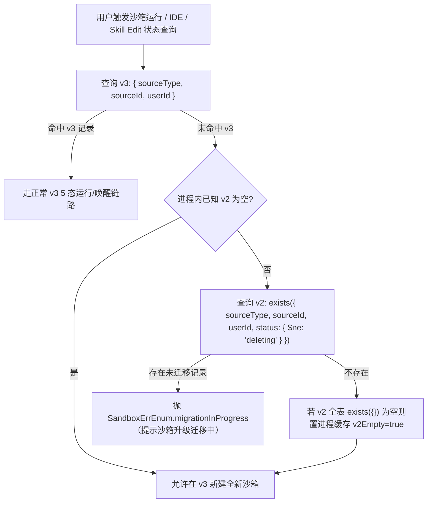

# Agent Sandbox v2 -> v3（纯 OpenSandbox + JuiceFS）迁移方案设计

状态：已实施

最后核对：2026-11-13

关联文档：
- [FastGPT Agent Sandbox 新架构方案设计（纯 OpenSandbox）](./pure-opensandbox-architecture.md)
- [Agent Sandbox 当前设计](./index.md)
- [系统升级任务管理设计](../../../common/system-upgrade-manager.md)

---

## 1. 背景与设计目标

从 `upstream/main`（v2 9 态架构）升级至当前纯 OpenSandbox `1.2.0` + JuiceFS 架构时，存在以下不兼容断层：

1. **Provider 收敛**：移除 `sealosdevbox`、`fastgpt-ide-agent` 与 `agent-sandbox-proxy`，统一收敛为 `opensandbox`（1.2.0 原生 `execd`）。
2. **存储介质切换**：
   - K8s 从无归属标签的旧块存储 RWO PVC 切换为带 `app=fastgpt`、`managed-by=fastgpt-volume-manager`、`fastgpt.deployment=<deploymentId>` 标签的 `juicefs-sc` 动态 PVC；
   - Docker 从无标签普通 `local` 命名卷切换为 `volume-manager` 自托管 `juicefs mount --subdir` + `local` bind 命名卷；
   - 取消 `S3PrivateBucket` 下的冷归档包 `sandbox/archive/<sandboxId>/package.zip`。
3. **Mongo Schema 与状态机收敛**：状态机从 9 态收敛为 5 态（移除 `archiving / archived / restoring / legacyMigrating`）；移除 `provider`、`limit.storageSize`（`v3` 存储配额统一跟随环境变量 `AGENT_SANDBOX_STORAGE_SIZE_GI`，旧沙箱超限则失败回滚）与 `operation.previousStatus`；`image` 从 `{ repository, tag }` 对象改为字符串；`v2` 与 `v3` 均移除无用的 `storage.volumes[].subPath`。
4. **同构记录歧义**：`upstream/main` 中处于 `stopped`（且未设 `image`）的 `opensandbox` 记录，其字段结构与新版完全相同，单凭原表字段无法区分 `claimName` 指向旧块存储/旧 local 卷还是新 JuiceFS 卷。

### 核心设计结论

| 决策维度 | 最终方案 |
| --- | --- |
| **存量覆盖范围** | 全量覆盖 4 类存量源：K8s 旧 RWO PVC、Docker 旧 `local` 命名卷、S3 已归档 `package.zip`、`sealosdevbox` 远端运行/暂停实例 |
| **升级与执行载体** | 接入 `projects/app/src/migration`（`version: '4.18.0'`，目录 `tasks/4180/`），拆分为**两个串联的 `manual: true` 手动触发任务**；主站非沙箱业务零停机上线 |
| **Mongo 集合隔离** | 新版运行时切换至新集合 **`agent_sandbox_instances_v3`**（保持 5 态纯净 Schema 零妥协）；`agent_sandbox_instances_v2` 保留作为只读迁移源 |
| **轻量运行时门禁** | 新版运行时/定时任务/配额只读写 `v3`；激活入口当 `v3` 未命中但 `v2` 存在有效未迁移记录（`status !== 'deleting'`）时，拒绝唤醒并提示“沙箱正在升级迁移中” |
| **数据搬迁通道** | 同 K8s 命名空间 / 同 Docker 宿主机内拉起短生命周期 **OpenSandbox 临时迁移容器**完成落盘（同集群旧卷双挂载 `tar` 直拷；跨集群/跨运行时 OpenSandbox 经源/目标 `execd` 直接枚举并流式同步，零 `/tmp` 中转；S3 zip 与 Sealos Devbox 流式传入目标容器 `/tmp` 解压） |
| **目录过滤规则** | 完整保留用户会话（`sessions/<chatId>`）、顶层 `projects`、`skillEdit` 草稿及已安装依赖；仅排除系统临时文件（`.fastgpt-sandbox-*.zip` / `lost+found` / JuiceFS 控制文件） |
| **并发与配额策略** | 分批游标读取使用框架 `systemMigrationBatchSize`；批内容器搬迁采用**固定并发（默认 `5`，支持环境变量调整）**，临时迁移容器不参与在线 `AGENT_SANDBOX_MAX` 配额礼让，优先全速迁完 |
| **容错与坏数据处理** | 业务源（`App` / `AgentSkills`）已删除或 `v2.status === 'deleting'` 直接跳过；物理源 404 / 解压失败 / 超配额等异常写入 `failedRecords` 并推进断点，扫描结束调用 `context.fail` 供管理员修复后重试 |
| **旧资源回收与回滚** | 任务 1 只停旧计算实例、保留全部旧存储资源与 `v2` 记录（支持无损回滚）；任务 2 显式 `dependsOn` 任务 1，验收稳定后由管理员手动触发，逐条回收旧容器/旧卷/S3 zip/Devbox 后删除对应 `v2` 文档 |

---

## 2. 代码物理隔离契约（零主干耦合红线）

所有与旧版 `v2` / 旧卷 / S3 冷归档 / Sealos Devbox 相关的代码与测试，必须严格收纳在独立的 **`legacy/`** 或 **`migration/tasks/4180/`** 目录内，**严禁污染主分支的领域模型、Provider 适配、Volume Driver 接口或公共 `serviceEnv`**：

```text
# 1. 主站沙箱隔离目录：仅含 v2 未迁移门禁与 OpenSandbox 旧容器/临时迁移容器执行器（主模块零感知 v2 结构）
packages/service/core/ai/sandbox/legacy/
├── legacyOpenSandbox.ts             # 查找并终止无 deploymentId 的旧容器 + 短生命周期临时迁移容器执行器
└── v2MigrationGate.ts               # 自包含 v2 最小只读查询 + 空表缓存 + assertNoUnmigratedLegacySandbox

packages/service/test/core/ai/sandbox/legacy/
├── legacyOpenSandbox.test.ts
└── v2MigrationGate.test.ts

# 2. volume-manager：旧卷查询/删除完全独立，不修改 IVolumeDriver / DockerVolumeDriver / K8sVolumeDriver / volumes.ts
projects/volume-manager/src/legacy/
├── env.ts                           # 仅解析旧卷前缀白名单配置
├── legacyDockerVolumes.ts           # 独立校验并查询/删除无标签普通 local 卷
├── legacyK8sVolumes.ts              # 独立校验并查询/删除无标签旧 PVC
└── legacyVolumeRoutes.ts            # 暴露 /v1/legacy-volumes/:claimName 路由

projects/volume-manager/test/legacy/
├── legacyDockerVolumes.test.ts
├── legacyK8sVolumes.test.ts
└── legacyVolumeRoutes.test.ts

# 3. 系统升级任务：全套迁移、S3 归档流读写与 Sealos 客户端 100% 内聚在 4180 任务目录
projects/app/src/migration/tasks/4180/
├── sandbox_migration_shared/
│   ├── env.ts                       # 仅在此解析 SYSTEM_MIGRATION_SANDBOX_CONCURRENCY、AGENT_SANDBOX_SEALOS_* 及跨运行时 AGENT_SANDBOX_LEGACY_*
│   ├── legacySchema.ts              # v2 原生集合读取与校验 Schema（不注册 Mongoose Model）
│   ├── legacyArchiveS3.ts           # 自包含 S3 sandbox/archive/<id>/package.zip 流读取与删除（不回写 common/s3）
│   ├── legacyVolumeClient.ts        # 调用 volume-manager /v1/legacy-volumes/*
│   └── sealosClient.ts              # 自包含轻量 Sealos Devbox REST 客户端
├── 20261111_migrate_sandbox_to_juicefs/
│   ├── index.ts
│   ├── service.ts
│   └── utils.ts
└── 20261111_cleanup_legacy_sandbox_resources/
    ├── index.ts
    └── service.ts
```

### 主干代码允许的唯一挂载点（日后下线仅需删目录 + 撤除这几行单行引用）

| 主干文件 | 允许的最小改动 | 严禁写入的内容 |
| --- | --- | --- |
| `packages/service/core/ai/sandbox/infrastructure/instance/schema.ts` | `collectionName` 改为 `'agent_sandbox_instances_v3'` | 严禁混入 `v2` 字段、旧状态枚举或版本判断 |
| `packages/service/core/ai/sandbox/application/ownership.ts` | `v3` 未命中时单行调用 `await assertNoUnmigratedLegacySandbox(params)` | 严禁直接查询 `v2` 表或感知迁移细节 |
| `packages/service/core/ai/sandbox/application/skillEdit/runtime.ts` | `v3` 未命中时单行调用 `await assertNoUnmigratedLegacySandbox(...)` | 严禁混入旧归档/升级分支 |
| `projects/volume-manager/src/index.ts` | 单行挂载 `app.route('/v1/legacy-volumes', legacyVolumeRoutes())` | **零修改** `IVolumeDriver`、`DockerVolumeDriver`、`K8sVolumeDriver`、`routes/volumes.ts`、`src/env.ts` |
| `projects/app/src/migration/registry.ts`（及 i18n 文案） | 数组尾部注册两个 `manual: true` 任务 | **零修改** `packages/service/env.ts`、`packages/service/common/s3` |

---

## 3. Mongo 集合切换与轻量门禁设计

### 3.1 新集合 `agent_sandbox_instances_v3`

- 将 [`packages/service/core/ai/sandbox/infrastructure/instance/schema.ts`](../../../../packages/service/core/ai/sandbox/infrastructure/instance/schema.ts) 的 `collectionName` 从 `'agent_sandbox_instances_v2'` 切换为 **`'agent_sandbox_instances_v3'`**。
- 新版沙箱生命周期、配额统计（`countActiveSandboxes`）、定时任务（闲置停止、卡死操作恢复、反向孤儿容器/孤儿卷 GC）全部只操作 `v3`，不读取也不污染 `v2`。
- `v2` 的访问完全封装在 `packages/service/core/ai/sandbox/legacy/v2MigrationGate.ts` 与 `projects/app/src/migration/tasks/4180/sandbox_migration_shared/legacySchema.ts` 两个隔离文件内。

### 3.2 轻量运行时门禁（防误建空卷覆盖旧数据）



关键边界：
- **单条迁完立即可用**：任务 1 每迁完一条记录并写入 `v3`，该用户的请求立即命中 `CheckV3` 正常唤醒，无需等待全表迁完。
- **全新部署 / 已完成任务 2 的部署零开销**：首次发现 `v2` 全表无任何有效文档后，进程内缓存 `v2Empty = true`，后续新建沙箱不再额外查询 Mongo（因为升级到新版后没有任何代码会再向 `v2` 写入文档）。
- **`Skill Edit` 兼容**：`getSkillEditRuntimeContext` / `initSkillEditRuntimeSandbox` 在 `v3` 未命中时同步经过该门禁校验，避免未迁移的技能草稿在打开编辑器时被当作首次初始化而重新解压覆盖。

---

## 4. 系统升级任务注册契约

在 [`projects/app/src/migration/registry.ts`](../../../../projects/app/src/migration/registry.ts) 数组尾部按序追加两个手动任务，共享组件与任务代码全部收敛在 `projects/app/src/migration/tasks/4180/` 内（目录结构见第 2 节）。

### 4.1 注册项元数据对照

| 属性 | 任务 1（数据迁移） | 任务 2（旧资源回收） |
| --- | --- | --- |
| **`id`** | `20261111_migrate_sandbox_to_juicefs` | `20261111_cleanup_legacy_sandbox_resources` |
| **`version`** | `4.18.0` | `4.18.0` |
| **执行模式** | `manual: true` | `manual: true` |
| **`dependsOn`** | 无 | `['20261111_migrate_sandbox_to_juicefs']` |
| **恢复策略** | 分批断点续跑（`_id` 升序游标） | 分批断点续跑（`_id` 升序游标） |
| **`progressSteps`** | `[{ key: 'preflight' }, { key: 'instances' }, { key: 'validation' }]` | `[{ key: 'preflight' }, { key: 'cleanup' }, { key: 'validation' }]` |
| **`result` 参数** | `{ migratedCount, skippedCount }` | `{ cleanedCount }` |

### 4.2 未启用沙箱环境的空跑短路（重要）

若集群从未开启过 Agent Sandbox（`agent_sandbox_instances_v2` 文档总数为 `0`）：
- 管理员点击执行任务 1 或任务 2 时，`preflight` 阶段检测到 `v2` 为空且无残留 `failedRecords`，**直接跳过环境变量与外部连通性校验**，按顺序将全部阶段标记为 `succeeded` 并返回 `{ migratedCount: 0, skippedCount: 0 }` / `{ cleanedCount: 0 }`。
- 仅当 `v2` 存在待处理记录时，`preflight` 阶段才强制校验：
  - 任务 1：OpenSandbox 配置（`AGENT_SANDBOX_OPENSANDBOX_BASEURL`）、OpenSandbox Server、`volume-manager` 连通性；若待迁记录中含需连远端的 `sealosdevbox`（非归档态），同时校验 `AGENT_SANDBOX_SEALOS_BASEURL` 与 `AGENT_SANDBOX_SEALOS_TOKEN`；
  - 任务 2：按 `v2` 实际包含的 `opensandbox` / `sealosdevbox` 记录类型校验对应外部服务凭证与连通性。

---

## 5. 任务 1：工作区与元数据迁移设计（`v2 -> v3`）

### 5.1 `v2` 9 态权威数据源判定矩阵

| `v2.status` | `v2.provider` | `v2.operation?.phase` | 判定动作与权威数据源 |
| --- | --- | --- | --- |
| 任意状态 | 任意 | 业务源 `App` / `AgentSkills` 不存在或 `deleteTime != null` | **跳过**（`skippedCount++`），不建卷、不写 `v3` |
| `deleting` | 任意 | 任意 | **跳过**（`skippedCount++`），交由任务 2 回收底层残留 |
| `archived` | `opensandbox` / `sealosdevbox` | 无 | **S3 归档包**：`sandbox/archive/<sandboxId>/package.zip` |
| `restoring` | `opensandbox` / `sealosdevbox` | 任意阶段（旧架构恢复完前始终保留 S3 zip） | **S3 归档包**：`sandbox/archive/<sandboxId>/package.zip` |
| `archiving` | `opensandbox` / `sealosdevbox` | `archiveUploaded` / `providerDeleted` / `volumeDeleted` | **S3 归档包**：`sandbox/archive/<sandboxId>/package.zip` |
| `archiving` | `opensandbox` / `sealosdevbox` | `claimed`（尚未完成上传） | 同下方 `running / stopped` 原存储源 |
| `running` / `stopping` / `stopped` / `provisioning` | `opensandbox` | 任意 | **OpenSandbox 旧卷**：读取 `v2.storage.volumes[0].claimName`（无 `claimName` 的早期失败 `provisioning` 若远端容器亦不存在则初始化空 JuiceFS 卷；若声明了 `claimName` 但旧卷 404 则记入 `failedRecords`） |
| `running` / `stopping` / `stopped` / `provisioning` | `sealosdevbox` | 任意 | **Sealos Devbox 远端实例**：连接 `GET /api/v1/devbox/{sandboxId}`（404 记入 `failedRecords`） |
| `legacyMigrating` | 任意 | 任意 | 记入 `failedRecords`（提示存在未完成的 4.16 v1 历史迁移） |

### 5.2 确定性幂等与锁协同

1. **锁与并发删除屏障**：单条记录处理时先快检业务源存活并解析 `teamId`，随后获取 `withSandboxLifecycleLease({ sandboxId })`；最终写入 `v3` 文档后，对齐 `v3` 主链路的 Store-Load 屏障复检 `resolveSandboxSourceTeamId`（若搬迁期间业务源被并发软删除，则立即回滚删除新建的 `v3` 记录与新 JuiceFS 卷并记为跳过）。
   - 持有 `SandboxLifecycleLease` 期间，主站 `reconcileOrphanSandboxContainers`（10 分钟宽限期）不会误杀正在执行搬迁的临时容器；若迁移进程崩溃，租约释放且满 10 分钟后由反向 GC 自动回收残留临时容器。
2. **幂等短路**：若 `v3` 中已存在匹配记录（`buildMatchingV3SandboxFilter` 按 `{ sourceType, sourceId, userId }` 或 `{ sandboxId }` 匹配，不再筛选已移除的 `provider` 字段），说明该条在前次运行中已完整提交，直接视为成功跳过。
3. **确定性目标卷名（避免重试产生孤儿卷）**：
   - 生成确定性 `generationId = sha256("v3-juicefs:" + String(v2._id)).slice(0, 8)`，拼接 `newClaimName = <volumeNamePrefix>-<sandboxId>-<generationId>`（若极端哈希碰撞等于 `oldClaimName` 则追加二次哈希，确保 `newClaimName !== oldClaimName`）。
   - 调用 `ensureSessionVolume`（底层 `volume-manager` `ensure`，配额统一取当前环境 `AGENT_SANDBOX_STORAGE_SIZE_GI` 对应值，不继承旧 `v2.limit.storageSize`；若旧沙箱超限则失败回滚）。若上次在同一沙箱中途失败重试，会幂等复用同一个 `newClaimName`，并在拷贝前先清空 `/workspace` 下非 JuiceFS 内部控制文件（保留 `.jfs*`、`.accesslog`、`.config`、`.stats`、`.trash`）。

### 5.3 三类物理源搬迁执行流

临时迁移容器公共参数：
- `image`: 当前配置的 `AGENT_SANDBOX_OPENSANDBOX_IMAGE`
- `entrypoint`: `['sleep', 'infinity']`（不跑业务 `entrypoint.sh`，避免触发外部网络下载或改动文件）
- `timeoutSeconds`: `600`（初始 10 分钟 TTL 防止进程崩溃后残留泄漏），并在 `withTemporaryMigrationSandbox` / `withLegacyExportOpenSandbox` 执行期间每 `3 分钟` 调一次 `sandbox.renew(600)` 续期；单步搬迁命令 / 下载超时为 `600s`（10 分钟）
- `ephemeral-storage`: 通过 `getDefaultOpenSandboxEphemeralStorageSize()` 计算（仅 Kubernetes 运行态生效）：常规 / OpenSandbox 旧卷迁移路径使用 `AGENT_SANDBOX_STORAGE_SIZE_GI + 0.5` Gi（与主运行时一致）；需要在临时容器 `/tmp` 落地完整归档包的 **Sealos Devbox 与 S3 归档迁移路径**通过 `ephemeralStorageWorkspaceMultiplier: 2` 放宽为 `AGENT_SANDBOX_STORAGE_SIZE_GI * 2 + 0.5` Gi（临时容器用完即毁，不影响常态调度与目标 PVC 配额）
- `metadata`: `{ app: 'fastgpt', deploymentId, sessionId: sandboxId, migration: 'v2-to-v3' }`

目录排除规则（统一构造 `tar` / `unzip` 过滤条件）：
- 仅排除系统临时与控制项：`.fastgpt-sandbox-archive.zip`、`.fastgpt-sandbox-restore.zip`、`.accesslog`、`.config`、`.stats`、`.trash`、`lost+found`、`.jfs*`；顶层 `projects` 对所有 `sourceType` 统一保留，防止误删用户历史数据。

#### 路径 A：OpenSandbox 旧卷（K8s 旧 PVC / Docker 旧 `local` 卷 / 跨运行时迁移）
1. **同集群就地升级（Docker -> Docker / K8s -> K8s）**：
   - 查询并终止无 `deploymentId` 的旧版 OpenSandbox 容器（`listSandboxInfos({ metadata: { sessionId: sandboxId } })`，确认进入 `UnExist`，释放云厂商 RWO 块存储挂载锁）。
   - 调用 `volume-manager` `GET /v1/legacy-volumes/:oldClaimName` 预检旧卷存在（404 则直接抛可定位错误进入 `failedRecords`，避免卡在 K8s Pod Pending 超时）。
   - `ensureSessionVolume(newClaimName)` 创建新 JuiceFS 卷，拉起临时迁移容器双挂载（`newClaimName -> /workspace (rw)` + `oldClaimName -> /legacy-workspace (ro)`），通过 `tar` 流式直拷数据并校验退出码为 `0`。
2. **跨运行时 / 跨集群升级（如旧 Docker OpenSandbox -> 新 K8s OpenSandbox）**：
   - 在 `tasks/4180/sandbox_migration_shared/env.ts` 成对读取可选源端变量 `AGENT_SANDBOX_LEGACY_OPENSANDBOX_BASEURL` 与 `AGENT_SANDBOX_LEGACY_VOLUME_MANAGER_URL`（及可选凭证/镜像/运行态，默认 `runtime=docker`）。
   - 先终止旧源端无 `deploymentId` 的旧容器，预检旧卷存在（兼容未升级 `v0.3.x` `volume-manager` 的路由降级）；随后在旧源端拉起只读挂载 `oldClaimName -> /legacy-workspace (ro, createIfNotExists: false, deleteOnSandboxTermination: false)` 的临时导出容器，通过 `execd` `listDirectory` 枚举文件树并批量解析软链（拒绝特殊节点与越界路径）。
   - 空工作区直接初始化空 JuiceFS 卷；非空时拉起新集群临时迁移容器，先清理 `/workspace` 租户目录、以 `755` 建目录后将所有普通文件统一通过 `openFileStream -> uploadStream` 有界并发（4 路）流式直传并保留文件权限（双端均零 `/tmp` 打包与额外内存缓冲开销），再按块通过 `/command` 还原软链并按由深到浅顺序恢复非 `755` 目录权限；任务 2 同步回收旧源端容器与旧卷。
3. 销毁临时迁移容器；Docker 目标运行态下调用 `unmountSessionVolume(newClaimName)` 释放空闲 FUSE 进程内存。

#### 路径 B：S3 已归档 `package.zip`
1. 检查 `S3PrivateBucket` 中 `sandbox/archive/<sandboxId>/package.zip` 是否存在（不存在抛 404 错误进入 `failedRecords`；若文件为空归档 `EMPTY_ZIP_BUFFER` 22 字节则只需初始化空 JuiceFS 卷）。
2. 终止可能残留的旧版 OpenSandbox 容器，`ensureSessionVolume(newClaimName)`，拉起挂载 `newClaimName -> /workspace` 的临时迁移容器。
3. 从 S3 获取下载可读流，经 OpenSandbox `writeFiles`（底层 `uploadFetch` 流式传输，无主站大 Buffer）写入 `/tmp/migrate.zip`，并在容器内通过 `wc -c` 核对落盘字节数与预期一致。
4. 容器内通过 Python `zipfile` 校验并防止 Zip Slip 路径穿越（拒绝 `/` 开头或含 `..` 条目），清空 `/workspace` 租户文件后安全解压至 `/workspace`，按固定系统过滤规则忽略临时项与 JuiceFS 控制项，删除 `/tmp/migrate.zip`。
5. 销毁临时迁移容器（Docker 下 `unmount`）。

#### 路径 C：Sealos Devbox 远端实例
1. 通过 `tasks/4180/sandbox_migration_shared/sealosClient.ts` 查询 `info(sandboxId)`：
   - 若为 `Paused / Stopped`，调用 `resumeAndWaitReady` 恢复实例并轮询等待命令通道就绪；
   - 若 404 则抛错进入 `failedRecords`。
2. 在远端 Devbox 内对 `workDirectory`（默认 `/home/devbox/workspace`）执行 `tar -C <workDir> <excludes> -czf /tmp/.fastgpt-v3-migrate.tar.gz .`。
3. `ensureSessionVolume(newClaimName)` 并拉起挂载 `newClaimName -> /workspace` 的 OpenSandbox 临时迁移容器。
4. 将 `sealosClient` 下载可读流直接流式管道桥接至临时容器 `/tmp/migrate.tar.gz` 并用 `wc -c` 核对写入字节数，容器内通过 Python `tarfile` 校验无绝对路径/`..` 条目与链接逃逸后清空 `/workspace` 并安全解包至 `/workspace`。
5. 清理远端 `/tmp/.fastgpt-v3-migrate.tar.gz`，并将远端 Devbox 执行 `pause(sandboxId)` 释放算力（保留磁盘供回滚），最后销毁本地临时迁移容器（Docker 下 `unmount`）。

### 5.4 `v3` 文档写入结构

搬迁校验成功后，向 `agent_sandbox_instances_v3` 执行幂等写入，并通过 Store-Load 屏障二次调用 `resolveSandboxSourceTeamId` 确认业务源未软删且同步最新 `teamId`：

```typescript
{
  sandboxId: v2Doc.sandboxId,
  sourceType: v2Doc.sourceType,
  sourceId: v2Doc.sourceId,
  userId: v2Doc.userId,
  status: 'stopped',
  lastActiveAt: v2Doc.lastActiveAt,
  createdAt: v2Doc.createdAt,
  ...(v2Doc.limit?.cpuCount !== undefined || v2Doc.limit?.memoryMiB !== undefined ? { resourceLimits: { ...(v2Doc.limit?.cpuCount !== undefined ? { cpuCount: v2Doc.limit.cpuCount } : {}), ...(v2Doc.limit?.memoryMiB !== undefined ? { memoryMiB: v2Doc.limit.memoryMiB } : {}) } } : {}), // storageSize 已从 v3 Schema 移除，统一由环境变量控制
  storage: buildVolumeConfig(newClaimName).storage,
  teamId: resolvedTeamId,
  image: serviceEnv.AGENT_SANDBOX_OPENSANDBOX_IMAGE,
  ...(v2Doc.versionId ? { context: { skillVersionId: v2Doc.versionId } } : {})
}
```

### 5.5 批处理与并发控制

- 外层游标分页：统一使用 `systemMigrationBatchSize`（默认 100），遵循 `getCheckpoint` -> 优先重试 `getFailedRecords()` -> `_id > cursor` 扫描 -> `batchRun` 固定并发 -> `reportFailedRecords`（完整快照覆盖） -> `saveCheckpoint` -> `reportProgress`。
- 批内并发度：读取可选环境变量 `SYSTEM_MIGRATION_SANDBOX_CONCURRENCY`（整数 `1..20`，**默认 `5`**），直接拉起临时迁移容器，不读取在线 `AGENT_SANDBOX_MAX` 做退避礼让。
- 完成校验阶段（`validation`）：若仍有未解决 `failedRecords`，调用 `context.fail({ message, failedRecords })`；否则核验 `v2` 中所有存活业务源且非 `deleting` 的记录均已在 `v3` 存在对应文档，返回 `{ migratedCount, skippedCount }`。

---

## 6. `volume-manager` 旧卷窄权限接口设计（独立 `src/legacy/` 模块）

新版 `K8sVolumeDriver` 与 `DockerVolumeDriver` 的 `/v1/volumes/*` 接口强制校验 `app=fastgpt` 与 `fastgpt.deployment=<deploymentId>` 标签，无法操作 `upstream/main` 创建的无标签旧卷。为保持主驱动与 `IVolumeDriver` 零改动，全部旧卷逻辑独立放置在 `projects/volume-manager/src/legacy/` 下，仅在 `src/index.ts` 单行挂载 `/v1/legacy-volumes` 路由：

- `GET /v1/legacy-volumes/:claimName` -> `{ exists: boolean }`（供任务 1 预检旧卷是否存在）
- `DELETE /v1/legacy-volumes/:claimName` -> `{ ok: true }`（供任务 2 物理删除旧卷，404 幂等返回成功）

**硬性安全护栏（防误伤新版 JuiceFS 卷或数据库持久卷）**：
1. **前缀白名单**：在 `src/legacy/env.ts` 读取可选环境变量 `VM_LEGACY_VOLUME_PREFIXES`（默认允许 `fastgpt-session-`），不匹配前缀的卷名（如 `fastgpt-mongo`、`fastgpt-pg`、`fastgpt-minio`）直接返回 `403` 拒绝。
2. **禁止触碰带新版归属标签的卷**：
   - K8s（`legacyK8sVolumes.ts`）：读取 PVC `metadata.labels`，凡带有 `managed-by: fastgpt-volume-manager` 或 `fastgpt.deployment` 标签的 PVC，一律拒绝按旧卷删除（返回 `409 VolumeOwnershipError`）；删除无标签旧 PVC 时独立实现 `preconditions.uid` + 轮询消失防竞态逻辑。
   - Docker（`legacyDockerVolumes.ts`）：`inspect` 卷信息，凡带有 `Labels.app === 'fastgpt'` / `Labels['fastgpt.deployment']`，或 `DriverOpts.device` 指向 `/var/lib/fastgpt/sandbox-mounts/` 的 bind 卷，一律拒绝按旧卷删除；确认无容器引用后仅执行 `DELETE /volumes/:claimName`。

---

## 7. 任务 2：旧侧物理资源与 `v2` 文档回收设计

管理员在线上验收新版沙箱运行稳定、确认无需回滚后，在后台手动点击触发 `20261111_cleanup_legacy_sandbox_resources`（框架自动校验前置任务 `20261111_migrate_sandbox_to_juicefs` 已 `succeeded`）。

### 7.1 单条 `v2` 记录回收顺序（全部幂等，404 视为已清理）

1. **防御性核验**：若该条 `v2` 记录对应业务源仍存活且 `v2.status !== 'deleting'`，先确认 `v3` 中已存在匹配记录（通过 `buildMatchingV3SandboxFilter` 按 `{ sourceType, sourceId, userId }` 或 `{ sandboxId }` 查询，无 `provider` 条件）且其 `v3.claimName !== v2.oldClaimName`（防止异常数据未进 `v3` 就被删源）。
2. **清理旧版 OpenSandbox 容器**：按 `metadata: { sessionId: sandboxId }` 查找无 `deploymentId` 的残留旧容器并终止。
3. **清理旧持久卷**：若 `v2.provider === 'opensandbox'`，对 `v2.storage.volumes[0].claimName`（及历史无代际后缀候选名，若不等于 `v3.claimName`）调用 `DELETE /v1/legacy-volumes/:claimName`。
4. **清理 S3 冷归档包**：通过 `legacyArchiveS3.ts` 删除 `S3PrivateBucket` 中的 `sandbox/archive/<sandboxId>/package.zip`（忽略不存在错误）。
5. **清理 Sealos Devbox 实例**：若 `v2.provider === 'sealosdevbox'`，调用 `sealosClient.delete(sandboxId)`（404 视为成功）。
6. **删除 `v2` Mongo 文档**：上述 2~5 步全部成功后，执行 `LegacySandboxV2Model.deleteOne({ _id: v2Doc._id })`。

任何一步失败均保留该条 `v2` 文档并记入 `failedRecords`，管理员修复后点击“重试”时天然只处理剩余未删净的 `v2` 记录；任务 `validation` 阶段断言 `agent_sandbox_instances_v2` 剩余文档数为 `0`，达成后门禁零开销闭环。

---

## 8. 升级与回滚操作流程（Runbook）

1. **部署前准备**：准备独立 PostgreSQL 元数据库与独立 S3 Bucket；K8s 部署 JuiceFS CSI 与 `juicefs-sc`，Docker 挂载 `/dev/fuse` 与 `/var/lib/fastgpt/sandbox-mounts:rshared`；若存量含未归档 `sealosdevbox`，在 App 环境变量中保留 `AGENT_SANDBOX_SEALOS_BASEURL` 与 `AGENT_SANDBOX_SEALOS_TOKEN`；若为跨运行时 / 跨集群迁移旧 OpenSandbox 卷，在 App 中成对配置 `AGENT_SANDBOX_LEGACY_OPENSANDBOX_BASEURL` 与 `AGENT_SANDBOX_LEGACY_VOLUME_MANAGER_URL`（及可选凭证/镜像/运行态）；若旧卷曾使用非默认前缀，在 `volume-manager` 中配置 `VM_LEGACY_VOLUME_PREFIXES`。
2. **上线新版服务**：升级 OpenSandbox `1.2.0`、`volume-manager` 与 FastGPT 主站。此时非沙箱业务立即可用；已有记录的旧沙箱被轻量门禁保护提示“升级迁移中”，全新沙箱可直接在 `v3` 正常创建使用。
3. **执行任务 1（数据迁移）**：管理员在 `/admin/migration` 点击执行 `20261111_migrate_sandbox_to_juicefs`；迁完一条即解锁一条，若有坏数据（如远端物理卷早已丢失），排查恢复或人工从 `v2` 移除死记录后点击重试直至 `succeeded`。
4. **回滚窗口（任务 2 执行前）**：若发现严重问题需回退旧版本，因 `v2` 表、旧 PVC/Docker 卷、S3 `package.zip` 及已暂停的 Sealos Devbox 全部完好保留，切回旧版镜像与配置即可恢复迁移前状态。
5. **执行任务 2（回收旧资源）**：验收稳定确认不再回滚后，管理员点击执行 `20261111_cleanup_legacy_sandbox_resources`，一键清空旧卷、S3 归档包、Sealos Devbox 与 `v2` 表文档；随后可从环境变量中移除 `AGENT_SANDBOX_SEALOS_*`、`AGENT_SANDBOX_LEGACY_*` 与 `VM_LEGACY_VOLUME_PREFIXES` 临时配置。

---

## TODO

- [x] **Phase 1：集合切换与隔离式轻量门禁（`packages/service/core/ai/sandbox/legacy/`）**
  - [x] 将 `packages/service/core/ai/sandbox/infrastructure/instance/schema.ts` 集合名切换为 `agent_sandbox_instances_v3`，同步更新集合名相关测试；
  - [x] 在独立目录 `packages/service/core/ai/sandbox/legacy/v2MigrationGate.ts` 实现 `v2` 未迁移检查与空表缓存，仅在 `ownership.ts` 与 `skillEdit/runtime.ts` 的 `v3` 未命中分支做单行调用；新增对应错误码与 i18n 文案。
- [x] **Phase 2：`volume-manager` 隔离式旧卷模块（`projects/volume-manager/src/legacy/`）**
  - [x] 不修改现有 `IVolumeDriver` / `DockerVolumeDriver` / `K8sVolumeDriver` / `routes/volumes.ts`；在 `projects/volume-manager/src/legacy/` 独立实现 `GET /v1/legacy-volumes/:claimName` 与 `DELETE /v1/legacy-volumes/:claimName`（仅在 `src/index.ts` 单行挂载路由），并在 `projects/volume-manager/test/legacy/` 补齐单测。
- [x] **Phase 3：自包含系统升级任务（`projects/app/src/migration/tasks/4180/`）**
  - [x] 实现 `tasks/4180/sandbox_migration_shared/`（自包含 `v2` Schema、S3 归档流读写 `legacyArchiveS3.ts`、轻量 `sealosClient.ts`、旧卷客户端、迁移专用环境变量解析，不触碰 `packages/service/env.ts` 与 `common/s3`）以及 `packages/service/core/ai/sandbox/legacy/legacyOpenSandbox.ts`；
  - [x] 实现任务 1 `20261111_migrate_sandbox_to_juicefs` 与任务 2 `20261111_cleanup_legacy_sandbox_resources`；
  - [x] 在 `projects/app/src/migration/registry.ts` 注册两个 `manual: true` 任务，补齐 `packages/web/i18n/*/system_migration.json` 多语言文案。
- [x] **Phase 4：测试与升级文档**
  - [x] 在 `projects/app/test/migration/tasks/4180/` 与 `packages/service/test/core/ai/sandbox/legacy/` 编写完整单元测试；
  - [x] 更新 `4.18.0` 升级指南文档（中英文），补充基础设施前置、环境变量说明与两阶段手动迁移操作指引。
