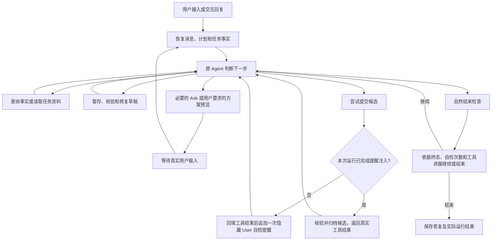

# Workflow Builder：单 Agent、自检续跑与任务记忆

## 设计目标与适用范围

Builder 在同一 Agent Loop 内理解需求、查询事实、选择任务、搭建、校验、修复并交付工作流候选。普通新建或修改请求可以直接搭建；用户明确要求先看方案、等待确认时才展示正式预览。候选仍由用户手动应用到画布，不自动应用、保存、发布或运行。

本设计对应主仓库 PR #8237 与配套 Pro PR #1244 的同上下文自检实现。聊天持久化、用量与节点记录继续使用现有 Handler；执行复用 AgentLoopCore，支持 FastAgent 和 PiAgent。不新增三阶段调度器，不单独记录构建意图，不另存一份完整模型消息与计划。

**当前采用原 Agent 自检：运行时在满足触发条件时追加一次固定的隐藏 User 提醒，不先调用独立模型裁判。** “一次”指一次 `runWorkflowBuilder` 调用，不是整个会话或整个任务一次。交互恢复及下一次用户请求会进入新的运行。

## 决策与执行职责

| 职责                                         | 负责方                 | 约定                                                                       |
| -------------------------------------------- | ---------------------- | -------------------------------------------------------------------------- |
| 理解业务目标、评估可构建性、判断缺失事实     | 原 Agent               | 结合对话、工具结果和按需读取的任务资料判断，不使用关键词或构建意图标记分流 |
| 选择直接搭建、Ask、方案预览、继续或新建任务  | 原 Agent               | 遵守用户目标与明确授权边界，不要求每轮走固定阶段                           |
| 核对草稿是否覆盖需求、如何修复、如何解释阻塞 | 原 Agent               | 结构校验成功不等于业务需求全部满足；需要时继续查询实际草稿                 |
| 发送自检提醒、记录工具活动、控制运行上限     | Runner / AgentLoopCore | 提供有限的续跑保障，不生成新的业务方案或伪造用户确认                       |
| 参数、任务归属、真实确认、取消与画布基线校验 | Task Runtime / Gateway | 只对真实来源与工具执行契约负责，模型不能用文件或文字替换执行依据           |
| 校验修订号、生成候选、归档与保存交付引用     | Gateway / Handler      | 真实交付后才返回 `candidate_ready`，不把文字“完成”当成交付                 |

“不增加业务阶段状态机”不等于删除全部运行标记。当前保留自检是否已发送、等待下一次模型请求、工具活动计数，以及确认回执、预览、取消、交付等事实。它们用于执行约束、交付要求和运行终止；不把模型固定在“需求分析 → 方案确认 → 构建”三个阶段。

同样，当前实现也不承诺“模型说结束就总能成功结束”：本轮已确认、已开始 stage/commit 或尝试预览时，仍受后文的交付与无进展限制。语义判断、候选实际交付和运行结果是三个不同概念。

## 单循环执行与交互



图中的提交路径以参数有效、任务执行依据有效为前提；同批重复 commit 在下一次模型请求开始前仍被拦截。它描述运行机制，不要求模型按图中工具顺序逐项调用。

- 用户未要求预览时，Agent 可以在目标范围内直接设计和搭建。只有无法查询且影响业务目标、核心输入输出或现行规则的必要事实才需要 Ask。
- 用户要求先审方案时，使用正式预览等待真实操作；正文列方案或询问“是否执行”不能代替预览工具。
- 确认后，Agent 应沿用已接受的需求和已有草稿连续交付，避免无依据地重复确认。新出现的必要业务事实仍可询问。
- Ask / Preview 返回有效 interactive 时先暂停；不再通过自然结束检查追加自检或催办消息。此优先级保障交互协议，并不代表业务任务已经完成。
- 技术参数和草稿诊断由 Agent 自主修复。当前 Ask validator 拒绝 `tool_unavailable`；不存在“已经确认就统一禁用所有 Ask / Preview”的拦截规则。
- 同一任务再次提交预览会更新其预览引用，原确认不能授权新的预览。是否应该重新预览由模型根据业务上下文决定，确认来源与匹配关系仍由服务端检查。

## 自检触发与续跑规则

### 固定自检提醒

固定提醒由自然结束和首次有效 commit 共用一个标记，每次运行最多注入一次。它要求原 Agent 对照本轮需求、已确认方案与真实工具结果核对完成情况，必要时查询草稿、修复和重新校验；它不是新用户需求，也不是新的执行授权。

| 触发位置                                                | 当前行为                                                                                   |
| ------------------------------------------------------- | ------------------------------------------------------------------------------------------ |
| 首次自然结束，尚无候选交付、取消或终止错误              | 追加一次固定自检提醒；普通咨询也可能触发，不先按业务意图过滤                               |
| 首次有效 commit，且尚未触发自检                         | 暂不归档，返回 `review_required` / `taskComplete: false`，在全部工具结果之后追加同一条提醒 |
| 同一模型响应中重复 commit，自检尚未被下一次模型请求接收 | 仍返回待自检结果，不能借第二个 commit 提前归档                                             |
| 自检已注入且下一次模型请求已经开始                      | 后续 commit 沿用正常参数、修订号及归档校验，不重复注入固定提醒                             |
| 已交付候选、取消、终止错误                              | 自然结束检查直接结束，不追加固定提醒                                                       |
| 交互暂停、显式工具停止或请求中止                        | 优先走各自出口，不为自检再启动模型请求                                                     |

首次自然结束已经触发过自检时，之后首次 commit 不会再触发第二次。`completionReviewPending` 只保障提醒先进入下一次模型请求，不证明模型一定充分执行了业务验收。

### 自检后的自然结束

固定自检提醒与后续续跑提醒不同，不能把“固定提醒最多一次”解释为“本次运行最多追加一条服务端消息”。

1. 已交付、取消或终止错误直接结束。
2. 本轮没有确认回执、未开始执行、未尝试预览时，允许原 Agent 自检后自然结束，包括咨询、等待或无法继续的答复。
3. 本轮已确认、已开始执行或尝试预览且尚未交付时，继续追加要求推进的消息；不指定具体业务步骤。
4. 每次结束检查比较完整 `tool_run_end` 计数，包含计划工具和隐藏文件读取。连续无工具进展达到上限（当前为 2 次检查）时停止并标记失败；另受公共最大调用次数、取消和错误出口约束。

当前结果映射也沿用这些事实：实际归档成功为 `candidate_ready`；有效交互为 `clarification_pending`；取消和中止分别返回相应结果；没有交付义务且正常结束为 `answered`；已有上述交付义务但未交付、无进展或运行错误为 `failed`。`answered` 不代表产生了候选。开始执行后解释真实阻塞仍可能对应失败的运行结果，不应在文档中承诺所有阻塞说明都返回 `answered`。

### 上下文与保存协议

自检不创建独立裁判请求，也没有“最近 6 条历史 / 每段 1200 字”的检查输入。它使用原 Agent 当前有效上下文；已有 checkpoint 压缩和工具结果压缩仍正常生效，“同上下文”不表示永远保留未压缩全文。

- FastAgent 将提醒追加到原请求消息链；PiAgent 在下一次请求的上下文转换中追加工具触发的提醒，结束检查的续跑也沿用原 Agent。
- 先补齐同一 assistant 的工具结果，再追加 `role: user`，避免破坏工具调用配对。
- 服务端提醒以 `userMessage: { content, source: 'server' }`、`hideInUI: true` 保存；恢复为隐藏 User 消息，不变成 System，不伪造工具调用。
- System 与工具目录保持稳定，任务变化通过尾部消息和工具结果传递。显式 checkpoint 是历史压缩边界，不在每轮重写已发送的历史。

通用协议见 [Agent Loop 设计](./agent-loop/index.md)。

## 多任务、草稿与执行依据

同一会话可同时保留多个任务。模型根据目标关联选择 `task: { mode: "new" }` 或 `task: { mode: "continue", taskId }`；首次 stage、draft query 或 preview 共用该选择，同轮后续调用可沿用。

- `new` 基于当前画布创建 v2 直接执行任务，保留原始请求引用和基线；不伪造用户已经点击确认。
- v1 预览任务读取原始预览及其紧邻 Human 决策，核对预览身份、内容 checksum 和画布基线。未接受的新预览不能凭旧确认执行。
- 模型选择业务归属；服务端检查所属会话、取消、交付与基线等事实。同轮开始执行或展示预览后不混合其他任务；明确确认轮绑定被确认的任务。
- 每个任务使用独立事务目录和 Gateway，分片、manifest、校验缓存、重试及交付引用不能串用。旧共享草稿仅在任务、应用和基线匹配时迁移。
- 恢复历史任务不自动要求本轮先完成旧目标。纯咨询可保留旧任务和草稿；只有本轮实际确认、执行或尝试预览才进入对应运行约束。

取消或基线失效后不能继续使用旧执行依据；新目标重新选择任务。任务记忆和索引用于找到资料，不赋予执行资格。

## 任务记忆与 checkpoint

### 信息来源

| 信息                                    | 来源与用途                                                                       |
| --------------------------------------- | -------------------------------------------------------------------------------- |
| 对话、工具调用及结果、预览和 Human 操作 | `ChatItem.value`，用于模型消息恢复及确认来源核验                                 |
| 当前计划                                | `value.plan` 与 activePlan reader，保留 `null` 终止标记；不是另一份 WorkflowPlan |
| 压缩上下文                              | `value.contextCheckpoint` 与其后的连续消息                                       |
| 当前任务 / 历史任务                     | `Chat.metadata.workflowBuilderTask` / `workflowBuilderTasks`，保存服务端任务事实 |
| 可按需读取的需求、修订、方案和任务镜像  | 会话研究目录下的 `task-memory/`                                                  |
| 工作流草稿与校验结果                    | 受保护的任务事务目录，模型通过 Gateway 访问                                      |

模型可读的目录结构为：

```text
task-memory/
  index.json
  tasks/<taskId-hash>/
    task.json
    request.md
    requests/<requestId-hash>.md
    plans/<preview-hash>.md
```

- `index.json` 保留至多 20 条近期任务入口；索引之外的任务文件仍可通过目录搜索定位，不因离开索引而删除。
- `task.json` 保存 revision、任务镜像、至多 200 字符的摘要和方案路径。索引与任务记录带有绑定团队、成员、应用和会话的签名；签名不能防止旧快照被回放，因此执行事实仍从服务端读取。
- `request.md` 首次保存源用户消息的完整 value 序列化内容；不是模型总结出的全部会话需求。任务持久化时按请求 ID 保存本轮输入到 `requests/`，纯对话不保证每轮都生成该文件。
- `plans/` 保存正式预览的参数快照，不是 AgentPlan。运行时自动维护文件；模型按需读取，不通过自由编辑文件授予自己执行资格。
- 通过租约、revision、临时文件原子替换及 Mongo CAS 降低并发覆盖风险。先写需求和方案，再写任务及索引，随后保存 Mongo 可信事实，成功后更新运行态；不承诺 Sandbox 与 Mongo 跨存储原子事务。

### 压缩时的恢复入口

`getCheckpointContext` 仅在真实压缩时调用：读取并检查任务文件，生成目录、当前任务 ID 及至多 5 个任务入口。这个入口快照在压缩摘要生成后由代码原样附加，随 checkpoint 保存；后续运行不重新计算并替换旧快照。

checkpoint 携带的是资料定位入口，不包含全部原需求、预览、修订或草稿。模型需要细节时读取任务文件；索引未列出的任务用 find/grep 定位。Hook 读取失败时压缩器保留原上下文，不发布缺少业务恢复入口的新 checkpoint。

### Sandbox 丢失与恢复限制

初始化时优先复用现有文件；有旧版任务文件目录时迁移完整目录；没有文件仓库时，读取 Mongo 任务记录及关联的原始 ChatItem 重建可获取的需求、当前方案与任务镜像。

**不能写成“从 checkpoint 重建完整任务文件”。** checkpoint 只提供入口和摘要；重建资料来自仍存在的服务端任务与源消息。不能保证重建所有历史修订文件、旧方案或未保存的草稿分片。任务文件恢复也不代表工作流事务草稿已经恢复；后者依赖实际存在的 manifest、分片及匹配基线。源消息缺失与读取异常必须分别处理，不能把读取失败当作空仓库覆盖。

## 交互持久化与候选交付

- Preview 展示载荷保留工具调用 ID 和原始参数，业务内容包括标题、Mermaid 和说明。固定确认/修改/取消按钮由前端本地化，不在原预览上回写 `actions` 或 `decision`。
- Human 独立保存 `action`；`revise` 必须有非空 `reviseText`，`confirm/cancel` 禁止该字段，不复用 Ask 的 `questions` 或保存 `answer`。
- FastAgent 从消息记录恢复交互；PiAgent 同时使用原生 providerState。确认适配仍对应原工具调用，不能跨消息寻找任意 Human 作为确认。
- `stage` 仅编辑草稿。有效 draft validate 后，commit 使用对应的 `draftRevision`；提醒后的修复需要重新校验，不能提交旧修订。
- 候选在独立目录生成，归档且持久化版本引用后才报告 `candidate_ready`。失败保留恢复或重试所需资料；重试复用已有交付身份，避免重复归档。
- S3 上传成功但引用保存失败可能留下到期清理的孤立对象，不承诺 S3/Mongo 跨存储原子事务。
- commit 成功后仍由原 Agent 更新计划并答复；取消独立无工具收尾请求，不由服务端强制把业务计划标为完成。

## 指令分层与审查依据

系统提示词保留目标、授权边界、持续执行与完成标准；Skill 负责工具使用方法、配置覆盖和诊断修复；工具描述负责调用契约。维护者说明放在 Pro Skill README，不再向模型重复注入一套任务状态说明。

审查与测试必须区分：

1. **确定性执行契约**：原上下文保留、工具结果配对、固定提醒次数、同批提交拦截、任务隔离、真实确认来源、取消、修订校验和归档幂等，可以用受控模型输出验证。
2. **模型行为质量**：是否识别直接搭建意图、是否遗漏需求、是否无故重复确认、是否正确判断技术阻塞，需要真实模型场景评估；提示词约束不能用受控响应证明已被遵守。

确认后的正常成功场景不应重复询问，这个产品目标保持不变。但“注入一个重复 Ask / Preview 后运行暂停”只能证明交互出口可达，不能单凭此断言必须新增“确认过就禁止交互”的状态拦截。应检查是否丢失上下文、工具契约或执行依据，并区分真实新问题与无依据重复确认。仍须修复能够独立证明的越权、串任务、消息丢失或错误交付问题。

本设计不再采用独立完成裁判、裁剪后的 6 条历史输入、`workRequested` 或 `answer_only`。历史 Review 应按其记录的主仓库 HEAD 和 Pro gitlink 解释，复审必须以当前实现和本设计为准，不能把旧解析器问题直接移植到自检实现。

## 关键实现位置

- Pro `workflowBuilder/handler.ts`：鉴权后的会话、文件、任务持久化与候选交付协调。
- Pro `workflowBuilder/runner.ts`、`prompt.ts`：单循环、工具入口、自检提醒、交互与运行结果。
- Pro `workflowBuilder/task/{entity,service,storage}.ts`：可信任务记录、执行依据与模型可读资料。
- Pro `workflowBuilder/sandbox/workspace.ts`、`cliGateway.ts`：草稿隔离、CLI 校验与候选提交。
- 主仓库 `packages/global/core/workflow/builder/type.ts`：任务与交互共享契约。
- 主仓库 `packages/service/core/ai/llm/agentLoop`、`compress`：两个 Provider 的消息续跑、事件、压缩与恢复 Hook。
- Pro `admin/src/service/core/ai/skill/builtin/workflow-builder/README.md`：维护者文档与参考资料导航。

## 验证与后续验收

文档描述当前契约，不把测试通过等同于真实模型质量已验收。仅文档更新检查内容一致性、链接与 diff；不为此运行全量测试。

- [x] 当前局部测试包含两个真实 Provider 配合受控模型响应：长需求、早期历史与工具结果进入自检上下文，固定提醒只注入一次，同批 commit 不能绕过提醒，修复后重新校验并交付。
- [x] 任务、存储与 Handler 测试包含隔离、并发、源消息核验和恢复边界；具体执行结果以对应提交的验证记录为准。
- [ ] 使用目标真实模型完成普通直接搭建、先审方案再确认、必要事实澄清、确认后自主修复、咨询与真实阻塞场景；评价是否无依据重复询问或遗漏业务需求。
- [ ] 在真实环境联合核对连续模型请求、UI/SSE、Mongo、Sandbox 和 S3，覆盖 A/B/A 任务切换、checkpoint、Sandbox 丢失与交付重试。
- [ ] 扩展两个 Provider 的连续请求前缀断言，包含交互恢复、切换、取消和交付；仅在显式压缩边界允许历史折叠。

业务验收入口：[确认执行与修复](../../../test/app/workflow/editor/FG-APP-WORKFLOW-052-builder-confirmed-execution-and-repair.md)、[任务记忆与恢复](../../../test/app/workflow/editor/FG-APP-WORKFLOW-053-builder-task-memory-and-recovery.md)。受控响应测试与真实模型验收分别记录，不能互相替代。
