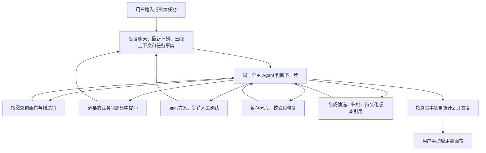

# Workflow Builder：同一 Agent 持续搭建

Builder 的聊天持久化与节点运行记录仍由现有 Handler 管理，核心执行复用 Agent V2 的 `AgentLoopCore`。不新增 Agent 引擎或三阶段调度器，也不另存一份完整消息与计划。

与旧实现的主要区别：普通请求不再清空未完成计划；取消 commit 后的独立无工具收尾请求和服务端强制完成计划。commit 是普通工具结果，交付后由同一 Agent 自己更新计划与答复。

上下文分工：

| 信息 | 唯一来源 |
| --- | --- |
| 对话、工具调用与结果 | `ChatItem.value` |
| 当前计划 | `value.plan` 和已有 activePlan reader，保留 `null` 终止标记 |
| 压缩上下文 | `value.contextCheckpoint`；恢复其后的连续消息 |
| 模型暂停和回答 | FastAgent 从 ChatItem interactive 与紧邻 Human 恢复；child interactive 仅保留续跑关联；Pi 保留原生 providerState |
| 任务、草稿归属、交付引用 | `Chat.metadata.workflowBuilderTask` |
| 预览确认或取消 | 紧邻预览 AI 的下一条 Human 消息；不回写原预览，不另存确认结果 |

确认从原预览及紧邻 Human 消息读取，并核对预览内容摘要和画布基线。需求充分并确认后，Agent 连续搭建、校验、修复和交付；技术问题不再使用 `ask_user` 转交用户。只有新出现且必须由用户决定的业务阻塞允许补问。方案或画布基线实质变化时重新预览确认。

Preview 的展示载荷只含 `title`、`mermaid`、`sections`，不保存 `actions` 或 `decision`。确认、修改、取消按钮由前端固定提供并翻译。Human 使用独立回复，不复用 Ask 的 `questions`，不保存 `answer`。Zod 按 `action` 区分：`confirm/cancel` 只保存 `type` 和 `action`；`revise` 必须保存非空 `reviseText`，其余动作禁止该字段。展示文案由前端按动作本地化生成。

恢复与交付约束：

- 读取最新压缩点之后的完整消息，并补齐最新计划和任务引用。没有压缩点时读取完整会话，避免固定 20 条窗口截断任务；模型上下文上限仍由公共压缩机制处理。
- Human 回答沿用公共 `preChatRound` 保存，原预览只保存展示值。模型历史适配读取紧邻 Human，并将确认、修改或取消投影到对应工具响应，回答只消费一次；中断恢复仍从同一对消息读取有效确认。压缩点之前的预览必须补齐其紧邻记录，不能跨消息寻找其他 Human。新任务或基线变化不能接管旧任务草稿。
- 草稿 manifest 记录任务 ID；旧格式继续受应用及基线校验约束。Sandbox 丢失时只能根据已保存上下文重建，不能恢复任意未落盘步骤。
- CLI Apply 在独立候选目录执行，保留原基线。候选归档并保存版本引用后，commit 才报告成功并清除草稿；失败重试复用已有候选或归档引用。上传成功而引用写入失败可能留下到期清理的孤立文件，不承诺跨 S3/Mongo 的原子事务。
- `candidate_ready` 只表示候选可靠交付。画布应用、应用回执、保存与发布继续沿用原有入口；本次不加入全自动模式。

实施与验收：

- 已实现：任务事实、上下文恢复、单 Agent 连续调用、基于 Human 回答的确认与自主修复、归档边界与预览刷新状态。
- 自动检查：相关局部回归、类型检查和格式检查，不运行全量测试。
- 待实际环境验收：使用目标模型完整走一次“收集需求 → 预览确认 → 搭建 → 中断继续 → 候选 → 人工应用”，并核对真实 provider 请求及 Sandbox/S3 故障恢复。单元测试不替代真实模型验收。
