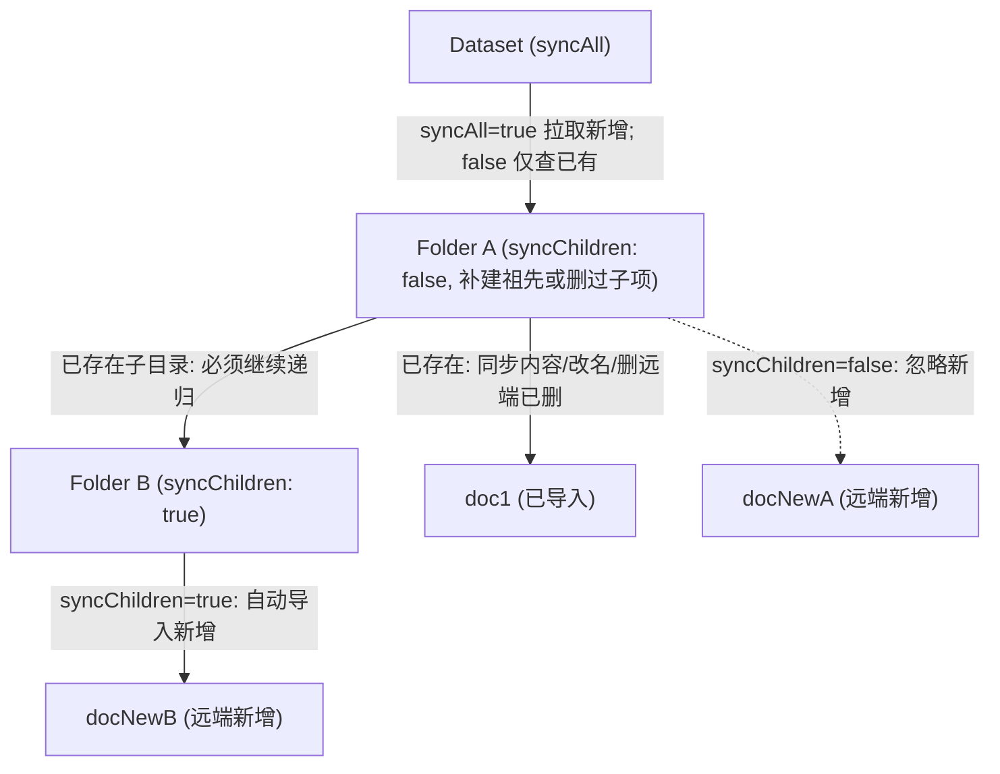

# API 知识库同步范围唯一真实来源（SSOT）与交互改造设计

## 1. 背景与目标

### 1.1 现状问题

当前 API 知识库（含自定义 API、飞书、语雀、钉钉）采用的是“添加文件 → 同步时从已有节点推导范围”的隐式逻辑，存在以下核心问题：

1. **缺乏“同步范围”的唯一真实来源（SSOT）**：
   - 全库同步依赖一个伪造的哨兵集合节点 `apiFileId: 'SYSTEM_ROOT'`（`name: 'ROOT_FOLDER'`），导致本地目录树多出一层无意义的虚拟根，污染树结构与集合级权限继承模型。
   - 删除目录内某个文件后，同步范围缺少显式标记；若父目录仍在本地，下次同步会再次把被删文件拉回来。
2. **本地目录树无法完整镜像远端结构（阻碍第三方权限同步）**：
   - 在导入弹窗（`APIDataset.tsx`）中深入子目录单选文件时，`createApiCollectionV2` 仅收到被选文件自身，丢失其上层祖先目录链，最终被直接挂在知识库根，无法承载远端目录树与权限继承关系。
3. **“添加文件”弹窗交互与同步状态脱节**：
   - 弹窗仅平铺展示当前目录一层的文件内容，跨目录勾选缺乏全局视角，且子目录无“全选”操作。
   - 一旦目录已存在于本地（`existIdList.has(item.id)`），勾选框被禁用且禁止点进子目录（`canEnter = item.hasChild && !isChecked`），导致用户无法进入 `syncChildren === false` 的目录补选文件，也无法重新勾选目录恢复同步。
   - 集合列表页（`CollectionCard`）不展示当前库/目录是否自动同步新增内容，用户无法感知或直接切换同步范围。

### 1.2 设计目标

1. 建立 `Dataset.syncAll` + `DatasetCollection.syncChildren` 作为同步范围的**唯一真实来源（SSOT）**。
2. 彻底移除 `ROOT_FOLDER` / `SYSTEM_ROOT`（`RootCollectionId`）哨兵节点，并提供可重复执行的存量数据清洗脚本。
3. 保证本地目录树始终完整镜像远端目录树：为深层选中文件自动补建的祖先目录强制 `syncChildren: false`，不引发“误拉全目录”。
4. 重构“添加文件”弹窗（支持树形视角 / 三态勾选 / 进入已导入目录补选或恢复同步）与集合列表页（`CollectionCard` / `Info` 展示并可切换同步状态）。

---

## 2. 核心数据模型与不变量

### 2.1 字段定义

| 模型 / 集合 | 新增字段 | 类型与默认值 | 语义说明 |
| :--- | :--- | :--- | :--- |
| `Dataset` (`datasets`) | `syncAll` | `boolean`（Schema 可选，默认/缺省视为 `false`） | 根级同步范围标记，替代 `SYSTEM_ROOT` 哨兵。`true` 表示同步时自动拉取远端根目录下的新增直属节点；`false` 表示仅维护本地已有子树。 |
| `DatasetCollection` (`dataset_collections`) | `syncChildren` | `boolean`（Schema 不设 default，仅 API 节点写入） | 目录/节点级同步范围标记。`false` 表示**不自动拉取该节点下新增直属子级**；`true` 或 `undefined`（兼容历史数据）视为允许自动同步新增子级。 |

> **关键区分：`Dataset.autoSync` vs `Dataset.syncAll`**
> - `Dataset.autoSync`：是否开启**定时自动同步调度**（BullMQ Scheduler 开关）。
> - `Dataset.syncAll`：同步执行时，**根目录是否自动纳入新增文件/目录**（范围定义，同时作用于手动同步与定时同步）。

### 2.2 统一判定 Helper

在 `@fastgpt/global/core/dataset/collection/utils`（或 `@fastgpt/service/core/dataset/apiDataset/utils`）集中提供判定函数，禁止在各处散落布尔判断：

```ts
/** 缺省（undefined）视为 true，以兼容存量 API 知识库集合；仅显式 false 停止拉取新增子级。 */
export const isCollectionSyncChildrenEnabled = (collection?: { syncChildren?: boolean }) =>
  collection?.syncChildren !== false;
```

### 2.3 带子文档的文件（`docA` + `docA#dir`）语义

针对语雀、钉钉等支持“文档下挂子文档”的 provider，已确认采用 **方案 A（统一默认 `true`）**：

- 单独勾选叶子文档 `docA` 时，落库 `syncChildren` 缺省/`true`。
- 若后续远端在 `docA` 下新增子文档 `docA1`，下次同步自动创建派生目录 `docA#dir`（`syncChildren: true`），将原正文 `docA` 移入 `docA#dir`，并自动拉取 `docA1`。
- 若用户主动删除 `docA#dir` 内的正文 `docA` 或任一子文档，触发删除联动将 `docA#dir.syncChildren` 置为 `false`，后续同步不再重新补建被删正文或新增子文档。
- 若用户删光 `docA#dir` 下的所有子文档、仅剩正文 `docA`，**保留 `docA#dir`（`syncChildren: false`）**，不自动折叠回单文件 `apiFile`，确保“停止同步其子文档”的状态不丢失。

### 2.4 四条核心不变量（铁律）

1. **自动补建的祖先目录必须为 `syncChildren: false`**：
   - 用户仅选中深层节点（如 `Root / A / B / doc1`）而未选中 `A`、`B` 时，为镜像远端目录树而自动创建的祖先目录 `A`、`B` 必须落库 `syncChildren: false`，且 `Dataset.syncAll` 保持 `false`。
   - 仅用户显式勾选的目录、或由 `syncAll === true` / 父目录 `syncChildren !== false` 自动展开创建的子目录，才为 `syncChildren: true`。
2. **`syncChildren === false` 不剪枝已有子树**：
   - `syncChildren === false` 仅阻止**新增直属子节点**（包含 `docA#dir` 下已被用户删除的正文 `docA`）。
   - 同步仍必须检查该目录下**本地已存在**的直属文件（更新正文/改名/远端删除清理），并继续递归进入本地已存在的子目录（若子目录自身 `syncChildren !== false`，该子目录依然正常自动拉取其下新增节点）。
3. **删除翻标仅发生在用户主动删除事务中**：
   - 仅在用户删除路由 `projects/app/src/pages/api/core/dataset/collection/delete.ts` 内，与 `delCollection` 处于**同一 MongoDB 事务**执行。
   - **严禁**放进共享的 `delCollection` helper（否则同步清理远端已删文件或整库删除时会错误破坏同步范围）。
   - 删除时仅修改被删边界节点的**直接父级**（`parentId` 目录置 `syncChildren: false`；`parentId === null` 时 `Dataset.syncAll` 置 `false`），不级联上翻祖先目录。
4. **彻底清除 `RootCollectionId`（`SYSTEM_ROOT`）哨兵**：
   - 导入请求、本地集合数据、同步计划、删除接口不再创建、识别或依赖 `SYSTEM_ROOT` 节点；全库选择通过显式 `syncAll: boolean` 表达。



---

## 3. 后端架构与接口设计

### 3.1 Schema 与 OpenAPI 契约变更

| 文件 | 变更内容 |
| :--- | :--- |
| `packages/service/core/dataset/schema.ts` | `DatasetSchema` 新增 `syncAll: { type: Boolean, default: false }`。 |
| `packages/service/core/dataset/collection/schema.ts` | `DatasetCollectionSchema` 新增 `syncChildren: Boolean`（不设 default）。 |
| `packages/global/core/dataset/type.ts` | `DatasetSchemaType` 补充 `syncAll?: boolean`；`DatasetCollectionSchemaType` 补充 `syncChildren?: boolean`。 |
| `packages/global/core/dataset/collection/constants.ts` | 移除 `RootCollectionId = 'SYSTEM_ROOT'`（待清洗脚本方案落地后统一清理引用）。 |
| `packages/global/openapi/core/dataset/api.ts` | `DatasetDetailResponseSchema` / `UpdateDatasetBodySchema` 补充 `syncAll?: boolean`。 |
| `packages/global/openapi/core/dataset/collection/api.ts` | `DatasetCollectionsListItemSchema`、`GetCollectionDetailResponseSchema` 补充 `syncChildren?: boolean`（及列表项 `apiFileId?: string` 以便前端区分远端 API 目录与普通文件夹）；`UpdateDatasetCollectionBodySchema` 补充 `syncChildren?: boolean`。 |
| `packages/global/openapi/core/dataset/collection/createApi.ts` | `CreateApiCollectionV2BodySchema` 新增 `syncAll?: boolean` 与 `ancestorPaths?: Array<...>`（或由 `ancestors` 携带浏览路径，详见 3.2）。 |
| `packages/global/openapi/core/dataset/apiDataset/api.ts` | 新增 `GET /api/core/dataset/apiDataset/syncState`（或扩展接口，保持旧 `listExistId` 返回 `string[]` 向后兼容），返回 `{ syncAll: boolean, collections: Array<{ collectionId, apiFileId, sourceId, type, syncChildren, parentId }> }`。 |

### 3.2 导入流程改造（`createApiCollectionV2` & `createApiDatasetCollection`）

涉及文件：
- `projects/app/src/pages/api/core/dataset/collection/create/apiCollectionV2.ts`
- `packages/service/core/dataset/apiDataset/service.ts`
- `packages/service/core/dataset/apiDataset/tree.ts`
- `packages/service/core/dataset/apiDataset/folder.ts`
- `packages/service/core/dataset/apiDataset/auth.ts`

#### 3.2.1 支持显式 `syncAll`
- 当请求 `syncAll === true` 时：
  - 不再要求 `apiFiles` 传入 `ROOT_FOLDER` 伪对象（允许 `apiFiles: []`）。
  - 服务端直接以 `request.listFiles({ parentId: startId })` 获取远端根下全部节点作为种子展开整棵树。
  - 鉴权：要求调用者对 Dataset 具备 `ManagePermissionVal`（与修改 `Dataset.syncAll` 口径一致），并走现有 `authApiFileImportChanges` 校验新建与移动权限。
  - 在目录和文件计划落地后，执行 `MongoDataset.updateOne({ _id: dataset._id }, { $set: { syncAll: true } })`。
  - 对于库内原本已存在且被用户显式设为 `syncChildren: false` 的子目录：
    - 若用户本次勾选的是根级 `syncAll: true`，则**默认同时恢复本次展开范围内缺失节点的同步**，或保持用户显式排除的子目录状态由前端明确提示（建议：全选根时，将未在弹窗中手动取消的半选目录一并恢复 `syncChildren: true`，确保“勾选全选 = 整库全量同步”的直觉一致）。

#### 3.2.2 祖先目录补齐（兼容飞书无 `parentId` 限制）
> **Provider 调研关键发现**：
> `packages/service/core/dataset/apiDataset/feishuDataset/api.ts` 中 `getFileDetail` 调用飞书 `/open-apis/drive/v1/metas/batch_query`，接口不返回 `parent_token`，目前固定返回 `parentId: null`。因此**不能**仅靠后端调用 `getFileDetail` 向上回溯祖先链。

采用**客户端传路径线索 + 服务端自顶向下 `listFiles` 校验**的统一方案（四类 Provider 100% 通用且防客户端伪造）：

1. 请求体支持为非根级选中节点携带其祖先 ID 路径（如 `ancestors?: Array<{ id: string; parentId?: string | null }>` 或 `ancestorIds: string[]`，按从根到直接父级排序）。
2. 服务端沿 `startId -> ancestor[0] -> ancestor[1] -> ... -> selectedItem` 逐层调用 `request.listFiles({ parentId })`（同一请求内做 `Map<parentId, APIFileItemType[]>` 内存缓存，避免重复请求）：
   - 仅从 `listFiles` 真实返回的远端对象中提取祖先目录的 `name`、`type`、`hasChild` 与父子边，彻底拒绝客户端伪造节点名称或错误挂接。
   - 若某层在 `listFiles` 中找不到对应子节点，直接报错提示远端目录已变更请刷新重试。
3. 将校验通过的祖先目录合入 `ApiFileTreeNode[]` 并标记 `isAutoAncestor = true`：
   - **已存在于本地的祖先目录**：保留其原 `syncChildren` 值不变（例如原本就是 `false` 则保持 `false`）。
   - **本次新建的祖先目录**：落库时强制写入 `syncChildren: false`。
4. **本次显式选中的节点（`apiFiles`）**：
   - **新建目录**：落库 `syncChildren: true`。
   - **本地已存在且 `syncChildren === false` 的目录**：将其纳入 `reEnableSyncFolderIds`，在 `authApiFileImportChanges` 中校验该目录 `ManagePermissionVal`；目录创建/移动阶段同步更新 `syncChildren: true`，并按 `buildApiFileTree` 递归展开补齐该目录下当前缺失的所有子目录与子文件。
   - 仅新建祖先和恢复目录标记、未产生新文件时，依然正常返回 `{ successCount, failedCount: 0 }`。

#### 3.2.3 权限继承（`inheritPermission`）调整
- 原本全库导入时 `requestInheritPermission` 落在 `SYSTEM_ROOT` 哨兵行上，其余节点继承它。
- 移除哨兵后：
  - `syncAll === true` 且传入 `requestInheritPermission` 时，作用于远端根下的直接顶层节点（`depth === 0`）。
  - 部分导入时，仍仅作用于用户显式选中的节点（`selectedDirIds`），自动补建的祖先目录保持 `inheritPermission: undefined`（默认继承），已存在节点不覆盖原 `inheritPermission`。

### 3.3 用户主动删除联动（`projects/app/src/pages/api/core/dataset/collection/delete.ts`）

1. 移除 `apiFileIds.includes(RootCollectionId)` 特判。
2. `findCollectionAndChild` 补充投影字段 `parentId apiFileId`：
   ```ts
   fields: '_id teamId type datasetId fileId metadata parentId apiFileId'
   ```
3. 在进入 `mongoSessionRun` 前计算本次删除的**同步范围收口目标**（仅针对存在 `apiFileId` 的集合）：
   - 令 `deletingIdSet = new Set(collections.map((c) => String(c._id)))`。
   - 遍历 `collections`，筛选**边界 API 节点**：`Boolean(c.apiFileId)` 且（`!c.parentId` 或 `!deletingIdSet.has(String(c.parentId))`）。
   - 若存在边界 API 节点的 `parentId` 非空：将 `String(c.parentId)` 加入 `disableSyncFolderIds`。
   - 若存在边界 API 节点的 `parentId == null`：标记 `shouldDisableDatasetSyncAll = true`。
4. 在**同一个 `mongoSessionRun` 事务**中原子执行：
   - `delCollection({ collections, delImg: true, delFile: true, session })`
   - 若 `disableSyncFolderIds.size > 0`：
     ```ts
     await MongoDatasetCollection.updateMany(
       {
         _id: { $in: [...disableSyncFolderIds] },
         teamId,
         datasetId: collection.datasetId,
         type: DatasetCollectionTypeEnum.folder,
         apiFileId: { $exists: true, $ne: null }
       },
       { $set: { syncChildren: false } },
       { session }
     );
     ```
   - 若 `shouldDisableDatasetSyncAll`：
     ```ts
     await MongoDataset.updateOne(
       { _id: collection.datasetId, teamId },
       { $set: { syncAll: false } },
       { session }
     );
     ```

**边界验证**：
- 删掉 `docA#dir` 内的正文 `docA`：边界节点是 `docA`，其 `parentId` 是 `docA#dir` → `docA#dir.syncChildren` 置 `false`。
- 删掉整个目录 `DirA`（含其内部所有子节点）：`DirA` 内子节点因 `parentId` 都在 `deletingIdSet` 内被忽略，边界节点只有 `DirA` → 仅 `DirA` 的直接父目录 `syncChildren` 置 `false`（若 `DirA` 在根，则 `Dataset.syncAll` 置 `false`）。
- 删除非 API 知识库或用户自建无 `apiFileId` 文件夹：不会触发上述更新。

### 3.4 同步范围开关接口

1. **根级 `Dataset.syncAll`**：复用 `POST /api/core/dataset/update`（`projects/app/src/pages/api/core/dataset/update.ts`）：
   - 已有 `ManagePermissionVal` 校验。
   - 仅允许对 API 知识库（`dataset.apiDatasetServer` 存在）生效，更新 `Dataset.syncAll`，并记录审计日志。
2. **目录级 `Collection.syncChildren`**：复用 `POST /api/core/dataset/collection/update`（`projects/app/src/pages/api/core/dataset/collection/update.ts`）：
   - 将 `syncChildren !== undefined` 纳入 `hasMetaUpdate`，要求该目录的 `ManagePermissionVal`（与 `forbid` / 改名一致）。
   - 校验目标集合必须是 `type === DatasetCollectionTypeEnum.folder && Boolean(collection.apiFileId)`（拒绝给普通文件或非 API 文件夹写 `syncChildren`）。
   - 仅更新当前目录自身，**不**级联覆盖子目录的 `syncChildren`（子目录保持各自独立的排除/开启状态）。

### 3.5 同步引擎改造（`fastgpt-pro` & `packages/service/core/dataset/apiDataset/`）

涉及核心文件：
- `fastgpt-pro/admin/src/service/core/dataset/dataset/sync.ts`
- `packages/service/core/dataset/apiDataset/tree.ts`
- `packages/service/core/dataset/apiDataset/syncPlan.ts`
- `packages/service/core/dataset/apiDataset/utils.ts`
- `packages/service/core/dataset/apiDataset/folder.ts`

#### 3.5.1 范围感知建树（替代无条件全量递归）

废弃 `const isRoot = allCollections.some((item) => item.apiFileId === RootCollectionId)`，改以 `Boolean(dataset.syncAll)` + 本地节点 `syncChildren` 驱动遍历：

1. **构建本地索引**：
   - `localByApiId`: `apiFileId -> collection`
   - `localSourceIds`: 本地所有 `apiFile` 的 `apiFileId` + 所有 API `folder` 的真实远端 ID（优先 `metadata.apiFileSourceId`，兼容历史派生目录规则）。
   - `localChildrenByParentSourceId`: 按本地父子关系索引各目录当前已导入的直属子节点，用于检测“原本在该目录下、本轮 `listFiles` 却未返回”的节点。
   - `syncChildrenEnabledOf(sourceId)`:
     - 对目录：查找对应本地目录（`folder` 查 `sourceId`，`file` 查 `sourceId#dir`；若派生目录尚未建立但本地已有叶子 `apiFile`，查该 `apiFile`）。若本地不存在（本轮新发现）返回 `true`，否则返回 `isCollectionSyncChildrenEnabled(localNode)`。

2. **顶层入口（Seeds）**：
   - `dataset.syncAll === true`：调用 `request.listFiles({ parentId: startId })`，全部远端顶层节点作为 seeds（同时记为根级允许新增）。
   - `dataset.syncAll === false`：找出本地顶层远端节点 ID（`getApiFileSyncRootIds(allCollections)`，不再过滤 `RootCollectionId`），并发调用 `request.getFileDetail({ apiFileId })`：
     - `success` → 作为 seed。
     - `NOT_FOUND` → 跳过，后续进入删除候选。
     - 其他错误（429/5xx/网络等）→ 立即抛错中止本轮同步，防止误删。

3. **递归展开规则（`walk(node)`）**：
   - 若 `!node.hasChild`，结束当前分支。
   - 调用 `request.listFiles({ parentId: node.id })` 获取远端直属子列表 `remoteChildren`。
   - 判断当前节点是否允许拉取新增：`allowNew = syncChildrenEnabledOf(node.id)`：
     - **`allowNew === true`**：将 `remoteChildren` 全部加入树并递归展开。
     - **`allowNew === false`**：**仅**将 `remoteChildren` 中满足 `localSourceIds.has(child.id)` 的已导入子项加入树并继续递归（**不剪枝已有子树，但完全忽略远端新增直属项**）。

4. **远端移动（Remote Move）与误删防护**：
   - 当存在 `syncChildren === false` 的目录（或 `dataset.syncAll === false`）时，某已导入文件 `doc1` 可能在远端被移动到了一个尚未导入的目录 `Folder C`：
     - 遍历结束后，检查所有本地 `localSourceIds` 中**未出现在本轮已遍历远端节点**的候选节点（排除其父级已确认为 `NOT_FOUND` 且明确属于整棵被删的情况，或在 `syncAll === true` 时已全树扫描无需二次探测）。
     - 当 `dataset.syncAll === false` 或存在任意 `syncChildren === false` 目录时，对未命中的本地节点并发调用 `request.getFileDetail({ apiFileId })` 做二次确认：
       - 返回 `NOT_FOUND`：确认为远端已删除 → 进入删除候选。
       - 返回限流/5xx/网络错误：抛错中止删除阶段（不误删）。
       - 返回 `success`（说明远端仍存活，只是移到了未展开的分支）：
         - **推荐策略（策略 1：跟随移动并补建 `syncChildren: false` 祖先）**：
           - 若 provider 返回有效 `parentId`（语雀、钉钉、自定义 API）：沿 `getFileDetail` 向上回溯直至命中本地已有节点或到达 `startId`/根，将缺失的新祖先目录以 `syncChildren: false` 加入本轮树，使 `doc1` 移动到新父目录下并继续同步内容；若 `doc1` 自身是目录且 `syncChildren !== false`，同时递归展开其子树。
           - 若 provider 不返回 `parentId`（**飞书 Drive 限制**：`getFileDetail` 固定返回 `parentId: null`）：无法获知新父目录位置，将其保留在远端存活集合中（不删除、暂保原本地位置继续同步正文），并记录告警日志提示远端位置无法回溯。

5. **`buildApiFileSyncPlan` 新增文件准入守卫**：
   - 移除 `rootCollectionId` 和所有 `RootCollectionId` 判断。
   - 在判断远端 `file` 是否加入 `missingFiles` 时，增加父级同步权限校验：
     - `record.parentDirId === null`：仅当 `dataset.syncAll === true` 时允许加入 `missingFiles`。
     - `record.parentDirId !== null`：仅当本地不存在 `record.parentDirId`（本轮新展开的目录），或本地存在且 `isCollectionSyncChildrenEnabled(existingParent)` 为 `true` 时，才允许加入 `missingFiles`。
   - **效果**：当 `docA#dir.syncChildren === false` 且用户已删除正文 `docA` 时，`docA` 的 `parentDirId` 是 `docA#dir`，被该守卫直接拦截，**绝不会**被重新补建；而 `docA#dir` 下其他已存在子文档仍正常进入 `existingFileIds` 更新内容。
   - 新建目录写入 `syncChildren`：`planApiFileFolders` / `createApiFileFolders` 透传每个目录记录的 `syncChildren`（补建祖先为 `false`，正常展开新建目录为 `true`）。

6. **清理 `utils.ts` / `folder.ts` 中的哨兵逻辑**：
   - `resolveApiFileRecordParent` 移除 `rootCollectionId` 参数；顶层节点 `parentId` 直接解析为 `targetParentId ?? rootParentIds?.get(record.sourceId) ?? null`，`apiFileParentId` 为 `record.apiFileParentId ?? null`。
   - `listV2.ts` 等查询不再出现隐藏哨兵层。

---

## 4. 前端交互设计

### 4.1 “添加文件”弹窗重构（`Import/diffSource/APIDataset.tsx`）

针对现状“弹窗仅显示当前目录一层内容、已导入目录无法点进或恢复”的痛点，改造如下：

#### 4.1.1 布局与浏览形态
推荐采用 **双栏“可展开目录树 + 已选/变更清单”布局**（兼顾深层目录浏览与跨目录全局可见性）：
- **左栏（远端文件树）**：
  - 顶部提供**根目录全选行**（对应 `Dataset.syncAll`，支持三态：`checked` / `indeterminate` / `unchecked`）与搜索框（自定义 API 支持）。
  - 树节点支持**点击展开/折叠懒加载**（按 `parentId` 调用现有 `POST /api/core/dataset/apiDataset/list`，并缓存已加载子节点），不再每次只能看到单一层级。
  - 从 `CollectionCard` 某个子目录点击“添加文件”进入时，根据当前目录的本地祖先链（`apiFileId` 路径）自动展开并滚动定位到该远端目录。
- **右栏（本次变更摘要）**：
  - 清晰分组展示：
    1. **新增导入的文件 / 目录**（带完整路径提示，支持点击移除）；
    2. **恢复自动同步的已有目录**（原 `syncChildren === false` 被重新勾选的目录，或开启根级 `syncAll`）。
  - 底部按钮准确反映总变更项数。

#### 4.1.2 节点三态勾选规则（基于 `GET /api/core/dataset/apiDataset/syncState`）

| 节点本地状态 | 勾选框视觉状态 | 允许操作 | 交互结果 |
| :--- | :--- | :--- | :--- |
| 未导入 | 未勾选（`unchecked`） | 可勾选 / 若 `hasChild` 可展开进入 | 勾选目录 = 导入该目录及子孙（`syncChildren: true`）；展开后只勾选其内部分文件 = 仅导入所选文件，祖先目录自动补建为 `syncChildren: false`（左栏祖先显示半选）。 |
| 已导入文件（`apiFile`） | 已勾选 + 禁用（已同步） | 若 `hasChild`（带子文档的文档），**允许展开**查看子文档 | 防止重复导入同一文件，但不再锁死其子文档入口。 |
| 已导入目录，`syncChildren !== false` | 已勾选 + 禁用（自动同步中） | **允许展开**查看子级（子级若全同步则显示已同步；若其下某孙目录为 `syncChildren: false` 仍可继续钻取恢复） | 打破原有 `canEnter = !isChecked` 限制，方便查看树状态及处理深层被暂停的子目录。 |
| 已导入目录，`syncChildren === false` | **半选（`indeterminate`）+ 可点击** | 1. **点击勾选框** → 切换为已选（加入本次“恢复自动同步”清单）；<br>2. **点击展开** → 浏览内部，仅补选个别未导入子文件 | 勾选框复选后提交会把目录 `syncChildren` 恢复为 `true` 并补齐缺失文件；仅展开补选子文件则保持该目录 `syncChildren: false`。 |
| 知识库根（`syncAll`） | `syncAll === true` 为已勾选；`syncAll === false` 且库内有文件为半选；空库为未勾选 | `syncAll === false` 时可勾选开启全库同步 | 提交时传 `syncAll: true`，不再构造 `ROOT_FOLDER` 节点。 |

#### 4.1.3 导入向导步骤衔接（`Import/Context.tsx`、`PreviewData.tsx`、`Upload.tsx`）
- `DatasetImportContext` 新增 `apiDatasetSyncAll: boolean` 与 `apiDatasetAncestors`（或在 `ImportSourceItemType` 补充 `ancestorIds?: string[]` / `isReEnableSync?: boolean`）。
- `PreviewData.tsx`：
  - 保持现有规则：点击目录或全库同步项时提示“文件夹暂不支持分块预览”（`preview_chunk_folder_warning`），点击单个文件正常预览。
  - 若 `apiDatasetSyncAll === true` 且 `sources` 无单个文件，展示一条明确的“全库同步（将同步根目录下全部新增文件）”汇总条目，避免左栏为空。
- `Upload.tsx`：
  - 调用 `postCreateDatasetApiDatasetCollection` 时透传 `syncAll`、`apiFiles` 与 `ancestorPaths`。

### 4.2 集合列表页（`CollectionCard`）与知识库信息页（`Info`）

1. **列表数据补齐**：
   - `projects/app/src/pages/api/core/dataset/collection/listV2.ts` 在 `selectField` 中增加 `syncChildren: 1`、`apiFileId: 1`。
   - `projects/app/src/pages/api/core/dataset/collection/detail.ts` 返回 `syncChildren`。
2. **`CollectionCard/index.tsx`（目录行状态与开关）**：
   - 仅当 `datasetDetail.type && ApiDatasetTypeMap[datasetDetail.type]` 时生效。
   - 对每一条 `type === DatasetCollectionTypeEnum.folder && Boolean(collection.apiFileId) && !collection.isNavigableFolder` 的目录行：
     - 在名称旁展示轻量同步状态标签（例如 `syncChildren === false` 时显示灰色 Tag“暂停同步新增” / 提示文案“已暂停自动同步该目录新增文件”，`syncChildren !== false` 时显示柔和状态标识或仅在开关列体现，保持列表清爽）。
     - 在表格列（仅 API 知识库显示“同步新增”列，或置于操作菜单 `MyMenu` + 状态 Tag）提供切换开关：
       - 有目录 `Manage` 权限：可直接切换 `syncChildren`（调 `putDatasetCollectionById({ id, syncChildren })`，从 `false` 切回 `true` 仅更新标记并通过 Toast 提示“将在下次同步时拉取新增内容”，不立即触发同步）。
       - 无 `Manage` 权限：只读展示当前同步状态。
   - 文件行（`apiFile`）与用户自建目录（无 `apiFileId`）该列显示 `-`。
3. **`CollectionCard/Header.tsx`（当前层级的同步范围提示/开关）**：
   - 处于知识库根目录（`!parentId`）且为 API 知识库时：展示根级同步状态（`datasetDetail.syncAll`：“同步根目录新增”开/关，具备 Dataset `Manage` 权限可切换；开启时仅更新标记并提示将在下次同步拉取新增内容）。
   - 处于某个 API 子目录内（`parentId` 存在）且该目录 `syncChildren === false` 时：在顶部路径栏旁展示醒目但克制的提示条/状态胶囊（“当前目录已暂停自动同步新增文件” + 权限允许时提供“恢复同步”快捷操作；恢复仅更新标记并提示下次同步生效）。
4. **`Info/index.tsx`（知识库右侧配置面板）**：
   - 仅 API 知识库展示 `syncAll` 开关，放在 `autoSync`（定时同步）附近，并用清晰的文案 + `QuestionTip` 区分（从 `false` 开启时仅更新标记并提示下次同步生效）：
     - **定时同步（`autoSync`）**：控制是否按计划自动触发同步任务。
     - **同步根目录新增（`syncAll`）**：控制同步时是否自动导入第三方根目录下的新增文件与文件夹。

---

## 5. 存量 `SYSTEM_ROOT` 数据清洗迁移方案

### 5.1 接入内置系统迁移框架（已确认选项 A）

- 路径：`projects/app/src/migration/tasks/4180/20261120_clean_api_dataset_system_root/`（严格遵循 `projects/app/src/migration/tasks/README.md` 与 `system-migration-development` 规范，注册至 `projects/app/src/migration/registry.ts` 尾部）。
- 调度策略：`blockStartup: true`，采用**幂等全量扫描 + 完成校验**（不使用 checkpoint，失败由框架自动重跑）：
  - 新版业务代码已移除 `RootCollectionId` 逻辑，`blockStartup: true` 保证业务启动前所有存量哨兵全部清洗完毕；
  - 单次执行耗时短（仅扫描 `apiFileId: 'SYSTEM_ROOT'` 与 `apiFileParentId: 'SYSTEM_ROOT'` 命中文档），逐 Dataset 事务提交，重复执行零副作用。
- 阶段声明：`migrate`（逐库事务清理哨兵、迁移权限并回填 `Dataset.syncAll`）→ `validation`（全库二次核验确认无残留 `SYSTEM_ROOT`）。
- 国际化文案：补全 `packages/web/i18n/{zh-CN,en,ja}/system_migration.json`。

### 5.2 执行步骤（逐 Dataset 事务）

1. 扫描所有存在哨兵节点或引用哨兵为父级的文档：
   ```ts
   MongoDatasetCollection.find({
     $or: [{ apiFileId: 'SYSTEM_ROOT' }, { apiFileParentId: 'SYSTEM_ROOT' }]
   })
     .select('_id teamId datasetId parentId apiFileId apiFileParentId inheritPermission')
     .sort({ _id: 1 })
     .lean()
   ```
   按 `datasetId` 升序稳定分组（兼容极少数脏数据下同一库存在多条 `SYSTEM_ROOT` 或仅有残留 `apiFileParentId: 'SYSTEM_ROOT'` 的情况）。
2. 对每个 `datasetId` 调用 `context.assertActive()` 后开启单库事务 `mongoSessionRun`：
   - **Step A（读取哨兵与直接子节点）**：
     - 查出该库所有 `apiFileId: 'SYSTEM_ROOT'` 的 `sentinelIds`，以及 `parentId: { $in: sentinelIds }` 的所有直接子节点。
     - 检查所属 `Dataset` 是否存在（若已被删则仅清理孤儿哨兵及其权限）。
   - **Step B（权限迁移与清理）**：
     - 查询 `ResourcePermission` 中 `resourceType: 'collection'`、`resourceId: { $in: sentinelIds }` 的记录。
     - 若该 `Dataset` 启用了集合级权限（`collectionPermissionEnabled`）且存在直接子节点：
       - 若哨兵存在非默认权限配置（`inheritPermission === false` 或挂载了显式 `ResourcePermission` 协作者），调用现有权限重算/移动逻辑将直接子节点从哨兵下重挂到根（`parentId: null`）后的权限快照正确保留。
     - 删除哨兵自身的 `ResourcePermission` 记录（`resourceType: 'collection', resourceId: { $in: sentinelIds }`），杜绝孤儿权限记录。
   - **Step C（子节点重挂到根）**：
     - 对直接子节点执行更新：`{ $set: { parentId: null } }`。
     - 对该库中所有 `apiFileParentId: 'SYSTEM_ROOT'` 的集合执行 `{ $unset: { apiFileParentId: '' } }`。
   - **Step D（写入根级标记 & 删除哨兵）**：
     - 当存在哨兵且 `Dataset` 存在时：`MongoDataset.updateOne({ _id: datasetId }, { $set: { syncAll: true } }, { session })`。
     - `MongoDatasetCollection.deleteMany({ _id: { $in: sentinelIds } }, { session })`。
3. **完成校验阶段（`validation`）**：
   - 执行全集合二次核验：`MongoDatasetCollection.countDocuments({ $or: [{ apiFileId: 'SYSTEM_ROOT' }, { apiFileParentId: 'SYSTEM_ROOT' }] }) === 0`；若不为 0 则通过 `context.fail` 报错阻止放行。
   - 成功返回标量结果 `{ datasets, sentinels, reparented }` 供管理员后台展示。

---

## 6. 已确认产品/交互决策

1. **存量 `SYSTEM_ROOT` 数据清洗形态**：接入内置 `admin/migrations` 系统迁移框架（`20261120_clean_api_dataset_system_root`，`blockStartup: true`）。
2. **在 `CollectionCard` / `Info` 把 `syncAll` 或目录 `syncChildren` 从 `false` 切回 `true` 时**：仅保存状态标记并提示“将在下次同步时拉取新增内容”，不立即自动触发同步。
3. **`docA#dir` 派生目录被删光所有子文档时**：保留 `docA#dir`（`syncChildren: false`），不自动折叠回单文件 `apiFile`。
4. **远端移动（Remote Move）到未同步目录时**：保留已导入文件，支持 `parentId` 的 provider 自动补建 `syncChildren: false` 新祖先并跟随移动；飞书暂保原位继续同步正文。
5. **“添加文件”弹窗形态**：升级为左栏懒加载目录树 + 右栏本次待导入/恢复同步清单。

---

## 7. 实施 TODO 列表

### 阶段一：Schema、类型与 OpenAPI 契约（`FastGPT`）
- [x] `packages/service/core/dataset/schema.ts`：新增 `Dataset.syncAll`（`default: false`）。
- [x] `packages/service/core/dataset/collection/schema.ts`：新增 `DatasetCollection.syncChildren`（无 default）。
- [x] `packages/global/core/dataset/type.ts`：更新 `DatasetSchemaType`、`DatasetCollectionSchemaType`。
- [x] `packages/global/core/dataset/collection/utils.ts`：新增 `isCollectionSyncChildrenEnabled` helper。
- [x] `packages/global/openapi/core/dataset/api.ts`、`collection/api.ts`、`collection/createApi.ts`、`apiDataset/api.ts`：补充 `syncAll`、`syncChildren`、`apiFileId`、祖先路径参数及 `syncState` 接口契约。
- [x] 移除 `packages/global/core/dataset/collection/constants.ts` 中的 `RootCollectionId`。

### 阶段二：后端业务、导入与删除联动（`FastGPT`）
- [x] 新增 `projects/app/src/pages/api/core/dataset/apiDataset/syncState.ts`（返回 `syncAll` 及本地节点同步状态映射，保留 `listExistId.ts` 向后兼容）。
- [x] 改造 `projects/app/src/pages/api/core/dataset/collection/delete.ts`：同事务内更新被删 API 边界节点的直接父目录 `syncChildren: false` 或 `Dataset.syncAll = false`；移除 `RootCollectionId` 特判。
- [x] 改造 `projects/app/src/pages/api/core/dataset/update.ts` 与 `collection/update.ts`：支持修改 `Dataset.syncAll` 与 API 目录的 `Collection.syncChildren`（含权限校验与类型校验）。
- [x] 改造 `projects/app/src/pages/api/core/dataset/collection/listV2.ts` 与 `detail.ts`：投影并返回 `syncChildren`、`apiFileId`。
- [x] 改造 `packages/service/core/dataset/apiDataset/{tree,folder,utils,syncPlan,auth,service}.ts`：
  - [x] 支持 `syncAll: true` 导入并更新 `Dataset.syncAll`；
  - [x] 支持客户端传祖先路径 + 服务端自顶向下 `listFiles` 校验补建 `syncChildren: false` 祖先目录；
  - [x] 支持重新勾选 `syncChildren: false` 目录恢复为 `true` 并补齐缺失子孙；
  - [x] `buildApiFileSyncPlan` 接入父级 `syncChildren` / `syncAll` 新增文件准入守卫；
  - [x] 清理所有 `RootCollectionId` / `rootCollectionId` 分支。

### 阶段三：同步引擎改造（`fastgpt-pro`）
- [x] 改造 `fastgpt-pro/admin/src/service/core/dataset/dataset/sync.ts`：
  - [x] 用 `Boolean(dataset.syncAll)` 替代 `SYSTEM_ROOT` 判断；
  - [x] 改造建树与展开逻辑：对 `syncChildren === false` 目录仅保留已导入子项继续递归，不拉取新增直属子级，不剪枝已有子树；
  - [x] 处理远端移动二次确认（`getFileDetail` 区分 `NOT_FOUND` vs 远端移动，支持 `parentId` 回溯补建 `syncChildren: false` 祖先；兼容飞书 `parentId: null` 不误删）；
  - [x] 传入 `syncAll` 与目录 `syncChildren` 状态给 `buildApiFileSyncPlan`，阻断 `docA#dir.syncChildren === false` 时重建已删正文 `docA`。

### 阶段四：前端交互改造（`FastGPT`）
- [x] 封装前端 API：`projects/app/src/web/core/dataset/api/apiDataset.ts` 新增 `getApiDatasetSyncState`。
- [x] 重构 `projects/app/src/pageComponents/dataset/detail/Import/diffSource/APIDataset.tsx` 及 `Import/Context.tsx`、`PreviewData.tsx`、`Upload.tsx`：
  - [x] 懒加载目录树 + 已选/变更摘要面板，支持三态勾选与已导入目录展开；
  - [x] 支持初始定位到当前目录；
  - [x] 移除所有 `RootCollectionId` / `ROOT_FOLDER` 逻辑，改传 `syncAll` 与祖先路径。
- [x] 改造 `projects/app/src/pageComponents/dataset/detail/CollectionCard/index.tsx`、`Header.tsx` 与 `Info/index.tsx`：
  - [x] 列表目录行展示并可切换 `syncChildren`（按权限控制，开启仅更新标记并提示下次同步生效）；
  - [x] 头部与信息页展示并可切换 `Dataset.syncAll`（与 `autoSync` 清晰区分，开启仅更新标记并提示下次同步生效），进入暂停同步的子目录时展示提示与快捷恢复入口。
- [x] 补全 `zh-CN` / `en` / `zh-Hant` / `ko-KR` i18n 文案（`packages/web/i18n/{zh-CN,en,zh-Hant,ko-KR}/{dataset,account_team,system_migration}.json`）。

### 阶段五：系统迁移任务与局部测试
- [x] 实现内置系统迁移任务 `projects/app/src/migration/tasks/4180/20261120_clean_api_dataset_system_root/` 并注册至 `projects/app/src/migration/registry.ts`（含 `system_migration.json` 多语文案、`README.md` 记录、逐库事务、权限迁移与清理、二次核验）。
- [x] 补充/更新局部单元测试（遵守最小必要范围原则，不运行全量测试）：
  - [x] `packages/service/test/core/dataset/apiDataset/{auth,tree,folder,utils,syncPlan,service}.test.ts`
  - [x] `projects/app/test/api/core/dataset/`（`update.test.ts`、`apiDataset/syncState.test.ts`、`collection/delete.test.ts`、`collection/update.test.ts`、`collection/listV2.test.ts`）
  - [x] `projects/app/test/migration/tasks/4180/20261120_clean_api_dataset_system_root/index.test.ts` 与 `projects/app/test/api/admin/migrations.test.ts`
  - [x] `fastgpt-pro/admin/test/service/core/dataset/dataset/sync.test.ts` 与 `fastgpt-pro/admin/test/integration/apiDatasetProviders.integration.test.ts`（`syncAll`、`syncChildren: false` 不剪枝已有子树、`docA#dir` 删正文不重建、远端移动处理、移除 `SYSTEM_ROOT` 用例）。
