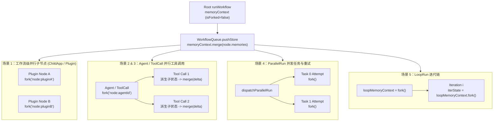

# 工作流与工具节点统一记忆状态（WorkflowMemoryContext）设计方案

## 1. 背景

工作流中的部分 AI 节点需要跨轮次持久化内部状态到 `ChatItem.memories`（运行时字段为 `DispatchNodeResponseKeyEnum.memories` / `system_memories`），当前主要包括三类节点：

1. **内容提取（`contentExtract`）**：保存上一轮提取结果与函数返回状态。
2. **问题分类（`classifyQuestion`）**：保存上一轮问题分类对话上下文。
3. **Agent（`agent` / `piAgent`）**：保存暂停态的 `providerState` 及恢复信息。

此前实现存在以下痛点：

- **键名格式不统一**：`extract` 与 `classifyQuestion` 使用 `${sourceType}:${sourceId}:${nodeId}`，而 `agent` 使用 `agentLoopMemory-${nodeId}`，缺少调用路径作用域前缀。
- **同应用/同插件被多次调用时发生键冲突**：当父工作流中存在两个插件节点或两个子应用节点指向同一个目标应用/插件时，其内部节点的 `${sourceType}:${sourceId}:${nodeId}` 完全一致，后执行的实例会覆盖先执行实例的记忆。
- **嵌套容器与工具调用链丢失子流程记忆**：`loopRun`、`parallelRun`、`agent` 子应用/工作流工具（`sub/app`）以及 `toolCall` 工具调用子工作流未向上归集 `system_memories`。
- **并行多子节点回写存在 Lost-Update 风险**：若子流程直接返回合并了历史基线的全量 `memories`，并发完成的兄弟子流程（如 `parallelRun` 并发任务、Agent 并行工具调用 `batchToolSize: 5`、`toolCall` 多路 `dataset_search`）会用各自的旧基线相互覆盖对方刚刚写入的新键。
- **同轮先写后读与末尾非 AI 消息误读**：节点各自散落从 `histories` 切片读取 `memories`，既无法读到同一轮上游或前序循环迭代刚产出的记忆，又容易在 `histories` 末尾为 `Human` 时误读更早轮次的残留状态。

## 2. 设计目标与非目标

### 2.1 目标

1. **统一键格式**：所有工作流节点记忆统一采用 `${scopePath}/${sourceType}:${sourceId}:${nodeId}`（根工作流无前缀时为 `${sourceType}:${sourceId}:${nodeId}`）。
2. **隔离 Legacy 兼容**：将旧版无前缀子流程键（`${sourceType}:${sourceId}:${nodeId}`）与旧版 Agent 键（`agentLoopMemory-${nodeId}`）的兼容读取和覆盖清理全部收拢到纯工具模块 `memory/utils.ts`，业务节点零感知。
3. **Baseline（只读快照）+ Delta（局部增量）分离**：
   - 根入口从上一轮末尾 `AI` 历史消息初始化 `baseline`，通过必填的 `WorkflowContext.memoryContext` 注入；
   - 子工作流、容器节点、工具调用通过 `fork()` 派生独立子状态（继承当前可读视图为 `baseline`，自身 `delta` 为空）；
   - 子工作流结束时只向父级返回 `getDelta()`（自身新增/修改/显式置 `undefined` 的增量），根工作流结束时返回 `toRecord()`（`baseline + delta`），彻底消除并行子节点回写时的旧基线覆盖问题。
4. **完整覆盖五类并行/嵌套多子节点场景**：
   - 主工作流 DAG 并发兄弟节点（`WorkflowQueue`）
   - Agent 节点并发工具调用（`batchToolSize: 5`）
   - ToolCall 节点多工具调用与多路并发 `dataset_search`
   - ParallelRun 并发任务与失败重试（按任务索引 `0..N-1` 确定性合并）
   - LoopRun 多轮迭代与循环体并发节点（跨成功迭代传递，失败迭代丢弃）
5. **最小侵入**：保持 `agentLoopCore` 通用运行时零改动，在 workflow adapter 层完成记忆派生与归集。

### 2.2 非目标

1. 不修改 MongoDB `ChatItem` schema（仍存储在 `ChatItem.memories` 字典中）。
2. 不对存量历史会话做离线数据迁移，通过运行时读取兼容与写入自动替换完成平滑过渡。

## 3. 核心模型：`WorkflowMemoryContext`

`packages/service/core/workflow/dispatch/context/memory.ts` 提供工作流记忆状态容器 `WorkflowMemoryContext`；`memory/utils.ts` 负责键格式、历史快照、旧键兼容和纯合并规则。

```ts
export class WorkflowMemoryContext {
  readonly isForked: boolean;

  static fromRecord(
    baseline?: Record<string, any>,
    context?: { rootSource?: WorkflowMemorySource }
  ): WorkflowMemoryContext;

  static fromHistories(
    histories?: ChatItemMiniType[],
    context?: { parentMemoryContext?: WorkflowMemoryContext; rootSource?: WorkflowMemorySource }
  ): WorkflowMemoryContext;

  static fromWorkflow(props: {
    memoryContext?: WorkflowMemoryContext;
    histories?: ChatItemMiniType[];
    runningAppInfo?: WorkflowMemorySource;
  }): WorkflowMemoryContext;

  fork(scopeSegment?: string, options?: ForkWorkflowMemoryOptions): WorkflowMemoryContext;

  getNodeMemoryKey(params: {
    runningAppInfo?: WorkflowMemorySource;
    nodeId: string;
  }): string;

  readNodeMemory(params: {
    runningAppInfo?: WorkflowMemorySource;
    nodeId: string;
  }): any;

  merge(entries?: Record<string, any>): void;
  getDelta(): Record<string, any>;
  toRecord(): Record<string, any>;
}
```

其中 `WorkflowMemorySource` 仅包含 `sourceType` 和 `sourceId`，由记忆模块定义，不依赖 `ChatDispatchProps`。根队列与直接调用节点的兜底入口提供 `rootSource`，派生状态和自定义历史均继承它；该信息只在运行时保存，交互落库合并时由会话来源重新提供。

### 3.1 统一键格式与作用域规则

- **根工作流节点**：`${sourceType}:${sourceId}:${nodeId}`
  - 示例：`app:65f001:extract_1`、`app:65f001:agent_1`
- **跨工作流嵌套节点**（`child/runApp`、`plugin/run`、`abandoned/runApp`、`agent`、`toolCall`）：进入子应用或工具前调用 `memoryContext.fork('node:${nodeId}')`，子流程内部节点键自动带上调用路径前缀：
  - 示例：`node:pluginNodeA/app:plugin_1:extract_1`。
- **Agent 调用的子应用/工作流工具**：在 Agent 的节点作用域内继续调用 `fork('app:${targetSourceId}')`，把目标应用身份保留在后代路径中。
  - 示例：`node:agent_1/app:subApp_A/node:sharedPlugin/app:plugin_1:extract_1`。两个克隆应用即使包含相同的插件节点 ID，也不会共享后代记忆。
  - 生成当前应用自身节点的键时，省略路径末尾与节点来源重复的应用段，直接子节点仍使用原有的 `node:agent_1/app:subApp_A:extract_1` 格式；状态中保留完整路径供后代派生。
- **同工作流内部容器**（`loopRun`、`parallelRun`）：内部节点本身属于当前工作流画布，`nodeId` 在画布内天然唯一，直接调用 `memoryContext.fork()`（保持当前 `scopePath`，隔离并发读写与失败回滚）。

### 3.2 读取优先级与 `history` 参数语义

通过统一辅助函数 `readWorkflowNodeMemory` 读取节点记忆：

1. `history === 0`：显式禁用历史上下文，直接返回 `undefined`。
2. `Array.isArray(history)`：上游传入了自定义聊天历史数组，通过 `WorkflowMemoryContext.fromHistories(history, { parentMemoryContext: memoryContext })` 从自定义历史末尾 `AI` 消息读取（同时保留当前 `scopePath` 和根来源）。
3. `typeof history === 'number'` 或未传：从当前工作流 `memoryContext` 读取，优先级为：
   - **当前作用域 `delta`**：支持同轮次先写后读（如 `loopRun` 下一轮读取上一轮更新）；
   - **当前作用域 `baseline`**：精确匹配 `${scopePath}/${sourceType}:${sourceId}:${nodeId}`；
   - **Legacy 基线回退（`readLegacyBaselineMemory`）**：
     1. 若根来源已知、目标来源与根不同、当前处于子作用域且 `baseline` 中尚不存在任何 `/${baseKey}` 结尾的带作用域键，回退读取旧版无前缀键 `${sourceType}:${sourceId}:${nodeId}`；
     2. 回退读取旧版 Agent 键 `agentLoopMemory-${nodeId}`。

`fork` 在交互恢复时支持 `hasInteractiveResume`：当父节点（如 `ToolCall`）处于交互恢复时保留已有 `baseline` 快照，即使节点配置 `history=0` 或空自定义历史。普通新请求仍遵守历史隔离。

### 3.3 写入、删除与 Legacy 键自动清理

- **写入**：节点返回 `{ [DispatchNodeResponseKeyEnum.memories]: { [key]: value } }`，`WorkflowQueue.pushStore` 调用 `this.memoryContext.merge(memories)` 写入当前 `delta`。
- **删除/清空**：当节点（如 `piAgent` 完成态）返回 `{ [key]: undefined }` 时，`delta` 显式记录 `key: undefined`；子工作流通过 `getDelta()` 向上传递该 `undefined` 墓碑，最终在根工作流落库（`Mongo` / `JSON` 序列化或对象合并）时清除旧值。
- **Legacy 清理（`cleanupSupersededLegacyKeys`）**：当节点以新统一键写入 `delta` 后，`toRecord()` 从合并结果中剔除其对应的旧版无前缀键和 `agentLoopMemory-${nodeId}` 键。无前缀键只有在确认不属于根来源时才清理；缺少来源时保守保留。递归进入根应用的子实例既不读取根节点的 canonical/旧 Agent 键，也不负责清理这些键，保证未执行根分支的记忆不丢失。

### 3.4 模块职责与依赖边界

- `memory/utils.ts` 只依赖全局聊天类型和通用拷贝工具，统一键格式及兼容规则。`saveChat` 直接使用纯合并函数，不构造运行状态，也不依赖调度器内部文件。
- `dispatch/context/memory.ts` 依赖纯记忆工具模块，负责基线、增量、派生与历史配置，不依赖 ALS；Workflow 节点统一读取 `getWorkflowContext().memoryContext`。显式参数 helper 仍支持独立 runner，不强制读取 Workflow ALS。
- `WorkflowDispatchProps` 不再携带记忆对象，队列和节点通过 WorkflowContext 获取当前层的实例。移除旧 `memory/state.ts` 路径，不提供转导层；持久化仍只依赖 `memory/utils.ts`。
- 并发读写边界、持久化历史格式校验、undefined 删除标记和旧键归属判断继续保留。工厂和 `fork` 已产生独占快照，私有构造函数不重复深拷贝；内部增量沿用 TypeScript 契约，不静默忽略错误类型。
- Pi adapter 只负责 providerState 的包装、AI 消息约束和暂停/完成语义；历史选择与 checkpoint 优先级复用通用读取入口。

### 3.5 Context 注入与派生

- `dispatchWorkFlow` 在根入口用 `WorkflowMemoryContext.fromHistories` 创建记忆；`runWorkflow` 与 Queue 只消费准备好的 Context，不自行补建。
- 普通节点的 Context 派生默认共享本层 memory；进入真正的子运行时显式 fork 并覆盖 `memoryContext`，不能在每次 `getChildContext()` 时自动 fork。
- Agent 自身暂停态继续使用父层节点键，内部工具使用 `node:${nodeId}` 派生作用域。工具 provider 捕获创建时的 Context，普通调用和交互续跑均激活该作用域，避免异步调用回退到父记忆。
- `system_memories` 返回协议、根全量/子增量输出、失败/交互处理和 Parallel 按任务索引归集顺序保持不变，不并入变量快照的提交策略。
- Pro Builder 补齐运行 Context，但独立 Agent 的 provider-state helper 继续按显式历史和 nodeId 工作，不改变其持久化键。

## 4. 五类并行与嵌套多子节点场景设计



### 4.1 场景 1：主工作流 DAG 并发兄弟节点（`WorkflowQueue`）

- `WorkflowQueue.checkNodeCanRun` 通过 `Promise.all` 并发调度就绪节点。
- 普通子应用（`child/runApp`）、插件节点（`plugin/run`）、旧版子应用（`abandoned/runApp`）通过其执行路径调用 `memoryContext.fork('node:${nodeId}')`，注入派生 Context 后执行子 `runWorkflow`。
- 子 `runWorkflow` 因 `memoryContext.isForked === true` 仅返回 `memoryContext.getDelta()`，由父 `WorkflowQueue.pushStore` 合并入父 `memoryContext`，兄弟节点互不覆盖。

### 4.2 场景 2：Agent 节点并发调用多个工具（`batchToolSize: 5`）

- `dispatchRunAgent` 创建 `agentMemoryContext = memoryContext.fork('node:${nodeId}')`，在派生 Context 内构建 `createWorkflowAgentLoopRuntime` 的工具能力。
- 当单轮并发执行最多 5 个子应用/工作流工具时，`dispatchApp` 与 `dispatchPlugin` 内部各自调用 `memoryContext.fork('app:${targetSourceId}')` 传入子 `runWorkflow`，执行完毕后调用 `memoryContext.merge(system_memories)` 将各自 `delta` 归集到 `agentMemoryContext`。
- `dispatchRunAgent` 结束（完成、暂停或异常）时，通过 `buildAgentMemories` 将 `agentMemoryContext.getDelta()` 与 Agent 自身的 `providerState` 记忆合并返回。

### 4.3 场景 3：ToolCall 节点多工具调用与并行 `dataset_search`

- `dispatchRunTools` 创建 `toolCallMemoryContext = memoryContext.fork('node:${nodeId}')`，通过派生 Context 执行 ToolCall/provider。
- `createToolCallToolProvider` 的 `runWorkflowTool` 在每次执行用户工具或通过 `Promise.all` 并发执行多个关联 `datasetSearchNode` 子流程时，为每个子流程调用 `memoryContext.fork()`，并在子流程返回后执行 `memoryContext.merge(result.system_memories)`。
- `dispatchRunTools` 结束时返回 `toolCallMemoryContext.getDelta()`。

### 4.4 场景 4：ParallelRun 并发任务与失败重试

- `dispatchParallelRun` 通过 `batchRun` 并发执行最多 `WORKFLOW_PARALLEL_MAX_CONCURRENCY` 个任务，且单个任务支持多次重试（`attempt`）。
- 每次 `attempt` 独立调用 `taskMemoryContext = parentMemoryContext.fork()`：
  - 若当前 `attempt` 失败并触发重试，或任务最终失败，该次 `attempt` 产出的 `system_memories` 直接丢弃；
  - 若任务成功，将其 `response.system_memories` 记录到 `successfulTaskMemories[index]`。
- 所有并发任务结束后，严格按任务索引 `0..N-1` 顺序合并 `successfulTaskMemories`，确保即使并发完成先后顺序不确定，最终记忆合并结果也完全确定（Deterministic）。

### 4.5 场景 5：LoopRun 顺序迭代与循环体内并发节点

- `dispatchLoopRun` 初始化 `loopMemoryContext = parentMemoryContext.fork()`。
- 第 `i` 轮迭代创建 `iterationMemoryContext = loopMemoryContext.fork()` 传入子 `runWorkflow`：
  - **迭代成功**：执行 `loopMemoryContext.merge(response.system_memories)`，下一轮迭代 `i + 1` 创建的 `iterationMemoryContext` 自动通过 `baseline` 读到第 `i` 轮更新的记忆；
  - **交互暂停（Interactive Pause）**：同样合并已完成节点的记忆增量并随暂停结果返回，保证断点恢复前后的记忆连续；
  - **迭代失败**：不合并本轮 `iterationMemoryContext`，确保失败轮次的脏状态不泄漏。
- 循环结束时向上返回 `loopMemoryContext.getDelta()`。

## 5. 修改文件清单

| 文件 | 职责与改动说明 |
| --- | --- |
| `packages/service/core/workflow/dispatch/context/memory.ts` | `WorkflowMemoryContext` 的基线、增量、路径管理与显式参数 helper |
| `packages/service/core/workflow/memory/utils.ts` | 节点键、历史快照、Legacy 读取与 `mergeWorkflowMemories` 纯合并规则，不依赖运行态或调度器 |
| `packages/service/core/chat/saveChat.ts` | `updateInteractiveChat` 合并 `chatItem.memories` 时通过 `mergeWorkflowMemories` 自动清理已被新统一键替代的旧版 legacy key |
| `packages/service/core/workflow/dispatch/context/index.ts` | 必填 `memoryContext`，校验初始化，派生默认共享、显式覆盖子实例 |
| `packages/service/core/workflow/dispatch/index.ts` / `queue.ts` | 根入口初始化；Queue 通过 Context 读取并在 `pushStore` 中合并节点记忆；`runWorkflow` 按 `isForked` 返回增量或全量 |
| `packages/service/core/workflow/dispatch/ai/extract.ts` | 改用 `readWorkflowNodeMemory` 与 `getWorkflowNodeMemoryKey`，移除内联历史切片查找 |
| `packages/service/core/workflow/dispatch/ai/classifyQuestion.ts` | 改用 `readWorkflowNodeMemory` 与 `getWorkflowNodeMemoryKey`，移除内联历史切片查找 |
| `packages/service/core/workflow/dispatch/ai/agentLoopCore/adapter/memory/providerState.ts` | 统一使用 `getWorkflowNodeMemoryKey` 与 `WorkflowMemoryContext` 读写 `piAgent` 的 `providerState` |
| `packages/service/core/workflow/dispatch/ai/agent/index.ts` | 派生 `agentMemoryContext = memoryContext.fork('node:${nodeId}')`，合并子工具记忆增量与 Agent 自身状态 |
| `packages/service/core/workflow/dispatch/ai/agent/toolProvider/createWorkflowAgentToolProvider.ts` | 工具执行/恢复绑定创建时的 Workflow Context，sub/utils 不再透传记忆 Props |
| `packages/service/core/workflow/dispatch/ai/agent/sub/app/index.ts` | `dispatchApp` / `dispatchPlugin` 按目标应用 `fork('app:${targetSourceId}')` 并归集子流程记忆 |
| `packages/service/core/workflow/dispatch/ai/toolcall/index.ts` | 派生 `toolCallMemoryContext = memoryContext.fork('node:${nodeId}')` 并透出工具子流程记忆增量 |
| `packages/service/core/workflow/dispatch/ai/toolcall/toolProvider/createToolCallToolProvider.ts` | `runWorkflowTool` 为每次工具调用及并发 `dataset_search` 子流程 `fork()` 并合并 `system_memories` |
| `packages/service/core/workflow/dispatch/child/runApp.ts` | 子应用通过 `fork('node:${nodeId}')` 隔离调用路径作用域 |
| `packages/service/core/workflow/dispatch/plugin/run.ts` | 插件工作流通过 `fork('node:${nodeId}')` 隔离调用路径作用域 |
| `packages/service/core/workflow/dispatch/abandoned/runApp.ts` | 旧版子应用通过 `fork('node:${nodeId}')` 隔离调用路径作用域并透传 `system_memories` |
| `packages/service/core/workflow/dispatch/loopRun/runLoopRun.ts` | 循环体每轮 `fork()`，成功/暂停轮次累积合并 `system_memories`，失败轮次丢弃 |
| `packages/service/core/workflow/dispatch/parallelRun/runParallelRun.ts` | 并发任务每轮 `attempt` 独立 `fork()`，按索引 `0..N-1` 确定性合并成功任务的 `system_memories` |

## 6. 测试矩阵

| 测试文件 | 覆盖场景 |
| --- | --- |
| `packages/service/test/core/workflow/dispatch/context/memory.test.ts` / `utils.test.ts` | 根/嵌套作用域键生成、`baseline` 与 `delta` 隔离、并发 `fork()` 不互相覆盖、旧版无前缀子流程键与 `agentLoopMemory-${nodeId}` 兼容读取及新键写入后自动清理、`history=0` / `history=ChatItemMiniType[]` / 末尾 `Human` 边界 |
| `packages/service/test/core/workflow/dispatch/ai/agentLoopCore/memory/providerState.test.ts` | 统一键名格式下 `piAgent` `providerState` 的读取、暂停保存、完成清理、作用域前缀生成与旧版 `agentLoopMemory-${nodeId}` 兼容恢复 |
| `packages/service/test/core/workflow/dispatch/ai/agent/index.test.ts` | Agent 节点暂停与完成时的统一键名记忆输出 |
| `packages/service/test/core/workflow/dispatch/ai/agent/sub/app.test.ts` | Agent 子应用工具调用 `fork()` 作用域生成与 `system_memories` 回写父 `memoryContext` |
| `packages/service/test/core/workflow/dispatch/ai/toolcall/toolProvider/createToolCallToolProvider.test.ts` | ToolCall 多路并发 `dataset_search` 与用户工具调用的 `memoryContext` 隔离派生与增量归集 |
| `packages/service/test/core/workflow/dispatch/loopRun/runLoopRun.test.ts` | LoopRun 跨成功迭代记忆累积传递、失败迭代回滚丢弃与最終增量透出 |
| `packages/service/test/core/workflow/dispatch/parallelRun/runParallelRun.test.ts` | ParallelRun 并发任务隔离、失败 `attempt` 丢弃、重试恢复以及按任务索引 `0..N-1` 确定性合并 |

## 7. TODO

- [x] Revert `a230fd9c29a98ec91588de3d19ec2fb36a1a8b61`，清理此前耦合实现。
- [x] 实现 `packages/service/core/workflow/dispatch/context/memory.ts` 与 `memory/utils.ts`（`WorkflowMemoryContext`、统一键生成、读取辅助函数与 Legacy 兼容层）。
- [x] 改造 `WorkflowQueue` 与 `runWorkflow` 主链路，支持 `memoryContext` 实时合并与 `isForked` 增量/全量返回切换。
- [x] 改造 `extract`、`classifyQuestion`、`agentLoopCore/adapter/memory/providerState.ts` 与 `agent/index.ts` 统一使用新记忆接口。
- [x] 改造 `child/runApp`、`plugin/run`、`abandoned/runApp`、`loopRun`、`parallelRun`、`agent/sub/app`、`toolcall` 支持作用域派生与并行子节点记忆归集。
- [x] 补充并通过 `dispatch/context/memory.test.ts`、`memory/utils.test.ts`、`providerState.test.ts`、`runParallelRun.test.ts`、`runLoopRun.test.ts`、`createToolCallToolProvider.test.ts`、`agent/sub/app.test.ts` 等单元测试与类型检查。
- [x] 验证 `history=0` 的嵌套 Pi 交互恢复、克隆应用共享后代插件的并发/跨轮隔离，以及递归根记忆的读取与落库保护。
