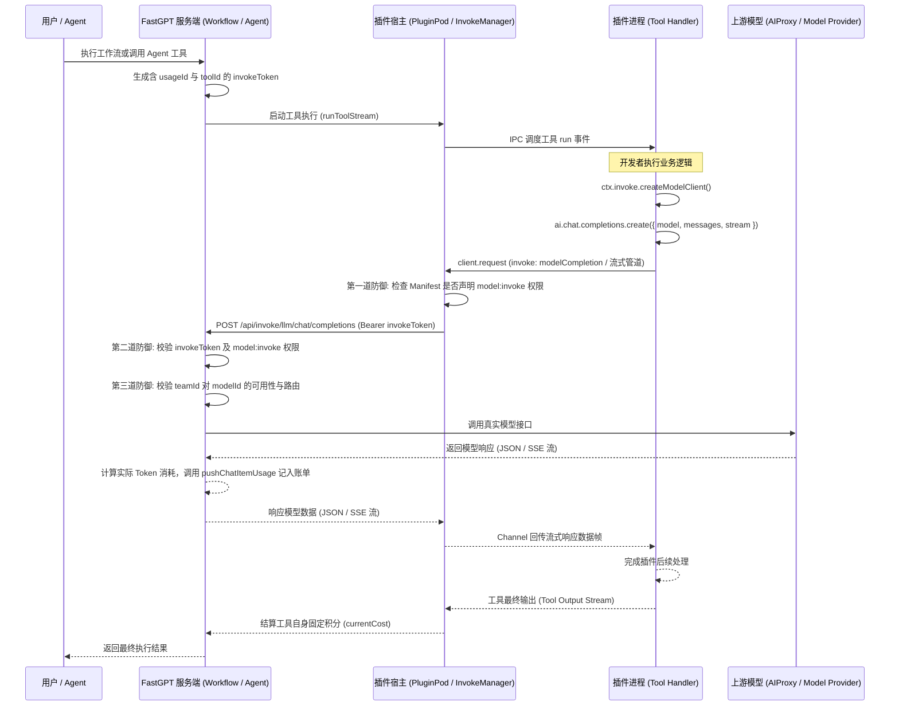

# Plugin 模型反向调用设计方案

## 1. 背景与目标

在 FastGPT 插件（System Tool / Team Plugin）开发过程中，许多高级工具需要借助大语言模型（LLM/VLM）完成内部推理、总结或格式化任务（例如“网页抓取并结构化提炼”、“代码审查分析”等）。目前插件仅支持单向接收模型调用的入参，无法在工具执行过程中反向调用 FastGPT 平台配置的模型。

本方案旨在为 FastGPT 与 FastGPT Plugin 体系建立统一、标准、安全、透明计费的**模型反向调用机制**。

### 1.1 核心目标
1. **开发者体验**：在 Plugin 侧提供标准的 OpenAI SDK 调用方式（`ctx.invoke.createModelClient()`），100% 保持官方原生语法、类型提示与流式/非流式契约。
2. **标识规范**：全链路统一以 FastGPT 的 `modelId`（`ai_models._id`）作为唯一稳定模型引用，屏蔽底层不同模型提供商差异。
3. **架构解耦与环境隔离**：通过 `PluginRuntimeChannel` 双向流代理转发模型请求，插件进程无须直连 FastGPT 内网地址，天然兼容容器沙箱与本地 CLI 远程调试。
4. **安全与多层鉴权**：在插件沙箱宿主层、FastGPT 服务端接口层实施双重权限校验，且在服务端强制鉴权当前团队对目标模型的可用性，阻断越权与非法模型调用。
5. **实时透明计费**：模型调用产生的 Token 消耗通过 JWT 载荷透传的 `usageId` 实时计入对话账单，明细中记录发起调用的工具标识与模型消耗，与工具本身的固定执行点数清晰分离。
6. **UI 联动**：在工作流工具节点和 Agent 工具配置弹窗中无缝渲染模型选择下拉框，且禁止模型参数由 Agent 运行时自动猜测生成。

### 1.2 范围边界（Non-Goals）

- **不包含知识库反向调用**：本轮设计与实现明确**不涉及知识库反向调用**（包括 `datasetQuery` 端口、`dataset:read` 反向检索接口、插件内知识库选择 UI 等）；此前需求背景中提及的知识库反向调用仅作为远期方向，后续如需推进将单独开案设计，不在本轮交付范围内。
- **模型单传边界**：插件工具入参仅支持单个模型传入（`format: 'modelId'`），不考虑传入可选/可用模型列表由插件动态挑选的场景。
- **模型能力聚焦**：本轮仅实现对话补全（`chat.completions`，覆盖 LLM / VLM），路由 `/api/invoke/llm/chat/completions` 与 `ctx.invoke.createModelClient()` 为未来扩展 `embeddings` / `audio` 等保留结构空间。

---

## 2. 总体架构与调用链路

### 2.1 架构时序



---

## 3. 详细设计

### 3.1 插件侧 SDK 与 Schema 声明

#### 3.1.1 权限声明
在 `fastgpt-plugin` 仓库与 FastGPT 之间新增 `'model:invoke'` 权限枚举：
- 插件在 `defineToolManifest` 的 `permission` 中必须声明 `'model:invoke'`，否则在宿主层与接口层均会被拦截。

```ts
export const PluginPermissionEnumSchema = z.enum([
  'userInfo:read',
  'teamInfo:read',
  'model:read',
  'model:invoke', // 新增模型反向调用权限
  'dataset:read',
  'file-upload:allow'
]);
```

#### 3.1.2 Model Schema 辅助定义
为避免插件与 FastGPT 内部枚举强耦合，基于标准 JSON Schema 的 `format: "modelId"` 进行约定。
在 `@fastgpt-plugin/sdk-factory` 中导出便捷对象 `Model`：

```ts
import z from 'zod';

export const Model = z.string().meta({
  format: 'modelId'
});
```

插件作者在定义工具入参时即可直接使用：

```ts
import { createToolHandler, Model } from '@fastgpt-plugin/sdk-factory';
import z from 'zod';

export const inputSchema = z.object({
  query: z.string().describe('用户提问'),
  model: Model.describe('用于分析的对话模型')
});
```

编译打包为插件 manifest 时，该字段生成的 JSON Schema 标准格式为：
```json
{
  "type": "string",
  "format": "modelId",
  "description": "用于分析的对话模型"
}
```

#### 3.1.3 `createModelClient` 语法与实现
`createModelClient()` 100% 保持官方 `OpenAI` 客户端类型与契约。

- **用法**：
  ```ts
  export default createToolHandler({
    inputSchema,
    outputSchema,
    handler: async (input, ctx) => {
      const ai = ctx.invoke.createModelClient();

      // 完全标准的 OpenAI 调用规范，显式传递 input.model
      const completion = await ai.chat.completions.create({
        model: input.model,
        messages: [
          { role: 'system', content: 'You are a helpful assistant.' },
          { role: 'user', content: input.query }
        ],
        temperature: 0.7,
        stream: true
      });

      for await (const chunk of completion) {
        const text = chunk.choices[0]?.delta?.content || '';
        ctx.streamResponse(text);
      }

      return { success: true };
    }
  });
  ```

- **SDK 内部实现**：
  `createModelClient()` 返回 `new OpenAI({ fetch: customFetch, apiKey: 'dummy', baseURL: 'http://fastgpt-internal' })`。
  `customFetch` 拦截对 `/chat/completions` 的所有请求，将其转换为 `channel.request(PluginChannelClientMethod.request, { method: 'chatCompletion', args: body })`，并通过 Channel 双向流管道将服务端的 SSE 数据解开为标准的 `ReadableStream<Uint8Array>` 交给 OpenAI SDK 消费。

---

### 3.2 传输链路与 Channel 协议

#### 3.2.1 Channel 方法扩展
在 `packages/domain/src/ports/invoke.port.ts` 中注册 `chatCompletion`：
```ts
export const InvokeMethodEnumSchema = z.enum([
  'uploadFile',
  'userInfo',
  'wecomCorpToken',
  'chatCompletion' // 开启模型调用
]);
```

#### 3.2.2 宿主代理（PluginPod & RemoteDebugInvokeBridge）
1. **宿主鉴权（第一道防线）**：
   `PluginPod.routeClientRequest` 收到 `method === 'chatCompletion'` 时，检查当前插件声明的 `permissions` 是否包含 `'model:invoke'`。若不包含，直接阻断并返回错误，不发起网络请求。
2. **转发 FastGPT**：
   宿主调用 `InvokeManager.chatCompletion(args, options)`，通过 HTTP POST 请求 FastGPT 的 `/api/invoke/llm/chat/completions`。
3. **流式转换**：
   若请求为流式（`stream: true`），`InvokeManager` 将 FastGPT 返回的 `Response.body`（SSE 字节流）以 `StreamData` / Channel 流式帧的形式无损透传回插件子进程。
4. **远程调试支持**：
   在 CLI 的 `RemoteDebugInvokeBridge` 中同步接入 `chatCompletion`，远程调试插件同样无缝代理反向调用。

---

### 3.3 FastGPT 服务端接口与安全防御

#### 3.3.1 接口契约
- **路径**：`POST /api/invoke/llm/chat/completions`
- **鉴权**：请求头 `Authorization: Bearer <invokeToken>`
- **请求体**：
  ```ts
  export const InvokeChatCompletionsBodySchema = z.object({
    model: z.string().min(1).describe('FastGPT 平台的 modelId (ai_models._id)'),
    messages: z.array(z.any()).min(1),
    stream: z.boolean().optional().default(false),
    temperature: z.number().nullish(),
    top_p: z.number().nullish(),
    max_tokens: z.number().nullish(),
    tools: z.array(z.any()).optional(),
    tool_choice: z.any().optional(),
    response_format: z.any().optional()
  });
  ```

#### 3.3.2 服务端多重防御
1. **Token 解密与权限检查（第二道防线）**：
   服务端通过 `InvokeProcessor.getInstanceFromToken(token)` 校验并解密 JWT，必须通过 `assertPermission(PluginPermissionEnum['model:invoke'])` 校验。
2. **模型合法性与可用性检查（第三道防线）**：
   服务端提取 Session 中的 `teamId`，调用：
   ```ts
   const modelHandle = await getTeamModelHandle({ teamId });
   const modelData = modelHandle.getModelData({ modelId: body.model }, { type: 'llm' });
   if (!modelData || !modelData.isActive) {
     throw new UserError('Model not found or disabled');
   }
   ```
   **严格禁止**任意外部传入的模型名称直接路由至上游，必须使用合法解析出的 `modelData.model`。

#### 3.3.3 请求执行
调用底层标准的 `createLLMResponse` / `createChatCompletion`：
- `stream: false` 时，返回标准 OpenAI JSON，并在响应后同步记账；
- `stream: true` 时，以 SSE 方式流式写入响应，在流正常结束或异常关闭时完成实际 Token 统计与记账。

---

### 3.4 账单与 Token 计量模型

#### 3.4.1 `invokeToken` 载荷扩展
保持 JWT 载荷平铺且体积克制，新增 `usageId` 与 `toolId`：

```ts
export const InvokeSessionSchema = z.object({
  appId: z.string().nonempty(),
  chatId: ChatIdSchema.nonempty(),
  uId: z.string().nonempty(),
  teamId: z.string().nonempty(),
  tmbId: z.string().nonempty(),
  permissions: PluginPermissionListSchema.default([]),
  // 账单上下文
  usageId: z.string().optional(),
  toolId: z.string().nonempty() // 标识发起调用的具体工具 ID
});
```
整段 JWT 维持在 450~500 字节，远低于 HTTP Header 的限制。

#### 3.4.2 独立账单明细记录（UsageItem）
模型反向调用费用与工具自身执行费用**在同一个 `usageId` 下记录为独立条目**：

1. **反向调用模型费用**：
   - 响应结束时，FastGPT 服务端根据模型配置、`inputTokens` 与 `outputTokens` 计算消耗点数 `totalPoints`。
   - 查询 `toolId` 获取对应的工具名称（例如 `联网研报生成`）。
   - 调用 `pushChatItemUsage` 记入：
     ```ts
     pushChatItemUsage({
       teamId,
       usageId,
       nodeUsages: [{
         moduleName: toolName, // 账单表格中清晰显示是哪个工具调用的
         modelId: modelData.modelId, // 关联模型 ID
         inputTokens,
         outputTokens,
         totalPoints
       }]
     });
     ```
2. **工具基础执行费用**：
   - 工具运行完毕后，由原有的 `dispatchRunTool` / `dispatchTool` 按工具配置的 `currentCost` 写入固定的 `usagePoints`。
3. **无 `usageId` 场景兜底**：
   若该次调用不处于对话工作流中（`usageId` 为空且非调试环境），则创建独立的 `Usage` 根记录，确保不漏计费。

---

### 3.5 UI 与 Schema 放行

#### 3.5.1 Schema 解析与类型映射
在 `packages/global/core/app/jsonschema.ts` 的 `jsonSchema2NodeInput` 中新增对 `format === 'modelId'` 的支持：
```ts
if (value.format === 'modelId' || value.type === 'string' && value.format === 'modelId') {
  return {
    key,
    label: localizedTitle || value.title || key,
    valueType: WorkflowIOValueTypeEnum.string,
    renderTypeList: [FlowNodeInputTypeEnum.selectLLMModel],
    selectedType: FlowNodeInputTypeEnum.selectLLMModel,
    required: isRequired,
    defaultToAgentGenerated: false // 严禁 Agent 自动生成
  };
}
```

#### 3.5.2 放行与安全边界
在 `packages/global/core/app/formEdit/utils.ts` 中：
1. **放行工具配置**：在 `unsupportedToolInputRenderTypes` 中移除 `FlowNodeInputTypeEnum.selectLLMModel`，使得工作流节点配置和 Agent 工具弹窗能够正常显示并保存模型配置。
2. **坚守安全防线**：在 `agentGeneratedDenyRenderTypes` 中保持保留 `FlowNodeInputTypeEnum.selectLLMModel`，确保 Agent 在执行工具时**无法随意编造或动态猜测**模型参数，必须读取开发者在界面配置好的固定值。
3. **表单组件支持**：`formRender` 已原生具备 `AIModelSelector`，配合更新后的映射即可在弹窗及画布侧边栏流畅渲染。

---

## 4. 实施清单 (TODO)

跨仓实施任务拆分如下：

- **Phase 1（`fastgpt-plugin` 基础与 SDK）**：
  - Task 1：新增 `model:invoke` 权限、`chatCompletion` 端口与 `Model` Schema Helper
  - Task 2：实现宿主 `InvokeManager`、`PluginPod` 与远程调试的 `chatCompletion` 流式代理
  - Task 3：实现 `InvokeClient` 与 `ctx.invoke.createModelClient()` 标准 OpenAI SDK
- **Phase 2（`FastGPT` 服务端与实时计费）**：
  - Task 4：扩展 `InvokeSession`（`usageId` / `toolId`）、`model:invoke` 权限与调度透传
  - Task 5：实现 `POST /api/invoke/llm/chat/completions` 接口与团队模型鉴权
  - Task 6：接入反向模型调用实时计费与 `toolId` 工具名称解析
- **Phase 3（`FastGPT` UI 联动与跨仓联调）**：
  - Task 7：适配 JSON Schema `format: 'modelId'` 映射与工作流 / Agent 工具表单放行
  - Task 8：账单 i18n 补齐与跨仓库端到端联调验收
