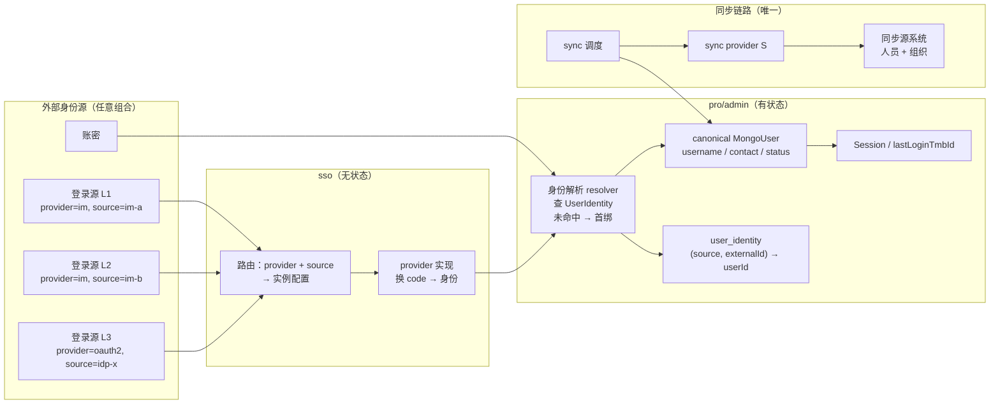

# 单同步源 + 多 SSO 登录收敛 — 通用设计

## 0. 版本记录

| 版本 | 日期 | 状态 | 说明 |
| --- | --- | --- | --- |
| **V1（本文）** | 2026-11-12 | 初版，已提交评审 | 身份收敛采用**独立身份表** `user_identity`（5.3）：`(source, externalId) → userId`，账号 `username = externalId` 不可改 |
| V2 | 2026-11-17 | 评审后修订 | 不新增表，身份绑定内嵌为 `users.accounts`；SSO/注册用户随机 username + 开放修改 |
| V2.1 | 2026-11-17 | **当前有效版本**，见《单同步源多SSO通用设计V2.md》 | username 生成策略延后：本期沿用现有代码逻辑（同步账号 = externalId），生成收敛为可替换策略位，随机生成留作预留策略；username 修改功能与 `accounts` 模型不变 |

> V2.1 是当前有效版本；本文保留作为 V1 存档，用于对照评审前后模型差异（独立表 vs 内嵌数组）。

> **文档定位**：通用能力设计，不绑定具体客户、不绑定具体 IdP。适用于"人员主数据来自**一个**同步源、登录入口有**多个** SSO（同一类型可有多套实例）"的场景。
>
> **阅读方式**：本文只描述与厂商无关的模型、数据、逻辑与配置形态。某个具体项目如何参数化落地（选了哪个同步源、哪几个登录源、怎么迁移存量），见对应的《XX 落地设计》文档。
>
> **代号约定**：`S` = 唯一同步源；`L1…Ln` = 登录源实例；`provider` = 登录类型；`source` = 类型下的实例 id。
>
> **先理解一个核心概念——canonical 账号**：指同一个自然人在 FastGPT 里的**唯一权威账号**，即 `users` 集合中的**一条 `MongoUser` 文档**，不是新表，也不是"所有 MongoUser 都算"。同一个人可能历史上留下多个账号（旧 SSO 自动建号、手工建号、旧同步、新同步），必须指定其中一个为"正本"，资源和权限都归它，其余合并后改名禁用。
>
> - **判定口径**：canonical = 由唯一同步源**新建或认领**的账号；手工账号、注册账号、旧 SSO 自动建号在未被同步认领前只是普通账号，不自动等于 canonical。
> - **承载物**：`_id` 即身份解析的最终产物 `userId`；团队/成员关系（`tmbId`）、应用/知识库/权限都挂在它下面；`status` 以同步源为准。
> - **与另两个概念的区别**：canonical 是**账号本身**；`syncSource` 是账号上的**一个字段**（谁维护）；`UserIdentity` 是**另一张表**（这个人还能从哪些外部身份登录）。
> - **一句话**：canonical 是"正本"，旧账号是"副本/别名"，身份表是"别名 → 正本"的目录。详见 5.1。

---

## 1. 适用场景与目标形态

### 1.1 适用场景

同时满足以下特征时适用本文设计：

1. 人员与组织由某一系统统一维护（HR / OA / IM / 自建用户中心），作为**唯一同步源**写入 FastGPT；
2. 用户从**多个**身份提供方登录：企业 IM、OA、第三方 OIDC/OAuth2、账密等，任意组合；
3. **同一类型可以有多个实例**（多子公司、多租户、多环境各一套），且实例之间 `userid` 可能重名；
4. 业务要求：所有入口进入**同一个** FastGPT 账号、看到**同一份**资源；同一人在系统里只有一个身份。

典型例子（仅示意，不限定实现）：

```text
同步源：人力资源系统（单实例）
登录源：总部 IM + 子公司 A IM + 子公司 B IM + OA 的 OAuth2 + 账密
```

> 这里的"多套 IM"是**一个** FastGPT 部署同时接入多套 IM 凭证（每套 `corpid + agentid + appSecret`），不是每个子公司各部署一套 FastGPT。

### 1.2 目标形态

```text
同步源 S（单实例）
  └─► canonical MongoUser（唯一账号；资源唯一载体 tmbId）

登录源 L1 … Ln（任意类型、任意个数、同类型可重复）
  └─► 每个登录源返回 (source, externalId, profile)
      └─► 身份解析 UserIdentity(source, externalId) → canonical userId
          └─► 同一个 userId → 同一个 tmbId → 同一份资源
```

一句话：**同步只认 S；登录来自多个 IdP；每个 IdP 身份通过身份绑定表收敛到同一个 userId。**

#### 1.2.1 身份键 `(source, externalId)` 是什么

一个登录身份由两个字段共同确定：

| 字段 | 含义 | 回答的问题 |
| --- | --- | --- |
| `source` | 登录源**实例**的 id（哪一套系统 / 租户 / 环境） | 这个人是从**哪个系统**来的？ |
| `externalId` | 该实例内标识用户的**稳定 ID**（userid / openid / 工号 / subject） | 在这个系统里**是谁**？ |

- `source` 决定 `externalId` 的唯一性范围：`externalId` **只在同一个 `source` 内唯一**；
- 因此 `(source, externalId)` 才能全局唯一地标识一个登录身份；
- 单看 `externalId` 会串号（不同系统可能有相同的工号 / userid），单看 `source` 又无法区分用户。

示例（同一个自然人在多个系统中的身份）：

```text
(source, externalId)
  (im-hq,    zhangsan)  → 总部 IM 里的 zhangsan
  (im-sub1,  zs01)      → 子公司 IM 里的 zs01
  (hr,       77000001)  → 人力系统里的工号 77000001

以上各行是同一个 userId 的多个身份。
```

账密**不是**身份表的一行：它没有外部 source，直接用 canonical `username` + 密码认证（见 6.4），账号本身即身份。

类比：`source` 是"学校"，`externalId` 是"学号"——学号只在各自学校内唯一，两个学校都可以有 `001`；"学校 + 学号"才能定位到唯一的人。

### 1.3 设计原则

| # | 原则 | 含义 |
| --- | --- | --- |
| P1 | 同步源与登录源解耦 | 换/加同步源或登录源，只做 provider 适配与配置，身份模型零改动 |
| P2 | 登录源不建号 | 账号由同步源产生；登录源只映射到既有账号，或进入人工绑定清单 |
| P3 | 长期登录键是 `(source, externalId)` | 手机号、邮箱等易变属性只用于首次绑定 |
| P4 | 身份数据在 pro 侧 | sso 保持无状态、可横向扩容；身份表与解析逻辑均在 pro/admin |
| P5 | 资源隔离不变 | 资源仍绑定 `tmbId`，不允许跨 tmb 聚合/并集视图 |
| P6 | 失败不静默 | 未绑定、多命中、来源禁用都明确拒绝并给可诊断原因 |

### 1.4 四个容易混淆的动作：同步建号 / 身份收敛 / 刷数 / 存量合并

| 动作 | 解决什么 | 何时发生 | 机制 | 新环境 / 新账号 |
| --- | --- | --- | --- | --- |
| **⓪ 同步建号与维护** | canonical 账号集合从哪来 | 首次上线 + 周期同步 | 唯一同步源按 `syncSource` 圈定自己的账号（6.8 S8–S10） | 必须生效，是 ①③ 的前提 |
| **① 运行时身份收敛** | 一个人有多个登录身份 | 每次登录 | 身份表 + 首绑（6.1 / 6.2） | 必须生效，**全自动** |
| **② 刷数（回填/纠错）** | 历史数据不符合新规则（缺 identity、旧用户名格式） | 上线窗口一次 | 幂等数据脚本 | **不需要**（新数据天然合规） |
| **③ 存量账号合并** | 旧平行账号持有资源，需要转移到 canonical 账号 | 上线窗口一次 | 合并脚本（第 7 章） | **不需要**（没有旧账号） |

四者边界：

- **⓪ 决定账号集合**：账号由同步源建立，登录源只映射；`username=externalId`、`syncSource=来源`。① 的登录命中、③ 的合并目标都建立在它之上——没有 ⓪，③ 没有稳定、可枚举的目标账号；
- **① 是产品能力**，每次登录都在跑，不依赖任何脚本；
- **② 只修数据、不动资源归属**：补齐 identity、改用户名、修昵称；
- **③ 迁移资源归属并禁用旧账号**：不可回退到"没合并"，必须预演 + 备份；
- 新部署、新入职、新增登录源都只走 ①；只有**已经存在旧账号且持有资源**时才有 ②/③。

**存量升级的固定顺序（只适用于已有账号的部署）**：

| 步骤 | 通用动作 | 前置 / 判断 |
| --- | --- | --- |
| **认领** | 把**非同步产生的存量账号**标记为目标同步源（补 `syncSource=S`）；`username` 必须与同步输入一致（默认等于该源的 `externalId`；保留前缀时同步输入也须带同样前缀）；账号须在同步目标团队。**目标团队内同名、且在来源名单内的账号，同步首跑会自动复用并写入 `syncSource`（自动认领）**；改名、团队外、其他来源仍需人工 | 只处理"同一自然人已存在、但不是 S 建的"账号；自动认领依赖 `username`（`externalId`）不跨人复用；不在人员名单内的账号**不要标记**，否则下一次同步会判其离职 |
| **同步** | 由 S 建立/维护 canonical 账号：新建账号 `username=externalId`；被认领的存量账号（含自动认领）原地刷新组织、`contact`、成员名 | 账号必须在目标团队且 username 与 incoming 一致；其他来源或团队外的同名账号 → "范围外同名"→ 整次同步失败 |
| **合并** | 旧体系账号按 matchKey（如 mobile）或 externalId 把资源换绑到 canonical 账号；写旧身份 identity 行；旧账号改名禁用 | 必须在同步之后；目标账号必须已由 S 建立/认领 |

术语边界：

- **非同步账号** = 不是由目标同步源创建的账号（手工创建、旧同步源遗留、旧 SSO 自动建号），不是"所有存量账号"；
- **认领** = 只补来源标记，不搬资源；账号的 `userId` / `tmbId` / 名下资源不变；可由同步自动完成（目标团队内同名、无来源），也可人工执行；
- **合并** = 搬资源 + 写旧身份行 + 禁用旧账号；认领与合并是两件事，不能合并成一步。

> 单账号的处理细节见 6.2.2；合并的通用方法见第 7 章。概念顺序仍是 **认领 → 同步 → 合并**：自动认领发生在同步内部，改名/移入目标团队等人工动作必须在同步前完成。

---

## 2. 术语

| 术语 | 含义 |
| --- | --- |
| 同步源（sync source） | 提供人员/组织主数据的系统，全系统只允许一个；决定账号集合与组织树 |
| 登录源（login source） | 提供登录身份的 IdP 实例，可多个、可同类多实例 |
| `provider` | 登录**类型**（如 IM、OA-OAuth2、OIDC），对应 sso 侧 provider 注册名 |
| `source` / `sourceId` | 类型下的**实例**唯一 id，全局唯一，即身份表的 `source` 列（例：`im-hq`、`oauth2-idp-x`） |
| `externalId` | 该实例内用户的稳定标识（userid / 工号 / subject / username），**只在同一 source 内唯一**（例：`zhangsan`） |
| canonical user | 同步源维护的**权威账号**：`users` 集合里的一条 `MongoUser` 文档（不是独立集合），资源归属主体；同一自然人的所有登录身份都解析到它，旧平行账号合并后退出 |
| `UserIdentity` | 身份绑定行：`(source, externalId) → userId`，多行指向同一 userId |
| 首绑（first bind） | 某 `(source, externalId)` 第一次登录时，与既有账号建立绑定的过程 |
| `matchKey` | 首绑使用的匹配规则（`mobile` / `email` / `username`，可配置） |
| `auto_link` | 首绑策略：按 matchKey 唯一命中既有账号则自动绑定 |
| `admin_bind` | 首绑策略：不自动绑定，等待管理员人工绑定 |

---

## 3. 设计目标与约束

### 3.1 功能目标

1. 任意一个受支持的同步源作为唯一人员/组织来源；
2. 任意多个登录源（任意类型组合、同类型多实例）都能登录；
3. 同一自然人从任意入口登录后：同一个账号、同一个 tmb、同一份资源、同一份权限；
4. 账密登录与 SSO 并存，同一账号保留账密能力；
5. 登录身份可单独禁用（某来源下线不影响其他来源）；
6. 首绑规则可配置，不把某个字段写死在代码里；
7. 存量账号（旧登录方式产生的平行账号）可迁移合并，不丢资源、不断审计。

### 3.2 硬约束

| # | 约束 | 影响 |
| --- | --- | --- |
| C1 | 资源绑定在 `tmbId` 上，登录入口不能改变资源归属 | "视图一致"只能靠"解析到同一个 userId → 同一个 tmb" |
| C2 | 多源登录必须收敛到同一个账号，不允许每个来源建平行账号 | 必须有身份绑定层 |
| C3 | `username` 全局唯一 | 同步源需保证其 externalId 唯一稳定 |
| C4 | 登录源的主数据（组织、状态）不由登录侧维护 | 人员状态以同步源为准；登录源状态只控制"该入口是否可用" |
| C5 | 存量平行账号不能直接删除 | 需资源转移 + 旧账号禁用保留 |
| C6 | 不能假设所有登录源都返回手机号/邮箱 | 长期登录键不能依赖单一易变属性 |
| C7 | 多团队切换能力不变 | `lastLoginTmbId` 回写、Session 重签行为与登录来源无关 |

### 3.3 非目标

- 不做跨 tmb 的资源聚合或并集视图；
- 不做多同步源同时维护同一批账号（多同步源互斥，切换即迁移）；
- 不在 sso 侧持久化身份数据；
- 不在本期做 IdP 侧的组织同步（登录源只提供身份）。

---

## 4. 通用架构



职责边界：

| 组件 | 职责 | 不负责 |
| --- | --- | --- |
| sso | 按 `provider` + `source` 选择实例、拼授权地址、code 换身份、返回 `(source, externalId, profile)` | 身份持久化、账号匹配、账号创建 |
| pro/admin | 身份解析、首绑、身份表读写、账号状态与团队校验、Session | IdP 协议细节 |
| UI | 来源列表展示、`autoSso` 自动跳转、失败回退 | 任何 secret |

**关键不变量**：登录源可以任意多，但落库账号只有一个；同步源只有一个。

---

## 5. 数据库设计：账号与身份数据模型

> 本章只放数据模型与数据生命周期；登录解析、首绑策略等**逻辑**见第 6 章。
>
> **标记约定**：🆕＝新增；🔧＝原有对象、规则/行为变更；＝＝原有，本期不动。

### 5.0 变动一览（通用口径）

| 对象 | 标记 | 说明 |
| --- | --- | --- |
| `users` 集合结构 | ＝ 原有 | 通用模型不要求新增账号字段 |
| `users.username` | ＝ 原有 | 同步源提供的稳定唯一标识 |
| `users.contact` | ＝ 原有字段 | 语义为"用于首绑匹配的联系值"；**存什么由同步源与 matchKey 共同决定**，并须全量一致（见 5.2） |
| `users.contact` 普通索引 | 🆕 新增索引 | 首绑按 `contact` 匹配的性能保障 |
| `user_identity` 集合 | 🆕 **新增表** | 唯一的结构性变更；三个索引均为新增（见 5.3） |
| 账号上的"同步来源"单值字段（如有） | ＝ 原有 | 语义不变：标记账号由哪个同步源维护，不能替代身份表（见 5.3） |
| `team_members` / `orgs` | ＝ 原有集合 | 由同步覆盖，无 schema 变更 |
| 业务资源集合（app / dataset / 协作权限 / 成员关系） | ＝ 原有集合 | 仅在存量合并时做 `tmbId` 换绑，无 schema 变更 |

### 5.1 canonical 账号模型

> 概念定义见文首"先理解一个核心概念——canonical 账号"；本节只列字段与写入要求。

| 字段 | 语义 | 要求 |
| --- | --- | --- |
| `username` | 账号标识 / 登录身份键 | 由同步源提供；全局唯一；稳定不变；**不承担圈定同步范围的职责**（同一来源内可作为二次校验） |
| `contact` | 首绑匹配值（默认手机号） | 全量、格式统一、与 matchKey 定义一致 |
| `status` | 账号状态（active/forbidden） | **以同步源为准**；任一登录源命中该账号都遵守此状态 |
| `syncSource`（如存在） | 账号由哪个同步源维护，**同步的匹配键** | 单值；只回答"账号从哪来"，不回答"能从哪登录"；同步按它圈定自己的账号（6.8 S8） |
| 团队/成员数据 | 资源归属与权限边界 | 与登录来源无关，切换团队照常 |

**`syncSource` 由谁写入（字段语义）**：

| 账号产生方式 | `syncSource` 的值 |
| --- | --- |
| 同步源新建（`syncUser` 插入） | 同步源标识（如 `weaver`） |
| 同步源命中存量账号（按来源匹配，或目标团队内同名无来源的自动认领） | 同步源标识 |
| 管理端手工新增用户 | **无值**（字段不存在 / undefined） |
| 邮箱、手机号等自助注册 | **无值** |
| 旧 SSO / 企微首次登录自动建号 | **无值** |
| 存量升级前的历史账号 | **无值** |

要点：

- **只有同步任务写这个字段**；手工创建、注册、登录自动建号等路径都不写。因此"无值"本身就是**非同步账号**的标记，不需要再引入 `manual` 之类的占位来源。
- **不要给手工账号伪造来源值**：填一个非同步源的字符串（如 `manual`）会让同步把它判成"其他来源同名"而冲突；要么留空，要么填该账号真正所属的同步源。
- 同步模式（`teamMode=sync`）下通常禁止手工建号，手工账号只存在于 single/multi 模式或切换 sync 之前的历史数据；这由产品实现决定，不改变字段语义。
- 无值账号不会自动变成同步账号：只有同步命中（目标团队内同名 + 在名单内）时才写入来源；名字不同、团队外、不在名单内的账号会一直保持无值，按手工账号处理（6.2.2）。

**示例数据（`users` / canonical 账号）**——只列与身份模型相关的字段，其余账号字段略：

| `_id` | `username` | `syncSource` | `contact` | `status` | 说明 |
| --- | --- | --- | --- | --- | --- |
| `U_001` | `77000001` | `weaver` | `13800000000` | `active` | 同步新建：张三；资源主体 |
| `U_002` | `77000002` | `weaver` | `13900000000` | `active` | 同步新建：李四 |
| `U_003` | `wangwu` | —（无值） | `13700000000` | `active` | 手工建号，未被同步认领；**不是** canonical 账号 |

### 5.2 匹配字段约束

- `contact` 的取值语义**必须与首绑使用的 matchKey 严格对应**：
  - matchKey = `mobile` → `contact` 只能存手机号，**不得用邮箱/办公电话顶替**；
  - matchKey = `email` → 同步侧把 `contact` 统一写成邮箱；
- 同步侧与登录侧的 matchKey 配置是**一对**，必须一起改，否则首绑永远匹配不上；
- 建议：matchKey 对应值为空的人员进入人工清单，不写占位值、不降级用其他字段顶替；
- `contact` 不建唯一索引（历史数据可能重复），但首绑时要求**唯一命中**，多命中直接拒绝；
- matchKey = `username`（账号标识）→ 账号 `username` 必须与登录源返回的账号标识完全一致；同步账号与手工账号同一要求。`username` 可修改，故该规则**只用于首绑**，绑定后不再参与登录（6.2.1）。

### 5.3 身份表 `UserIdentity`（🆕 新增表）

#### 5.3.1 为什么必须有独立映射表

| | 账号上的单值来源字段（如 `syncSource`） | `UserIdentity` 表 |
| --- | --- | --- |
| 登记什么 | 账号由**哪个同步源维护** | 账号可以**从哪些身份登录** |
| 关系形态 | 1 账号 : 1 值 | 1 账号 : N 行 |
| 键 | 仅来源名 | 唯一索引 `(source, externalId)` |
| externalId | 不存 | 每行一个，多来源可重复 |
| 能力 | 同步匹配依据 | per-source 禁用、首绑记录、最后登录审计、管理员绑定 |

结论：**多源登录收敛要求 1 账号对 N 个 `(source, externalId)`，单值字段装不下，必须独立映射表。**

满足以下**任一条**，无身份表的"纯属性直连"就不够（详见附录 A）：任一登录源可能不返回匹配字段、匹配字段会变更、同一匹配值命中多账号、需要 per-source 禁用、需要登录来源审计、需要管理员预绑定、后续新增不返回该字段的 SSO。

#### 5.3.2 表结构

原则：**只保留"认证必须"与"审计可追溯"两类字段；凡是能从别处查到、或会随时间过期的快照，都不进表。**

```ts
type UserIdentity = {
  _id: ObjectId;
  source: string;        // 登录源实例 id，全局唯一（如 im-a / oauth2-x）
  externalId: string;    // 该实例内的稳定用户标识
  userId: ObjectId;      // 指向 canonical MongoUser
  status: 'active' | 'disabled';
  matchKey?: 'mobile' | 'email' | 'username';  // 首绑实际使用的匹配规则（写一次）
  matchValue?: string;   // 首绑实际使用的值（写一次；展示需脱敏）
  createdAt: Date;
  lastLoginAt?: Date;
};
```

**枚举命名原则**：这里存的是**首绑匹配规则名**，不是 IdP 字段名。

| 取值 | 规则含义 | 匹配的账号字段 |
| --- | --- | --- |
| `mobile` | 用登录源返回的手机号匹配 | `users.contact`（手机号归一化后） |
| `email` | 用登录源返回的邮箱匹配 | `users.contact`（邮箱归一化后） |
| `username` | 用登录源返回的账号标识匹配 | `users.username` |

IdP 侧的实际字段叫 `workcode`、`loginid`、`employeeNo` 还是别的，由该 source 的 profile 字段映射配置决定，**不进枚举**——否则每接一个系统就要改一次 schema。新增匹配方式时按"规则名"扩展（或把该字段改为字符串规则 id，并用来源配置做校验）。

逐字段的存在理由（每个字段都必须能回答"去掉会怎样"）：

| 字段 | 类型 | 必填 | 存在意义 | 去掉的后果 |
| --- | --- | --- | --- | --- |
| `_id` | ObjectId | 是 | 文档主键；审计/日志引用 | Mongo 强制字段，无业务含义，不需要额外解释 |
| `source` | string | 是 | 登录源**实例** id；与 `externalId` 共同组成身份唯一键；决定 `externalId` 的唯一性范围 | 多实例下同名用户串号（两个实例都有 `zhangsan`）；多实例路由无法落地 |
| `externalId` | string | 是 | 该实例内的稳定用户标识；登录解析的**唯一查找条件** | 无法定位用户，只能回退手机号匹配，重新引入"匹配值会变"的问题 |
| `userId` | ObjectId | 是 | 指向 canonical 账号；resolver 的最终产物 | 身份行无法落到账号，整张表失去意义 |
| `status` | enum（active/disabled） | 是 | 按**单个身份**关闭入口：人还在公司、只是不再从某个系统登录 | 只能整源停用或物理删行；删行丢失绑定证据，且无法单独恢复该入口 |
| `matchKey` | enum（mobile/email/username） | 否（首绑写入） | 记录首绑**凭什么**判定是同一个人；争议追溯、解绑/重绑的依据 | 无法回答"这个身份为什么绑到这个账号"，只能翻登录审计日志（若还留着） |
| `matchValue` | string | 否（首绑写入） | 首绑时实际使用的值（如具体手机号），与 `matchKey` 成对，写一次不再改 | 只知道"用了手机号"却不知道是哪个号码；注意属 PII，管理端展示需脱敏 |
| `createdAt` | Date | 是 | 绑定建立时间；用于排序、清理，以及区分"同步新建"与"上线回填" | 无法判断绑定先后，排障与数据治理没有时间轴 |
| `lastLoginAt` | Date | 否 | 最近一次从该身份登录；识别长期未用的身份、判断合并后旧入口是否还有设备在用 | 需查登录日志库才能得到；不影响认证，故设为可选，每次登录只更新这一个字段 |

**`matchKey` / `matchValue` 的作用边界（只记证据，不参与认证）**

| 用途 | 说明 |
| --- | --- |
| 绑定依据留痕 | 回答"这个身份凭什么绑到这个账号、用的是哪个值、什么时候绑的" |
| 争议追溯 | 用户投诉或工单（如"为什么我登录进了这个账号"）时，一次查询即可复核，不依赖日志保留期与独立日志库的可访问性 |
| 批量复核 | 按 `(matchKey, matchValue)` 反查"某个手机号绑过哪些身份"，用于首绑后抽查、误绑排查（如 HR 把 A 的手机号填给了 B） |
| 解绑/重绑决策 | 管理员先看到绑定依据，再决定解绑或改绑，降低误操作 |
| 合规审计 | 绑定是权限授予行为，这两个字段是该行为的自证材料 |

边界与约束：

- **只写一次**：之后不随用户资料变化更新；最新资料以 canonical 账号为准，不在这里维护第二份；
- **为空是正常的**：表示该行不是首绑产生（同步 / 合并 / 管理员绑定），不代表没有依据——这些动作有自己的审计记录；
- **不参与登录解析**：即使两字段缺失或有误，登录仍按 `(source, externalId)` 正常进行，功能零影响；
- **PII**：`matchValue` 管理端展示需脱敏，导出按敏感数据管理；
- **若未来为压缩 schema 删除**：必须先把上述证据迁到"绑定事件审计"（记录 source、externalId、userId、matchKey、matchValue、时间、方式），并保证日志保留期覆盖身份行寿命，否则证据链会断。

索引（三个均为 🆕）：

```ts
unique(source, externalId)   // 身份键；首绑幂等与并发安全的兜底
index(userId)                // 按账号查全部身份（后台展示、解绑、合并）
index(matchKey, matchValue)  // 首绑审计：某个值绑到了哪些账号；不参与登录关键路径
```

> `matchKey` / `matchValue` 为空的行走普通索引即可（不要建成唯一索引）；该索引可随时由数据重建，若存储敏感需评估脱敏或改为只索引 `matchKey`。

**示例数据（`user_identity`）**——对应 5.1 的 `users`：

| `_id` | `source` | `externalId` | `userId` | `status` | `matchKey` | `matchValue` | `createdAt` | `lastLoginAt` |
| --- | --- | --- | --- | --- | --- | --- | --- | --- |
| `I_001` | `weaver` | `77000001` | `U_001` | `active` | — | — | 2026-01-05 | 2026-01-06 |
| `I_002` | `wecom-hq` | `zhangsan` | `U_001` | `active` | `mobile` | `138****0000` | 2026-01-20 | 2026-01-20 |
| `I_003` | `wecom-sub1` | `zs01` | `U_001` | `active` | `mobile` | `138****0000` | 2026-01-21 | 2026-01-21 |
| `I_004` | `wecom-hq` | `lisi` | `U_002` | `active` | `mobile` | `139****0000` | 2026-01-22 | 2026-01-23 |
| `I_005` | `wecom-sub1` | `wangwu` | `U_003` | `active` | — | — | 2026-01-25 | — |

- `I_001` 由同步写入，`matchKey`/`matchValue` 为空是正常的（同步不是首绑）；
- `I_002`–`I_004` 是首次登录按 `mobile` 唯一命中后写入的首绑行；绑定后再登录直查 `(source, externalId)`，不再依赖手机号；
- `I_005` 是管理员手工预绑定：没有首绑证据，也从未登录（`lastLoginAt` 为空）；
- 张三的 `I_001`–`I_003` 三行指向同一个 `U_001`，即"一个账号、多个登录身份"；
- `wecom-hq` 和 `wecom-sub1` 下可以出现相同的 `externalId`，因为唯一键是 `(source, externalId)`；
- `matchValue` 在库中存原值，上表仅示意脱敏展示。

#### 5.3.3 为什么不用账号文档里的内嵌数组

把 identities 作为 `MongoUser.identities[]` 也能表达 1:N，但不推荐：

- 无法对 `(source, externalId)` 建跨文档唯一索引，首绑并发下可能重复绑定；
- 登录解析按 `(source, externalId)` 直查需要全表扫描大文档；
- 绑定/解绑/审计都写整个账号大文档，并发冲突风险高；
- per-source 状态、`lastLoginAt` 挤在账号文档里，职责不清。

独立集合 + 唯一索引是成本最低且可演进的形态。

#### 5.3.4 身份行的数据来源（🆕 新增行为）

| # | 时机 | 写入的行 | 触发方 |
| --- | --- | --- | --- |
| 1 | 同步时 / 上线回填 | `(同步源, sync externalId) → userId` | 同步链路；存量账号跑一次幂等回填脚本 |
| 2 | 存量账号合并时 | `(旧账号所属 source, 旧 externalId) → canonical userId` | 合并脚本 |
| 3 | 首次登录（惰性首绑） | `(source, externalId) → userId` | resolver：未命中 → 按 matchKeys 唯一命中 → 写行 |
| 4 | 管理员手工绑定 | 任意 `(source, externalId)` | 管理端，处理无匹配值/多命中/预绑定 |

不变量：

- **幂等**：一律 upsert，唯一索引兜底；并发首绑撞唯一索引时，以"冲突后重读该行"为准，不视为失败；
- **顺序**：时机 #1 必须在 #2、#3 之前完成，否则首绑匹配不到 canonical 账号；
- **新环境不需要回填**：首次同步建号时同事务写 identity；回填脚本只用于"身份表上线前已存在的账号"；
- **禁止自动写入**：合并/首绑过程中匹配不到账号的，不创建 identity 行，进人工清单；
- **回填可核对**：回填脚本产出"写入/跳过/冲突"统计，供上线核对。

#### 5.3.5 绑定后的语义

- 长期登录键为 `(source, externalId)`；绑定后手机号变更**不影响登录**（前提是 `externalId` 满足 5.3.6 的稳定性契约）；
- 同一 `externalId` 在不同 `source` 下可共存（多实例不撞键）；
- `UserIdentity.status='disabled'` 只关闭该入口，不影响账号与其他入口；
- 账号状态（离职/禁用）由同步源决定，所有入口一致生效。

#### 5.3.6 `externalId` 会不会变？（契约、后果与对账）

**结论：不保证，也不能由表来保证。** 身份表只能保证"登录时按 `(source, externalId)` 查得到一行"，不能保证 IdP 永远返回同一个值。`externalId` 的稳定性是**来源侧契约**（6.8 S1），不是数据库赋予的属性。因此每个登录源接入前都必须逐源确认两件事：**会不会变**、**会不会被复用**。

稳定性分四级（接入评审时给每个 source 打标）：

| 级别 | 含义 | 对设计的影响 |
| --- | --- | --- |
| A 不可变且不复用 | 人一生一个值，离职后该值不再分配给他人 | 理想契约；`(source, externalId)` 可视为永久身份 |
| B 极少变、不复用 | 可能因调岗或数据更正而变，但不会分配给他人 | 可接受；变更后靠首绑自愈 + 对账清理 |
| C 可改，且历史上出现过复用 | 管理员可改，离职账号的标识可能被重新分配 | **高危**；必须对账，且客户需书面承诺不再复用 |
| D 不稳定 | 用可编辑的登录名、邮箱、手机号当 `externalId` | **不可接入**；换稳定字段，或把它降级为 matchKey |

两种失效模式必须分开看：

| 失效模式 | 现象 | 后果 | 系统行为 |
| --- | --- | --- | --- |
| **变更**（同一个人换了标识） | 登录时查不到旧行 → 走首绑 | 旧行成孤儿、同人出现两行；登录通常不中断（只要手机号仍能唯一命中） | 首绑成功即写新行；**不自动删除旧行**；若同一 `userId` 在同一 `source` 下已有其他 active 行，记"疑似标识变更"告警并进对账清单；手机号也同时变了 → 拒绝，走管理员绑定 |
| **复用**（同一个值换了人） | 查得到旧行 → 直接放行 | **新人登进旧人的账号**，属于越权；单靠身份表无法发现 | 只能靠来源侧承诺 + 定期对账（下）；发现复用立即停用该行、要求重新首绑，并复核该账号的审计日志 |

因此每个接入必须同时具备：

1. **不复用承诺**：来源侧书面保证——删除/离职人员的标识不得再分配给新员工；
2. **可对账**：该来源能提供当前人员清单（同步接口或定期导出）。对账规则：
   - 行在、清单无 → 标记孤儿（疑似变更或离职），不自动删；
   - 行在、清单有但手机号/姓名明显不符 → 疑似复用，人工复核后停用行；
   - 清单有、行无 → 新入职，等待首绑或由管理员预绑。

> 对账频率：上线时一次 + 每季度（或与人员同步同频）。既拿不到清单、也不承诺不复用的来源，只能按低价值登录源接入，并把串号风险写进风险登记。已绑身份不是"永久真相"，而是"以来源侧契约和定期对账保鲜的结论"。

### 5.4 关联集合与数据变动总表（通用）

| 集合 | 变动类型 | 最终形态 / 操作 | 触发方 |
| --- | --- | --- | --- |
| `users` | ＝ 原有；🆕 `contact` 索引 | `username`、`contact` 由同步源维护；状态随同步 | 同步 / 迁移脚本 |
| `user_identity` | 🆕 新增集合 | 见 5.3.2 / 5.3.4 | 同步 / 合并脚本 / 登录首绑 / 管理员 |
| `team_members` | ＝ 原有 | 名称、状态随同步 | 同步 |
| `orgs` | ＝ 原有 | 全量重建，跟随同步源组织结构 | 同步 |
| app / dataset / 协作权限 / 成员关系 | ＝ 原有，仅数据迁移 | 存量合并时 `tmbId` 从旧 tmb 换到新 tmb | 合并脚本 |
| 聊天记录 / 审计日志 | ＝ 原有，不动 | 按 userId/tmbId 归属保留；旧账号禁用不删除 | 合并脚本 |
| Session（Redis） | ＝ 原有，清理 | 旧账号 `delUserAllSession` 下线 | 合并脚本 |

---

## 6. 核心逻辑设计

### 6.1 登录身份解析（pro 侧 resolver）

```text
1. sso 返回 source + externalId + profile
2. 查 UserIdentity(source, externalId)
   - 命中且 active  → 得到 userId
   - 命中但 disabled → 拒绝（该来源/该身份已禁用）
   - 未命中         → 首绑策略（6.2）
3. 首绑策略
   - auto_link：按该来源的 matchKeys 依次查找 MongoUser
        唯一命中 → 创建 identity 行（记录 matchKey/matchValue）
        0 / 多命中 → 尝试下一个键；全部失败 → 拒绝，进入管理员绑定清单
   - admin_bind：直接拒绝，等待管理员绑定
   - create：创建新账号（单同步源场景默认关闭；开启即破坏账唯一性）
4. 得到 userId → 账号 / 团队 / Session 的既有登录逻辑
```

该解析**对同步源无感知**：resolver 只认 `(source, externalId) → userId`，不关心 userId 由哪个同步源产生——这是"任一同步源 + 任意多 SSO"的基础。

**身份解析的唯一入口**：写身份表的地方有四处（5.3.4），读身份表的地方只有登录准入一处；排障链路清晰。

### 6.2 首绑匹配策略（可配置）

"用手机号定位同一个人"不是硬编码，而是**可配置的首绑策略**：每个登录源可配一组有序 matchKeys。

```env
# 全局默认首绑键（缺省 mobile）
SSO_FIRST_BIND_MATCH_KEYS=mobile

# 按来源覆盖（数组形式；未来统一为 SSO_LOGIN_SOURCES）
<PROVIDER>_LOGIN_SOURCES='[
  {
    "id": "idp-a",
    "provider": "oauth2",
    "firstBind": { "matchKeys": ["mobile", "email"] }
  }
]'
```

matchKey 与 canonical 账号字段的映射：

| matchKey | 身份 profile 取值 | 匹配的账号字段 | 前提（同步侧保证） |
| --- | --- | --- | --- |
| `mobile`（默认） | profile.mobile | `contact` | `contact` 必须存手机号（5.2） |
| `email` | profile.email | `contact` | 同步把 contact 统一写成邮箱 |
| `username` | 该 source 映射的账号标识字段（如 workcode / loginid） | `users.username` | 登录源返回的账号标识稳定，且与账号 username 一致 |

规则：

```text
1. 按 matchKeys 顺序取键：取 profile 对应值 → 在账号字段做唯一命中查找
   唯一命中 → 写 identity 行，记录 matchKey/matchValue
   0 / 多命中 → 尝试下一个键
2. 全部键失败 → 拒绝，进入管理员绑定清单
```

约束：

- 匹配字段必须有数据来源（同步侧保证有值且格式统一）；
- 切换策略时同步侧与登录侧配置必须一起改；
- 每行 identity 记录实际使用的 `matchKey/matchValue`，审计可回答"当时用什么字段绑上的"；
- 首绑命中的 `userId` 在同一 `source` 下已有其他 active identity（`externalId` 不同）→ 允许写入新行（视作"标识变更自愈"），同时记告警并进对账清单，**不删除旧行**（5.3.6）；
- 存量合并脚本复用同一份 matchKeys 配置，保证迁移与运行时行为一致。

#### 6.2.1 无同步源的手工账号（pro 直接创建）如何首绑

手工账号指管理员在 pro/admin 直接创建、**没有 `syncSource`、没有 identity 行**的账号。开启多 SSO 后，它不会自动获得身份行，能否"第一次登录就绑上"完全取决于它有没有可匹配的值：

| 首绑键 | 手工账号必须具备 | 能否绑上 | 说明 | 是否需改造当前代码 |
| --- | --- | --- | --- | --- |
| `mobile`（默认） | `users.contact` 是手机号，且与登录源返回值一致 | **能**，需唯一命中 | 手工账号默认没有 `contact` → 补数据即可；不是手机号策略不可用 | **是**：当前 SSO 登录只按 `username` 命中（`usernameLoginCore`），需新增 `contact` 首绑 |
| `email` | `users.contact` 是邮箱 | **能**，需唯一命中 | 同上；同步侧 `contact` 需统一写邮箱 | **是**：同 `mobile`，复用 `contact` 字段但需新增匹配键 |
| `username`（账号标识） | `users.username` 与登录源返回的账号标识完全一致 | **能**，需唯一命中 | 不依赖 `contact`；弱标识（可改、可复用），建议放在 matchKeys 末尾兜底 | **否**：现有 SSO 登录已按 `username` 查找（`usernameLoginCore`）；多源收敛另需 Phase 1 的 identity 改造 |

> 首绑前改名会导致 `username` 匹配失败；能预绑定（管理员或回填脚本直接写 identity 行）就不要依赖首次登录匹配。手工账号后续纳入同步见 6.2.2。

#### 6.2.2 手工账号先建、后开同步怎么处理

同步源以 `syncSource` 圈定账号，**不认 identity 表**，但并不只认"已带来源标记"的账号：**目标团队内同名、`syncSource` 为空的存量账号也会被复用并写入来源（自动认领）**。"先手工建号、再点同步"的结果取决于三件事：账号是否在**目标团队**、`username` 是否与同步输入一致、`syncSource` 是否为空或等于本来源（为空 → 认领；其他来源 → 冲突）。

| 存量账号情况 | 同步首跑结果 |
| --- | --- |
| 在目标团队、`username` 与同步标识（如工号）相同、无 `syncSource` | **复用并原地认领**：同步在更新分支写入 `syncSource=S`，刷新组织/contact/成员名；`userId` / `tmbId` / 名下资源不变（沿用旧同步的静默复用语义） |
| 在目标团队、`username` 不同 | 同步新建一个账号；手工账号原样保留 → 同人两账号，且资源还挂在手工账号上 |
| 已归属其他来源（`syncSource≠S`），或不在目标团队，且 `username` 相同 | **同名冲突，整次同步失败**；不隐式接管（避免认错人、连带转移资源） |

处理原则：**让账号在同步视角里属于它**，而不是靠 identity 行。

| 场景 | 做法 |
| --- | --- |
| 人在同步名单内，`username` 已是同步标识且在目标团队 | 无需手工补 `syncSource`，直接跑同步即自动复用认领；也可提前补，结果相同 |
| 人在同步名单内，`username` 不是同步标识 | 先把 `username` 改成同步标识，再跑首次同步；确认新 username 未被占用 |
| 人在同步名单内，但账号在其他团队 | 先把账号/成员关系移到同步目标团队（或走合并）；团队外同名不会被自动认领，而是冲突 |
| 人不在同步名单内（外部人员） | **不要补 `syncSource`**：同步会把它判为"已删除"而禁用，可能连带转移其资源。保留为手工账号，SSO 侧走管理员预绑定或 matchKey 首绑 |
| 已经先跑了同步、产生两个账号 | 用合并脚本 `--pair 手工账号:同步账号` 显式配对后合并（自动匹配通常识别不到没有 `syncSource` 的手工账号） |

注意：

- **自动认领只覆盖"同名 + 同团队 + 无来源"**：名字不同、跨团队、已归属其他来源的账号都不会被静默复用；自动认领的前提是 `username`（`externalId`）稳定且不跨人复用（6.8 S1）。
- **预写 identity 行不能让同步接管账号**：同步的输入是人员清单，不是身份表；identity 行只影响登录解析，不影响同步的建号/匹配逻辑。
- **同步的视野是它配置的目标团队**（单同步源部署通常是 root 团队）：手工账号若在其他团队，不会被自动认领；先按团队维度确认，必要时走合并而不是认领。
- 补 `syncSource` 前（若手工执行）必须确认该人员确实在清单内、且 `username` 与清单一致；否则下一次同步会把账号判为"已删除"。
- 需要改名的，**改名必须发生在首次同步之前**；不要"先同步再补救"：名字不一致会新建平行账号，只能再做一次资源合并。

**本期范围（重要）**：同步的匹配逻辑是本方案的前置改动（6.8 S8–S10），其中已包含"目标团队内同名、无来源账号的自动复用 + 写来源"，**不包含**"不同名账号的自动合并"、"跨团队自动迁移"或"其他来源账号的自动接管"。后三者仍需一次性数据认领或合并，必须先定义唯一命中与冲突规则，不能默认接管。

> **实现依据（前置改动，非本期新增能力）**：按 `syncSource` 匹配、团队内同名无来源复用认领、其他来源/团队外同名整体失败，来自 6.8 S8–S10 对同步识别逻辑的改动（本项目对应提交与版本见落地文档 1.4#6）。本方案把它固化为约束：实现侧不得把冲突账号（其他来源/团队外）改成"静默接管"。

### 6.3 多 provider / source 路由

sso 登录接口从"单 provider"升级为"provider + source"：

```text
GET /login/oauth/getAuthURL?provider=<type>&source=<instance>&redirect_uri=...
GET /login/oauth/getUserInfo?provider=<type>&source=<instance>&code=...
```

规则：

- 未传 `provider` → 回落到 `SSO_PROVIDER`（兼容旧部署）；
- `provider` 必须是注册表内的值；
- `source` 必须是该 provider 已配置的实例 id；
- `provider` 无实例概念时可省略 `source`（账密不走 SSO 路由，不参与 `provider`/`source` 参数）；
- 同步 provider 由独立的 `SSO_SYNC_PROVIDER` 决定，登录路由改动不影响同步；
- sso 只返回 `(source, externalId, profile)`，不做任何落库。

**多实例不猜**：同类型配置了多个实例而请求未指定 `source` → 不默认第一个，返回来源选择或 400，避免静默跳错企业。

**入口链接从第一天就带 `source`**：即使当前只有一个实例。原因：单实例时省略 source 的链接，在扩容到第二个实例当天会命中"多实例未指定"分支，行为从"一点就进"悄悄变成选择页/拒绝；带 source 的链接在单/多实例下行为一致，扩容零感知。

### 6.4 账密登录共存

- 账密直接使用 canonical `username`（同步源提供的唯一标识）；
- 密码策略统一走 `disablePasswordForSsoUsers` 等既有开关，不做前缀硬编码判断；
- 同步产生的账号默认无密码，初始密码下发是运营动作；
- 存量平行账号合并后禁用，账密统一用 canonical 账号；
- 账密登录**不读写 `UserIdentity`**：没有外部 `source`，按 `users.username` + 密码直接认证；额外写一行 `(password, username)` 只是把账号自己的用户名抄一份，改名后会漂移，不写。账号"有没有密码"是账号属性（同步/SSO 建的账号默认无密码），与身份行无关。
- 同步新建账号：`status=active`、**无 `password`**，账密登录在管理员设密前不可用（报"账号或密码错误"，不是被策略拦截）；被同步**认领**的存量账号：更新分支只写 `username`/`syncSource`/`contact`，**不碰 `password`**，原密码继续有效（策略允许时立即可账密登录）。

**存量同步账号的登录现状（是否需改代码）**：

| 登录方式 | 现状 | 是否需改造 |
| --- | --- | --- |
| SSO 登录 | `usernameLoginCore` 按 `username` 查用户，不校验密码；同步账号用 canonical `username` 即可登录 | **否** |
| 账密登录（canonical 无前缀） | `resolveAccountKindByUsername` 判为 `local`，`disablePasswordForSsoUsers` 不拦；同步不写密码，补密码走管理端改密 / 激活流程 | **否**（补密码是运营动作） |
| 账密登录（存量 `weaver-<工号>`） | SSO 已配置时判为 `sso`，开关开启时被 `assertUserPasswordAvailable` 拒绝 | 迁移为 canonical 用户名后自然放行（1.6①），非代码问题 |
| `wecom-` 前缀账号 | `assertPasswordLoginUser` 仍硬编码拒绝 `wecom-`，与"不做前缀硬编码"冲突 | **是**（纯清理，不影响本同步源账号） |

> `disablePasswordForSsoUsers` 目前按 username 前缀识别 SSO 用户；canonical 用户名被判为 `local`，开关对它不生效。若产品要求"同步来的账号也算 SSO 用户、开启开关即禁用其密码"，需改为按 `syncSource` / identity 判断——这是与"让账号能登录"方向相反的独立改造，需另行确认。

### 6.5 参数、优先级与校验

| 参数 | 层级 | 作用 | 默认 / 约束 |
| --- | --- | --- | --- |
| `SSO_PROVIDER` | sso env | 缺省登录 provider | 请求未指定时使用 |
| `SSO_SYNC_PROVIDER` | sso env | 唯一同步源 | 必填 |
| `SSO_DEFAULT_SOURCE` | sso env | 全局自动登录时的默认来源 id | 空 |
| `<PROVIDER>_LOGIN_SOURCES` | sso env | 该类型全部实例配置（含 secret） | 多实例必填 |
| `SSO_FIRST_BIND_MATCH_KEYS` | sso env | 全局默认首绑键 | `mobile` |
| `SSO_ALLOWED_SOURCES` | sso env | provider/source 白名单 | 空=全部 |
| `provider` | URL / API query | 本次登录类型 | 回落 `SSO_PROVIDER` |
| `source` | URL / API query | 本次登录实例 | 单实例可省略；多实例必填 |
| `autoSso` | 前端 URL | 自动跳转，值等于 provider | 空=不自动 |
| `sso.autoLogin` | 管理端配置 | 全局自动跳默认来源 | `false`，不推荐开启 |

选择优先级：

```text
1. URL 显式 autoSso + source
2. URL 显式 autoSso（provider 唯一）
3. sso.autoLogin=true → SSO_DEFAULT_SOURCE，未配置则 SSO_PROVIDER
4. 终端内置浏览器 + 只有一套同类实例 → 自动该类
5. 其他 → 多来源选择页
```

校验规则：

- `provider` / `source` 不在允许范围 → **严格 400**，不做宽容降级；
- 同类型多实例、未传 `source` → 不猜，返回选择；
- `source` 对无实例化的 provider 无意义，传了按 400 处理；
- URL 中不允许出现任何 secret。

> 不要用全局 `sso.autoLogin` 劫持所有 `/login`：账密入口会不可达。多入口场景一律用 `?autoSso=<provider>&source=<id>`。

### 6.6 通用登录源模型（任意类型组合、同类型可重复）

#### 6.6.1 三元组

每个登录源 = `(provider, sourceId, instanceConfig)`：

| 项 | 说明 | 例 |
| --- | --- | --- |
| `provider` | 登录**类型**，对应 sso provider 注册名 | `im` / `oauth2` / `oidc` |
| `sourceId` | 实例唯一 id，全局唯一，即 `UserIdentity.source` | `im-hq`、`oauth2-idp-x` |
| `instanceConfig` | 该类型专属的一套连接配置 | tenantId/appId/clientSecret/端点… |

- **同类型可重复**：同一 provider 注册 N 个实例，靠 `sourceId` 区分；`(sourceId, externalId)` 唯一索引保证互不冲突；
- **跨类型组合**：身份层（身份表 / resolver / 首绑）只认 `(source, externalId)` 字符串，对 provider 类型零感知，任意组合无需改动。

一个 FastGPT 部署同时接入同一类型的多套实例：

```text
FastGPT
 ├─ provider=im,     source=im-hq     → 企业 A 的 corpid + 自建应用凭证
 ├─ provider=im,     source=im-sub1   → 企业 B 的 corpid + 自建应用凭证
 └─ provider=oauth2, source=idp-x     → 第三方 IdP 的一整套 OAuth2 凭证
```

这里"实例"指**一套能独立完成一次 OAuth 授权的凭证集合**（如 IM 的 `租户 ID + 应用 ID + 应用密钥`），通常对应一个企业 / 租户 / 环境——是**一个** FastGPT 接多套身份系统，不是每个子公司各部署一套 FastGPT。

两条关键事实：

1. **`externalId` 只在实例内唯一**。IM 的 userid 只在同一租户内唯一，两家公司都可以有 `zhangsan`。因此登录键必须是 `(source, externalId)` 二元组，单看 `externalId` 会串号。
2. **服务端无法从协议层判断"该用哪套实例"**。浏览器 UA 只能说明"在某个 IM 的内置浏览器里"，不能说明是哪家企业；请求必须带 `source`，服务端据此选择对应租户的授权地址。

同一自然人在多个实例都有身份时，表现为多行 identity 指向同一 `userId`（首绑按 matchKey 认人）；绑定后各实例独立查表，互不影响。

#### 6.6.2 通用配置形态

各 provider 统一采用 `<PROVIDER>_LOGIN_SOURCES` 列表（未来可收敛为 `SSO_LOGIN_SOURCES` 单一数组，provider 作为条目字段）：

```jsonc
{
  "id": "oauth2-idp-x",              // 实例 id = UserIdentity.source
  "provider": "oauth2",              // 登录类型
  "name": "某 IdP",                   // 前端展示名（脱敏后进前端元数据）
  "status": "active",                // per-source 开关
  "firstBind": { "matchKeys": ["email", "mobile"] },  // 可选，见 6.2
  // ---- provider 专属配置（按类型展开）----
  // im:      { corpid, agentid, appSecret }
  // oauth2:  { authorizeUrl, tokenUrl, userInfoUrl, clientId, clientSecret, usernameMap, contactMap }
  // oidc:    { issuer, clientId, clientSecret, scopes }
}
```

要求：

- `id` 全局唯一；
- 敏感值放 K8s Secret / 环境变量，不落代码、文档、镜像；
- 前端只拿到 `{ id, provider, name }` 等安全元数据。

#### 6.6.3 通用化的实现落点

| 层 | 状态 | 通用化所需工作 |
| --- | --- | --- |
| `UserIdentity` / resolver / 首绑 | 天然通用 | 零改动 |
| 前端来源列表 | 天然通用（id + provider + name，类型无关） | 零改动 |
| 多实例配置读取 | 需要按 provider 推广 | 从"固定 env 单实例"改为"按 `source` 从实例列表取配置" |
| 新 provider 接入 | 需要按类型实现 | 只需实现"授权地址 / code 换身份"两件事，输出 `(source, externalId, profile)` |

> 关键结论：**通用化的剩余工作集中在 provider 配置读取层**；身份模型、解析逻辑、首绑策略、前端元数据、路由参数与校验规则均无需再动。

### 6.8 同步源侧配合要求（通用）

身份模型能否成立，取决于同步源遵守以下最低要求（这些是**适配约束**，不是可由登录侧补救的问题）：

| # | 要求 | 不满足的后果 |
| --- | --- | --- |
| S1 | `externalId` 唯一、稳定且**不复用**：不随改名/调岗变化；离职/删除人员的标识不得再分配给他人 | 变更 → 孤儿行、同人两行（5.3.6 有自愈与对账）；复用 → 新人登进旧账号，属越权 |
| S2 | 账号 `username` 与 `externalId` 保持一致 | 登录命中、管理员/合并脚本按 username 定位时分裂；新建账号必须用 externalId 作 username |
| S3 | `contact` 的取值与首绑 matchKey 严格一致（5.2） | 首绑永远匹配不上 |
| S4 | 账号状态（在职/离职/禁用）以同步源为权威 | 各登录源状态判断不一致 |
| S5 | 同步时同步写入 `(source, externalId)` identity，幂等 upsert | 首绑数据基线不完整 |
| S6 | 同步源不因登录源产生账号；登录源不写人员/组织数据 | 出现平行账号，破坏唯一性 |
| S7 | 拉取成功但过滤后为空 → 视为异常，不得据此删号/删组织 | 一次接口异常可能清空账号与组织树 |
| S8 | 新接入 / 已声明 `syncSource` 的同步源，按来源标识圈定账号，**不按 username 前缀**；无来源标识的存量同步可保留前缀兼容（6.8.1） | username 格式一变（如前缀改纯标识）同步即失配：重复建号、唯一索引整批失败、误判离职 |
| S9 | 同步入口（`syncUser`）收到的清单 username 必须**非空且唯一**；provider 负责把同一人的多条组织记录合并成一条 | 清单重名被 Map 静默去重 → 少同步一个人且不报错 |
| S10 | 同名账号按来源与团队判定：**目标团队内、无 `syncSource`** 的同名账号 → 复用并在更新分支写入 `syncSource`（原地认领）；**已归属其他来源 / 不在目标团队**的同名账号 → **整次同步失败并列出冲突，不隐式接管** | 前者保证"先手工建号、后开同步"能原地收拢且资源不变；后者防止改写其他来源账号、认错人、连带转移资源 |

> **S8–S10 是对同步实现逻辑的明确改动，不是可选优化。** 旧实现按
> `latestUserList[0].username.split('-')[0]` 取前缀圈定账号；当 username 改为纯 externalId（如纯工号）后，
> 前缀等于第一个人的完整标识，同步只能命中个别人，其余人要么被当新账号撞 `username` 唯一索引导致整批失败，
> 要么被误判为离职。改为按 `syncSource` 圈定后，同步才能稳定识别"自己名下的账号"，存量合并也才有可枚举、
> 可重复执行的目标账号集合；团队内同名无来源账号复用以保持旧行为，其他来源/团队外同名显式冲突，
> 避免把不属于本来源的账号静默改写。
>
> 该改动是**同步适配层的前置条件**，不属于本期"自动合并/跨团队迁移/其他来源接管"的增强范围（6.2.2）。
> 其中"团队内同名无来源账号复用+写来源"沿用旧同步的静默复用语义，保证存量纯外部标识账号不需要一次性手工补字段；
> 其他来源与团队外同名仍显式冲突。具体项目的提交、错误文案与验证方式见对应落地文档，通用层只约束行为。
>
> 该要求只作用于**已声明来源标识**的同步源；没有 `syncSource` 的存量同步路径保持原样，见 6.8.1。

**全量失败 vs 跳过冲突（策略取舍）**：S10 的“整次失败”是**安全默认**——一次冲突就阻塞整次同步，保证不会隐式接管，但也会连带阻塞新入职员工。若部署方更看重同步可用性，可在实现层提供 `syncConflictPolicy`：

| 取值 | 行为 | 适用 |
| --- | --- | --- |
| `fail`（默认） | 列出冲突账号，整次不写库；管理员处理后重跑 | 安全优先；冲突少、可人工及时处理 |
| `skip` | 冲突账号不参与本次任何写操作（不改、不禁用、不新建），其余账号正常同步，返回冲突清单 | 可用性优先；冲突可能持续一段时间，但不能阻塞新员工 |

两种模式都必须在**写库前**完成冲突判定；`skip` 也**不得自动接管**冲突账号。全量失败不是“重名就失败”，而是“同名账号的归属无法判定”；**团队内同名无来源账号属于可判定的复用+认领，不算冲突**；正常的重名（显示名相同、工号不同）也不会触发。

#### 6.8.1 前缀命名与来源匹配的兼容边界（含对存量单 SSO 的影响）

先把两个决策拆开，不要混在一起：

| 决策 | 可选做法 | 是否强制 |
| --- | --- | --- |
| `username` 是否带前缀 | `wecom-<userid>`、`weaver-<workcode>` 等命名前缀；或直接用 `externalId`（如纯工号） | **不强制统一**。前缀只是账号命名；完整 `username` 仍是账号标识、登录键与唯一性约束，前缀本身不参与身份解析 |
| 同步如何圈定自己的账号 | 按 username 前缀；或按 `syncSource` | **新接入 / 已声明来源的同步源必须按 `syncSource`**；无来源标识的存量同步可保留前缀兼容 |

**为什么不能把“去前缀”变成强制项**：前缀本身不产生歧义，产生歧义的是“用前缀当同步范围键”。存量单 SSO 的 `wecom-<userid>` 已经承载账号、资源、密码和历史审计，强制改名收益低、风险高（账密登录名变化、外部脚本/报表引用、回滚困难）。因此：

- 前缀**可以保留**，但前提是**同步输入（incoming username）与账号 username 使用同一种形式**：同步输入带前缀，账号也带前缀；同步输入是纯 `externalId`，账号也必须是纯 `externalId`；
- 一旦该同步源配置了 `syncSource`，**同步匹配**就必须按 `syncSource` 圈定，不能再用前缀当同步范围键；`username` 仍然承担**账号标识、登录与唯一性约束**（SSO 登录按 username 查账号、账密按 username + 密码登录、`username` 全局唯一），只是在同步匹配中不再作为"圈定范围"的依据，只在候选集内做二次校验/展示；
- **新接入的同步源必须声明 `syncSource`**：它是同步范围、per-source 禁用、冲突判断、合并目标枚举的共同前提；存量无来源标识的同步只作为兼容模式保留；
- 纯 `externalId`（无前缀）是**新部署推荐形态**，不是对存量的强制要求。存量若保留前缀，必须在同步输入侧保持同样前缀，或做一次性改名/旧前缀迁移。

**内置 provider 的前缀现状（企微 / 飞书 / 钉钉）**：

| provider | `getUserList` 返回的 username | 是否要求去前缀 |
| --- | --- | --- |
| 企微 `wecom` | `wecom-<userid>`（`sso/src/provider/wecom.ts`） | **不要求**。同步输入与账号 username 同为带前缀形式，可继续使用 |
| 飞书 `feishu` | `feishu-<open_id>`（`sso/src/provider/feishu.ts`） | **不要求**，同上 |
| 钉钉 `dingtalk` | `dingtalk-<userid>`（`sso/src/provider/dingtalk.ts`） | **不要求**，同上 |

- 这些 provider 的前缀**硬编码在返回的 username 里**，不是同步侧另外加的；建号、匹配、登录都用同一种形式，prefix 一致性天然成立；
- 即使配置了 `syncSource`（如 `EXTERNAL_USER_SYSTEM_SOURCE=wecom`），改变的也只是**匹配键**（按来源字段而不是按前缀），**username 字符串不变**，不需要改名迁移；
- 只有希望把账号命名统一成纯外部标识时才需要"去前缀"：同时改 provider 输出 + 一次性迁移存量 username（影响账密登录名），属于可选的重构，不是同步匹配的前置条件；
- 不要把"来源字段的值"和"username 前缀"混为一谈：`syncSource=wecom` 不意味着 username 要去掉 `wecom-`。

**实现层可提供的一次性旧前缀开关（可选）**：若部署要从 `前缀+externalId` 迁移到纯 `externalId`，同步实现可以提供一个显式的旧前缀参数（例如 `EXTERNAL_USER_SYSTEM_LEGACY_USERNAME_PREFIX=weaver-`）：同步时额外把 `前缀+incoming` 作为候选，命中后原地把 `username` 改为纯 `externalId` 并写入来源，迁移完成后撤掉开关。它**只是迁移工具**，不是命名强制项，也不绕过来源匹配；不配置时按正常规则处理（名字不一致 → 同人两账号，需改名或合并）。该开关必须可选、可撤、幂等，不能成为长期匹配依赖。

**配置组合与存量影响**：

| 配置 | 同步行为 | 对现有单 SSO 的影响 |
| --- | --- | --- |
| 无 `syncSource` + 前缀 username（典型存量：单 SSO + 单同步） | 走旧前缀匹配，代码路径不变 | **零影响**；升级代码但不配置来源，不需要迁移 |
| 有 `syncSource` + 前缀 username | 按来源圈定；**只有 incoming username 也带同样前缀时才匹配** | 补 `syncSource` 只是第一步；若同步输入是纯 `externalId`，username 对不上 → 要么改名为纯 `externalId`，要么让同步输入保持同样前缀，要么做一次性旧前缀迁移。匹配上后原地接管，资源不变 |
| 有 `syncSource` + 纯 externalId（目标形态） | 按来源圈定；`username` 与 incoming 的 `externalId` 一致 | **目标团队内的存量同名账号无需手工补来源**：同步首跑复用并写入 `syncSource`（改名不需要，资源不变）；只有 username 不一致才需要一次性改名（影响账密登录名，SSO 登录不受影响，需备份/回滚方案） |

**切换来源匹配的前置检查（避免把存量打挂）**：

1. 该来源的存量账号是否都在同步目标团队？目标团队内同名、无 `syncSource` 的，同步会复用并自动认领；团队外或已归属其他来源的，会进冲突；
2. username 是否与 incoming 的 externalId 一致？不一致的先改名，或保留前缀并保证同步输入也带同样前缀；
3. 账号是否都在同步目标团队？不在的会进冲突；
4. 是否有**其他同步源 / 目标团队外**的账号与目标 username 同名？有则先处理（改名/合并/人工绑定）；目标团队内无来源的同名账号无需处理，同步会复用并认领；
5. 回滚路径：改名是否可逆、旧前缀是否保留、账密用户如何通知。

**结论**：

- 不强制所有同步场景去掉前缀；**强制的是“声明了来源就必须按来源匹配”**；
- 存量单 SSO 不改配置 → 行为不变；要接入身份表/多登录源 → 先补来源标记，username 可保留前缀，也可以借机改成纯 externalId；
- 多同步源不在本期；未来若支持，前缀无法可靠编码来源，`syncSource` 是必需项。

> 若存量部署只有单个 SSO、**没有同步源**（账号手工创建）：本节不触发，因为没有前缀匹配路径；身份表/resolver 是独立能力，是否启用按 6.1/6.2 的接入条件判断，不与同步改动绑定。

---

## 7. 存量平行账号合并（通用方法）

> 适用：**已经存在**旧的平行账号且其名下持有资源，需要一次性转移到 canonical 账号。
>
> 本章只处理 1.4 中的动作 ③。运行时身份收敛（①）与刷数（②）不在此列：
> - 新环境、新入职、新增登录源 → 只走 ①，**没有合并步骤**；
> - 存量账号只有数据不合规（缺 identity / 旧用户名）→ 走 ②，不迁移资源；
> - 只有"旧账号已经装着资源"才走 ③，且只需要执行一次；③ 的目标账号必须由 ⓪ 同步建号/认领后才能合并。
>
> 本质：把"旧账号持有的资源与权限"转移到"同一自然人的 canonical 账号"，旧账号仅改名禁用，保留用于历史外键与审计。

### 7.1 前置条件（顺序不可颠倒）

```text
1. 新同步源已稳定运行，canonical 账号齐全（username / contact 完整）
2. (同步源, externalId) 身份行已完成全量回填
3. 新登录入口尚未对用户开放（避免合并期间新旧身份并发登录）
4. 旧同步源已停止写入（或暂停）；旧 SSO 登录入口已关闭
5. 已确认团队模式（sync / multi），据此确定迁移语义（7.4.2）
6. 全量备份 + 合并清单预览已通过人工核对
7. 已确认资源不会被新同步提前转移（如离职转移策略），否则资源已离开原账号，无法还原归属
```

### 7.2 遗留账号识别

合并的第一步是**可枚举地**找出"哪些账号属于要退役的旧体系"，不允许靠用户名猜测：

| 识别方式 | 说明 | 适用 |
| --- | --- | --- |
| 来源标记字段 | 账号上记录旧登录源/旧同步源（如 `syncSource='旧源'`） | 有该字段时优先 |
| 用户名前缀 | 旧体系生成的固定前缀 | 有稳定前缀时 |
| 显式清单 | 客户/管理员提供账号清单或映射表 | 无上述标记、或历史数据混乱时 |

规则：

- 三种方式可组合，执行前必须输出**全量待处理清单**及账号数；
- 不允许"扫到哪个算哪个"；清单之外的新账号不得被合并逻辑碰到；
- 旧账号与 canonical 账号可能同时存在同一个人（如新旧同步代码交替期），必须能在清单中区分。

### 7.3 旧账号 → canonical 账号的映射

#### 7.3.1 匹配值来源（按优先级）

| 档 | 来源 | 说明 |
| --- | --- | --- |
| 1 | 旧账号自身字段 | 旧账号上已有匹配值（如手机号），直接使用 |
| 2 | 旧登录源反查 | 按 `externalId` 查旧登录源接口（如通讯录 `user/get`）取得匹配值 |
| 3 | 离线映射表 | 客户花名册/管理员导出 `externalId → 匹配值`，作为文件输入（只用于匹配，不写库） |

- 三档是补充关系，不是替代：接口拿不到（无权限/无该接口）时用离线映射表兜底；
- 映射复用登录首绑的同一份 `matchKeys` 配置（6.2），保证"迁移时怎么认人"与"运行时怎么认人"一致。

#### 7.3.2 映射结果矩阵

| 情况 | 处理 |
| --- | --- |
| 唯一命中 canonical 账号 | 自动合并 |
| **多个旧账号命中同一个 canonical** | **允许，逐个合并到同一目标**（同一人有多套旧账号是常态） |
| 匹配值命中多个 canonical 账号 | 阻断，人工指定保留哪个 |
| 同一自然人有多个 canonical 账号（新旧同步交替产物） | 阻断，人工指定，脚本不得自行选择 |
| 一个旧标识命中多个登录源实例 | 人工确认，禁止自动合并 |
| 多个实例标识相同但匹配值不同 | 视为不同的人，人工处理 |
| 匹配值缺失 | 进人工清单，或经 7.3.1 第 2/3 档补齐后重跑 |
| 共享匹配值（多人共用手机号） | 人工抽查；自动化无法识别，属于数据风险 |
| 全部失败 | 进人工清单，不自动迁移 |

### 7.4 迁移内容

#### 7.4.1 字段分类（先分类，再决定迁不迁）

| 类别 | 处理 | 说明 |
| --- | --- | --- |
| **权限归属字段** | 迁移 | 决定"谁能看到/使用资源"的字段：资源归属 `tmbId`、协作权限、成员关系、团队 owner、最近登录团队 |
| **创建者/历史归属字段** | 可选迁移 | 只记录"谁创建"、不决定权限；默认保留原值，避免改写历史 |
| **审计/计费/日志** | **不迁移** | 审计日志、埋点、用量、账单、发票等保持原样，保证可追溯 |
| **旧账号本身** | 保留 | 只改名禁用，不物理删除，维持历史外键完整 |

#### 7.4.2 团队语义（迁移方式由团队模式决定）

| 团队模式 | 迁移语义 |
| --- | --- |
| `sync`（单团队） | 新旧账号同在根团队，只需换绑 `tmbId` 与 ACL，风险最低 |
| `multi` / 历史多团队 | 新账号需加入旧账号所在的全部团队（必要时创建成员行）；旧账号是 owner 时转移 owner；团队级配置（钱包/套餐/渠道）留在原团队，不迁移、不丢失 |

#### 7.4.3 冲突合并规则

多个旧账号合并进同一个目标时，冲突必须**确定性处理**，不能随机覆盖：

| 冲突对象 | 规则 |
| --- | --- |
| 协作权限 ACL | 按位 OR 合并（保留双方权限的并集），归一化无符号值 |
| 成员组角色 | 取高（owner > admin > member） |
| 组织成员 | 去重 |
| 同名标签/分类 | 把旧对象的引用重指到目标同名对象，删除旧对象 |
| 同名模型/工作流等强引用资源 | **阻断**，人工确认保留哪条（引用方可能持有旧 `_id`） |
| 最近使用记录 | 同一资源保留更新时间较晚的一条 |
| 资源数量/配额 | 合并前核对目标团队配额；超限时阻断而不是静默失败 |

#### 7.4.4 会话

- 旧账号全部下线（删除 Session 或等待自然过期，优先删除）；
- 合并后重启应用进程，使团队/成员缓存失效。

### 7.5 旧账号处置

```text
username: <旧标识> → merged-<旧标识>
status: forbidden
成员状态: leave
密码: 清空或禁用
审计字段: 保留来源 source、合并时间、目标 userId
```

- 不物理删除，避免资源与审计断链；
- 合并失败不得改名/禁用，保持原状等待人工处理；
- 合并完成后旧账号不再作为任何登录源的 identity。

### 7.6 执行纪律

| 项 | 要求 |
| --- | --- |
| 预演 | 提供 `DRY_RUN`，输出逐人映射、资源清单、阻断项；人工核对后才执行 |
| 事务 | 按"人"为单位开事务，单人失败整体回滚，不影响其他批次 |
| 幂等 | 重复执行不重复迁移、不重复改名；已合并记录跳过 |
| 分批 | 支持按批次执行与按批次回滚，保留迁移前快照 |
| 隔离 | 执行期间暂停同步写入、登录入口与定时任务 |
| 备份 | 执行前对全部将变更/删除的文档做全量备份，可逐文档恢复 |
| 演练 | 先在测试库完整执行 `plan → execute → verify → restore` |
| 产出 | 输出成功/跳过/失败/阻断/人工清单五类统计 |

### 7.7 完成判据

1. 全部遗留账号处于"已合并"或"人工清单"两种终态之一；
2. 已合并账号的资源在新账号下可见、权限等价；
3. 旧账号 Session 已全部失效；
4. 新登录源对已合并用户的登录全部命中 canonical 账号；
5. **全库残留扫描通过**：迁移范围内的集合中不再存在旧 `tmbId`/旧 `userId`/旧 `ownerId` 引用；白名单（审计/计费/历史）之外的残留一律视为失败；
6. 人工清单已由业务方逐条确认处理方式。

---

## 8. 异常与边界

| 场景 | 处理 |
| --- | --- |
| 登录源未返回任何 matchKey 对应值 | 已绑定 → 正常登录；未绑定 → 拒绝，进管理员绑定清单 |
| 首绑匹配值多命中 | 仅首绑阶段拒绝，列出候选，管理员处理后重试 |
| 某来源身份被禁用 | 该入口拒绝；其他入口与账号状态不受影响 |
| canonical 账号被禁用 / 已离职 | 所有入口一致拒绝（状态以同步源为准） |
| 登录源有、同步源无此人 | 默认不允许登录（单同步源语义）；客户可决定是否保留独立账号 |
| 同步源修改 externalId（如改工号） | 旧账号禁用、新账号新建；须要求同步侧保证标识稳定 |
| 多团队 | 以 `lastLoginTmbId` / 可用团队为准，不跨团队并集 |
| 账密共存 | 统一 canonical username；`disablePasswordForSsoUsers` 按需配置 |
| 多副本 / 多实例部署 | 身份解析与首绑在 pro 侧查库，不依赖进程内缓存 |
| sso 无状态扩容 | 实例配置随 env 分发；不做进程内身份状态 |

---

## 9. 测试与验收（通用矩阵）

### 9.1 单元 / 集成

1. resolver：identity 命中 active → 直接返回 userId；命中 disabled → 拒绝；
2. 首绑：matchKeys 唯一命中 → 写行并记录 matchKey/matchValue；
3. 首绑：0 命中 / 多命中 → 拒绝，不写行；
4. 首绑幂等：并发首绑唯一索引冲突后重读，不产生重复行；
5. matchKeys 可配置：调整顺序后按新顺序匹配；
6. 绑定后换手机号 → 登录仍命中；
7. 多实例路由：`source` 不在配置内 → 400；同类多实例未传 `source` → 不猜；
8. 回填脚本幂等，产出统计正确；
9. 合并脚本 DRY_RUN / 失败回滚 / 幂等；
10. 资源换绑后新账号可见原资源，旧账号不再可登录。

### 9.2 手工验收

| # | 场景 | 预期 |
| --- | --- | --- |
| 1 | 同步 | 账号以同步源标识为准，字段完整 |
| 2 | 主同步源登录 | 直接命中 canonical 账号 |
| 3 | 其他登录源首次登录 | 按首绑进入同一账号；第二次直查 identity |
| 4 | 账密登录 | 进入同一账号 |
| 5 | 多入口资源对比 | 应用/知识库/团队/权限完全一致 |
| 6 | 存量合并 | 旧账号禁用，资源在新账号可见 |
| 7 | 人员离职 | 所有入口统一拒绝 |
| 8 | 某来源下线 | 该入口拒绝，其他入口正常 |

---

## 10. 实施路线

| 期 | 内容 |
| --- | --- |
| Phase 1 | 身份表 + resolver（查表→首绑→写行）+ 回填脚本 + 合并脚本扩展；多 provider 路由 |
| Phase 2 | 管理端身份工具（查看/解绑/手工绑定）、per-source 禁用 UI、登录审计报表；各 provider 多实例配置推广 |
| Phase 3 | 新增同步源接入（复用同一身份模型）；新增 provider 类型接入 |
| 后续（非本期） | 同步逻辑增强：不同名账号自动合并、跨团队自动迁移、其他来源自动接管（需先定义唯一命中、冲突与覆盖面规则）；本期团队内同名无来源账号已由同步自动认领，其余仍用一次性数据认领/合并兜底（6.2.2） |

---

## 11. 风险清单（通用）

> 等级：高＝会导致登录不可用、账号串号或资源丢失；中＝功能可用但有明显缺陷或排障成本；低＝体验/可维护性问题。

| # | 风险 | 触发条件 | 影响 | 等级 | 应对 / 兜底 |
| --- | --- | --- | --- | --- | --- |
| R1 | 匹配属性不可靠 | 手机号缺失、换号、共用 | 首绑失败或误绑到他人 | 高 | 绑定后不依赖属性；缺失进人工清单；共用属性上线前人工抽查，绑定结果支持解绑复核 |
| R2 | `externalId` 变更 | 来源侧改工号/改账号 | 旧身份成孤儿、同人两行；手机号同时变则登录中断 | 中 | 要求稳定（S1）；首绑自愈写新行 + 告警；手机号也变的走管理员绑定；旧行不自动删，对账清理 |
| R2b | `externalId` 被复用 | 离职者标识被分配给新员工 | **新人登进旧人账号**，越权访问 | 高 | 接入前取得"不复用"书面承诺；按人员清单上线对账 + 定期对账；发现复用立即停用该行并复核审计 |
| R3 | 登录源与同步源并存写账号 | 旧同步未停、登录源开启 create | 平行账号复活，收敛失败 | 高 | 同步源单值；`create` 默认关闭；部署纪律 + 监控新建账号来源 |
| R4 | 回填未完成就放开登录 | 顺序颠倒 | 首绑失败、多命中 | 中 | 严格顺序（6.3.4 #1 先于 #2/#3）；回填统计核对 |
| R5 | 并发首绑 | 多副本同时首登 | 重复绑定/写失败 | 中 | 唯一索引兜底，冲突后重读；不视为失败 |
| R6 | matchKey 与账号字段规则不一致 | 同步改 contact 规则但登录未改（或反之） | 永远匹配不上 | 高 | 两侧配置成对变更；联调用例覆盖 |
| R7 | 多实例配置漂移 | 多副本 env 不一致、漏配 source | 跳错实例、400 | 中 | 配置集中管理；启动时校验 source 列表 |
| R8 | 合并冲突处理不确定 | ACL/同名资源/模型冲突 | 权限丢失、引用断裂 | 高 | 确定性冲突规则（第 7 章）；dry-run、备份、verify 全库扫描 |
| R9 | 合并期间旧同步恢复 | 旧同步未真正停用 | 旧账号复活、资源回流 | 高 | 停用旧同步并监控；合并后校验旧账号状态 |
| R10 | 审计粒度不足 | 埋点只记 `'sso'` | 排障与合规困难 | 中 | 记录 `source`/`externalId`；必要时扩展枚举 |
| R11 | 来源禁用误伤 | 把 source 当账号状态用 | 该来源全部用户无法登录 | 中 | 明确 per-source 状态只控入口；账号状态由同步源决定 |
| R12 | sso 无状态导致身份不可见 | 只看 sso 无法判断绑定关系 | 排障链路长 | 低 | 身份表提供查询接口；日志带 source |
| R13 | 手工账号先建、后开同步 | username 在目标团队外、已归属其他来源，或不是外部标识 | 团队内同名无来源可被同步复用认领（资源不变）；团队外/其他来源同名整次失败；username 不同产生同人两账号 | 中 | 上线前枚举：纯外部标识且在目标团队的可交给同步自动认领；团队外先移入或走合并；其他来源用 `merge --pair`；username 不同先改名（6.2.2） |

---

## 附录 A：纯属性直连形态（无身份表）何时够用

不做身份表、每次登录直接按手机号（或其他属性）匹配 canonical 账号，成立的前提是：

```text
每个登录源都能稳定返回该属性
该属性唯一、稳定、格式统一
该属性不会变更
不存在同值多账号
```

任一条不满足，直连就会失败或误匹配（换号后被当成新人、多命中时无法登录、某来源不返回手机号时完全不可用）。

结论：属性直连只适合"单一登录源 + 属性绝对可靠"的极简场景；多登录源、存量迁移、审计中的任何一个诉求出现，都应直接上身份表。属性直连的匹配逻辑没有浪费——它就是身份表方案里 `auto_link` 的首绑策略。

---

## 附录 B：一句话结论

**一个同步源产生唯一的 canonical 账号；每个登录源用 `(source, externalId)` 在身份表里认领这个账号；手机号等属性只在首次认领时帮一次忙。**
