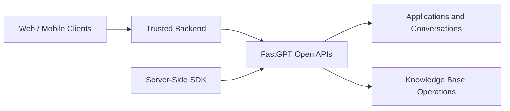

{/* Preserve incoming bookmarks for reorganized sections. */}

## Developer Integration Architecture

FastGPT provides an open capability matrix for enterprise systems and developers:

Keep API keys on a trusted server. Identity proxy is optional and requires endpoint support and a trusted mapping to a member in the same team. MCP clients use the separately configured MCP service and its authentication.

## Credential Types and Authentication

Each endpoint declares the credentials it accepts. Use the generated contract to verify authentication requirements.

| Credential | Transport Location | Permission Scope | Recommended Scenario |
|---|---|---|---|
| **Team API Key** | `Authorization: Bearer <apiKey>` | Scoped to resources available to the issuing team member | Backend integrations, automated jobs, model calls |
| **User Session Token** | Cookie `fastgpt_token` or `token` header | Current member permissions, subject to endpoint authorization and session checks | Web UI communication, same-origin management APIs |
| **Root Key** | Header `rootkey: <ROOT_KEY>` | Administrative operations on endpoints that explicitly enable root authentication | Cross-team maintenance, model status probing, migrations |

## Core Integration Workflows

1. [API Quick Start](/en/openapi/intro): Obtain team API keys, execute the first end-to-end request, and connect via the official OpenAI SDK.
2. [Identity Proxy](/en/openapi/identity-proxy): Execute on behalf of end users using `authProxy` to enforce member-level permissions and audit logging.
3. [Application and Workflow Integration](/en/openapi/app): Execute published Chat Agents, Agent V2, and Workflows while injecting global variables.
4. [Conversations and 17 SSE Stream Events](/en/openapi/chat): Maintain persistent `chatId` sessions and parse answer chunks, thoughts, node statuses, plans, and interactive pauses.
5. [Knowledge Base Integration](/en/openapi/dataset): Create collections via API, push content to training queues asynchronously, and run search tests.

## Extension Development

- [Plugin System Overview](/en/plugin/intro): FastGPT Plugin microservice architecture and standardized `.pkg` bundles.
- [System Tool Development](/en/plugin/system-tool-development): Build single tools (`defineTool`) and tool suites (`defineToolSet`) with `@fastgpt-plugin/cli`.
- [Model Presets](/en/plugin/model-presets): Register new model providers and map AIProxy channels.
- [Skill Development](/en/guide/build/skill/development): Create persistent Agent skills in isolated sandbox environments.
- [External Datasets](/en/guide/dataset/third-party/third_dataset): Connect custom vector engines and search APIs via standard HTTP contracts.

## Machine-Readable OpenAPI Contracts

Each FastGPT deployment generates OpenAPI 3.1 specification files locally:

- **System OpenAPI (API Key Operations)**: Access `/apidoc/systemopenapi` (UI) or `/api/apidoc/systemopenapi.json` (JSON).
- **Dev API (Full Developer Operations)**: Access `/apidoc/devapi` (UI) or `/api/apidoc/devapi.json` (JSON).

When maintaining older integrations, refer to [Historical API Parameters and Migration](/en/openapi/legacy).
