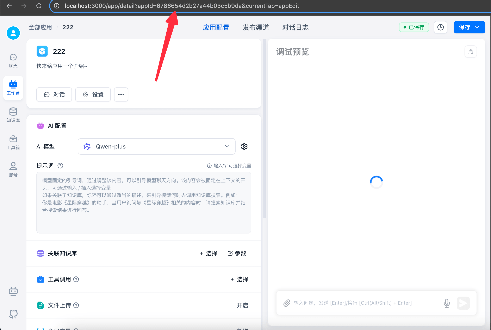

# How to Get AppId

Open the app configuration page and copy the `appId` query parameter from the browser address bar.



# Start a Session

- Authenticate with an API key. When calling `chat/completions`, pass `appId` in the request body.
- For OpenAI SDK compatibility, you can also use `Authorization: Bearer <apiKey>-<appId>` and omit `body.appId`.
- FastGPT resolves the app ID in this order: `body.appId`, the `<apiKey>-<appId>` suffix, then the app ID associated with a legacy API key.
- In FastGPT >= v4.15.0, the team owner can enable `authProxy` when creating or editing a key to act as a team member. That member must have permission to access the target app and chat.
- Some packages require adding `v1` to the `BaseUrl`. If you get a 404 error, try adding `v1` and retry.

## Start Chat

The `v1` chat API supports the OpenAI chat-completion format. Configure your client with the FastGPT `BaseUrl` and `Authorization` header, and follow these rules:

- Parameters like `model` and `temperature` are ignored. These values are determined by your workflow configuration.
- The top-level `usage` fields contain placeholder token counts. Set `detail=true` and total the `tokens` values in `responseData` to calculate actual usage.

### Request

<Tabs items={["Basic Request Example","Image/File Request Example","Parameters"]}>

<Tab value="Basic Request Example">

```bash
curl --location --request POST 'http://localhost:3000/api/v1/chat/completions' \
--header 'Authorization: Bearer fastgpt-xxxxxx' \
--header 'Content-Type: application/json' \
--data-raw '{
"appId": "your_app_id",
"chatId": "my_chatId",
"stream": false,
"detail": false,
"responseChatItemId": "my_responseChatItemId",
"variables": {
    "uid": "asdfadsfasfd2323",
    "name": "Zhang San"
},
"messages": [
    {
        "role": "user",
        "content": "Who is the director?"
    }
]
}'
```

</Tab>

<Tab value="Image/File Request Example">

- Only `messages` differs slightly; other parameters are the same.
- Direct file uploads are not supported. Upload files to your object storage and provide the URL.

```bash
curl --location --request POST 'http://localhost:3000/api/v1/chat/completions' \
--header 'Authorization: Bearer fastgpt-xxxxxx' \
--header 'Content-Type: application/json' \
--data-raw '{
    "appId": "your_app_id",
    "chatId": "abcd",
    "stream": false,
    "messages": [
        {
            "role": "user",
            "content": [
                {
                    "type": "text",
                    "text": "Who is the director?"
                },
                {
                    "type": "image_url",
                    "image_url": {
                        "url": "Image URL"
                    }
                },
                {
                    "type": "file_url",
                    "name": "File name",
                    "url": "Document URL; supported formats: txt md html word pdf ppt csv excel"
                }
            ]
        }
    ]
}'
```

</Tab>

<Tab value="Parameters">

- headers.Authorization: Bearer [apikey]
- chatId: string | undefined.
  - Empty or omitted: FastGPT context is not used, and context is built entirely from `messages`.
  - Non-empty string: uses `chatId` for the chat, automatically reads messages from the FastGPT session, and uses only the last item in `messages` as the user question. Other messages are ignored. Make sure `chatId` is unique and shorter than 250 characters. You can use the conversation ID from your own system.
- messages: Same structure as [GPT chat messages](https://platform.openai.com/docs/api-reference/chat/object) .
- responseChatItemId: string | undefined. If provided, FastGPT uses it as the response message ID and stores it in the database. Make sure it is unique under the current `chatId`.
- detail: Whether to return intermediate values, such as node status and complete results. In `stream` mode, they are separated by `event`; in non-stream mode, they are stored in `responseData`.
- variables: Node variables. This object replaces `[key]` placeholders in input fields.

</Tab>
</Tabs>

### Response

Token counts, timings, and scores in the examples below are illustrative.

<Tabs items={['detail=false, stream=false Response','detail=false, stream=true Response','detail=true, stream=false Response','detail=true, stream=true Response','Event Values']}>
<Tab value="detail=false, stream=false Response">

```json
{
  "id": "adsfasf",
  "model": "",
  "usage": {
    "prompt_tokens": 1,
    "completion_tokens": 1,
    "total_tokens": 1
  },
  "choices": [
    {
      "message": {
        "role": "assistant",
        "content": "Suzume was directed by Makoto Shinkai."
      },
      "finish_reason": "stop",
      "index": 0
    }
  ]
}
```

</Tab>
<Tab value="detail=false, stream=true Response">

```bash
data: {"id":"","object":"","created":0,"choices":[{"delta":{"content":""},"index":0,"finish_reason":null}]}

data: {"id":"","object":"","created":0,"choices":[{"delta":{"content":"The "},"index":0,"finish_reason":null}]}

data: {"id":"","object":"","created":0,"choices":[{"delta":{"content":"film "},"index":0,"finish_reason":null}]}

data: {"id":"","object":"","created":0,"choices":[{"delta":{"content":"Suzume"},"index":0,"finish_reason":null}]}
```

</Tab>
<Tab value="detail=true, stream=false Response">

```json
{
  "responseData": [
    // Response values vary by node and version. Log the response to inspect the latest structure.
    {
      "moduleName": "Dataset Search",
      "price": 1.2000000000000002,
      "model": "Embedding-2",
      "tokens": 6,
      "similarity": 0.61,
      "limit": 3
    },
    {
      "moduleName": "AI Chat",
      "price": 454.5,
      "model": "FastAI-4k",
      "tokens": 303,
      "question": "Who is the director?",
      "answer": "Suzume was directed by Makoto Shinkai.",
      "maxToken": 2050,
      "quoteList": [
        {
          "dataset_id": "646627f4f7b896cfd8910e38",
          "id": "8099",
          "q": "Who is the protagonist?",
          "a": "The protagonist is a girl named Suzume.",
          "source": "Manually edited"
        },
        {
          "dataset_id": "646627f4f7b896cfd8910e38",
          "id": "8686",
          "q": "Who is the male lead in Suzume?",
          "a": "The male lead in Suzume is Souta Munakata, voiced by Hokuto Matsumura.",
          "source": ""
        },
        {
          "dataset_id": "646627f4f7b896cfd8910e38",
          "id": "19339",
          "q": "Who directed Suzume?22",
          "a": "Suzume was directed by Makoto Shinkai.",
          "source": "Manually edited"
        }
      ],
      "completeMessages": [
        {
          "obj": "System",
          "value": "Dataset content:\n1. [Who is the protagonist?\nThe protagonist is a girl named Suzume.]\n2. [Who is the male lead in Suzume?\nThe male lead in Suzume is Souta Munakata, voiced by Hokuto Matsumura.]\n3. [Who directed Suzume?22\nSuzume was directed by Makoto Shinkai.]\n"
        },
        {
          "obj": "System",
          "value": "1. Remember that you are Baidu's next-generation knowledge-enhanced language model. Answer using only the supplied Dataset content.\n\n2. Disregard knowledge unrelated to the film Suzume."
        },
        {
          "obj": "System",
          "value": "Answer only questions about Suzume. For any other question, reply: I do not know."
        },
        {
          "obj": "Human",
          "value": "Who is the director?"
        },
        {
          "obj": "AI",
          "value": "Suzume was directed by Makoto Shinkai."
        }
      ]
    }
  ],
  "id": "",
  "model": "",
  "usage": {
    "prompt_tokens": 1,
    "completion_tokens": 1,
    "total_tokens": 1
  },
  "choices": [
    {
      "message": {
        "role": "assistant",
        "content": "Suzume was directed by Makoto Shinkai."
      },
      "finish_reason": "stop",
      "index": 0
    }
  ]
}
```

</Tab>
<Tab value="detail=true, stream=true Response">

```bash
event: flowNodeStatus
data: {"status":"running","name":"Dataset search"}

event: flowNodeStatus
data: {"status":"running","name":"AI Chat"}

event: answer
data: {"id":"","object":"","created":0,"model":"","choices":[{"delta":{"content":"Suzume"},"index":0,"finish_reason":null}]}

event: answer
data: {"id":"","object":"","created":0,"model":"","choices":[{"delta":{"content":" was "},"index":0,"finish_reason":null}]}

event: answer
data: {"id":"","object":"","created":0,"model":"","choices":[{"delta":{"content":"directed "},"index":0,"finish_reason":null}]}

event: answer
data: {"id":"","object":"","created":0,"model":"","choices":[{"delta":{"content":"by Makoto "},"index":0,"finish_reason":null}]}

event: answer
data: {"id":"","object":"","created":0,"model":"","choices":[{"delta":{"content":"Shinkai."},"index":0,"finish_reason":null}]}

event: answer
data: {"id":"","object":"","created":0,"model":"","choices":[{"delta":{},"index":0,"finish_reason":"stop"}]}

event: answer
data: [DONE]

event: flowResponses
data: [{"moduleName":"Dataset search","moduleType":"datasetSearchNode","runningTime":1.78},{"question":"Who is the director?","quoteList":[{"id":"654f2e49b64caef1d9431e8b","q":"Who directed Suzume?","a":"Suzume was directed by Makoto Shinkai!","indexes":[{"type":"qa","dataId":"3515487","text":"Who directed Suzume?","_id":"654f2e49b64caef1d9431e8c","defaultIndex":true}],"datasetId":"646627f4f7b896cfd8910e38","collectionId":"653279b16cd42ab509e766e8","sourceName":"data (81).csv","sourceId":"64fd3b6423aa1307b65896f6","score":0.8935586214065552},{"id":"6552e14c50f4a2a8e632af11","q":"Who is the director?","a":"Suzume was directed by Makoto Shinkai.","indexes":[{"defaultIndex":true,"type":"qa","dataId":"3644565","text":"Who is the director?\nSuzume was directed by Makoto Shinkai.","_id":"6552e14dde5cc7ba3954e417"}],"datasetId":"646627f4f7b896cfd8910e38","collectionId":"653279b16cd42ab509e766e8","sourceName":"data (81).csv","sourceId":"64fd3b6423aa1307b65896f6","score":0.8890955448150635},{"id":"654f34a0b64caef1d946337e","q":"Who is the protagonist?","a":"The protagonist is a girl named Suzume.","indexes":[{"type":"qa","dataId":"3515541","text":"Who is the protagonist?","_id":"654f34a0b64caef1d946337f","defaultIndex":true}],"datasetId":"646627f4f7b896cfd8910e38","collectionId":"653279b16cd42ab509e766e8","sourceName":"data (81).csv","sourceId":"64fd3b6423aa1307b65896f6","score":0.8738770484924316},{"id":"654f3002b64caef1d944207a","q":"Who is the male lead in Suzume?","a":"The male lead in Suzume is Souta Munakata, voiced by Hokuto Matsumura.","indexes":[{"type":"qa","dataId":"3515538","text":"Who is the male lead in Suzume?","_id":"654f3002b64caef1d944207b","defaultIndex":true}],"datasetId":"646627f4f7b896cfd8910e38","collectionId":"653279b16cd42ab509e766e8","sourceName":"data (81).csv","sourceId":"64fd3b6423aa1307b65896f6","score":0.8607980012893677},{"id":"654f2fc8b64caef1d943fd46","q":"Who wrote Suzume?","a":"Makoto Shinkai wrote the screenplay.","indexes":[{"defaultIndex":true,"type":"qa","dataId":"3515550","text":"Who wrote Suzume?22","_id":"654f2fc8b64caef1d943fd47"}],"datasetId":"646627f4f7b896cfd8910e38","collectionId":"653279b16cd42ab509e766e8","sourceName":"data (81).csv","sourceId":"64fd3b6423aa1307b65896f6","score":0.8468944430351257}],"moduleName":"AI Chat","moduleType":"chatNode","runningTime":1.86}]
```

</Tab>
<Tab value="Event Values">

Event values:

    - answer: Text returned to the client (counts as the final answer)
    - chatTitle: Chat title generated from the current user question
    - fastAnswer: Preset reply text returned to the client (counts as the final answer)
    - toolCall: Tool execution
    - toolParams: Tool parameters
    - toolResponse: Tool response
    - flowNodeStatus: Current workflow step status
    - flowResponses: Complete workflow step responses
    - updateVariables: Updated variables
    - interactive: Interactive config
    - error: Error

</Tab>
</Tabs>

### Response

**Interactive node responses**

If your workflow contains interactive nodes, still call this API with `detail=true`:

- `stream=true`: read the interactive config from `event=interactive` in `data.interactive`.
- `stream=false`: read the element that contains the `interactive` field from `choices[].message.content`.

The `interactive` payload returned to external callers is display config only. It contains only `type` and `params`; internal runtime fields such as `entryNodeIds`, `memoryEdges`, `nodeOutputs`, and `nodeResponseId` are not returned. If the workflow internally hits a children / loop / tool wrapper interaction, the API returns the deepest user-facing interaction.

When calling a workflow with interactive steps, if an interaction is encountered, it returns immediately. The examples below show the element inside `choices[].message.content[]` when `stream=false`; when `stream=true`, `event=interactive` returns `{ "interactive": ... }` as its `data`:

<Tabs items={['User Selection','Form Input']}>
<Tab value="User Selection">

```json
{
  "interactive": {
    "type": "userSelect",
    "params": {
      "description": "Test",
      "userSelectOptions": [
        {
          "value": "Confirm",
          "key": "option1"
        },
        {
          "value": "Cancel",
          "key": "option2"
        }
      ]
    }
  }
}
```

</Tab>
<Tab value="Form Input">

```json
{
  "interactive": {
    "type": "userInput",
    "params": {
      "description": "Test",
      "inputForm": [
        {
          "type": "input",
          "key": "测试 1",
          "label": "Test 1",
          "description": "",
          "value": "",
          "defaultValue": "",
          "valueType": "string",
          "required": false,
          "list": [
            {
              "label": "",
              "value": ""
            }
          ]
        },
        {
          "type": "numberInput",
          "key": "测试 2",
          "label": "Test 2",
          "description": "",
          "value": "",
          "defaultValue": "",
          "valueType": "number",
          "required": false,
          "list": [
            {
              "label": "",
              "value": ""
            }
          ]
        }
      ]
    }
  }
}
```

</Tab>
</Tabs>

### Continue Interaction

After receiving interactive info, render your UI to guide user input or selection. Then call this API again to continue the workflow. Use this format:

<Tabs items={['User Selection','Form Input']}>
<Tab value="User Selection">

For user selection, simply pass the selected value to messages.

```bash
curl --location --request POST 'http://localhost:3000/api/v1/chat/completions' \
--header 'Authorization: Bearer fastgpt-xxx' \
--header 'Content-Type: application/json' \
--data-raw '{
    "appId": "your_app_id",
    "stream": true,
    "detail": true,
    "chatId":"22222231",
    "messages": [
        {
            "role": "user",
            "content": "Confirm"
        }
    ]
}'
```

</Tab>
<Tab value="Form Input">

For form input, serialize an object as a JSON string in `messages[].content`. Use the exact form keys from the interaction response and the values entered by the user. Keep the same `chatId` when continuing the workflow.

```bash
curl --location --request POST 'http://localhost:3000/api/v1/chat/completions' \
--header 'Authorization: Bearer fastgpt-xxxx' \
--header 'Content-Type: application/json' \
--data-raw '{
    "appId": "your_app_id",
    "stream": true,
    "detail": true,
    "chatId":"22231",
    "messages": [
        {
            "role": "user",
            "content": "{\"测试 1\":\"Text entered in the input field\",\"测试 2\":666}"
        }
    ]
}'
```

</Tab>
</Tabs>

## Request Plugin

The request example below has one plugin input parameter, `query`.

Plugin API is identical to chat API, with slight parameter differences:

- When calling a Plugin-type App, the endpoint uses `detail` mode by default.
- No need to pass `chatId` since plugins run only once.
- No need to pass `messages`.
- Pass `variables` to represent plugin inputs.
- Get plugin outputs from `pluginData`.

### Request

```bash
curl --location --request POST 'http://localhost:3000/api/v1/chat/completions' \
--header 'Authorization: Bearer test-xxxxx' \
--header 'Content-Type: application/json' \
--data-raw '{
    "appId": "your_app_id",
    "stream": false,
    "chatId": "test",
    "variables": {
        "query":"Hello"
    }
}'
```

### Response

<Tabs items={['detail=true, stream=false Response','detail=true, stream=true Response','Output Retrieval']}>
<Tab value="detail=true, stream=false Response">

- Find plugin output by locating `moduleType=pluginOutput` in `responseData`. Its `pluginOutput` contains the output.
- Stream output is still available via `choices`.

```json
{
  "responseData": [
    {
      "nodeId": "fdDgXQ6SYn8v",
      "moduleName": "AI Chat",
      "moduleType": "chatNode",
      "totalPoints": 0.685,
      "model": "FastAI-3.5",
      "tokens": 685,
      "query": "Hello",
      "maxToken": 2000,
      "historyPreview": [
        {
          "obj": "Human",
          "value": "Hello"
        },
        {
          "obj": "AI",
          "value": "Hello! How can I help you? Ask me a question."
        }
      ],
      "contextTotalLen": 14,
      "runningTime": 1.73
    },
    {
      "nodeId": "pluginOutput",
      "moduleName": "Plugin output",
      "moduleType": "pluginOutput",
      "totalPoints": 0,
      "pluginOutput": {
        "result": "Hello! How can I help you? Ask me a question."
      },
      "runningTime": 0
    }
  ],
  "newVariables": {
    "query": "Hello"
  },
  "id": "safsafsa",
  "model": "",
  "usage": {
    "prompt_tokens": 1,
    "completion_tokens": 1,
    "total_tokens": 1
  },
  "choices": [
    {
      "message": {
        "role": "assistant",
        "content": "Hello! How can I help you? Ask me a question."
      },
      "finish_reason": "stop",
      "index": 0
    }
  ]
}
```

</Tab>
<Tab value="detail=true, stream=true Response">

- Get plugin output by deserializing the `event=flowResponses` string into an array. Find `moduleType=pluginOutput` element; its `pluginOutput` contains the output.
- Stream output works the same as chat API.

```bash
event: flowNodeStatus
data: {"status":"running","name":"AI Chat"}

event: answer
data: {"id":"","object":"","created":0,"model":"","choices":[{"delta":{"role":"assistant","content":""},"index":0,"finish_reason":null}]}

event: answer
data: {"id":"","object":"","created":0,"model":"","choices":[{"delta":{"role":"assistant","content":"Hel"},"index":0,"finish_reason":null}]}

event: answer
data: {"id":"","object":"","created":0,"model":"","choices":[{"delta":{"role":"assistant","content":"lo"},"index":0,"finish_reason":null}]}

event: answer
data: {"id":"","object":"","created":0,"model":"","choices":[{"delta":{"role":"assistant","content":"!"},"index":0,"finish_reason":null}]}

event: answer
data: {"id":"","object":"","created":0,"model":"","choices":[{"delta":{"role":"assistant","content":" "},"index":0,"finish_reason":null}]}

event: answer
data: {"id":"","object":"","created":0,"model":"","choices":[{"delta":{"role":"assistant","content":"How"},"index":0,"finish_reason":null}]}

event: answer
data: {"id":"","object":"","created":0,"model":"","choices":[{"delta":{"role":"assistant","content":" "},"index":0,"finish_reason":null}]}

event: answer
data: {"id":"","object":"","created":0,"model":"","choices":[{"delta":{"role":"assistant","content":"can"},"index":0,"finish_reason":null}]}

event: answer
data: {"id":"","object":"","created":0,"model":"","choices":[{"delta":{"role":"assistant","content":" "},"index":0,"finish_reason":null}]}

event: answer
data: {"id":"","object":"","created":0,"model":"","choices":[{"delta":{"role":"assistant","content":"I"},"index":0,"finish_reason":null}]}

event: answer
data: {"id":"","object":"","created":0,"model":"","choices":[{"delta":{"role":"assistant","content":" "},"index":0,"finish_reason":null}]}

event: answer
data: {"id":"","object":"","created":0,"model":"","choices":[{"delta":{"role":"assistant","content":"help"},"index":0,"finish_reason":null}]}

event: answer
data: {"id":"","object":"","created":0,"model":"","choices":[{"delta":{"role":"assistant","content":" you"},"index":0,"finish_reason":null}]}

event: answer
data: {"id":"","object":"","created":0,"model":"","choices":[{"delta":{"role":"assistant","content":"?"},"index":0,"finish_reason":null}]}

event: answer
data: {"id":"","object":"","created":0,"model":"","choices":[{"delta":{"role":"assistant","content":""},"index":0,"finish_reason":null}]}

event: answer
data: {"id":"","object":"","created":0,"model":"","choices":[{"delta":{},"index":0,"finish_reason":"stop"}]}

event: answer
data: [DONE]

event: flowResponses
data: [{"nodeId":"fdDgXQ6SYn8v","moduleName":"AI Chat","moduleType":"chatNode","totalPoints":0.033,"model":"FastAI-3.5","tokens":33,"query":"Hello","maxToken":2000,"historyPreview":[{"obj":"Human","value":"Hello"},{"obj":"AI","value":"Hello! How can I help you?"}],"contextTotalLen":2,"runningTime":1.42},{"nodeId":"pluginOutput","moduleName":"Plugin output","moduleType":"pluginOutput","totalPoints":0,"pluginOutput":{"result":"Hello! How can I help you?"},"runningTime":0}]
```

</Tab>
<Tab value="Output Retrieval">

Event values:

    - answer: Text returned to the client and counted as the final answer
    - fastAnswer: Specified Reply text returned to the client and counted as the final answer
    - toolCall: Run a tool
    - toolParams: Tool parameters
    - toolResponse: Tool response
    - flowNodeStatus: Status of the current node
    - flowResponses: Complete node responses
    - updateVariables: Updated variables
    - error: Error

</Tab>
</Tabs>

# Chat CRUD

**Important Fields**

- appId - The app ID

- chatId - The ID of a session under an app
- dataId - The ID of a message under a session

## Session Management

### Get Session List

<Tabs items={['Request Example','Parameters','Response Example']}>
<Tab value="Request Example">

```bash
curl --location --request POST 'http://localhost:3000/api/core/chat/history/getHistories' \
--header 'Authorization: Bearer [apikey]' \
--header 'Content-Type: application/json' \
--data-raw '{
    "appId": "appId",
    "offset": 0,
    "pageSize": 20,
    "source": "api"
}'
```

</Tab>
<Tab value="Parameters">

- appId - App ID
- offset - Offset (starting position)
- pageSize - Number of items
- source - Chat source. `source=api` means get API-created sessions only (excludes web UI sessions)

</Tab>

<Tab value="Response Example" >

```json
{
  "code": 200,
  "statusText": "",
  "message": "",
  "data": {
    "list": [
      {
        "chatId": "usdAP1GbzSGu",
        "updateTime": "2024-10-13T03:29:05.779Z",
        "appId": "66e29b870b24ce35330c0f08",
        "customTitle": "",
        "title": "Hello",
        "top": false
      },
      {
        "chatId": "lC0uTAsyNBlZ",
        "updateTime": "2024-10-13T03:22:19.950Z",
        "appId": "66e29b870b24ce35330c0f08",
        "customTitle": "",
        "title": "Test",
        "top": false
      }
    ],
    "total": 2
  }
}
```

</Tab>
</Tabs>

### Update Session Title

<Tabs items={['Request Example','Parameters','Response Example']}>
<Tab value="Request Example">

```bash
curl --location --request PUT 'http://localhost:3000/api/core/chat/history/updateHistory' \
--header 'Authorization: Bearer [apikey]' \
--header 'Content-Type: application/json' \
--data-raw '{
    "appId": "appId",
    "chatId": "chatId",
    "customTitle": "Custom title"
}'
```

</Tab>

<Tab value="Parameters" >

- appId - App ID
- chatId - Session ID
- customTitle - Custom session title

</Tab>

<Tab value="Response Example" >

```json
{
  "code": 200,
  "statusText": "",
  "message": "",
  "data": null
}
```

</Tab>
</Tabs>

### Update Session Pin Status

<Tabs items={['Request Example','Parameters','Response Example']}>
<Tab value="Request Example">

```bash
curl --location --request PUT 'http://localhost:3000/api/core/chat/history/updateHistory' \
--header 'Authorization: Bearer [apikey]' \
--header 'Content-Type: application/json' \
--data-raw '{
    "appId": "appId",
    "chatId": "chatId",
    "top": true
}'
```

</Tab>

<Tab value="Parameters" >

- appId - App ID
- chatId - Session ID
- top - Whether to pin. true = pin, false = unpin

</Tab>

<Tab value="Response Example" >

```json
{
  "code": 200,
  "statusText": "",
  "message": "",
  "data": null
}
```

</Tab>
</Tabs>

### Delete a Session

<Tabs items={['Request Example','Parameters','Response Example']}>
<Tab value="Request Example">

```bash
curl --location --request DELETE 'http://localhost:3000/api/core/chat/history/delHistory?chatId=[chatId]&appId=[appId]' \
--header 'Authorization: Bearer [apikey]'
```

</Tab>

<Tab value="Parameters" >

- appId - App ID
- chatId - Session ID

</Tab>

<Tab value="Response Example" >

```json
{
  "code": 200,
  "statusText": "",
  "message": "",
  "data": null
}
```

</Tab>
</Tabs>

### Clear App Sessions

This endpoint clears sessions created through an API key. Sessions from the web UI, shared links, and other sources are preserved.

<Tabs items={['Request Example','Parameters','Response Example']}>
<Tab value="Request Example">

```bash
curl --location --request DELETE 'http://localhost:3000/api/core/chat/history/clearHistories?appId=[appId]' \
--header 'Authorization: Bearer [apikey]'
```

</Tab>

<Tab value="Parameters" >

- appId - App ID

</Tab>

<Tab value="Response Example" >

```json
{
  "code": 200,
  "statusText": "",
  "message": "",
  "data": null
}
```

</Tab>
</Tabs>

## Message Management

Operations on messages under a specific session.

### Get Session Basic Info

<Tabs items={['Request Example','Parameters','Response Example']}>
<Tab value="Request Example">

```bash
curl --location --request GET 'http://localhost:3000/api/core/chat/init?appId=[appId]&chatId=[chatId]' \
--header 'Authorization: Bearer [apikey]'
```

</Tab>

<Tab value="Parameters" >

- appId - App ID
- chatId - Session ID

</Tab>

<Tab value="Response Example">

```json
{
  "code": 200,
  "statusText": "",
  "message": "",
  "data": {
    "chatId": "sPVOuEohjo3w",
    "appId": "66e29b870b24ce35330c0f08",
    "variables": {},
    "app": {
      "chatConfig": {
        "questionGuide": true,
        "ttsConfig": {
          "type": "web"
        },
        "whisperConfig": {
          "open": false,
          "autoSend": false,
          "autoTTSResponse": false
        },
        "chatInputGuide": {
          "open": false,
          "textList": [],
          "customUrl": ""
        },
        "instruction": "",
        "variables": [],
        "fileSelectConfig": {
          "canSelectFile": true,
          "canSelectImg": true,
          "maxFiles": 10
        },
        "_id": "66f1139aaab9ddaf1b5c596d",
        "welcomeText": ""
      },
      "chatModels": ["GPT-4o-mini"],
      "name": "Test",
      "avatar": "/imgs/app/avatar/workflow.svg",
      "intro": "",
      "type": "advanced",
      "pluginInputs": []
    }
  }
}
```

</Tab>
</Tabs>

### Get Message List

<Tabs items={['Request Example','Parameters','Response Example']}>
<Tab value="Request Example">

```bash
curl --location --request POST 'http://localhost:3000/api/core/chat/record/getPaginationRecords' \
--header 'Authorization: Bearer [apikey]' \
--header 'Content-Type: application/json' \
--data-raw '{
    "appId": "appId",
    "chatId": "chatId",
    "offset": 0,
    "pageSize": 10,
    "loadCustomFeedbacks": true
}'
```

</Tab>

<Tab value="Parameters" >

- appId - App ID
- chatId - Session ID
- offset - Offset
- pageSize - Number of items
- loadCustomFeedbacks - Whether to load custom feedbacks (optional)

</Tab>

<Tab value="Response Example" >

```json
{
  "code": 200,
  "statusText": "",
  "message": "",
  "data": {
    "list": [
      {
        "_id": "670b84e6796057dda04b0fd2",
        "dataId": "jzqdV4Ap1u004rhd2WW8yGLn",
        "obj": "Human",
        "value": [
          {
            "text": {
              "content": "Hello"
            }
          }
        ],
        "customFeedbacks": []
      },
      {
        "_id": "670b84e6796057dda04b0fd3",
        "dataId": "x9KQWcK9MApGdDQH7z7bocw1",
        "obj": "AI",
        "value": [
          {
            "text": {
              "content": "Hello! How can I help you?"
            }
          }
        ],
        "customFeedbacks": [],
        "totalQuoteList": [],
        "totalRunningTime": 2.42,
        "useAgentSandbox": false
      }
    ],
    "total": 2
  }
}
```

</Tab>
</Tabs>

### Get Message Run Details

<Tabs items={['Request Example','Parameters','Response Example']}>
<Tab value="Request Example">

```bash
curl --location --request GET 'http://localhost:3000/api/core/chat/record/getResData?appId=[appId]&chatId=[chatId]&dataId=[dataId]' \
--header 'Authorization: Bearer [apikey]'
```

</Tab>

<Tab value="Parameters" >

- appId - App ID
- chatId - Session ID
- dataId - Message ID

</Tab>

<Tab value="Response Example" >

```json
{
  "code": 200,
  "statusText": "",
  "message": "",
  "data": [
    {
      "id": "mVlxkz8NfyfU",
      "nodeId": "448745",
      "moduleName": "common:core.module.template.work_start",
      "moduleType": "workflowStart",
      "runningTime": 0
    },
    {
      "id": "b3FndAdHSobY",
      "nodeId": "z04w8JXSYjl3",
      "moduleName": "AI Chat",
      "moduleType": "chatNode",
      "runningTime": 1.22,
      "totalPoints": 0.02475,
      "model": "GPT-4o-mini",
      "tokens": 75,
      "query": "Test",
      "maxToken": 2000,
      "historyPreview": [
        {
          "obj": "Human",
          "value": "Hello"
        },
        {
          "obj": "AI",
          "value": "Hello! How can I help you?"
        },
        {
          "obj": "Human",
          "value": "Test"
        },
        {
          "obj": "AI",
          "value": "The test passed! What question or topic would you like to discuss?"
        }
      ],
      "contextTotalLen": 4
    }
  ]
}
```

</Tab>
</Tabs>

### Delete Message

<Tabs items={['Request Example','Parameters','Response Example']}>
<Tab value="Request Example" >

```bash
curl --location --request DELETE 'http://localhost:3000/api/core/chat/record/delete?contentId=[contentId]&chatId=[chatId]&appId=[appId]' \
--header 'Authorization: Bearer [apikey]'
```

</Tab>

<Tab value="Parameters" >

- appId - App ID
- chatId - Session ID
- contentId - Message ID

</Tab>

<Tab value="Response Example" >

```json
{
  "code": 200,
  "statusText": "",
  "message": "",
  "data": null
}
```

</Tab>
</Tabs>

### Update Feedback (Like / Dislike)

<Tabs items={['Request Example','Parameters','Response Example']}>
<Tab value="Request Example">

Like / unlike:

```bash
curl --location --request POST 'http://localhost:3000/api/core/chat/feedback/updateUserFeedback' \
--header 'Authorization: Bearer [apikey]' \
--header 'Content-Type: application/json' \
--data-raw '{
    "appId": "appId",
    "chatId": "chatId",
    "dataId": "dataId",
    "userGoodFeedback": "yes"
}'
```

Dislike / remove dislike:

```bash
curl --location --request POST 'http://localhost:3000/api/core/chat/feedback/updateUserFeedback' \
--header 'Authorization: Bearer [apikey]' \
--header 'Content-Type: application/json' \
--data-raw '{
    "appId": "appId",
    "chatId": "chatId",
    "dataId": "dataId",
    "userBadFeedback": "yes"
}'
```

</Tab>

<Tab value="Parameters" >

- appId - App ID
- chatId - Session ID
- dataId - Message ID
- userGoodFeedback - User feedback when liking (optional). Omit to unlike.
- userBadFeedback - User feedback when disliking (optional). Omit to remove dislike.

</Tab>

<Tab value="Response Example" >

```json
{
  "code": 200,
  "statusText": "",
  "message": "",
  "data": null
}
```

</Tab>
</Tabs>

## Question Suggestions

**New API for releases after 4.8.16**

The suggested questions feature requires both appId and chatId. It automatically fetches the last 6 message turns from the session as context.

<Tabs items={['Request Example','Parameters','Response Example']}>
<Tab value="Request Example">

```bash
curl --location --request POST 'http://localhost:3000/api/core/ai/agent/v2/createQuestionGuide' \
--header 'Authorization: Bearer [apikey]' \
--header 'Content-Type: application/json' \
--data-raw '{
    "appId": "appId",
    "chatId": "chatId",
    "questionGuide": {
        "open": true,
        "model": "GPT-4o-mini",
        "customPrompt": "You are an intelligent assistant. Generate suggested follow-up questions based on the question from the user."
    }
}'
```

</Tab>

<Tab value="Parameters" >

| Parameter     | Type   | Required | Description                                                                               |
| ------------- | ------ | -------- | ----------------------------------------------------------------------------------------- |
| appId         | string | ✅       | App ID                                                                                    |
| chatId        | string | ✅       | Session ID                                                                                |
| questionGuide | object |          | Custom configuration. If omitted, uses the latest published configuration for the App ID. |

```ts
type CreateQuestionGuideParams = OutLinkChatAuthProps & {
  appId: string;
  chatId: string;
  questionGuide?: {
    open: boolean;
    model?: string;
    customPrompt?: string;
  };
};
```

</Tab>

<Tab value="Response Example" >

```json
{
  "code": 200,
  "statusText": "",
  "message": "",
  "data": ["What do you think about AI?", "Would you like to learn about AI applications?", "What would you like AI to do?"]
}
```

</Tab>
</Tabs>
