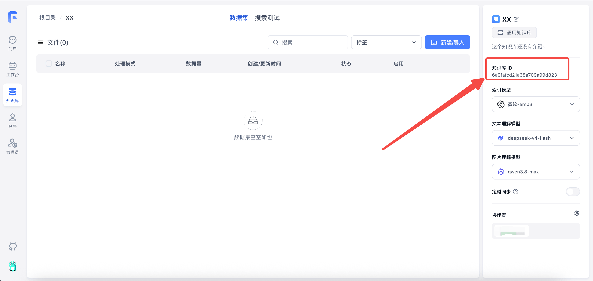
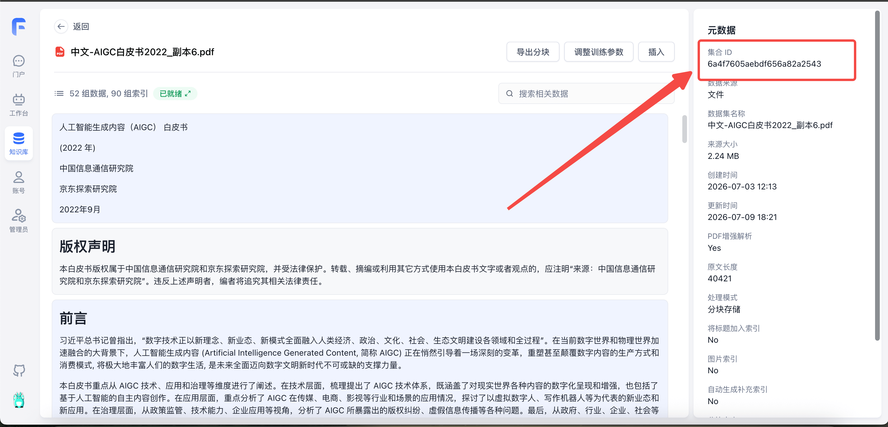

To find `datasetId`, open the Dataset and select **Configuration**; copy the Dataset ID shown at the top. To find a collection ID, open its file in the Dataset and copy the file ID displayed below the filename. Use that value for the collection ID parameter required by the endpoint.

| How to Get Dataset ID (datasetId)       | How to Get Collection ID (collection_id)   |
| --------------------------------------- | ------------------------------------------ |
|  |  |

## Dataset

### Create Dataset

<Tabs items={['Request Example','Parameters','Response Example']}>
<Tab value="Request Example" >

```bash
curl --location --request POST 'http://localhost:3000/api/core/dataset/create' \
--header 'Authorization: Bearer {{authorization}}' \
--header 'Content-Type: application/json' \
--data-raw '{
  "parentId": null,
  "type": "dataset",
  "name":"Test",
  "intro":"Description",
  "avatar": "",
  "vectorModel": "text-embedding-ada-002",
  "agentModel": "gpt-3.5-turbo-16k",
  "vlmModel": "gpt-4.1"
}'
```

</Tab>
<Tab value="Parameters" >

- parentId - Parent ID for building directory structure. Usually can be null or omitted.
- type - `dataset` or `folder`, represents regular dataset or folder. If not provided, creates a regular dataset.
- name - Dataset name (required)
- intro - Description (optional)
- avatar - Avatar URL (optional)
- vectorModel - Embedding model. Leave empty to use the system default.
- agentModel - Text processing model. Leave empty to use the system default.
- vlmModel - Image understanding model. Leave empty to use the system default.

</Tab>

<Tab value="Response Example" >

```json
{
  "code": 200,
  "statusText": "",
  "message": "",
  "data": "65abc9bd9d1448617cba5e6c"
}
```

</Tab>
</Tabs>

### Get Dataset List

<Tabs items={['Request Example','Parameters','Response Example']}>
<Tab value="Request Example" >

```bash
curl --location --request POST 'http://localhost:3000/api/core/dataset/list?parentId=' \
--header 'Authorization: Bearer xxxx' \
--header 'Content-Type: application/json' \
--data-raw '{
    "parentId":""
}'
```

</Tab>
<Tab value="Parameters">

- parentId - Parent ID. Pass empty string or null to get datasets in the root directory

</Tab>

<Tab value="Response Example" >

```json
{
  "code": 200,
  "statusText": "",
  "message": "",
  "data": [
    {
      "_id": "65abc9bd9d1448617cba5e6c",
      "parentId": null,
      "avatar": "",
      "name": "Test",
      "intro": "",
      "type": "dataset",
      "permission": "private",
      "canWrite": true,
      "isOwner": true,
      "vectorModel": {
        "model": "text-embedding-ada-002",
        "name": "Embedding-2",
        "charsPointsPrice": 0,
        "defaultToken": 512,
        "maxToken": 8000,
        "weight": 100
      }
    }
  ]
}
```

</Tab>
</Tabs>

### Get Dataset Details

<Tabs items={['Request Example','Parameters','Response Example']}>
<Tab value="Request Example" >

```bash
curl --location --request GET 'http://localhost:3000/api/core/dataset/detail?id=6593e137231a2be9c5603ba7' \
--header 'Authorization: Bearer {{authorization}}' \
```

</Tab>
<Tab value="Parameters" >

- id: Dataset ID

</Tab>

<Tab value="Response Example" >

```json
{
  "code": 200,
  "statusText": "",
  "message": "",
  "data": {
    "_id": "6593e137231a2be9c5603ba7",
    "parentId": null,
    "teamId": "65422be6aa44b7da77729ec8",
    "tmbId": "65422be6aa44b7da77729ec9",
    "type": "dataset",
    "status": "active",
    "avatar": "/icon/logo.svg",
    "name": "FastGPT test",
    "vectorModel": {
      "model": "text-embedding-ada-002",
      "name": "Embedding-2",
      "charsPointsPrice": 0,
      "defaultToken": 512,
      "maxToken": 8000,
      "weight": 100
    },
    "agentModel": {
      "model": "gpt-3.5-turbo-16k",
      "name": "FastAI-16k",
      "maxContext": 16000,
      "maxResponse": 16000,
      "charsPointsPrice": 0
    },
    "intro": "",
    "permission": "private",
    "updateTime": "2024-01-02T10:11:03.084Z",
    "canWrite": true,
    "isOwner": true
  }
}
```

</Tab>
</Tabs>

### Delete Dataset

<Tabs items={['Request Example','Parameters','Response Example']}>
<Tab value="Request Example" >

```bash
curl --location --request DELETE 'http://localhost:3000/api/core/dataset/delete?id=65abc8729d1448617cba5df6' \
--header 'Authorization: Bearer {{authorization}}' \
```

</Tab>
<Tab value="Parameters" >

- id: Dataset ID

</Tab>

<Tab value="Response Example" >

```json
{
  "code": 200,
  "statusText": "",
  "message": "",
  "data": null
}
```

</Tab>
</Tabs>

## Collection

### Common Creation Parameters (Must Read)

**Request**

| Parameter        | Description                                                                                                                                                                                   | Required |
| ---------------- | --------------------------------------------------------------------------------------------------------------------------------------------------------------------------------------------- | -------- |
| datasetId        | Dataset ID                                                                                                                                                                                    | ✅       |
| parentId         | Parent ID. Defaults to root directory if not provided                                                                                                                                         |          |
| trainingType     | Data processing method. chunk: split by text length; qa: Q&A extraction                                                                                                                       | ✅       |
| indexPrefixTitle | Whether to auto-generate title index                                                                                                                                                          |          |
| customPdfParse   | Whether to enable enhanced PDF parsing. Default false: disabled; true: enabled                                                                                                                |          |
| autoIndexes      | Whether to auto-generate indexes (commercial version only)                                                                                                                                    |          |
| imageIndex       | Whether to auto-generate image indexes (commercial version only)                                                                                                                              |          |
| chunkSettingMode | Chunk parameter mode. auto: system default; custom: manual specification                                                                                                                      |          |
| chunkSplitMode   | Chunk split mode. size: split by length; char: split by character. Ineffective when chunkSettingMode=auto.                                                                                    |          |
| chunkSize        | Chunk size, default 1500. Ineffective when chunkSettingMode=auto.                                                                                                                             |          |
| indexSize        | Index size, default 512, must be less than embedding model max token. Ineffective when chunkSettingMode=auto.                                                                                 |          |
| chunkSplitter    | Custom highest priority split symbol. Won't split further unless exceeding file processing max context. Ineffective when chunkSettingMode=auto.                                               |          |
| qaPrompt         | QA split prompt                                                                                                                                                                               |          |
| tags             | Collection tags (Commercial). Accepts structured tag objects (`[{"tag": "Applicable Dept", "value": ["All", "R&D"]}, {"tag": "Security Level", "value": 1}]`) as well as legacy string arrays |          |
| createTime       | File creation time (Date / String)                                                                                                                                                            |          |

**Response**

- collectionId - New collection ID
- insertLen: Number of inserted chunks

### Create Empty Collection/Folder

<Tabs items={['Request Example','Parameters','Response Example']}>
<Tab value="Request Example" >

```bash
curl --location --request POST 'http://localhost:3000/api/core/dataset/collection/create' \
--header 'Authorization: Bearer {{authorization}}' \
--header 'Content-Type: application/json' \
--data-raw '{
    "datasetId":"6593e137231a2be9c5603ba7",
    "parentId": null,
    "name":"Test",
    "type":"virtual",
    "metadata":{
      "test":111
    }
}'
```

</Tab>
<Tab value="Parameters" >

- datasetId: Dataset ID (required)
- parentId: Parent ID. Defaults to root directory if not provided
- name: Collection name (required)
- type:
  - folder: Folder
  - virtual: Virtual collection (manual collection)
- metadata: Metadata (not currently used)

</Tab>

<Tab value="Response Example" >

data is the collection ID.

```json
{
  "code": 200,
  "statusText": "",
  "message": "",
  "data": "65abcd009d1448617cba5ee1"
}
```

</Tab>
</Tabs>

### Create a Text Collection

Pass in text to create a collection. The text will be split accordingly.

<Tabs items={['Request Example','Parameters','Response Example']}>
<Tab value="Request Example" >

```bash
curl --location --request POST 'http://localhost:3000/api/core/dataset/collection/create/text' \
--header 'Authorization: Bearer {{authorization}}' \
--header 'Content-Type: application/json' \
--data-raw '{
    "text":"xxxxxxxx",
    "datasetId":"6593e137231a2be9c5603ba7",
    "parentId": null,
    "name":"Test processing",

    "trainingType": "qa",
    "chunkSettingMode": "auto",
    "qaPrompt":"",

    "metadata":{}
}'
```

</Tab>
<Tab value="Parameters" >

- text: Original text
- datasetId: Dataset ID (required)
- parentId: Parent ID. Defaults to root directory if not provided
- name: Collection name (required)
- metadata: Metadata (not currently used)

</Tab>

<Tab value="Response Example" >

`data.collectionId` is the new collection ID; `data.results.insertLen` reports the number of inserted chunks.

```json
{
  "code": 200,
  "statusText": "",
  "message": "",
  "data": {
    "collectionId": "65abcfab9d1448617cba5f0d",
    "results": {
      "insertLen": 5
    }
  }
}
```

</Tab>
</Tabs>

### Create a Link Collection

Pass in a web link to create a collection. Content will be fetched from the webpage first, then split.

<Tabs items={['Request Example','Parameters','Response Example']}>
<Tab value="Request Example" >

```bash
curl --location --request POST 'http://localhost:3000/api/core/dataset/collection/create/link' \
--header 'Authorization: Bearer {{authorization}}' \
--header 'Content-Type: application/json' \
--data-raw '{
    "link":"https://doc.fastgpt.io/guide/getting-started/quick-start",
    "datasetId":"6593e137231a2be9c5603ba7",
    "parentId": null,

    "trainingType": "chunk",
    "chunkSettingMode": "auto",
    "qaPrompt":"",

    "metadata":{
        "webPageSelector":".docs-content"
    }
}'
```

</Tab>
<Tab value="Parameters" >

- link: Web link
- datasetId: Dataset ID (required)
- parentId: Parent ID. Defaults to root directory if not provided
- metadata.webPageSelector: Web page selector to specify which element to use as text (optional)

</Tab>

<Tab value="Response Example" >

`data.collectionId` is the new collection ID; `data.results.insertLen` reports the number of inserted chunks.

```json
{
  "code": 200,
  "statusText": "",
  "message": "",
  "data": {
    "collectionId": "65abd0ad9d1448617cba6031",
    "results": {
      "insertLen": 1
    }
  }
}
```

</Tab>
</Tabs>

### Create a File Collection

Pass in a file to create a collection. File content will be read and split. Currently supports: pdf, docx, md, txt, html, csv.

<Tabs items={['Request Example','Parameters','Response Example']}>
<Tab value="Request Example" >

When uploading via code, note that Chinese filenames need to be encoded to avoid garbled text.

```bash
curl --location --request POST 'http://localhost:3000/api/core/dataset/collection/create/localFile' \
--header 'Authorization: Bearer {{authorization}}' \
--form 'file=@"C:\\Users\\user\\Desktop\\fastgpt测试文件\\index.html"' \
--form 'data="{\"datasetId\":\"6593e137231a2be9c5603ba7\",\"parentId\":null,\"trainingType\":\"chunk\",\"chunkSize\":512,\"chunkSplitter\":\"\",\"qaPrompt\":\"\",\"metadata\":{}}"'
```

</Tab>
<Tab value="Parameters" >

Use POST form-data format for upload. Contains file and data fields.

- file: File
- data: Dataset-related info (pass as serialized JSON). See "Common Creation Parameters" above

</Tab>

<Tab value="Response Example" >

`data.collectionId` is the new collection ID; `data.results.insertLen` reports the number of inserted chunks.

```json
{
  "code": 200,
  "statusText": "",
  "message": "",
  "data": {
    "collectionId": "65abc044e4704bac793fbd81",
    "results": {
      "insertLen": 1
    }
  }
}
```

</Tab>
</Tabs>

### Create a Collection from an API Dataset (V1)

Pass in a file ID to create a collection. File content will be read and split. Currently supports: pdf, docx, md, txt, html, csv.

<Tabs items={['Request Example','Parameters','Response Example']}>
<Tab value="Request Example" >

When uploading via code, note that Chinese filenames need to be encoded to avoid garbled text.

```bash
curl --location --request POST 'http://localhost:3000/api/core/dataset/collection/create/apiCollection' \
--header 'Authorization: Bearer fastgpt-xxx' \
--header 'Content-Type: application/json' \
--data-raw '{
  "name": "A Quick Guide to Building a Discord Bot.pdf",
  "apiFileId":"A Quick Guide to Building a Discord Bot.pdf",

  "datasetId": "674e9e479c3503c385495027",
  "parentId": null,

  "trainingType": "chunk",
  "chunkSize":512,
  "chunkSplitter":"",
  "qaPrompt":""
}'
```

</Tab>
<Tab value="Parameters" >

Send a JSON request body with `Content-Type: application/json`, as shown in the request example.

- name: Collection name, recommended to use filename, required.
- apiFileId: File ID, required.
- datasetId: Dataset ID (required)
- parentId: Parent ID. Defaults to root directory if not provided
- trainingType: Indexing mode (required)
- chunkSize: Length of each chunk (optional). chunk mode: 100~3000; qa mode: 4000~model max token (16k models usually recommended not to exceed 10000)
- chunkSplitter: Custom highest priority split symbol (optional)
- qaPrompt: QA split custom prompt (optional)

</Tab>

<Tab value="Response Example" >

`data.collectionId` is the new collection ID; `data.results.insertLen` reports the number of inserted chunks.

```json
{
  "code": 200,
  "statusText": "",
  "message": "",
  "data": {
    "collectionId": "65abc044e4704bac793fbd81",
    "results": {
      "insertLen": 1
    }
  }
}
```

</Tab>
</Tabs>

### Create an External File Collection (Commercial)

<Tabs items={['Request Example','Parameters','Response Example']}>
<Tab value="Request Example" >

```bash
curl --location --request POST 'http://localhost:3000/api/proApi/core/dataset/collection/create/externalFileUrl' \
--header 'Authorization: Bearer {{authorization}}' \
--header 'User-Agent: Apifox/1.0.0 (https://apifox.com)' \
--header 'Content-Type: application/json' \
--data-raw '{
    "externalFileUrl":"https://image.xxxxx.com/fastgpt-dev/%E6%91%82.pdf",
    "externalFileId":"1111",
    "createTime": "2024-05-01T00:00:00.000Z",
    "filename":"custom-file-name.pdf",
    "datasetId":"6642d105a5e9d2b00255b27b",
    "parentId": null,
    "tags": ["tag1","tag2"],

    "trainingType": "chunk",
    "chunkSize":512,
    "chunkSplitter":"",
    "qaPrompt":""
}'
```

</Tab>

<Tab value="Parameters" >

| Parameter       | Description                                     | Required |
| --------------- | ----------------------------------------------- | -------- |
| externalFileUrl | File access URL (can be temporary)              | ✅       |
| externalFileId  | External file ID                                |          |
| filename        | Custom filename with extension                  |          |
| createTime      | File creation time (Date or ISO string both ok) |          |

</Tab>

<Tab value="Response Example" >

`data.collectionId` is the new collection ID; `data.results.insertLen` reports the number of inserted chunks.

```json
{
  "code": 200,
  "statusText": "",
  "message": "",
  "data": {
    "collectionId": "6646fcedfabd823cdc6de746",
    "results": {
      "insertLen": 1
    }
  }
}
```

</Tab>
</Tabs>

### Get Collection List

<Tabs items={['Request Example','Parameters','Response Example']}>
<Tab value="Request Example" >

```bash
curl --location --request POST 'http://localhost:3000/api/core/dataset/collection/listV2' \
--header 'Authorization: Bearer {{authorization}}' \
--header 'Content-Type: application/json' \
--data-raw '{
    "offset":0,
    "pageSize": 10,
    "datasetId":"6593e137231a2be9c5603ba7",
    "parentId": null,
    "searchText":""
}'
```

</Tab>

<Tab value="Parameters" >

- offset: Offset
- pageSize: Items per page, max 100 (optional)
- datasetId: Dataset ID (required)
- parentId: Parent ID (optional)
- searchText: Fuzzy search text (optional)
- tagFilters: Filter collection list by tag values (optional, Commercial), formatted as `[{"tagId": "tag_id", "values": ["option_or_number"]}]`

</Tab>

<Tab value="Response Example" >

```json
{
  "code": 200,
  "statusText": "",
  "message": "",
  "data": {
    "list": [
      {
        "_id": "6593e137231a2be9c5603ba9",
        "parentId": null,
        "tmbId": "65422be6aa44b7da77729ec9",
        "type": "virtual",
        "name": "Manual entry",
        "updateTime": "2099-01-01T00:00:00.000Z",
        "dataAmount": 3,
        "trainingAmount": 0,
        "externalFileId": "1111",
        "tags": ["11", "Test tag"],
        "forbid": false,
        "trainingType": "chunk",
        "permission": {
          "value": 4294967295,
          "isOwner": true,
          "hasManagePer": true,
          "hasWritePer": true,
          "hasReadPer": true
        }
      },
      {
        "_id": "65abd0ad9d1448617cba6031",
        "parentId": null,
        "tmbId": "65422be6aa44b7da77729ec9",
        "type": "link",
        "name": "Quick Start | FastGPT",
        "rawLink": "https://doc.fastgpt.io/guide/getting-started/quick-start",
        "updateTime": "2024-01-20T13:54:53.031Z",
        "dataAmount": 3,
        "trainingAmount": 0,
        "externalFileId": "222",
        "tags": ["Test tag"],
        "forbid": false,
        "trainingType": "chunk",
        "permission": {
          "value": 4294967295,
          "isOwner": true,
          "hasManagePer": true,
          "hasWritePer": true,
          "hasReadPer": true
        }
      }
    ],
    "total": 93
  }
}
```

</Tab>
</Tabs>

### Get Collection Details

<Tabs items={['Request Example','Parameters','Response Example']}>
<Tab value="Request Example" >

```bash
curl --location --request GET 'http://localhost:3000/api/core/dataset/collection/detail?id=65abcfab9d1448617cba5f0d' \
--header 'Authorization: Bearer {{authorization}}' \
```

</Tab>

<Tab value="Parameters" >

- id: Collection ID

</Tab>

<Tab value="Response Example" >

```json
{
  "code": 200,
  "statusText": "",
  "message": "",
  "data": {
    "_id": "65abcfab9d1448617cba5f0d",
    "parentId": null,
    "teamId": "65422be6aa44b7da77729ec8",
    "tmbId": "65422be6aa44b7da77729ec9",
    "datasetId": {
      "_id": "6593e137231a2be9c5603ba7",
      "parentId": null,
      "teamId": "65422be6aa44b7da77729ec8",
      "tmbId": "65422be6aa44b7da77729ec9",
      "type": "dataset",
      "status": "active",
      "avatar": "/icon/logo.svg",
      "name": "FastGPT test",
      "vectorModel": "text-embedding-ada-002",
      "agentModel": "gpt-3.5-turbo-16k",
      "intro": "",
      "permission": "private",
      "updateTime": "2024-01-02T10:11:03.084Z"
    },
    "type": "virtual",
    "name": "Test processing",
    "trainingType": "qa",
    "chunkSize": 8000,
    "chunkSplitter": "",
    "qaPrompt": "11",
    "rawTextLength": 40466,
    "hashRawText": "47270840614c0cc122b29daaddc09c2a48f0ec6e77093611ab12b69cba7fee12",
    "createTime": "2024-01-20T13:50:35.838Z",
    "updateTime": "2024-01-20T13:50:35.838Z",
    "canWrite": true,
    "sourceName": "Test processing"
  }
}
```

</Tab>
</Tabs>

### Update Collection Info

<Tabs items={['Request Example','Parameters','Response Example']}>
<Tab value="Request Example" >

**Update Collection Info by Collection ID**

```bash
curl --location --request POST 'http://localhost:3000/api/core/dataset/collection/update' \
--header 'Authorization: Bearer {{authorization}}' \
--header 'Content-Type: application/json' \
--data-raw '{
    "id":"65abcfab9d1448617cba5f0d",
    "parentId": null,
    "name": "Test2222",
    "tags": ["tag1", "tag2"],
    "forbid": false,
    "createTime": "2024-01-01T00:00:00.000Z"
}'
```

**Update Collection Info by External File ID**: Replace `id` with `datasetId` and `externalFileId`.

```bash
curl --location --request POST 'http://localhost:3000/api/core/dataset/collection/update' \
--header 'Authorization: Bearer {{authorization}}' \
--header 'Content-Type: application/json' \
--data-raw '{
    "datasetId":"6593e137231a2be9c5603ba7",
    "externalFileId":"1111",
    "parentId": null,
    "name": "Test2222",
    "tags": ["tag1", "tag2"],
    "forbid": false,
    "createTime": "2024-01-01T00:00:00.000Z"
}'
```

</Tab>

<Tab value="Parameters" >

- id: Collection ID
- parentId: Update parent ID (optional)
- name: Update collection name (optional)
- tags: Update collection tags (optional, Commercial). Accepts structured tag objects `[{"tag": "Applicable Dept", "value": ["All", "R&D"]}, {"tag": "Security Level", "value": 2}]` as well as legacy string arrays
- forbid: Update collection disabled status (optional)
- createTime: Update collection creation time (optional)

</Tab>

<Tab value="Response Example" >

```json
{
  "code": 200,
  "statusText": "",
  "message": "",
  "data": null
}
```

</Tab>
</Tabs>

### Delete Collection

<Tabs items={['Request Example','Parameters','Response Example']}>
<Tab value="Request Example" >

```bash
curl --location --request POST 'http://localhost:3000/api/core/dataset/collection/delete' \
--header 'Authorization: Bearer fastgpt-' \
--header 'Content-Type: application/json' \
--data-raw '{
    "collectionIds": ["65a8cdcb0d70d3de0bf08d0a"]
}'
```

</Tab>

<Tab value="Parameters" >

- collectionIds: Collection ID list

</Tab>

<Tab value="Response Example" >

```json
{
  "code": 200,
  "statusText": "",
  "message": "",
  "data": null
}
```

</Tab>
</Tabs>

## Data

### Data Structure

**Data Structure**

| Field         | Type    | Description    | Required |
| ------------- | ------- | -------------- | -------- |
| teamId        | String  | Team ID        | ✅       |
| tmbId         | String  | Member ID      | ✅       |
| datasetId     | String  | Dataset ID     | ✅       |
| collectionId  | String  | Collection ID  | ✅       |
| q             | String  | Primary data   | ✅       |
| a             | String  | Auxiliary data | ✖        |
| fullTextToken | String  | Tokenization   | ✖        |
| indexes       | Index[] | Vector indexes | ✅       |
| updateTime    | Date    | Update time    | ✅       |
| chunkIndex    | Number  | Chunk index    | ✖        |

**Index Structure**

Maximum 5 custom indexes per data group

| Field  | Type   | Description                                                                                                                         | Required |
| ------ | ------ | ----------------------------------------------------------------------------------------------------------------------------------- | -------- |
| type   | String | Optional index types: default-default index; custom-custom index; summary-summary index; question-question index; image-image index |          |
| dataId | String | Associated vector ID. Pass this ID when updating data for incremental updates instead of full updates                               |          |
| text   | String | Text content                                                                                                                        | ✅       |

Omitting `type` creates a `custom` index. FastGPT also creates a default index from `q` and `a` unless you supply a default index in the request.

### Push Data to Processing Queue

Each request can push up to 200 data groups. FastGPT automatically creates the processing usage record, so you do not need to provide `billId`.

<Tabs items={['Request Example','Parameters','Response Example','QA Prompt Template']}>
<Tab value="Request Example" >

```bash
curl --location --request POST 'http://localhost:3000/api/core/dataset/data/pushData' \
--header 'Authorization: Bearer apikey' \
--header 'Content-Type: application/json' \
--data-raw '{
    "collectionId": "64663f451ba1676dbdef0499",
    "trainingType": "chunk",
    "prompt": "Optional. QA split guide prompt, ignored in chunk mode",
    "data": [
        {
            "q": "Who are you?",
            "a": "I am the FastGPT assistant"
        },
        {
            "q": "What can you do?",
            "a": "I can do anything",
            "indexes": [
                {
                    "text":"Custom index 1"
                },
                {
                    "text":"Custom index 2"
                }
            ]
        }
    ]
}'
```

</Tab>

<Tab value="Parameters" >

- collectionId: Collection ID (required)
- trainingType: Indexing mode (required)
- prompt: Custom QA split prompt. Must follow template strictly. Recommended not to pass. (optional)
- data: Data groups to insert

- q: Primary data (required)
- a: Auxiliary data (optional)
- indexes: Custom indexes (optional). Can omit or pass empty array. By default, an index will be created from q and a.

</Tab>

<Tab value="Response Example" >

```json
{
  "code": 200,
  "statusText": "",
  "data": {
    "insertLen": 1
  }
}
```

</Tab>

<Tab value="QA Prompt Template" >

Replace `[theme]` with a description of the topics in your data. The default is: "It may cover multiple topics."

```
Read the following text, [theme], and organize its information into questions and answers. Follow these requirements:
1. Create up to 25 questions.
2. Answer each question.
3. Answers should be detailed and complete, and can include plain text, links, code, tables, formulas, media links, and other markdown elements.
4. Return the questions and answers in this format:

Q1: Question.
A1: Answer.
Q2:
A2:
……

Text: """{{text}}"""
```

</Tab>

</Tabs>

### Get Collection Data List

<Tabs items={['Request Example','Parameters','Response Example']}>
<Tab value="Request Example" >

```bash
curl --location --request POST 'http://localhost:3000/api/core/dataset/data/v2/list' \
--header 'Authorization: Bearer {{authorization}}' \
--header 'Content-Type: application/json' \
--data-raw '{
    "offset": 0,
    "pageSize": 10,
    "collectionId":"65abd4ac9d1448617cba6171",
    "searchText":""
}'
```

</Tab>

<Tab value="Parameters" >

- offset: Offset (optional)
- pageSize: Items per page, max 30 (optional)
- collectionId: Collection ID (required)
- searchText: Fuzzy search term (optional)

</Tab>

<Tab value="Response Example" >

```json
{
  "code": 200,
  "statusText": "",
  "message": "",
  "data": {
    "list": [
      {
        "_id": "65abd4b29d1448617cba61db",
        "datasetId": "65abc9bd9d1448617cba5e6c",
        "collectionId": "65abd4ac9d1448617cba6171",
        "q": "No. 202212. China Academy of Information and Communications Technology; JD Explore Academy. September 2022. Artificial Intelligence Generated Content (AIGC) White Paper (2022). Copyright notice: Copyright in this white paper belongs to the China Academy of Information and Communications Technology and JD Explore Academy and is protected by law. Reprints, excerpts, and other uses of its text or views must credit the China Academy of Information and Communications Technology and JD Explore Academy as the source. The editors reserve the right to pursue legal responsibility for violations. Foreword: Xi Jinping has stated that digital technology, through new concepts, business forms, and models, is becoming fully integrated into every field and stage of economic, political, cultural, social, and ecological development. As the digital and physical worlds converge, artificial intelligence generated content (AIGC) is driving profound change in how digital content is produced and consumed. It will greatly enrich digital life and provide essential support for a new era of digital civilization.",
        "a": "",
        "chunkIndex": 0
      },
      {
        "_id": "65abd4b39d1448617cba624d",
        "datasetId": "65abc9bd9d1448617cba5e6c",
        "collectionId": "65abd4ac9d1448617cba6171",
        "q": "This white paper examines AIGC technology, applications, and governance. It outlines a technical framework covering both the digital representation and enhancement of real-world content and autonomous content creation using AI. It analyzes applications in media, e-commerce, film, and television, including emerging businesses and applications such as virtual digital humans and writing bots. From regulatory, technical, and enterprise perspectives, it examines challenges such as copyright disputes and the spread of misinformation. It concludes with recommendations for AIGC development and governance at the government, industry, enterprise, and societal levels. AI is evolving rapidly, and our understanding of AIGC requires further study. We welcome corrections and feedback on this white paper. Contents: I. The history and concept of AIGC ... 1; (1) History of AIGC ... 1; (2) The concept and scope of AIGC ... 4; II. The AIGC technology framework and its evolution ... 7; (1) AIGC technology advances ... 7; (2) The potential of large-model architectures for AIGC ... 10; (3) Three emerging capabilities in AIGC ... 18; III. AIGC applications ... 26; (1) AIGC + media: collaborative production by humans and machines,",
        "a": "",
        "chunkIndex": 1
      }
    ],
    "total": 63
  }
}
```

</Tab>
</Tabs>

### Get Single Data Details

<Tabs items={['Request Example','Parameters','Response Example']}>
<Tab value="Request Example" >

```bash
curl --location --request GET 'http://localhost:3000/api/core/dataset/data/detail?id=65abd4b29d1448617cba61db' \
--header 'Authorization: Bearer {{authorization}}' \
```

</Tab>

<Tab value="Parameters" >

- id: Data ID

</Tab>

<Tab value="Response Example" >

```json
{
  "code": 200,
  "statusText": "",
  "message": "",
  "data": {
    "id": "65abd4b29d1448617cba61db",
    "q": "No. 202212. China Academy of Information and Communications Technology; JD Explore Academy. September 2022. Artificial Intelligence Generated Content (AIGC) White Paper (2022). Copyright notice: Copyright in this white paper belongs to the China Academy of Information and Communications Technology and JD Explore Academy and is protected by law. Reprints, excerpts, and other uses of its text or views must credit the China Academy of Information and Communications Technology and JD Explore Academy as the source. The editors reserve the right to pursue legal responsibility for violations. Foreword: Xi Jinping has stated that digital technology, through new concepts, business forms, and models, is becoming fully integrated into every field and stage of economic, political, cultural, social, and ecological development. As the digital and physical worlds converge, artificial intelligence generated content (AIGC) is driving profound change in how digital content is produced and consumed. It will greatly enrich digital life and provide essential support for a new era of digital civilization.",
    "a": "",
    "chunkIndex": 0,
    "indexes": [
      {
        "type": "default",
        "dataId": "3720083",
        "text": "No. 202212. China Academy of Information and Communications Technology; JD Explore Academy. September 2022. Artificial Intelligence Generated Content (AIGC) White Paper (2022). Copyright notice: Copyright in this white paper belongs to the China Academy of Information and Communications Technology and JD Explore Academy and is protected by law. Reprints, excerpts, and other uses of its text or views must credit the China Academy of Information and Communications Technology and JD Explore Academy as the source. The editors reserve the right to pursue legal responsibility for violations. Foreword: Xi Jinping has stated that digital technology, through new concepts, business forms, and models, is becoming fully integrated into every field and stage of economic, political, cultural, social, and ecological development. As the digital and physical worlds converge, artificial intelligence generated content (AIGC) is driving profound change in how digital content is produced and consumed. It will greatly enrich digital life and provide essential support for a new era of digital civilization.",
        "_id": "65abd4b29d1448617cba61dc"
      }
    ],
    "datasetId": "65abc9bd9d1448617cba5e6c",
    "collectionId": "65abd4ac9d1448617cba6171",
    "sourceName": "中文-AIGC白皮书2022.pdf",
    "sourceId": "65abd4ac9d1448617cba6166",
    "isOwner": true,
    "canWrite": true
  }
}
```

</Tab>
</Tabs>

### Update Single Data

<Tabs items={['Request Example','Parameters','Response Example']}>
<Tab value="Request Example" >

```bash
curl --location --request PUT 'http://localhost:3000/api/core/dataset/data/update' \
--header 'Authorization: Bearer {{authorization}}' \
--header 'Content-Type: application/json' \
--data-raw '{
    "dataId":"65abd4b29d1448617cba61db",
    "q":"Test 111",
    "a":"sss",
    "indexes":[
        {
            "dataId": "xxxx",
            "type": "default",
            "text": "Default index"
        },
        {
            "dataId": "xxx",
            "type": "custom",
            "text": "Existing custom index 1"
        },
        {
            "type":"custom",
            "text":"New custom index"
        }
    ]
}'
```

</Tab>

<Tab value="Parameters" >

- dataId: Data ID
- q: Primary data (optional)
- a: Auxiliary data (optional)
- indexes: Custom indexes (optional). Use the Index structure above. Preserve each existing index's `dataId` when updating it so FastGPT can apply incremental changes.

</Tab>

<Tab value="Response Example" >

```json
{
  "code": 200,
  "statusText": "",
  "message": "",
  "data": null
}
```

</Tab>
</Tabs>

### Delete Single Data

<Tabs items={['Request Example','Parameters','Response Example']}>
<Tab value="Request Example" >

```bash
curl --location --request DELETE 'http://localhost:3000/api/core/dataset/data/delete?id=65abd4b39d1448617cba624d' \
--header 'Authorization: Bearer {{authorization}}' \
```

</Tab>

<Tab value="Parameters" >

- id: Data ID

</Tab>

<Tab value="Response Example" >

```json
{
  "code": 200,
  "statusText": "",
  "message": "",
  "data": "success"
}
```

</Tab>
</Tabs>

## Search Test

<Tabs items={['Request Example','Parameters','Response Example']}>
<Tab value="Request Example" >

```bash
curl --location --request POST 'http://localhost:3000/api/core/dataset/searchTest' \
--header 'Authorization: Bearer fastgpt-xxxxx' \
--header 'Content-Type: application/json' \
--data-raw '{
    "datasetId": "Dataset ID",
    "text": "Who is the director",
    "limit": 5000,
    "similarity": 0,
    "searchMode": "embedding",
    "usingReRank": false,

    "datasetSearchUsingExtensionQuery": true,
    "datasetSearchExtensionModel": "gpt-5",
    "datasetSearchExtensionBg": ""
}'
```

</Tab>

<Tab value="Parameters" >

- datasetId - Dataset ID
- text - Text to test
- limit - Maximum tokens
- similarity - Minimum similarity (0~1, optional)
- searchMode - Search mode: embedding | fullTextRecall | mixedRecall
- usingReRank - Use rerank
- datasetSearchUsingExtensionQuery - Use query rewriting
- datasetSearchExtensionModel - Query rewriting model
- datasetSearchExtensionBg - Query rewriting background description

</Tab>

<Tab value="Response Example" >

Returns top k results. limit is the maximum tokens, up to 20000 tokens.

```json
{
  "code": 200,
  "statusText": "",
  "data": [
    {
      "id": "65599c54a5c814fb803363cb",
      "q": "Who are you?",
      "a": "I am the FastGPT assistant",
      "datasetId": "6554684f7f9ed18a39a4d15c",
      "collectionId": "6556cd795e4b663e770bb66d",
      "sourceName": "GBT 15104-2021 装饰单板贴面人造板.pdf",
      "sourceId": "6556cd775e4b663e770bb65c",
      "score": 0.8050316572189331
    }
  ]
}
```

</Tab>
</Tabs>
