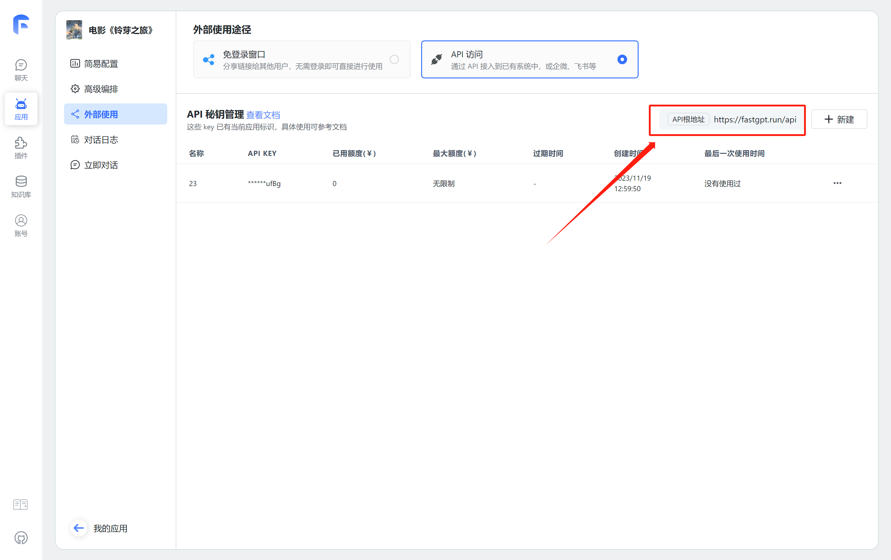

Starting with `4.15.0`, FastGPT API documentation is generated automatically with `zod-openapi` (some legacy endpoints have not been migrated, so they are not shown). You can view the latest endpoint status by opening the API documentation URL. The manually edited endpoint descriptions in the left sidebar of this documentation are no longer updated.

FastGPT API documentation is split into two sets:

- Dev API: all development APIs. Not every endpoint can be called with an API Key.
- System OpenAPI: all system public endpoints, callable with a system API Key.

## API Documentation URL

`endpoint` is your FastGPT access URL. Append the corresponding path to open the documentation.

- Dev API: `{{endpoint}}/apidoc/devapi`
- System OpenAPI: `{{endpoint}}/apidoc/systemopenapi`

## Cloud API Documentation URL

**Dev API:**

- [Mainland China documentation](https://cloud.fastgpt.cn/apidoc/devapi)
- [International documentation](https://cloud.fastgpt.io/apidoc/devapi)

**System OpenAPI**

- [Mainland China documentation](https://cloud.fastgpt.cn/apidoc/systemopenapi)
- [International documentation](https://cloud.fastgpt.io/apidoc/systemopenapi)

## Usage Notes

FastGPT OpenAPI endpoints let you authenticate with an API Key to operate related FastGPT services and resources, such as calling app chat endpoints, uploading Dataset data, and running search tests. For compatibility and security reasons, not all endpoints can be accessed with an API Key.

### How to Get an API Key

You can find API Keys in two places:

1. `Account` - `API Keys`
2. `App` - `Publishing Channels` - `API Access`

### API Key Scope

An API Key carries the current account's permissions within its team. Use it to operate on resources that the account can access in that team.

### How to Find the BaseURL

**BaseURL is the shared root URL for API requests. Append the endpoint path before sending a request.**

Open your app's **API Access** page and copy the API root address displayed beside the API key list. The screenshot highlights this address. For a local deployment, the example below uses `http://localhost:3000/api`.



### Basic Configuration

In OpenAPI, all endpoints authenticate through `Header.Authorization`.

```
baseUrl: "http://localhost:3000/api"
headers: {
    Authorization: "Bearer {{apikey}}"
}
```
