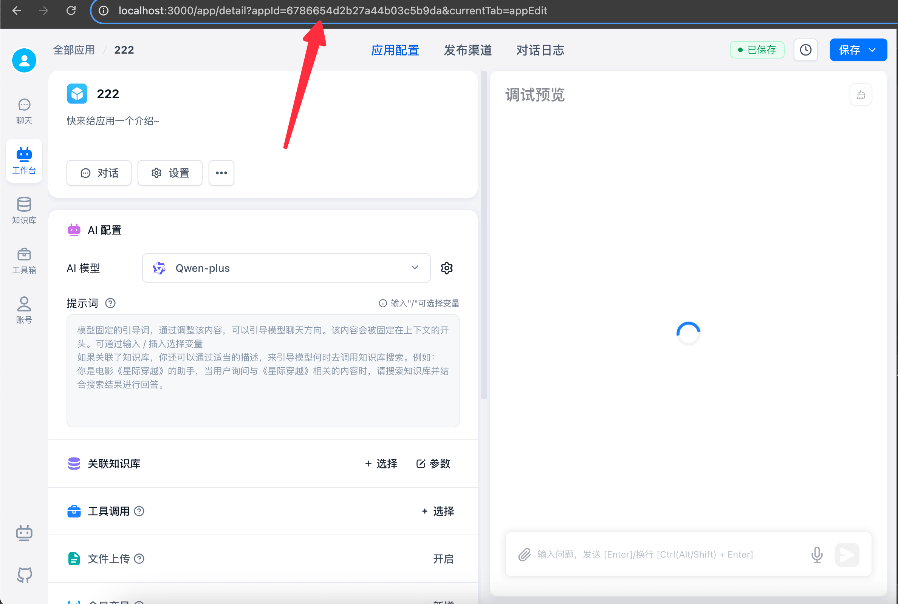
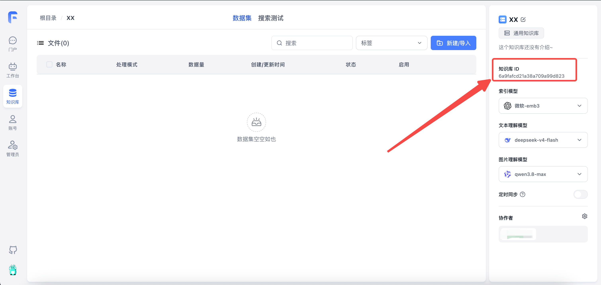
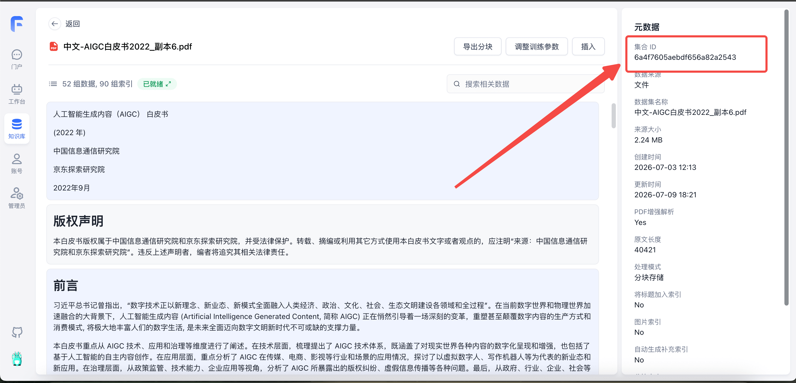

Starting with `4.15.0`, FastGPT API documentation is generated automatically with `zod-openapi`. You can view the latest endpoint status by opening the API documentation URL. The manually edited endpoint descriptions in the left sidebar of this documentation are no longer updated.

FastGPT API documentation is split into two sets:

- Dev API: all development APIs. Not every endpoint can be called with an API Key.
- System OpenAPI: all system public endpoints, callable with a system API Key.

## API Documentation URL

`endpoint` is your FastGPT access URL. Append the corresponding path to open the documentation.

- Dev API: `{{endpoint}}/apidoc/devapi`
- System OpenAPI: `{{endpoint}}/apidoc/systemopenapi`

## Cloud API Documentation URL

**Dev API:**

- [Mainland China documentation](https://cloud.fastgpt.cn/apidoc/devapi)
- [International documentation](https://cloud.fastgpt.io/apidoc/devapi)

**System OpenAPI**

- [Mainland China documentation](https://cloud.fastgpt.cn/apidoc/systemopenapi)
- [International documentation](https://cloud.fastgpt.io/apidoc/systemopenapi)

## Usage Notes

FastGPT OpenAPI endpoints let you authenticate with an API Key to operate related FastGPT services and resources, such as calling app chat endpoints, uploading Dataset data, and running search tests. For compatibility and security reasons, not all endpoints can be accessed with an API Key.

### How to Get an API Key

You can find API Keys in two places:

1. `Account` - `API Keys`: manage your personal keys.
2. `App` - `Publishing Channels` - `API Access`: switch between app keys and personal keys.

### API Key Scope

**App keys require FastGPT 4.18.0 or later.**

| Type         | Scope                                                                                                                                                                                   | Management                                                                                                                                 |
| ------------ | --------------------------------------------------------------------------------------------------------------------------------------------------------------------------------------- | ------------------------------------------------------------------------------------------------------------------------------------------ |
| App key      | Chat and chat management for its bound app, including chat logs and supporting chat file and Sandbox file endpoints. App configuration, publishing channels, and Datasets are excluded. | Only app administrators can view, create, and manage keys. Administrators can manage keys created by other administrators of the same app. |
| Personal key | Resources the member can access within the current team, subject to each endpoint's API key support.                                                                                    | Members manage only their own keys.                                                                                                        |

An app key grants access independently of its owning member's app permissions. If the key, member, team, and bound app remain valid, the key continues to work when the member loses access to the app. Managing the key still requires app administrator permissions.

### API key usage

- Authenticate with `Authorization: Bearer <apiKey>`.
- **App key**: omit `appId` from any chat or chat management endpoint that supports app keys. The server uses the key's bound app, even if a different `appId` is provided in the request or the `apiKey-appId` suffix.
- **Personal key**: pass `body.appId` when calling `chat/completions` whenever possible. The `Authorization: Bearer <apiKey>-<appId>` format is also supported for OpenAI SDK compatibility, with `body.appId` taking precedence. Other endpoints that need an app target still require an explicit `appId`.
- In the generated API documentation, select the **app API key (no appId required)** format to view its request parameters. The server fixes `sourceType` to `app`; omit it from the request.
- Some SDKs require adding `v1` to the `BaseURL`. If you get a 404 error, try adding `v1` and retry.
- Personal keys support `authProxy` when the team owner enables it while creating or editing the key. The proxied member must still have permission to access the target app and session. (FastGPT >= v4.15.0) App keys do not support `authProxy`.

### List sessions with an app key

With an app key, `getHistories` lists only API-source sessions in the bound app. You cannot use `source` to select another channel. Omit `appId`, `sourceType`, and `source`:

```bash
curl --request POST 'http://localhost:3000/api/core/chat/history/getHistories' \
  --header 'Authorization: Bearer YOUR_APP_API_KEY' \
  --header 'Content-Type: application/json' \
  --data '{"offset": 0, "pageSize": 20}'
```

- Offset pagination: pass `offset`, starting at `0`.
- Page pagination: omit `offset` and pass `pageNum`, starting at `1`. For example: `{"pageNum": 2, "pageSize": 20}`. If both are provided, `offset` takes precedence.
- `pageSize` defaults to `20` and is capped at `500`. Larger values are reduced to `500`. Omitting pagination parameters returns the first page.
- Optionally filter by time with `startCreateTime`, `endCreateTime`, `startUpdateTime`, and `endUpdateTime`.

**BaseURL is the shared root URL for API requests. Append the endpoint path before sending a request.** For a local deployment, the example below uses `http://localhost:3000/api`.

### How to find the app ID (appId)

Open the app details page and find `appId` in the URL in your browser's address bar.



### How to find Dataset and Collection IDs

| Dataset ID (datasetId)                  | Collection ID (collectionId)               |
| --------------------------------------- | ------------------------------------------ |
|  |  |

### Basic Configuration

In OpenAPI, all endpoints authenticate through `Header.Authorization`.

```
baseUrl: "http://localhost:3000/api"
headers: {
    Authorization: "Bearer {{apikey}}"
}
```
