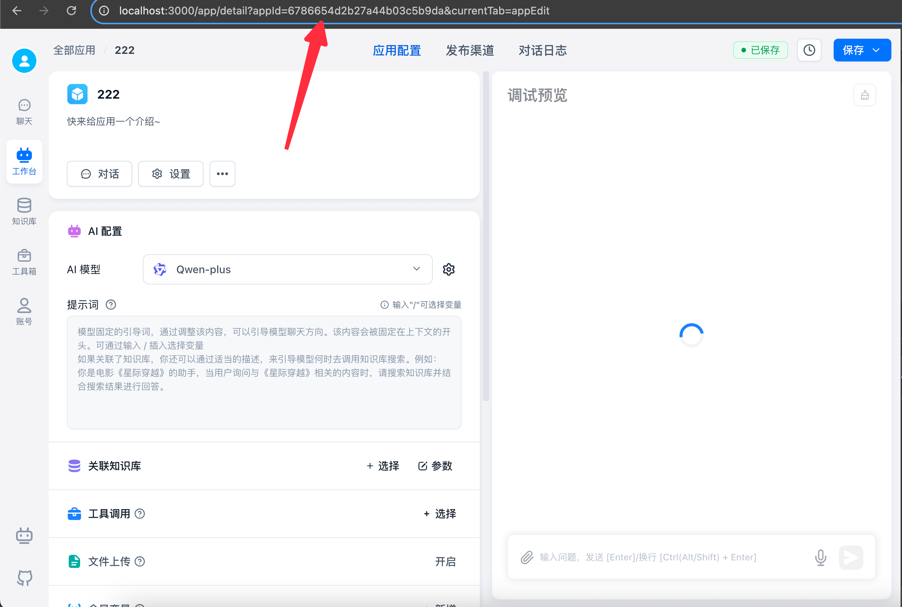
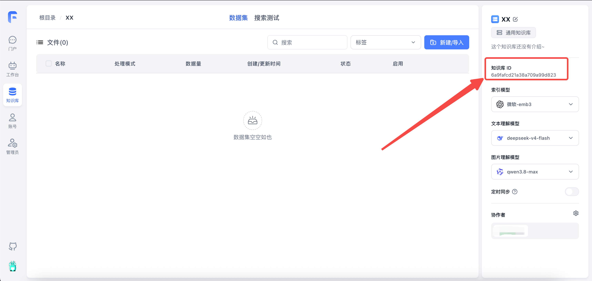
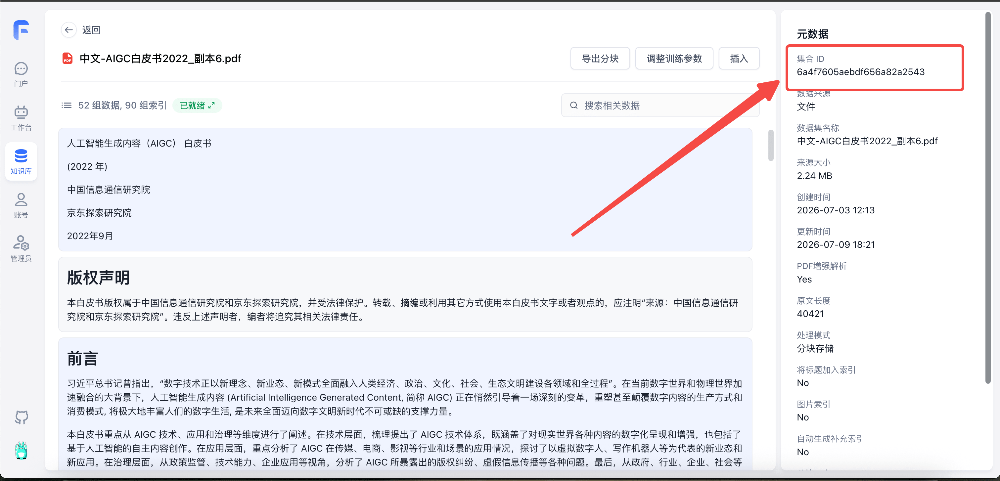

从 `4.15.0` 开始，FastGPT API 文档均采用 `zod-openapi` 自动生成的方式。可通过访问 API 文档地址查看最新的接口情况，**该文档里左侧手动编辑的接口说明不再更新。**

FastGPT API 文档一共分成两套：

- Dev API: 所有开发的 API，不一定能通过 ApiKey 调用。
- System OpenAPI: 系统所有开放的接口，可以通过系统 ApiKey 调用。

## API 文档地址

endpoint 是你的 FastGPT 访问地址，拼上对应 path 即可打开文档。

- Dev API: `{{endpoint}}/apidoc/devapi`
- System OpenAPI: `{{endpoint}}/apidoc/systemopenapi`

## 云服务 API 文档地址

**Dev API:**

- [中国大陆版文档](https://cloud.fastgpt.cn/apidoc/devapi)
- [国际版文档](https://cloud.fastgpt.io/apidoc/devapi)

**System OpenAPI**

- [中国大陆版文档](https://cloud.fastgpt.cn/apidoc/systemopenapi)
- [国际版文档](https://cloud.fastgpt.io/apidoc/systemopenapi)

## 使用说明

FastGPT OpenAPI 接口允许你使用 API Key 进行鉴权，从而操作 FastGPT 上的相关服务和资源，例如：调用应用对话接口、上传知识库数据、搜索测试等等。出于兼容性和安全考虑，并不是所有的接口都允许通过 API Key 访问。

### 如何获取 API Key

系统里有两个地方可看到 API 密钥：

1. `账号` - `API 密钥`：管理自己的个人密钥。
2. `应用` - `发布渠道` - `API 访问`：切换查看应用 Key 和个人密钥。

### API 密钥可用范围

**FastGPT 4.18.0 及以上支持应用 Key。**

| 类型     | 授权范围                                                                                                     | 管理方式                                                           |
| -------- | ------------------------------------------------------------------------------------------------------------ | ------------------------------------------------------------------ |
| 应用 Key | 仅限绑定应用的对话与对话管理，包括对话日志及配套的对话文件、沙盒文件接口；不能管理应用配置、发布渠道或知识库 | 仅应用管理员可查看、创建和管理；不同管理员可以操作同一应用下的 Key |
| 个人密钥 | 以成员身份访问当前团队中有权限的资源，仍受各接口开放范围限制                                                 | 仅管理本人的密钥                                                   |

应用 Key 的调用授权来自 Key 本身。只要 Key、归属成员、团队和绑定应用仍有效，即使归属成员失去该应用的访问权限，也可继续调用；管理 Key 仍需应用管理员权限。

### 密钥使用规范

- 统一使用 `Authorization: Bearer <apiKey>` 鉴权。
- **应用 Key**：所有支持应用 Key 的对话与对话管理接口均可省略 `appId`，由服务端读取 Key 的绑定应用。即使请求中的 `appId` 或 `apiKey-appId` 后缀不同，也始终使用绑定应用。
- **个人密钥**：调用 `chat/completions` 时推荐传 `body.appId`；为兼容 OpenAI SDK，也支持 `Authorization: Bearer <apiKey>-<appId>`，优先使用 `body.appId`。其他需要定位应用的接口仍需显式传入 `appId`。
- 在自动生成的接口文档中，选择“应用 API Key（无需 appId）”格式即可查看对应请求参数；`sourceType` 由服务端固定为 `app`，无需传入。
- 部分 SDK 需要在 `BaseURL` 后添加 `v1` 路径。如果出现 404，可补充 `v1` 后重试。
- 个人密钥可使用 `authProxy` 代理团队成员身份，需要团队所有者在创建或编辑密钥时开启；代理身份仍需具备目标应用和会话的访问权限。（FastGPT >= v4.15.0）应用 Key 不支持 `authProxy`。

### 使用应用 Key 获取会话列表

应用 Key 调用 `getHistories` 时固定查询绑定应用的 API 来源会话，不能通过 `source` 改为查询其他来源。请求不需要 `appId`、`sourceType` 或 `source`：

```bash
curl --request POST 'http://localhost:3000/api/core/chat/history/getHistories' \
  --header 'Authorization: Bearer YOUR_APP_API_KEY' \
  --header 'Content-Type: application/json' \
  --data '{"offset": 0, "pageSize": 20}'
```

- 按偏移量获取：传 `offset`，从 `0` 开始。
- 按页码获取：省略 `offset`，传 `pageNum`，从 `1` 开始；例如 `{"pageNum": 2, "pageSize": 20}`。同时传入两者时，以 `offset` 为准。
- `pageSize` 默认 `20`，最大 `500`；超过上限时按 `500` 处理。不传分页参数时获取第一页。
- 可选传 `startCreateTime`、`endCreateTime`、`startUpdateTime`、`endUpdateTime` 筛选时间范围。

### 如何获取应用 ID（appId）

打开应用详情，可在浏览器地址栏的 URL 中获取 `appId`。



### 如何获取知识库 ID 和文件集合 ID

| 知识库 ID（datasetId）                  | 文件集合 ID（collectionId）                |
| --------------------------------------- | ------------------------------------------ |
|  |  |

### 基本配置

OpenAPI 中，所有的接口都通过 Header.Authorization 进行鉴权。

```
baseUrl: "http://localhost:3000/api"
headers: {
    Authorization: "Bearer {{apikey}}"
}
```
