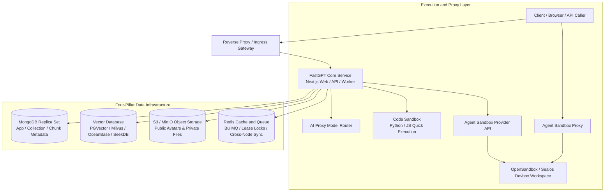

{/* Preserve incoming bookmarks for reorganized sections. */}

## System Architecture and Components

The FastGPT self-hosted deployment consists of the core application layer, runtime execution sandboxes, and a four-pillar data infrastructure:

## Capacity Planning and Baseline Specifications

Size the deployment with representative documents and queries. Capacity depends on vector dimensions, chunk count, model latency, ingestion concurrency, and retention. Measure before setting production limits:

| Workload | Measurements | Acceptance Check |
|---|---|---|
| Evaluation | Peak memory and disk use across required services | Complete import, retrieval, and conversation flows |
| Production | Concurrent requests, queue delay, p95 latency, vector index size | Meet the service target under a representative load |
| High availability | Replica topology, recovery time, backup storage | Verify failover and restore in a staging environment |

## Vector Database Selection and Priority

FastGPT reads environment variables at startup and chooses the first configured driver in this fixed order:

1. **SeekDB** (`SEEKDB_URL`): MySQL-compatible vector driver.
2. **OceanBase** (`OCEANBASE_URL`): OceanBase vector driver; configure compatible server features.
3. **PostgreSQL** (`PG_URL`): Built-in default driver using the pgvector extension.
4. **Milvus** (`MILVUS_ADDRESS`): Requires version 2.5.16+, using the `modeldata_v2` collection for unified vector and BM25 full-text storage.
5. **OpenGauss** (`OPENGAUSS_URL`): Enterprise openGauss vector driver.

## Deployment Pathways

| Pathway | Scenario | Guide |
|---|---|---|
| **Docker Compose** | Single-host private deployment, quick staging, and testing | [Docker Compose Deployment Guide](/en/self-host/deploy/docker) |
| **Sealos Cloud Native** | Container deployment; validate scaling and redundancy separately | [Sealos Deployment Guide](/en/self-host/deploy/sealos) |
| **Source Development** | Platform extension, debugging, and plugin development | [Local Source Development Guide](/en/self-host/dev) |

## Core Configuration and Operations

- **System Configuration**: Review [Environment Variables](/en/self-host/config/env), [Object Storage Configuration](/en/self-host/config/object-storage), and [Persistent Sandboxes](/en/self-host/config/sandbox/opensandbox).
- **Model Integration**: Configure models through [AI Proxy Integration](/en/self-host/config/model/intro) or connect [Local Models via Ollama / Xinference](/en/self-host/custom-models/ollama).
- **Observability**: Set up [SigNoz Tracing](/en/self-host/config/signoz) for API latency and telemetry metrics.
- **Data and Upgrades**: Review [Storage Architecture](/en/self-host/design/dataset), [Data Backup and Migration](/en/self-host/migration/docker_db), and [Upgrade Instructions](/en/self-host/upgrading/upgrade-instruction).
- **Troubleshooting**: Use the [Troubleshooting Manual](/en/self-host/troubleshooting/methods) to diagnose startup and runtime errors.
