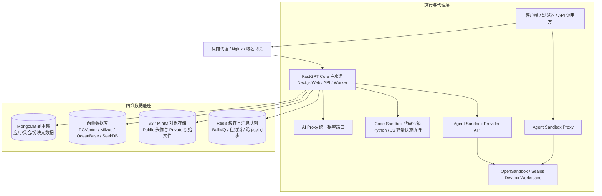

{/* Preserve incoming bookmarks for reorganized sections. */}

## 系统架构与组件拓扑

FastGPT 私有化部署由核心应用层、辅助执行层与四维数据底座协同构成：

## 资源规划与基准配置

使用代表性资料与提问进行容量验证。资源需求取决于向量维度、分块数量、模型延迟、导入并发及保留周期；生产限额应依据实测结果确定。

| 工作负载 | 观测指标 | 验收方式 |
|---|---|---|
| 测试体验 | 所需服务的峰值内存、磁盘占用 | 完成导入、检索和对话全流程 |
| 生产运行 | 并发请求、队列等待、p95 延迟、向量索引大小 | 代表性负载下满足服务目标 |
| 高可用 | 副本拓扑、恢复耗时、备份容量 | 在预发布环境验证故障切换与恢复 |

## 向量数据库选型与优先级

系统在启动时读取环境变量，按固定优先级选择第一个有效配置的驱动：

1. **SeekDB**（`SEEKDB_URL`）：通过 MySQL 协议接入向量驱动。
2. **OceanBase**（`OCEANBASE_URL`）：OceanBase 向量驱动，按服务端版本配置支持的能力。
3. **PostgreSQL**（`PG_URL`）：内置默认驱动，采用 pgvector 插件，运维链路极简。
4. **Milvus**（`MILVUS_ADDRESS`）：版本要求 2.5.16 以上，启用 `modeldata_v2` 单表，由 Milvus 协同存储向量与 BM25 全文。
5. **OpenGauss**（`OPENGAUSS_URL`）：国产化信创场景适配。

## 部署路径

| 部署方案 | 适用场景 | 引导链接 |
|---|---|---|
| **Docker Compose** | 单机私有化、局域网快速交付与开发测试 | [Docker Compose 部署指南](/zh-CN/self-host/deploy/docker) |
| **Sealos 云原生** | 容器化部署，弹性与冗余能力需单独配置和验证 | [Sealos 部署指南](/zh-CN/self-host/deploy/sealos) |
| **源码本地调试** | 平台定制二开、代码断点调试与插件研发 | [本地源码开发环境搭建](/zh-CN/self-host/dev) |

## 核心配置与运维导航

- **系统配置**：查阅 [环境变量字典](/zh-CN/self-host/config/env)、[对象存储双桶配置](/zh-CN/self-host/config/object-storage) 与 [持久沙箱运行环境](/zh-CN/self-host/config/sandbox/opensandbox)。
- **模型接入**：通过 [模型服务与 AI Proxy](/zh-CN/self-host/config/model/intro) 统一接入商业模型与 [本地 Ollama / Xinference](/zh-CN/self-host/custom-models/ollama)。
- **监控观测**：接入 [SigNoz 全链路追踪](/zh-CN/self-host/config/signoz) 监控 API 耗时与系统调用指标。
- **数据与升级**：了解 [存储全景设计](/zh-CN/self-host/design/dataset)、[冷热数据迁移备份](/zh-CN/self-host/migration/docker_db) 与 [平滑升级指令](/zh-CN/self-host/upgrading/upgrade-instruction)。
- **故障排查**：依据 [运维排障手册](/zh-CN/self-host/troubleshooting/methods) 快速定位启动与接口异常。
