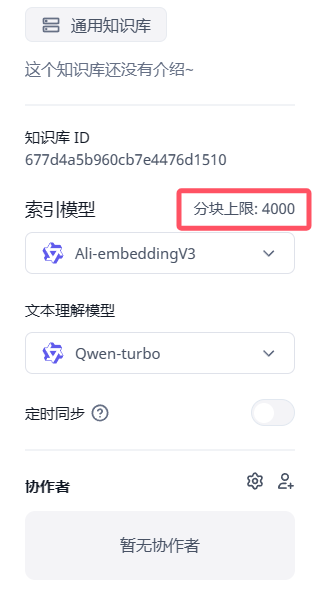
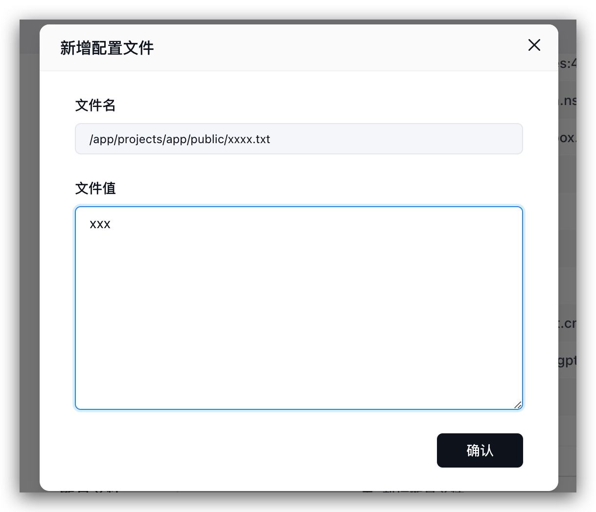
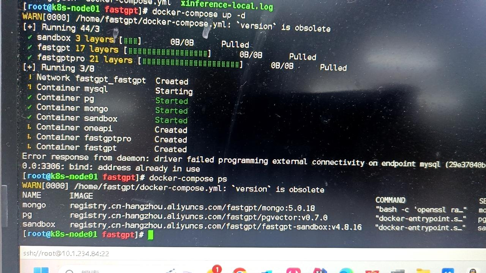

### Frontend Page Crash

1. The troubleshooting guidance attributes 90% of cases to model configuration. Enable at least one model in each category, then check parameters that expect arrays or objects. Use an empty array or object where an empty value is required.
2. Older browsers may lack support for JavaScript features used by FastGPT. Include the steps to reproduce the crash and browser console errors in a GitHub issue.
3. Disable the browser's automatic translation, which can interfere with the page.

---

### If deployed via sealos, are there no limitations of local deployment?

The screenshot shows an embedding model input-length limit. This limit applies to every deployment method. Each embedding model has its own settings, which you can adjust in the admin panel.

---

### How to mount the Mini Program configuration file

Mount the verification file to the specified location: /app/projects/app/public/xxxx.txt

Then restart. For example:

---

### Database port 3306 is occupied, service startup failed

Change the port mapping to 3307 or similar, for example 3307:3306.

---

### Can it run purely locally?

Yes. You need to prepare the vector model and LLM model.

---

### Other models cannot perform question classification/content extraction

1. Check the logs for errors such as `JSON invalid` or `not support tool`. For a model without tool or function calling support, set `toolChoice=false` and `functionCall=false` to use prompt mode. The built-in prompts have been tested with commercial model APIs; question classification generally works, while content extraction remains limited.
2. If the configuration is correct and the logs show no errors, adapt the classification prompt to the model using `customCQPrompt`.

---

### Page Crash

1. Disable automatic browser translation.
2. Check that the configuration file loaded successfully. Missing system settings can cause null-reference errors during some operations.

- The troubleshooting guidance attributes 95% of these cases to configuration errors, often reported as `xxx undefined`.
- For `URI malformed`, report the affected page and steps in a GitHub issue. This error indicates a problem decoding an encoded string.

3. Check for API compatibility issues, which are a less common cause.

---

### After enabling content completion, the response speed becomes slow

1. Query rewriting requires an additional model call.
2. It also performs 3–5 search queries, so database performance can significantly affect response time.

---

### Normal reply in the page, API error

The chat page uses `stream=true`. Test the API with the same setting using `curl`, because some model APIs have limited support for non-streaming requests.

---

### Dataset indexing has no progress/indexing is very slow

Check the error logs and identify the matching case:

1. Chat works but indexing stalls: check that an embedding model is configured in `vectorModels`.
2. Both chat and indexing fail: model API requests may be failing. Check connectivity to OneAPI or OpenAI.
3. Indexing progresses slowly: check the API key's rate limits. The historical example in this guide cites free OpenAI account limits of 3 or 60 requests per minute and 200 per day; verify the limits that apply to your current account.

---

### Connection error

Check connectivity from the FastGPT server to the model API. A server in mainland China may be unable to reach OpenAI. For OneAPI, also check that its container and FastGPT can communicate on the same network.

---

### Changes to vectorModels have no effect

1. Enable the new Embedding model in the admin panel's **Model Configuration**, then refresh the page. For older versions that configure models through `vectorModels` in `config.json`, restart the service after editing the file.
2. Existing Datasets do not automatically switch models. As the Dataset owner, open its **Configuration** page, select the new **Embedding model**, and confirm reindexing. You do not need to delete the Dataset.
3. If processing or reindexing is in progress, wait for it to finish before switching. Reindexing calls the selected model and is billed according to its pricing.

---

### How to change the root password

Modify the `DEFAULT_ROOT_PSW` environment variable, and then restart FastGPT.

---

### Does FastGPT support OpenAI's Responses API (/v1/responses)?

No (up to 4.17.0); requests return 404. Use `POST /api/v1/chat/completions` to call an app instead; it is compatible with the OpenAI Chat Completions format.

---

### After upgrading, FastGPT fails to start with "index not found (collection=modeldata_v2)"

Applies to: 4.16.2 and later, with Milvus. The log contains `IndexNotExist ... index not found[collection=modeldata_v2]`.

Cause: Starting with 4.16.2, both vector search and full-text search use the `modeldata_v2` collection. If it already exists at startup but lacks the full-text search index, FastGPT reports this error and exits. Why the index is missing has not been confirmed. Milvus must also be 2.5.16 or later.

What to do: before upgrading, follow [Milvus BM25 Full-Text Search Configuration and Migration](/en/self-host/milvus-bm25) to back up and upgrade Milvus, then upgrade FastGPT and migrate the data. If you already see this error, the collection has to be deleted and recreated, which deletes data: back up first and contact technical support. Until the migration finishes, knowledge base search cannot find the old data.

---

### Deploying with docker-compose reports AGENT_SANDBOX_OPENSANDBOX_IMAGE is not configured or AGENT_SANDBOX_PREVIEW_PROXY_URL is wrong

Applies to: 4.16.0 and later. Since 4.16.0 the sandbox image is set only by `AGENT_SANDBOX_OPENSANDBOX_IMAGE`, and `AGENT_SANDBOX_PREVIEW_PROXY_URL` must be configured. Using a 4.15 or earlier docker-compose template with a newer image causes both errors.

What to do: follow [Deploy with Docker Compose](/en/self-host/deploy/docker) and use the one-click script, or manually download the template that matches the image version (for the current version, use the `main` directory; there are no v4.16 or v4.17 directories).

Note: running the one-click script again in a directory that is already deployed regenerates the database passwords and `AES256_SECRET_KEY` and overwrites `docker-compose.yml`. Back up the original file first. To keep your data, choose not to auto-generate passwords (or set `FASTGPT_AUTO_GENERATE_CREDENTIALS=false`) and copy the original passwords and secrets over.

---

### Parallel Run reports parallel_task_not_reach_end, or runs only one task

Applies to: verified against 4.17.0. Parallel Run starts one task per element of the input array. A whole block of multi-line text (for example, one URL per line) is treated as an array with a single element, so only one task runs. `parallel_task_not_reach_end` means the sub-workflow of a task did not reach the End node; if the sub-workflow has a more specific error, that error is shown instead.

What to do: add a Code run node before Parallel Run that splits the text into an array by newline, for example returning `text.split('\n').map(s => s.trim()).filter(Boolean)`, and have the Parallel Run array input reference its result. If it still fails, open the failing task's Run Details and check whether the sub-workflow reached the End node.

---

### Uploading files over HTTPS fails with "s3 upload network error"

Applies to: verified against 4.17.0. The address the browser uploads files to comes from `FILE_DOMAIN`, or from `FE_DOMAIN` if it is not set. If the page uses HTTPS but this address is `http://`, the browser blocks the request as mixed content and it never reaches the server.

What to do: change the matching setting to a reachable https address (`FILE_DOMAIN` if it is set, otherwise `FE_DOMAIN`) and restart. You can confirm in the browser console whether there is a Mixed Content error.

---

### On Windows, FastGPT fails to start in local development because it can't reach the plugin service (localhost:3004)

Applies to: the local development environment (`deploy/dev`). `fastgpt-plugin` runs with host networking on port 3004, and FastGPT exits at startup if it can't reach `http://localhost:3004`. On Windows Docker Desktop, host networking by default only takes effect inside Docker's own virtual machine, so the host cannot reach it.

What to do: in Docker Desktop (version 4.34 or later, signed in), go to Settings → Resources → Network, check Enable host networking, and restart; or develop under WSL2, Linux, or macOS, as the development docs recommend.

---

### The model reports "Download multimodal file timed out", or can't read images

Applies to: 4.15.2 and later. `MULTIPLE_DATA_TO_BASE64` defaults to `true` in 4.15.2 and to `false` from 4.15.3. When it is `false`, FastGPT passes file download short links that start with `http(s)://` to the model provider, which downloads them itself. The short link prefix is the first one set among `FILE_DOWNLOAD_PUBLIC_URL_PREFIX`, `FILE_DOMAIN`, and `FE_DOMAIN`. If it is an internal address, the provider cannot reach it and the download times out (it may return `Download multimodal file timed out`).

What to do (either one): set `MULTIPLE_DATA_TO_BASE64=true` so FastGPT converts the file to base64 before sending it (larger requests); or set `FILE_DOMAIN` to a FastGPT address the provider can reach from the public internet, rather than changing `FE_DOMAIN`, which is the address your users use to access FastGPT.

---

### Importing a template reports "The template file format is incorrect, it should be the csv file with the first column as q,a,indexes"

Applies to: 4.9.11–4.15.8.

Cause: These versions only accept CSV files, and the file content (after trimming leading and trailing whitespace) must start with `q,a,indexes`. A header with every column wrapped in quotes (such as `"q","a","indexes"`), a header written as `index`, or extra content before the first line all trigger this error.

What to do: fill in the CSV template provided on the import page, open the file in a text editor and confirm the first line starts with `q,a,indexes`, and do not save it as `.xlsx`. You can also upgrade to 4.16.0 or later: it supports `.csv` and `.xlsx`, with the headers `q`, `a`, `index` (repeatable), and `metadata` (optional), and the old `q,a,indexes` header still works, so you do not need to change the file. See [Template Import](/en/guide/dataset/template) for the new template.

---

### How do I get the model's thinking content when calling the chat API?

Applies to: 4.15.2 and later. The thinking content is returned in a separate `reasoning_content` field, apart from the body text in `content`: in streaming responses, a chunk that carries thinking has `reasoning_content` in its `choices[0].delta`; in non-streaming responses, a plain text answer has `reasoning_content` in `choices[0].message`. The field is present only when the model actually outputs thinking content and FastGPT can recognize it: the upstream returns a `reasoning_content` field, or, with thinking support turned on in the model config, the body wraps it in `<think></think>`. From 4.17.1, OpenAI-type channels of AI Proxy can also map the upstream `reasoning` field to `reasoning_content`.

---

### How do I switch the vector database from Milvus to pgvector?

After you switch from Milvus to pgvector, the vectors stored in Milvus are not migrated automatically and need to be regenerated. Your knowledge bases, files, and text chunks are not affected. The steps below apply to 4.16.2 and later.

1. Following the official template, add a pgvector service to docker-compose, set `PG_URL` on `fastgpt-app`, remove `MILVUS_ADDRESS`, and restart. The table and indexes are created automatically. If SeekDB or OceanBase is also configured, it takes priority over pgvector and must be removed as well.
2. Open the configuration page of each knowledge base, switch the index model to a different one (you cannot pick the one currently in use), and confirm rebuilding the index. Until the rebuild finishes, search can only find data whose vectors have been regenerated. If the new model does not support images and the knowledge base has no image understanding model configured, the image index of that knowledge base is turned off.
3. After all knowledge bases have been rebuilt and search tests pass, stop the old Milvus. Back up its data before you do.

---

### How do I collect the result of every iteration of the Loop Node into an array?

The Loop Node added in 4.15.0 keeps only the value of the last iteration in its custom output (the old loop node collects the results of all iterations automatically). To collect the result of every iteration, declare an array global variable outside the loop and append to it from a Variable Update node inside the loop body.

1. In the Variable Update node, select the array variable, switch the value to Manual Input, and choose Append. In the input box of a string array, type `/` to insert the result of the current iteration. Variable Citation replaces the whole array with the referenced array and has no append option.
2. The append box of an object array is a JSON input. To append an object output by an upstream node, add a Code run node in the loop body that combines the existing array and the current object into a new array, then update the variable with Variable Citation.

---
