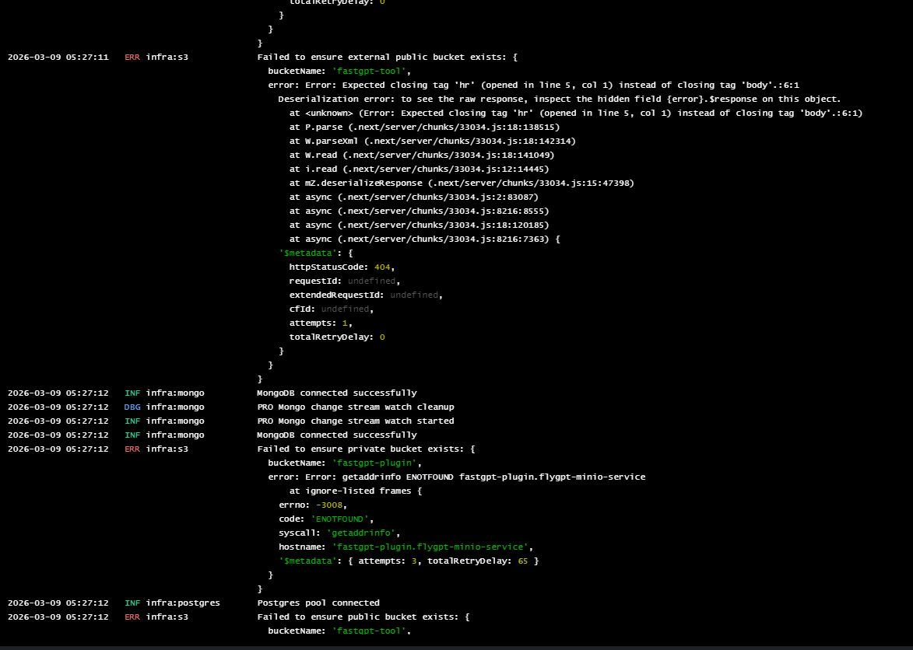

## 1. Log shows ERR level "Failed to ensure external public/private bucket exists", resulting in inability to connect to object storage

### 1.1 Error Stack Display

- error: Error: getaddrinfo ENOTFOUND

Example

- 

### Possible Errors

- `STORAGE_S3_FORCE_PATH_STYLE` is configured incorrectly.

### Solution

- Set `STORAGE_S3_FORCE_PATH_STYLE=true` so the client can resolve the object storage service using path-style addressing.

---

## 2. Upload conversation file / Dataset file error

Example

- 

### 2.1 SignatureDoesNotMatched

- A signature mismatch is often caused by the Nginx proxy configuration.

### Possible Errors

- Check whether Nginx forwards the required request headers, especially `Host`.

### Solution

- Set `proxy_set_header Host $http_host;` in Nginx to preserve the original host and port used to sign the request. Nginx's `$host` variable strips the port.

---
