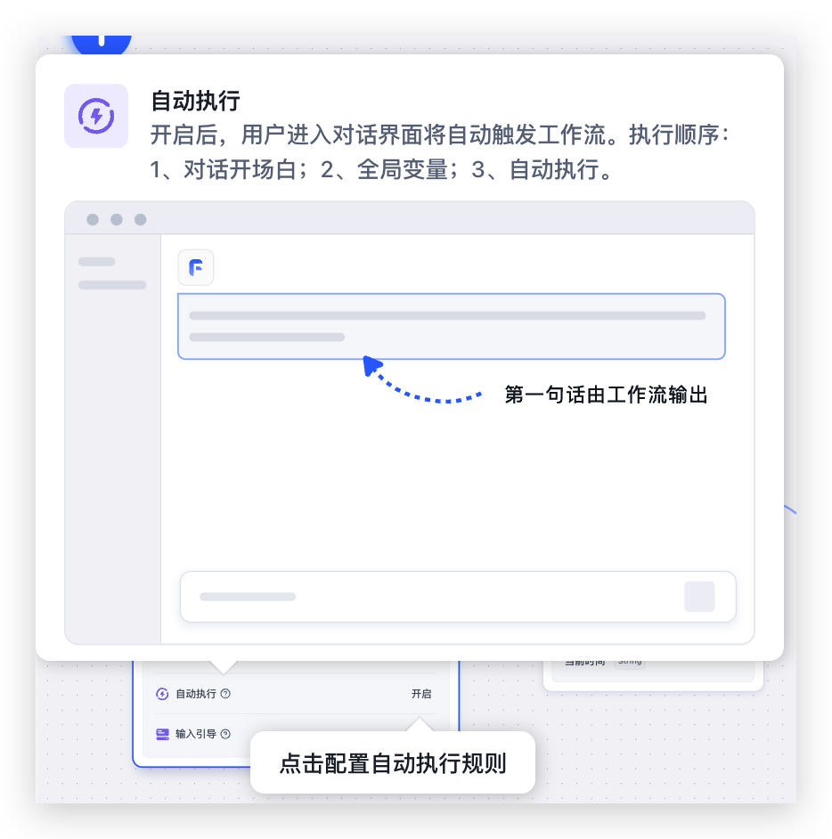
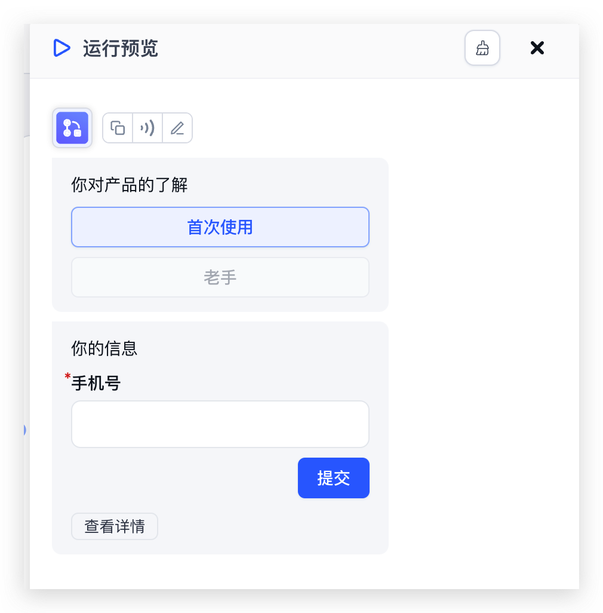

## Upgrade Guide

### 1. Back up your data

### 2. Update images

- Update the FastGPT image tag to v4.8.14-fix
- Update the FastGPT commercial edition image tag to v4.8.14 (fastgpt-pro image)
- Sandbox image update is optional

For Milvus users: use the v4.8.14-milvus-fix image.

## New Feature Preview

### Auto-trigger Workflow

You can configure a workflow to automatically trigger once when a user loads a conversation. This can guide users through a CRM onboarding flow as soon as they arrive.

Open the workflow’s **Auto-execute** setting to configure this behavior. The sequence is: conversation opener, global variables, then automatic workflow execution. The example below starts with a choice between first-time and experienced users, followed by a required phone-number field and a **Submit** button.

|                                                  |                                                  |
| ------------------------------------------------ | ------------------------------------------------ |
|  |  |

## Full Release Notes

1. New - Workflows support auto-triggering a conversation round when entering the chat or clicking "Start conversation".
2. New - Rewritten chatContext. Chat testing now generates logs, and conversations persist after page refresh.
3. New - Share links support configuring whether to allow viewing original source text.
4. New - New doc2x plugin.
5. New - Traditional Chinese language support.
6. New - Share links and chat API support passing a custom uid.
7. Commercial - Microsoft OAuth login.
8. Improved - Workflow UI details.
9. Improved - App edit history now uses diff-based storage to prevent browser overflow.
10. Improved - Code entry point adds a register entry, no longer requiring the first visit to execute.
11. Improved - Workflow validation with additional missing value checks.
12. Improved - Added a maximum retry limit for Dataset indexing.
13. Improved - Image path issues and diagram tasks.
14. Improved - Milvus description.
15. Fixed - Chunking strategy was dropping level-4 headings. Also added level-5 heading support.
16. Fixed - MongoDB Dataset collection unique index.
17. Fixed - Deselecting Dataset citations could cause errors.
18. Fixed - Converting Simple Mode to workflow was not using the latest edit history.
19. Fixed - Form input description text not displaying.
20. Fixed - API unable to use Base64 images.
