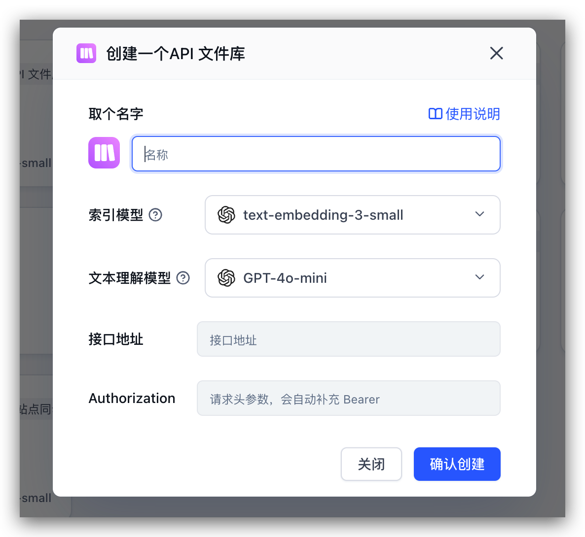
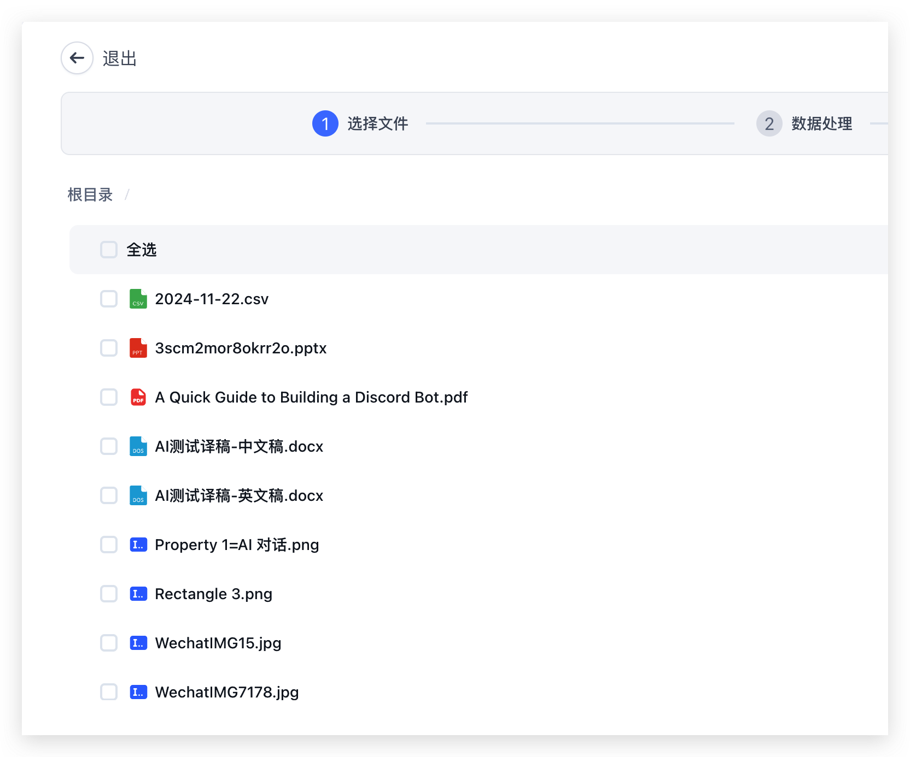
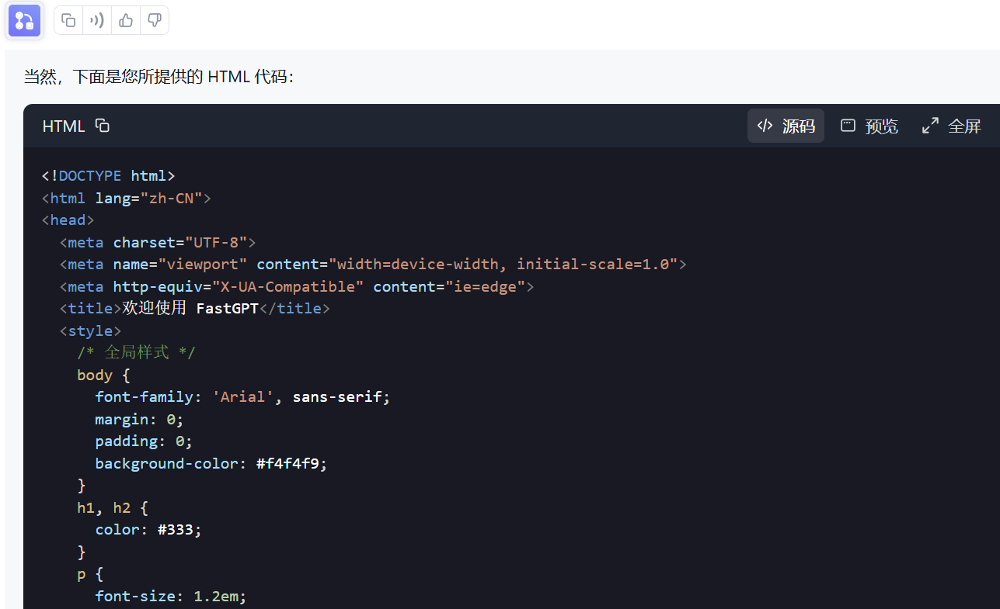
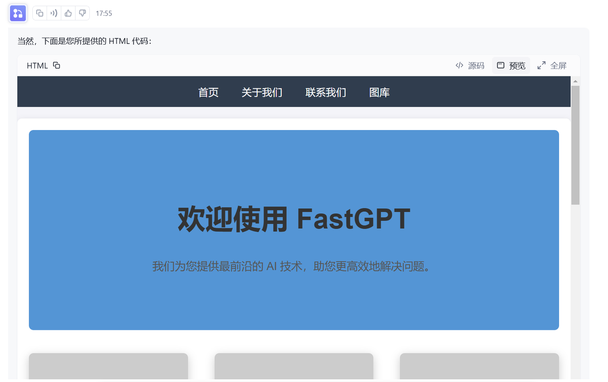
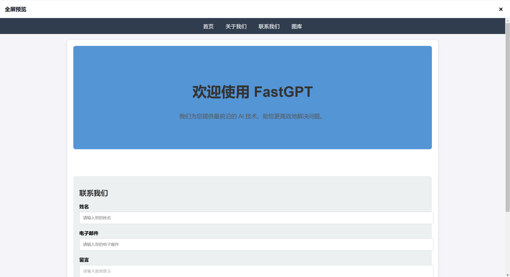

## New Feature Preview

### API Dataset

Create an API Dataset by entering a name, choosing the embedding and text-understanding models, and supplying the API endpoint and authorization value. FastGPT automatically adds the `Bearer` prefix to the authorization header. After creation, select files from the connected source and proceed to data processing.

|                                                   |                                                   |
| ------------------------------------------------- | ------------------------------------------------- |
|  |  |

### HTML Rendering

Use **Source** to inspect an HTML code block, **Preview** to view the rendered page inside the chat, and **Fullscreen** to expand the preview. Script execution is blocked in this release’s preview mode.

| Source Mode                                       | Preview Mode                                      | Fullscreen Mode                                   |
| ------------------------------------------------- | ------------------------------------------------- | ------------------------------------------------- |
|  |  |  |

## Upgrade Guide

- Update the fastgpt image tag to v4.8.15-fix3
- Update the fastgpt-pro commercial edition image tag to v4.8.15
- Sandbox image update is optional

## Run Migration Script

From any terminal, send an HTTP request. Replace `{{rootkey}}` with the `rootkey` from your environment variables, and `{{host}}` with your **FastGPT domain**:

```bash
curl --location --request POST 'https://{{host}}/api/admin/initv4815' \
--header 'rootkey: {{rootkey}}' \
--header 'Content-Type: application/json'
```

This resets the scheduled execution fields for apps, removing null values to reduce index size.

---

From any terminal, send an HTTP request. Replace `{{rootkey}}` with the `rootkey` from your environment variables, and `{{host}}` with your **FastGPT domain**:

```bash
curl --location --request POST 'https://{{host}}/api/admin/init/refreshFreeUser' \
--header 'rootkey: {{rootkey}}' \
--header 'Content-Type: application/json'
```

This recalculates free-tier user durations. A previous version upgrade did not recalculate time properly, which caused incorrect notifications.

## Full Release Notes

1. New - API Dataset. See [API Dataset Introduction](/en/guide/dataset/third-party/api_dataset). The external file library will be deprecated.
2. New - Toolbox page displaying all available system resources. The commercial edition admin panel now offers easier configuration of system plugins and custom categories.
3. New - HTML code in Markdown is now rendered separately. You can choose preview mode, which blocks all scripts and only displays content.
4. New - Custom system-level file parsing service. See [Integrating Marker PDF Document Parsing](/en/self-host/custom-models/marker).
5. New - Collections can be reconfigured directly without deleting and re-importing.
6. New - Commercial edition admin panel supports configuring sidebar navigation links.
7. Improved - Base64 image truncation detection.
8. Improved - i18n cookie detection.
9. Improved - Markdown text splitting now supports heading-only sections with no content.
10. Improved - String variable substitution: unassigned variables now resolve to `undefined` instead of preserving the raw ID string.
11. Improved - Global variable default values now take effect in API calls, and custom variables support default values.
12. Improved - Added JSON parsing for HTTP Body with regex conversion of `undefined` to `null`, reducing Body parsing errors.
13. Improved - Scheduled execution now includes run logs and retries to reduce error rates.
14. Fixed - Share link like/upvote authentication issue.
15. Fixed - Switching to an auto-execute app on the chat page could incorrectly trigger non-auto-execute apps.
16. Fixed - Audio playback authentication issue.
17. Fixed - Plugin app Dataset citation limit was always capped at 3000.
18. Fixed - Workflow edit history storage limit. Removed local storage and added forced auto-save on abnormal exit.
19. Fixed - Workflow special variable substitution issue (strings starting with `$` could not be replaced).
