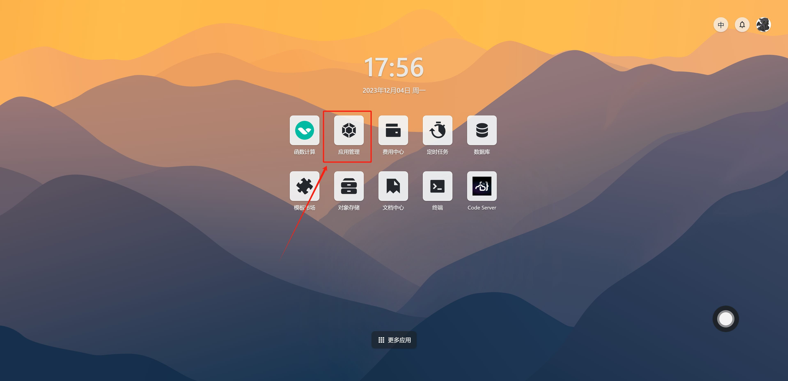
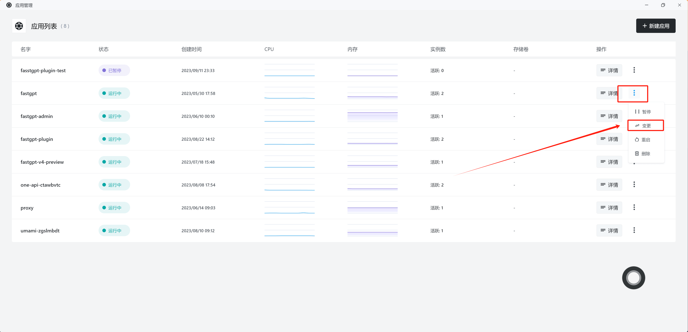
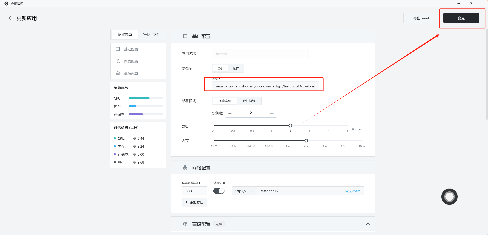
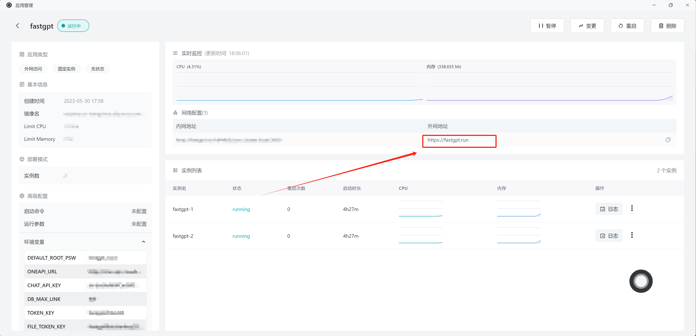

## 版本说明

从 4.14.11 开始，为了区分稳定版和快速迭代版，对版本命名进行了调整，未来将按以下方式进行版本命名：

1. 维护 2 个稳定版本。例如当前迭代功能处于 4.16.x 版本，则会维护 4.14.x 和 4.15.x 两个文档版本。
2. 稳定版本命名不带后缀，例如：4.14.11, 4.14.12, 4.15.0, 4.15.1。如果 4.14.11 有问题，会修复后发布 4.14.12，并同步修复到 4.15.x 的稳定版，以确保修复问题同时不引入新的功能。
3. 快速迭代版本命名带后缀，例如：4.16.0-beta.1, 4.16.0-beta.2, 4.16.0-beta.3。
4. 迭代版本约 2 个月发布一次稳定版，并且会提供一个聚合的升级脚本，用户只需要执行一次请求，即可完成所有迭代版本的升级。

生产环境建议直接升级不带 beta 后缀的稳定版本，以确保系统平稳可靠。

## 升级说明

FastGPT 升级通常包括两个步骤：

1. 修改镜像名
2. 执行升级初始化脚本

## 镜像名

**git 版**

- FastGPT 主镜像: ghcr.io/labring/fastgpt
- Plugin 镜像: ghcr.io/labring/fastgpt-plugin
- 代码沙箱镜像: ghcr.io/labring/fastgpt-code-sandbox
- MCP SSE server 镜像: ghcr.io/labring/fastgpt-mcp_server
- 商业版镜像: ghcr.io/c121914yu/fastgpt-pro

**阿里云**

- FastGPT 主镜像: registry.cn-hangzhou.aliyuncs.com/fastgpt/fastgpt
- Plugin 镜像: registry.cn-hangzhou.aliyuncs.com/fastgpt/fastgpt-plugin
- 代码沙箱镜像: registry.cn-hangzhou.aliyuncs.com/fastgpt/fastgpt-code-sandbox
- MCP SSE server 镜像: registry.cn-hangzhou.aliyuncs.com/fastgpt/fastgpt-mcp_server
- 商业版镜像: registry.cn-hangzhou.aliyuncs.com/fastgpt/fastgpt-pro

各服务使用目标版本部署模板指定的镜像 Tag。配套服务的版本号可能各自独立，升级前记录完整镜像组合与配置。

## Sealos 修改镜像

1. 打开 [Sealos Cloud](https://cloud.sealos.io?uid=fnWRt09fZP)，找到桌面上的应用管理



2. 选择对应的应用 - 点击右边三个点 - 变更



3. 修改镜像 - 确认变更

   如果要修改配置文件，可以拉到下面的 `配置文件` 进行修改。



## Docker-Compose 修改镜像

直接修改 `yml` 文件中的 `image: ` 即可。随后执行:

```bash
docker-compose pull
docker-compose up -d
```

## 执行升级初始化脚本

镜像更新完后，可以查看文档中的 `版本介绍`，通常需要执行升级脚本的版本都会标明 `包含升级脚本`，打开对应的文档，参考说明执行**升级脚本**即可，大部分时候都是需要发送一个 `POST` 请求。

## QA

### 为什么需要执行升级脚本

在 FastGPT 4.17+ 中，主应用启动时自动调用分布式数据迁移执行器。多个副本通过 MongoDB 租约竞选执行权，按序自动执行注册的结构回填与迁移任务，并记录断点游标支持中断重试。面对大数据量业务库迁移，建议在维护窗口期执行并预留时间。

### `{{host}}` 是什么

`{{}}` 代表变量，`{{host}}` 代表一个名为 host 的变量。指的是你服务器的域名或 IP。

Sealos 中，你可以在下图中找到你的域名：



### 如何获取 rootkey

从 `docker-compose.yml` 中的 `environment` 中获取，对应的是 `ROOT_KEY` 的值。

sealos 中可以从上图左侧的环境变量中获取。

### 如何跨版本升级

1. 阅读跨越版本的发布说明，遵循指定升级路径及必需的中间版本。
2. 一致性备份 MongoDB、向量库、对象存储和配置，并在独立环境验证恢复。
3. 使用生产数据副本演练，检查启动迁移状态，执行对应版本明确要求的手动步骤。
4. 在维护窗口升级，验证登录、导入、检索、对话和文件下载后再恢复流量。
5. 准备相互兼容的应用镜像与数据备份作为回退方案。涉及数据迁移时，回退可能需要同时恢复旧版数据状态。
